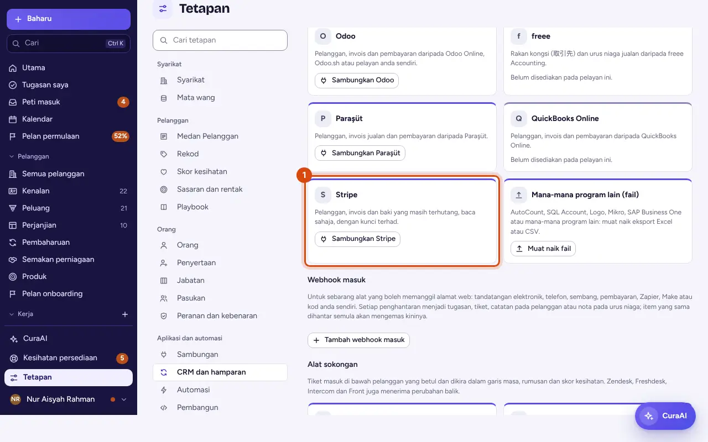

# Stripe (baca sahaja)

Pelanggan, invois (dengan tarikh akhir dan baki yang masih terhutang) dan pembayaran daripada Stripe. Curahold tidak pernah menulis ke Stripe: kunci yang anda berikan hanya boleh membaca.

## Dalam Curahold {#connect}

1. Buka **Tetapan → CRM dan hamparan**, cari **Program perakaunan** dan klik **Sambungkan Stripe**.
   

Tampal kunci terhad ke dalam **Kunci terhad** dan klik **Semak dan sambung**. Kunci rahsia penuh (`sk_…`) sengaja ditolak. Kemudian klik **Mula** dan semak pelanggan yang tidak dapat dipadankan pada tab **Pemadanan**.

## Dalam Stripe

1. Buka **Developers → API keys** dan klik **Create restricted key**.
2. Namakannya `Curahold`.
3. Tetapkan **Customers**, **Invoices** dan **Events** kepada **Read**. Biarkan yang lain pada **None**.
4. Klik **Create key**, sahkan dengan langkah kedua anda, dan salin kunci itu. Ia bermula seperti ini:

```text
rk_live_
```

Gunakan kunci daripada sandbox (`rk_test_…`) untuk mencubanya dahulu.

## Had dan masa

Bacaan pertama membawa segala-galanya; selepas itu hanya apa yang berubah, daripada senarai acara Stripe (disimpan 30 hari oleh Stripe). Stripe membenarkan 100 permintaan sesaat (25 dalam sandbox); Curahold kekal jauh di bawahnya. Amaun mengikut perpuluhan setiap mata wang (yen tiada perpuluhan). Invois yang ditandakan "uncollectible" oleh Stripe kekal terhutang di sini, jadi bayaran lewat masih kelihatan.

## Jika ada masalah

Kunci yang ditukar atau dipadam menandakan sambungan **Perlu perhatian**: buat kunci terhad baharu dan tampalnya dengan **Sambung semula**. Jika ada kebenaran yang tertinggal, langkah sambungan menamakannya. **Buang** memadamkan kunci; angka yang sudah dibaca kekal sehingga anda membuangnya.

## Lihat juga

- [Program perakaunan](/docs/ms/accounting/)
