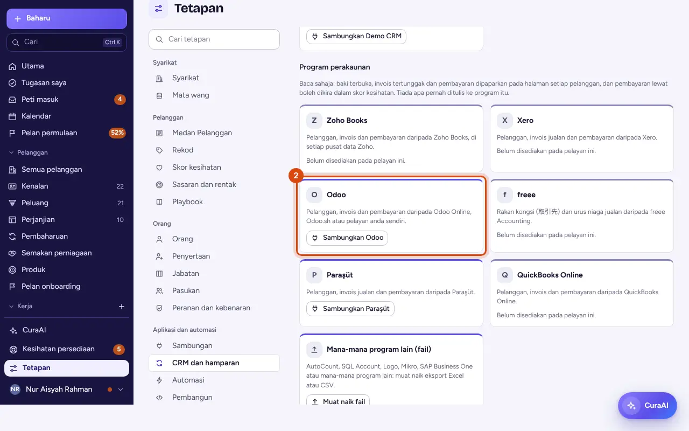

# Program perakaunan

Sambungkan program perakaunan anda dan halaman setiap pelanggan menunjukkan apa yang mereka hutang: baki tertunggak, apa yang lewat bayar dan berapa lama, bayaran terakhir dan invois. Pembayaran lewat boleh dikira dalam skor kesihatan. Curahold hanya membaca: tiada apa-apa yang pernah ditulis ke program itu.

## Program mana

| Program | Cara ia disambungkan | Halaman |
| --- | --- | --- |
| Zoho Books | Log masuk dengan Zoho | [Zoho Books](/docs/ms/accounting-zohobooks/) |
| Xero | Log masuk dengan Xero | [Xero](/docs/ms/accounting-xero/) |
| Odoo | Alamat, log masuk dan kunci API | [Odoo](/docs/ms/accounting-odoo/) |
| freee | Log masuk dengan freee | [freee](/docs/ms/accounting-freee/) |
| Paraşüt | Nombor syarikat, klien API dan seorang pengguna | [Paraşüt](/docs/ms/accounting-parasut/) |
| QuickBooks Online | Log masuk dengan Intuit | [QuickBooks Online](/docs/ms/accounting-quickbooks/) |
| Mana-mana yang lain (Logo, Mikro, Tally, SAP Business One…) | Fail Excel atau CSV | [Fail](/docs/ms/accounting-file/) |

## Sambungkan program anda {#connect}

Anda memerlukan kebenaran untuk mengurus sambungan (pentadbir memilikinya).

1. Buka **Tetapan → CRM dan hamparan** dan tatal ke **Program perakaunan**. Klik **Sambung …** pada jubin program anda, atau **Muat naik fail** pada **Mana-mana program lain (fail)**, dan ikut halaman program itu dalam jadual di atas.
   

## Memadankan pelanggan

Setiap pelanggan dalam program perakaunan dipadankan dengan seorang pelanggan dalam Curahold: mula-mula mengikut nombor cukai, kemudian mengikut alamat web atau domain e-mel, kemudian mengikut nama (bentuk syarikat seperti Sdn. Bhd., Ltd., A.Ş. atau 株式会社 diabaikan). Apabila tepat satu pelanggan sepadan, padanan dibuat; apabila tiada atau beberapa yang sepadan, ia menunggu pada tab **Pemadanan** sambungan itu. Di sana anda boleh memilih pelanggan, atau mengecualikannya. Padanan yang anda buat secara manual dikekalkan.

## Siapa melihat angka

Amaun ditunjukkan kepada peranan yang mempunyai **Lihat angka kewangan** (pentadbir dan pengurus pada permulaannya; ubahnya dalam Tetapan → Peranan dan kebenaran). Semua orang lain yang melihat pelanggan itu hanya melihat, dalam skor kesihatan, berapa hari bayaran lewat — tidak pernah amaun.

Orang dalam jabatan **Kewangan** juga melihat amaun, apa pun peranan mereka, begitu juga jabatan yang dipilih di bawah **Siapa melihat Kewangan pada halaman pelanggan** dalam Tetapan → Jabatan. Mematikan Kewangan menarik balik akses ini.

## Pembayaran lewat dalam skor kesihatan

Apabila anda memulakan bacaan pertama, anda boleh menandakan **Kira pembayaran lewat dalam skor kesihatan**. Isyarat **Pembayaran tepat pada masanya** memberikan markah penuh apabila tiada apa-apa yang lewat bayar dan tiada markah apabila invois belum dibayar yang paling lama sudah lewat 60 hari; kedua-dua nombor boleh diubah dalam Tetapan → Skor kesihatan. Pelanggan yang tidak dipadankan dengan program itu tidak dimasukkan.

## Kesihatan sambungan

Sambungan perakaunan dipaparkan dalam Tetapan → Sambungan bersama yang lain: berfungsi, ada masalah, atau dijeda, dan bila kali terakhir ia berfungsi.
