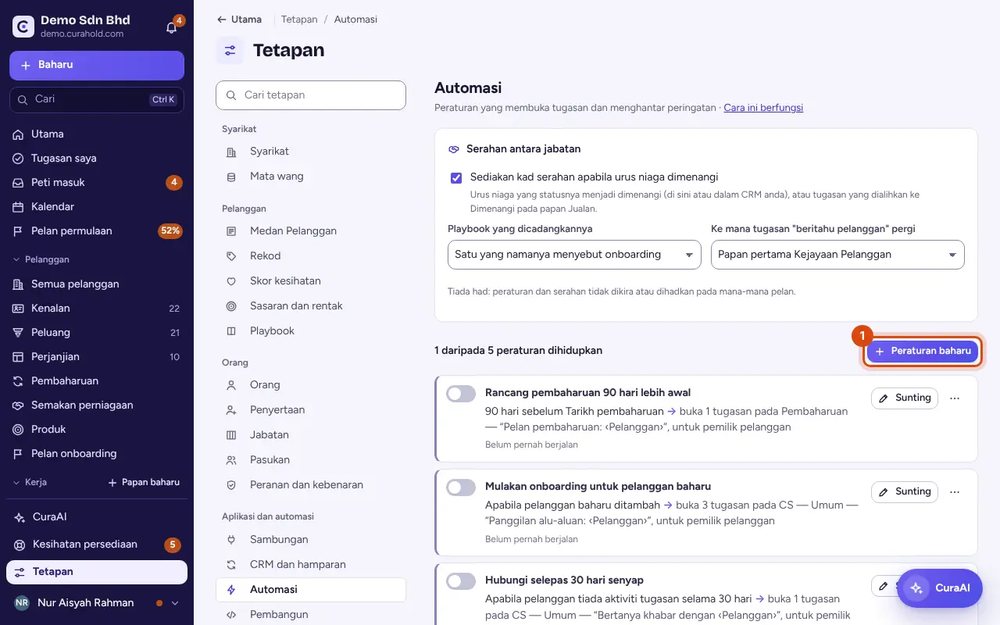
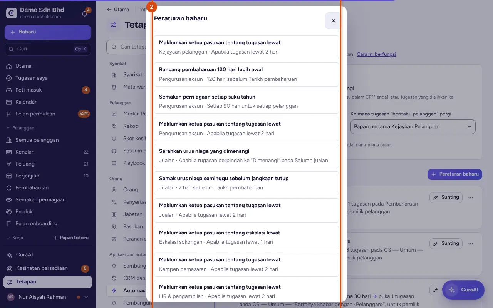
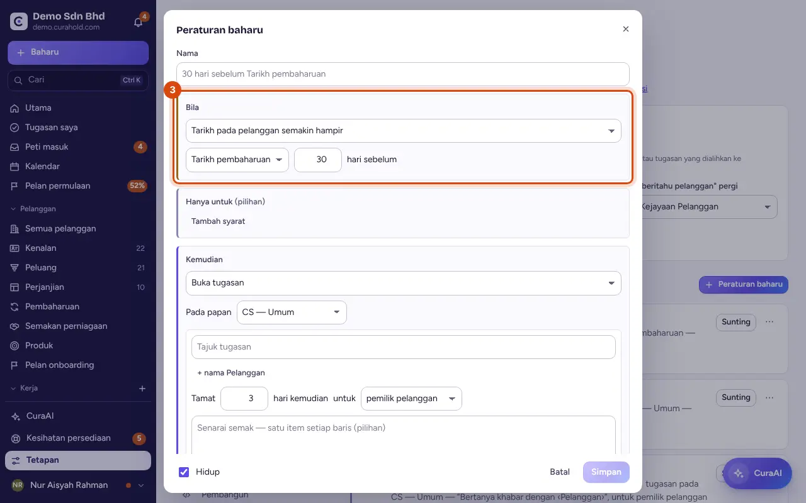
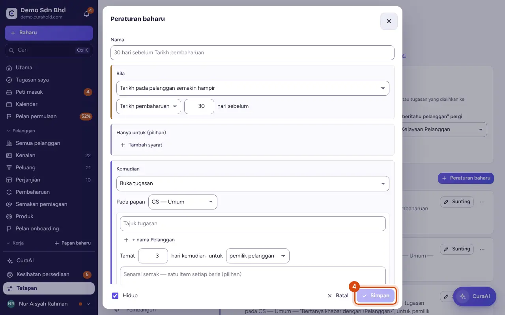

# Automasi

Peraturan melakukan kerja rutin untuk anda: pelan pembaharuan 90 hari lebih awal, panggilan alu-aluan untuk pelanggan baharu, peringatan apabila tugasan lewat, kad serahan apabila urus niaga dimenangi. Ia tidak pernah dikira atau dihadkan pada mana-mana pelan.

## Cipta peraturan {#new-rule}

Anda memerlukan kebenaran untuk mengurus automasi (pentadbir memilikinya).

1. Buka **Tetapan → Automasi** dan klik **Peraturan baharu**.
   
2. Pilih peraturan sedia yang sesuai, atau **Mula dari kosong**.
   
3. Di bawah **Bila**, pilih apa yang memulakannya, serta butirannya (tarikh mana, berapa hari, papan mana). Klik **Tambah syarat** untuk menghadkannya kepada sesetengah pelanggan atau tugasan. Di bawah **Kemudian**, pilih apa yang berlaku. Di bawahnya, "Hari ini ia akan bertindak ke atas …" menunjukkan apa yang akan disentuhnya sekarang; belum ada apa-apa yang diubah.
   
4. Beri **Nama**, biarkan **Hidup** ditanda dan klik **Simpan**.
   

## Apa yang boleh memulakan peraturan {#when}

Tarikh pelanggan yang akan tiba (pembaharuan, tamat kontrak), setiap beberapa hari bagi setiap pelanggan, pelanggan yang telah senyap, pelanggan baharu, tugasan lewat tarikh akhir, tugasan yang berpindah ke sesuatu lajur, tugasan yang ditambah atau diselesaikan, permintaan melalui borang papan, rekod yang mencapai sesuatu peringkat, tiket sokongan yang dibuka.

## Apa yang boleh dilakukan oleh peraturan {#then}

Membuka tugasan (dengan senarai semak, untuk pemilik pelanggan atau sesiapa sahaja), menghantar peringatan, menugaskan, memindahkan, menetapkan medan, menulis komen, menghantar ke webhook anda, atau menyediakan kad serahan.

## Menjalankan dan menghentikan {#running}

Setiap peraturan menunjukkan berapa kerap ia berjalan dalam 30 hari terakhir. **Jalankan sekarang** menjalankan peraturan berjadual dengan serta-merta tanpa menunggu jam seterusnya; ia tetap bertindak sekali bagi setiap peristiwa. Matikan peraturan untuk menjedanya. Memadam peraturan mengekalkan tugasan yang telah dibukanya, dan peraturan itu kekal dalam tong sampah selama 30 hari.

Tetapan serahan di bahagian atas halaman yang sama diterangkan dalam [Serahan, permintaan dan gelung balik](/docs/ms/handover-and-requests/).
