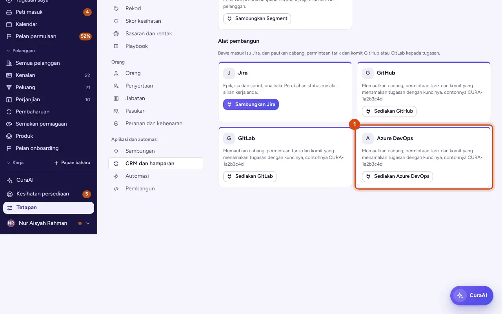
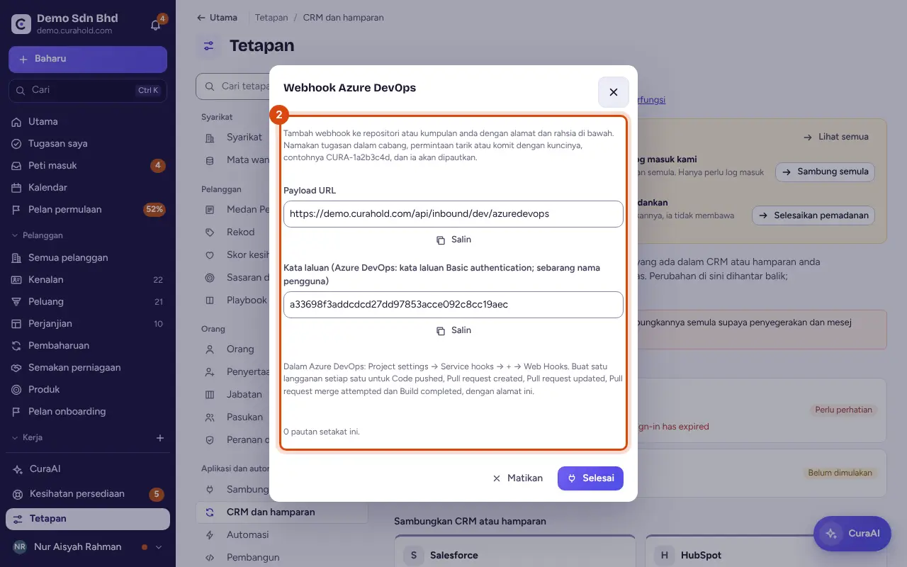

# Azure DevOps

Cawangan, pull request dan commit dalam Azure Repos yang menamakan tugasan dipautkan kepadanya, bersama keadaannya (terbuka, digabungkan, ditutup) dan hasil binaan. Ia berfungsi seperti GitHub dan GitLab: letakkan kunci tugasan, contohnya `CURA-1a2b3c4d`, dalam nama cawangan, tajuk pull request atau mesej commit.

## Dalam Curahold {#connect}

1. Buka **Tetapan → CRM dan hamparan**, cari **Alat pembangun** dan klik **Sediakan Azure DevOps**.
   
2. Klik **Hidupkan**, kemudian salin **alamat** dan **kata laluan** yang dipaparkan.
   

## Dalam Azure DevOps

Lakukan ini sekali bagi setiap acara (Code pushed, Pull request created, Pull request updated, Pull request merge attempted, Build completed):

1. Buka projek → **Project settings** → **Service hooks** → **+** (Create subscription).
2. Pilih **Web Hooks** dan klik **Next**.
3. Pilih acara, biarkan penapis seperti sedia ada, dan klik **Next**.
4. Tampal alamat ke dalam **URL**. Taip sebarang **Username** (contohnya `azure`) dan tampal kata laluan ke dalam **Password**.
5. Biarkan **Resource details to send** pada **All**, klik **Test**, kemudian **Finish**.

## Had dan masa

Pautan dipaparkan sebaik sahaja Azure DevOps menghantarnya. Azure DevOps hanya menghantar melalui HTTPS dan tidak menandatangani apa-apa: kata laluan itulah buktinya, jadi simpannya seperti kata laluan.

## Jika ada masalah

Azure DevOps memaparkan jawapan setiap penghantaran di bawah **Service hooks → History**: 401 bermakna kata laluan salah (hidupkan webhook sekali lagi untuk kata laluan baharu dan kemas kini setiap langganan). **Matikan** menghentikan pautan baharu; pautan yang sudah dibuat kekal pada tugasan.

## Lihat juga

- [Tugasan dan papan](/docs/ms/tasks/)
- [Sambungan dan CRM](/docs/ms/connections/)
