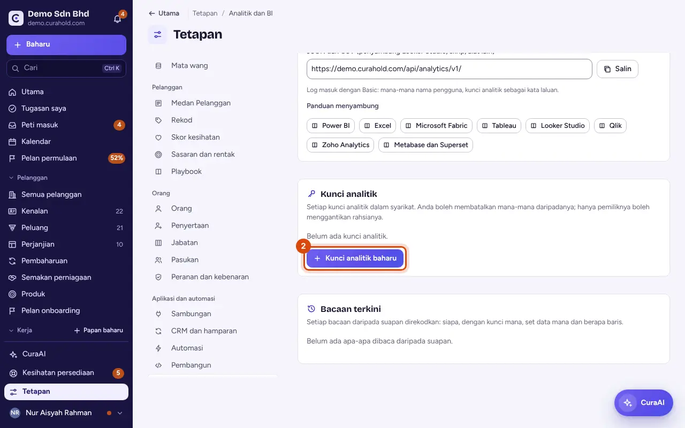
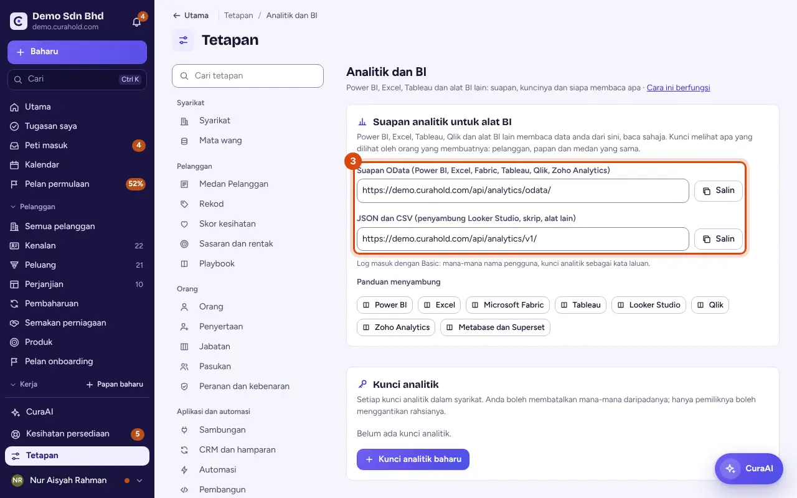

# Sambungkan alat BI

Curahold mempunyai satu **suapan analitik** baca sahaja untuk alat BI. Power BI, Excel, Microsoft Fabric, Tableau, Qlik dan Zoho Analytics membacanya sebagai **suapan OData**; Looker Studio, skrip dan alat lain membaca data yang sama sebagai **JSON atau CSV**. Tiada apa-apa dalam Curahold boleh diubah melaluinya.

## Sebelum anda bermula {#key}

Anda memerlukan kebenaran untuk mengeksport data (pentadbir dan pengurus memilikinya).

1. Buka **Tetapan → Analitik dan BI** dan klik **Kunci analitik baharu**. Beri nama (contohnya "Papan pemuka jualan Power BI"), pilih set data dan jabatan yang boleh dibacanya serta tarikh tamat, dan ciptanya. Salin kunci itu dengan segera: ia hanya ditunjukkan sekali, dan bermula dengan `chb_`.
   
2. Pada halaman yang sama, di bawah **Suapan analitik untuk alat BI**, klik **Salin** di sebelah alamat yang diperlukan oleh alat anda. Ia kelihatan seperti ini, dengan alamat syarikat anda:
   

Suapan OData (Power BI, Excel, Fabric, Tableau, Qlik, Zoho Analytics):

```text
https://your-company.curahold.com/api/analytics/odata/
```

JSON dan CSV (Looker Studio, skrip, alat lain):

```text
https://your-company.curahold.com/api/analytics/v1/
```

Apabila alat bertanya cara log masuk, pilih **Basic**: taip apa sahaja sebagai nama pengguna dan tampal kunci sebagai kata laluan.

Kunci membaca tepat apa yang anda lihat dalam Curahold: pelanggan, papan dan medan yang sama. Medan yang tidak boleh dilihat oleh peranan anda tidak menjadi lajur pun. Jika anda meninggalkan syarikat atau kehilangan kebenaran eksport, kunci itu berhenti. **Gantikan rahsia** memberikan nilai baharu kepada kunci yang sama; **Batalkan** menamatkannya dengan serta-merta.

## Set data

| Set data | Apa yang terkandung |
| --- | --- |
| `Customers` | Satu baris bagi setiap pelanggan, dengan setiap medan pelanggan yang boleh anda lihat sebagai lajur tersendiri |
| `Renewals` | Pelanggan dengan tarikh pembaharuan: nilai, kesihatan dan urus niaga pembaharuan terbuka |
| `HealthHistory` | Skor kesihatan setiap pelanggan pada setiap hari |
| `Opportunities` | Saluran jualan anda: amaun, peringkat, status, tarikh tutup |
| `Tickets` | Tiket sokongan |
| `Contacts` | Kenalan di pelanggan anda |
| `Records…` | Satu set data bagi setiap jenis rekod yang anda tambah (perjanjian, risiko…) |
| `Boards`, `Tasks`, `TaskAssignees` | Papan, tugasannya, dan satu baris bagi setiap tugasan dan penerima tugasan |
| `Sprints`, `SprintBurndown` | Sprint, serta skop dan kerja yang tinggal setiap hari |
| `People` | Nama dan peranan, untuk meletakkan nama pada id pemilik dan penerima tugasan |

Setiap set data mempunyai `Id` dan `ModifiedAt` (bila baris itu terakhir berubah). Kebanyakannya juga mempunyai `IsDeleted`: baris yang diarkibkan kekal dalam suapan dengan `IsDeleted = true`, supaya muat semula boleh membuangnya daripada laporan anda. Gabungkan set data pada lajur id: `Tasks.CustomerId` → `Customers.Id`, `Tasks.BoardId` → `Boards.Id`, `OwnerId` → `People.Id`.

## Power BI

1. Dalam Power BI Desktop, pilih **Get data → OData feed**.
2. Tampal alamat OData dan pilih **OK**.
3. Pilih **Basic**. User name: apa sahaja. Password: kunci analitik anda. Pilih **Connect**.
4. Tandakan set data yang anda mahu dalam Navigator dan pilih **Load** (atau **Transform data** untuk membuang lajur dahulu).
5. Selepas menerbitkan, buka **Settings → Data source credentials** model semantik, pilih **Basic** sekali lagi dengan kunci, dan hidupkan **scheduled refresh**.

Jika perkhidmatan Power BI meminta gateway untuk log masuk Basic, gunakan kunci sebagai **Web API key**: dalam **Transform data → Advanced editor** tulis sumber sebagai `OData.Feed("https://your-company.curahold.com/api/analytics/odata/Tasks", null, [ApiKeyName = "key", Implementation = "2.0"])`, kemudian pilih **Web API** dan tampal kunci apabila Power BI memintanya.

**Set data besar.** Untuk muat semula tokokan, letakkan julat dalam alamat supaya Curahold menapis sebelum menghantar:

```
let
    Start = DateTime.ToText(RangeStart, "yyyy-MM-ddTHH:mm:ss") & "Z",
    End = DateTime.ToText(RangeEnd, "yyyy-MM-ddTHH:mm:ss") & "Z",
    Source = OData.Feed("https://your-company.curahold.com/api/analytics/odata/Tasks?$filter=CreatedAt ge " & Start & " and CreatedAt lt " & End, null, [Implementation = "2.0"])
in
    Source
```

Kemudian tetapkan dasar muat semula tokokan pada jadual seperti biasa, dan tandakan **Detect data changes** dengan lajur `ModifiedAt`, supaya tempoh yang barisnya berubah dibaca semula.

## Excel

1. Dalam Excel untuk Windows, pilih **Data → Get Data → From Other Sources → From OData Feed**.
2. Tampal alamat OData dan pilih **OK**.
3. Pilih **Basic**, taip mana-mana nama pengguna dan tampal kunci sebagai kata laluan, kemudian **Connect**.
4. Pilih set data dalam Navigator dan pilih **Load**.
5. **Data → Refresh All** mengambil data terkini bila-bila masa anda mahu.

## Microsoft Fabric

1. Dalam ruang kerja anda, pilih **New item → Dataflow Gen2**, kemudian **Get data → OData**.
2. Tampal alamat OData. Di bawah connection credentials, pilih **Basic**, mana-mana nama pengguna dan kunci sebagai kata laluan.
3. Pilih set data, bentukkannya jika perlu, dan tambah **data destination** (lakehouse atau warehouse).
4. **Publish**, kemudian tetapkan jadual muat semula pada dataflow.

**Copy activity** dalam data pipeline boleh membaca suapan yang sama dengan penyambung OData dan log masuk Basic.

## Tableau

1. Dalam Tableau Desktop, pilih **Connect → To a Server → OData**.
2. Sebagai pelayan, tampal alamat satu set data, contohnya `https://your-company.curahold.com/api/analytics/odata/Customers`.
3. Pilih **Use username and password**: mana-mana nama pengguna, kunci sebagai kata laluan. Pilih **Sign In**.
4. Tableau membaca OData sebagai **extract**. Tambah satu lagi sambungan OData bagi setiap set data yang anda mahu dan hubungkannya pada lajur id.
5. Apabila menerbitkan ke Tableau Cloud atau Server, benamkan bukti kelayakan dan tetapkan jadual muat semula extract.

## Looker Studio

Looker Studio memerlukan penyambung untuk membaca suapan seperti ini. **Penyambung Looker Studio Curahold sendiri akan datang tidak lama lagi.** Sementara itu:

1. Dalam Google Sheet baharu, tulis dalam sel A1: `=IMPORTDATA("https://your-company.curahold.com/api/analytics/v1/Customers.csv?limit=5000&key=YOUR-KEY")`.
2. Dalam Looker Studio, pilih **Create → Data source → Google Sheets** dan pilih helaian itu.
3. Buat kunci khas untuk ini sahaja, dihadkan kepada set data yang diperlukan oleh helaian: sesiapa yang boleh menyunting helaian boleh melihat kunci dalam formula. Batalkannya dalam Curahold jika helaian dikongsi terlalu luas.

Anda juga boleh mengemas kini helaian dengan **CRM dan hamparan** (Tetapan → CRM dan hamparan) dan menggunakan helaian itu dalam Looker Studio.

## Qlik

1. Dalam Qlik Sense atau Qlik Cloud, pilih **Add data → OData** (atau **Create new connection → OData**).
2. Tampal alamat OData, pilih pengesahan **Basic**, mana-mana nama pengguna dan kunci sebagai kata laluan.
3. Pilih set data dan muatkannya; jadualkan muat semula dalam tetapan aplikasi.

Penyambung REST Qlik juga berfungsi dengan alamat JSON (`…/api/analytics/v1/Customers.json`), dengan log masuk Basic dan penomboran halaman "next URL" pada medan `next`.

## Zoho Analytics

1. Pilih **Create → New Workspace → Web URL / Feeds** (import daripada suapan web).
2. Tampal alamat satu set data: alamat OData (`…/api/analytics/odata/Customers`) atau alamat CSV (`…/api/analytics/v1/Customers.csv`).
3. Di bawah pengesahan, pilih **Basic**: mana-mana nama pengguna, kunci sebagai kata laluan.
4. Untuk penomboran halaman, pilih **next page URL**: `@odata.nextLink` untuk OData, `next` untuk JSON.
5. Tetapkan kekerapan import berulang.

## Metabase / Superset

Metabase dan Superset membaca pangkalan data, bukan suapan web. Sambungan terus datang bersama **eksport gudang data** Curahold (ke BigQuery atau Snowflake), yang akan datang tidak lama lagi. Sementara itu, muat naik CSV daripada `…/api/analytics/v1/<dataset>.csv` jika persediaan anda membenarkan muat naik fail.

## Alat dan skrip lain

Alamat JSON dan CSV menerima:

| Pilihan | Maksud |
| --- | --- |
| `limit` | Baris setiap halaman, sehingga 5000 (1000 secara lalai) |
| `page` atau `offset` | Halaman mengikut nombor atau mengikut baris |
| `cursor` | Nilai `next` halaman sebelumnya (paling pantas untuk set data besar) |
| `since` | Hanya baris yang berubah pada atau selepas tarikh atau masa ini, cth. `2026-11-01` |
| `fields` | Hanya lajur ini, cth. `Id,Name,ModifiedAt` |
| `filter`, `orderby` | Ungkapan yang sama seperti `$filter` dan `$orderby` OData |
| `count=1` | Juga pulangkan jumlah bilangan baris |

Hantar kunci sebagai Basic (kata laluan) atau sebagai `Authorization: Bearer chb_…`. Halaman JSON kelihatan seperti `{ "dataset": "Tasks", "rows": [...], "next": "…" }`; halaman CSV memberikan alamat seterusnya dalam pengepala `Link`. Alat seperti Domo, SAP Analytics Cloud, Quick BI dan FineBI membaca alamat JSON atau OData dengan cara yang sama.

Suapan OData memahami `$select`, `$filter` (`eq ne gt ge lt le`, `and`, `or`, `not`, `contains`, `startswith`, `endswith`), `$orderby`, `$top`, `$skip`, `$count` dan `/$count`. Ia tidak menawarkan `$expand`: gabungkan set data pada lajur id sebaliknya.

## Muat semula dan had

- Set data besar datang dalam halaman 1,000 baris; alat BI mengikut pautan halaman seterusnya dengan sendirinya.
- **Perubahan sahaja:** tapis pada `ModifiedAt` (`$filter=ModifiedAt ge 2026-11-01T00:00:00Z`) atau gunakan `since` dalam JSON. Dengan pengepala `Prefer: odata.track-changes`, halaman terakhir juga memberikan `@odata.deltaLink` yang kemudiannya hanya memulangkan apa yang berubah.
- Setiap kunci boleh membuat kira-kira dua permintaan sesaat, dan setiap syarikat mempunyai bajet baris harian. Jika melebihinya, suapan menjawab 429 dan menyatakan bila boleh cuba semula.
- Setiap bacaan direkodkan (siapa, kunci mana, set data mana, berapa baris) dan dipaparkan di bawah **Bacaan terkini** dalam Tetapan.

## Apabila berlaku masalah

- **401 / alat meminta bukti kelayakan sekali lagi:** kunci salah, dibatalkan atau melepasi tarikh tamatnya, atau medan nama pengguna dibiarkan kosong dalam alat yang memerlukannya: taip apa sahaja di situ.
- **403:** pemilik kunci tidak lagi mempunyai kebenaran untuk mengeksport data.
- **404 untuk set data:** kunci dihadkan kepada set data atau jabatan lain, atau medan set data itu ditutup kepada peranan pemilik.
- **400 dengan mesej:** pertanyaan menggunakan sesuatu yang tidak disokong oleh suapan; mesej itu menamakannya.
