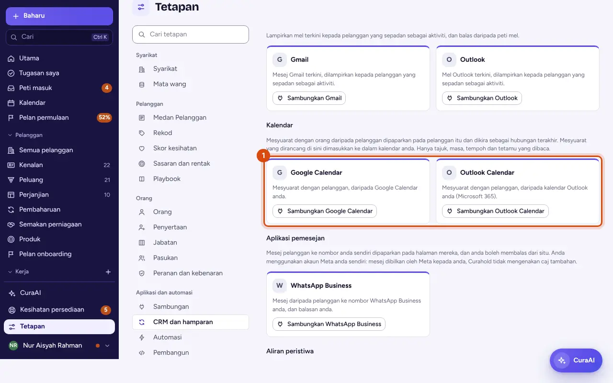

# Google Calendar dan Outlook Calendar

Sambungkan kalendar anda dan setiap mesyuarat yang anda adakan dengan orang daripada pelanggan dipaparkan pada garis masa pelanggan itu, sebagai mesyuarat bersama tempohnya. Ia juga dikira sebagai hubungan terakhir. Daripada garis masa pelanggan, anda boleh merancang mesyuarat terus ke dalam kalendar anda; kalendar menghantar jemputan.

## Apa yang dibaca, dan apa yang tidak

Hanya mesyuarat yang sudah berlangsung, daripada kalendar utama anda: tajuk, masa, tempoh dan tetamu. Tidak sekali-kali penerangan, tempat atau pautan panggilan. Mesyuarat peribadi, catatan sepanjang hari dan mesyuarat tanpa orang luar ditinggalkan. Mesyuarat difailkan di bawah pelanggan yang kenalannya menjadi tetamu, atau yang alamat webnya ialah domain seorang tetamu.

## Dalam Curahold {#connect}

1. Buka **Tetapan → CRM dan hamparan**, cari **Kalendar** dan klik **Sambungkan Google Calendar** atau **Sambungkan Outlook Calendar**.
   

Google atau Microsoft dibuka. Pilih akaun kerja anda dan klik **Allow** (Google) atau **Accept** (Microsoft). Kembali ke Curahold, klik **Mula**: 90 hari lepas dibaca, kemudian setiap jam.

## Rancang mesyuarat

Pada halaman pelanggan, buka **Garis masa** dan klik **Rancang mesyuarat dalam Google Calendar** (atau Outlook). Taip tajuk, masa, tempoh dan e-mel tetamu, kemudian klik **Tambah ke …**. Mesyuarat itu dipaparkan pada garis masa sebaik sahaja ia berlangsung.

## Had dan masa

Dibaca setiap jam; mesyuarat minggu lepas yang dialihkan atau dinamakan semula akan dikemas kini. Mesyuarat yang dibatalkan kekal: padamkannya daripada garis masa jika ia tidak berlangsung (ia pergi ke tong sampah). Google dan Microsoft mengehadkan permintaan seminit: jawapan sibuk menjeda bacaan, yang diteruskan pada kali seterusnya.

## Jika ada masalah

Jika log masuk tamat tempoh, ia diperbaharui sendiri. Jika akses ditarik balik (kata laluan diubah, keputusan pentadbir), sambungan menunjukkan **Perlu perhatian**: klik **Sambung semula** dan log masuk dengan akaun yang sama. **Buang** memadamkan log masuk; mesyuarat yang sudah ada pada garis masa kekal.

## Lihat juga

- [Garis masa dan skor kesihatan](/docs/ms/timeline-and-health/)
- [Sambungan dan CRM](/docs/ms/connections/)
