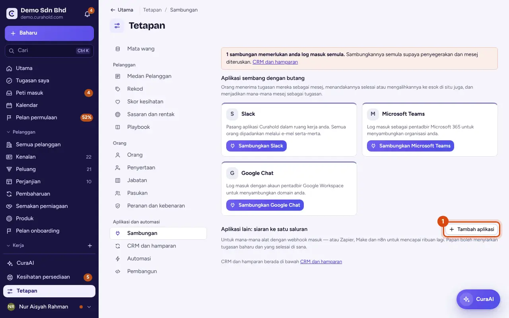
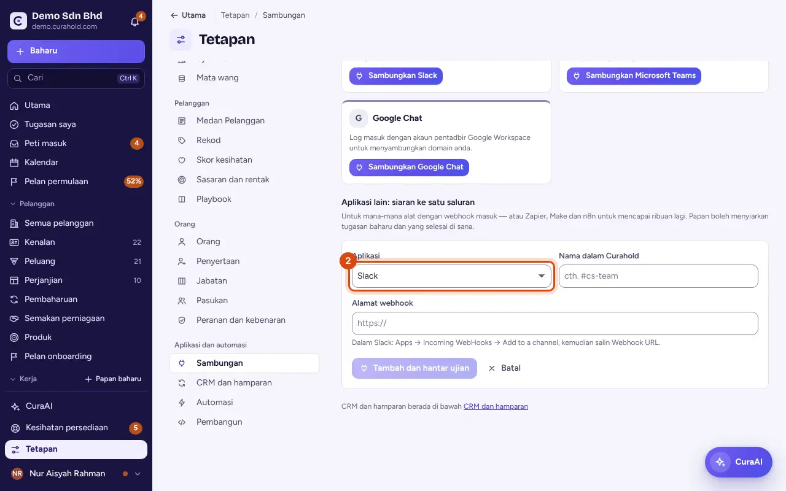

# Pemberitahuan Lark, Feishu dan Telegram

Papan boleh menghantar beritanya (tugasan baharu, tugasan selesai) ke sembang kumpulan. Lark dan Feishu menggunakan bot tersuai kumpulan; Telegram menggunakan bot yang anda buat dalam dua minit. Kedua-duanya sehala: ia menghantar, tiada sesiapa membalas melaluinya.

## Dalam Curahold {#connect}

1. Buka **Tetapan → Sambungan** dan klik **Tambah aplikasi**.
   
2. Pilih **Lark · Feishu** atau **Telegram** di bawah **Aplikasi**, tampal apa yang diberikan oleh langkah di bawah, dan klik **Tambah dan hantar ujian**. Mesej ujian tiba dalam kumpulan.
   

Kemudian buka papan itu, pilih **Tetapan papan → Pemberitahuan** dan pilih sambungan baharu untuk berita yang anda mahu.

## Lark atau Feishu

1. Dalam kumpulan, buka **Settings → Bots → Add bot → Custom bot**, beri nama dan klik **Add**.
2. Salin **webhook address**. Rupanya seperti ini:

```text
https://open.larksuite.com/open-apis/bot/v2/hook/0f3c2a9e-7d1b-4c55-9a7e-2b8f6c1d3e4f
```

3. Pilihan, tetapi disyorkan: di bawah **Security settings**, tandakan **Signature verification** dan salin rahsia itu ke **Rahsia tandatangan** dalam Curahold. Jangan gunakan penapis kata kunci: mesej akan tercicir.

## Telegram

1. Dalam Telegram, tulis kepada **@BotFather**, hantar `/newbot`, jawab dua soalannya dan salin **token** yang diberikan.
2. Tambah bot itu ke kumpulan anda (untuk saluran: tambahkannya sebagai pentadbir).
3. Hantar satu mesej dalam kumpulan. Curahold mencari kumpulan itu daripadanya, jadi anda tidak memerlukan ID kumpulan.
4. Tampal token itu ke **Token bot** dalam Curahold. Untuk saluran awam, anda boleh menaip `@nama` saluran itu.

## Had dan masa

Lark menerima kira-kira 100 hantaran seminit bagi setiap bot dan Telegram kira-kira 20 seminit bagi setiap kumpulan; jawapan sibuk akan dicuba semula, tidak hilang. Mesej Telegram ialah teks biasa, sehingga 4,096 aksara.

## Jika ada masalah

Rahsia tandatangan yang salah, bot yang dialih keluar atau token yang dibatalkan menandakan sambungan **Perlu perhatian** dalam Tetapan → Sambungan, dan ujian juga menyatakannya. Betulkannya di pihak sana, kemudian klik **Hantar ujian** sekali lagi: ujian yang berjaya menghapuskan masalah itu. **Buang** menghentikan hantaran; bot kekal dalam kumpulan anda sehingga anda mengalih keluarnya di sana.

## Lihat juga

- [Sambungan dan CRM](/docs/ms/connections/)
- [Pemberitahuan](/docs/ms/notifications/)
