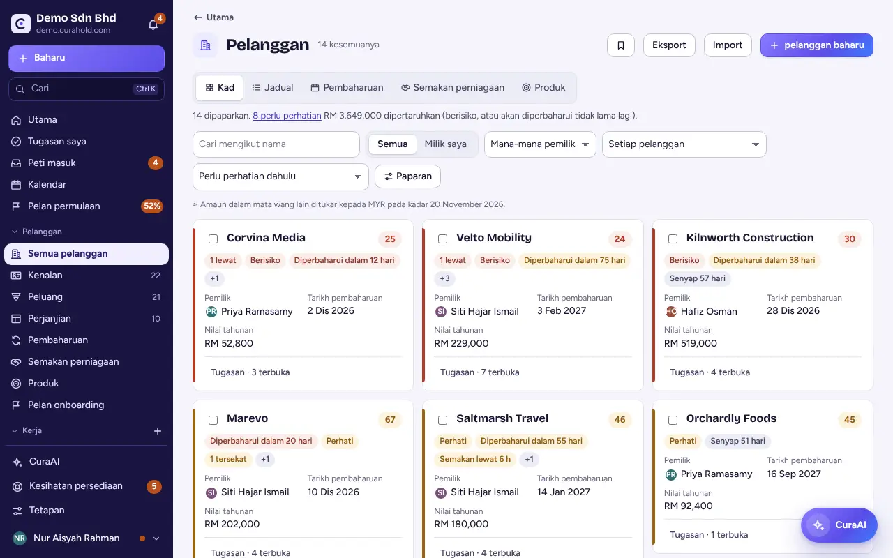
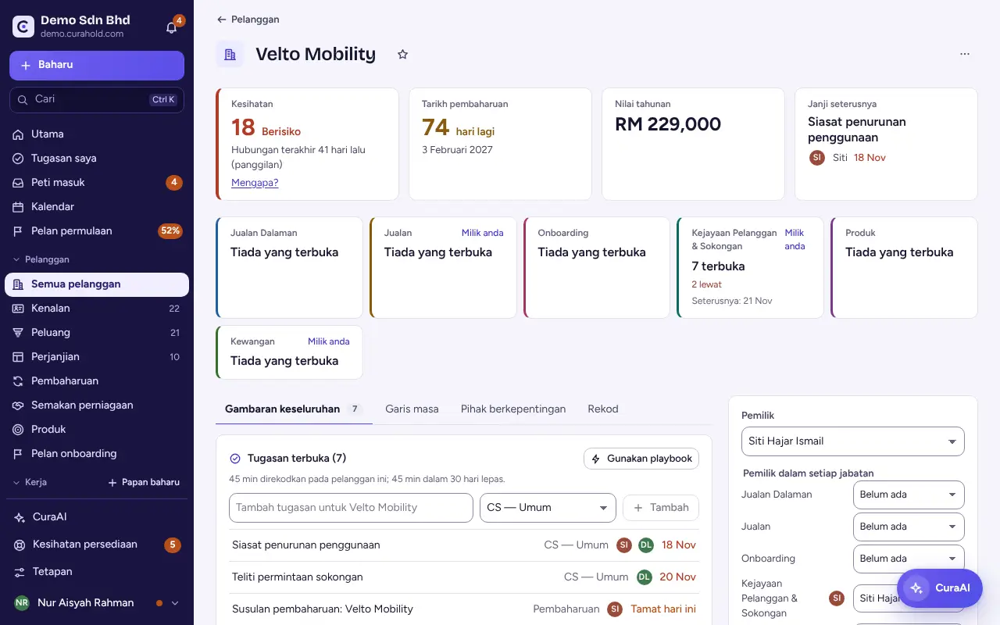

# Pelanggan, medan dan rekod

Pelanggan berada di tengah-tengah Curahold. Setiap pelanggan mempunyai pemilik, pasukan pilihan dan medan anda sendiri.

## Halaman pelanggan

Di bahagian atas halaman pelanggan, jalur untuk dibaca sekali imbas: **Kesihatan** dengan sebabnya dan butang **Mengapa?**, tarikh pembaharuan dan baki hari, nilai tahunan, dan **Janji seterusnya**: langkah terdekat yang anda janjikan kepada pelanggan, dan siapa yang memegangnya. Di bawah jalur, terdapat tab: **Gambaran keseluruhan** (tugasan terbuka dan mesyuarat akan datang), **Garis masa**, **Pihak berkepentingan**, **Rekod** dan **Butiran**. Tab yang terbuka kekal dalam alamat, jadi muat semula atau pautan yang anda hantar kembali kepadanya.

## Medan

Tambah medan dalam Tetapan → Medan pelanggan: teks, nombor, wang, tarikh, pilihan, e-mel, pautan. Pilihan boleh mempunyai warna, jadi medan seperti kesihatan dipaparkan dalam warna itu dalam senarai dan kad.

Anda juga boleh menamakan semula "Pelanggan": "Akaun", "Jenama", "Rakan kongsi" — apa sahaja yang disebut oleh pasukan anda dipaparkan di seluruh antara muka.

## Rekod: kenalan, peluang dan banyak lagi

Simpan rekod di bawah pelanggan:

- **Kenalan (pihak berkepentingan):** jawatan, peranan dalam keputusan (pembuat keputusan, pelulus bajet, pempengaruh, penilai, pengguna) dan pendirian terhadap anda (penyokong utama, penyokong, neutral, ragu-ragu, penghalang).
- **Peluang:** amaun, tarikh tutup, peringkat dan status.
- **Jenis rekod anda sendiri:** contohnya "Projek" atau "Kontrak".

Rekod boleh mengisi medan pelanggan: "Saluran jualan terbuka", "Penyokong utama", "Penghalang". Medan dikemas kini dengan sendirinya apabila rekod berubah.

## Paparan: kad, jadual, pembaharuan, produk

Tukar antara empat paparan dengan butang di bahagian atas halaman Pelanggan; pilihan anda diingati pada peranti itu.

- **Kad:** satu kad bagi setiap pelanggan, menyatakan apa yang perlu disemak: tugasan lewat, kesihatan berisiko atau patut diperhatikan, pembaharuan yang akan tiba atau telah lepas, tugasan yang tidak disentuh selama 14 hari, tiada hubungan selama 30 hari. Yang paling serius dahulu; "Semua beres" jika tiada apa-apa. Kad disusun "yang perlu perhatian dahulu" secara lalai dan boleh diisih mengikut nama, kesihatan, nilai, pembaharuan atau tugasan terbuka. Pilih medan yang dipaparkan pada kad daripada menu **Paparan**.
- **Jadual:** senarai boleh diisih di mana anda boleh mengubah banyak pelanggan sekali gus.
- **Pembaharuan:** pembaharuan 12 bulan akan datang, bulan demi bulan, dengan jumlah setiap bulan dan berapa banyak daripadanya berisiko atau patut diperhatikan.
- **Produk:** siapa mempunyai produk mana, mengikut medan pilihan sesuatu jenis rekod (contohnya "Langganan → Produk"). **+** dalam sel kosong membuka tugasan jualan silang untuk pelanggan itu.

Ayat di bahagian atas menyatakan berapa ramai pelanggan perlu perhatian dan berapa banyak nilai yang berisiko; pautan "perlu perhatian" mengecilkan senarai kepada mereka. Pada telefon, penapis berada bersama pada satu helaian **Tapis**.

## Menambah pembaharuan

Pembaharuan ialah **Tarikh pembaharuan** pelanggan. Buka pelanggan dan isikannya di bawah **Butiran**, atau bawa masuk dalam satu lajur semasa mengimport. Selepas itu pelanggan muncul dalam **Pembaharuan**, pada bulannya dan bersama nilainya. Belum ada medan itu? Tambah medan tarikh dalam Tetapan → Medan pelanggan. Untuk kerja pembaharuan bermula dengan sendirinya, hidupkan **Mulakan pembaharuan dengan sendirinya** dalam Tetapan → **Sasaran dan rentak** dan pilih berapa awal serta dengan playbook yang mana.

## Mengimport

Lepaskan fail Excel atau CSV, padankan lajur dengan medan, semak pratonton, import. Import yang salah boleh dibuat asal dengan satu klik dalam tempoh 30 hari.

## Mengeksport

Muat turun senarai pelanggan dan rekod, dengan penapis yang anda gunakan, sebagai Excel atau CSV. Fail dibuat dalam pelayar anda, dan medan yang tidak boleh anda lihat juga tiada di dalamnya.

## Mengubah banyak sekali gus

Pilih beberapa pelanggan dalam senarai dan ubah pemilik, pasukan atau medan mereka bersama-sama. Notis di bahagian bawah menawarkan **Buat asal**.

## Memadam pelanggan, dan mendapatkan semula pelanggan yang dipadam

Pelanggan yang dipadam masuk ke [tong sampah](/docs/ms/trash/) bersama rekod, garis masa, mesyuarat dan orang portalnya, dan boleh dipulihkan dalam tempoh 30 hari: pilih **Buat asal** dalam notis sejurus selepas memadam, atau buka menu anda, pilih **Tong sampah** dan kemudian **Pulihkan**. Tugasannya kekal pada papan masing-masing tanpa pelanggan, dan merujuk kepadanya semula apabila ia kembali. Untuk mengetepikan pelanggan tanpa memadamnya, arkibkannya.

## Playbook

**Playbook** ialah set tugasan bertarikh yang diletakkan pada pelanggan dengan satu klik: onboarding, persediaan pembaharuan, QBR. Pentadbir menulisnya sekali dalam Tetapan → **Playbook** (tajuk tugasan, berapa hari selepas mula, untuk siapa); pada halaman pelanggan, **Gunakan playbook** membolehkan anda memilih hari mula dan menambah semuanya. `{account_name}` dalam tajuk menjadi nama pelanggan.

## Semakan perniagaan

Tentukan sekali berapa kerap anda duduk bersama setiap pelanggan: Tetapan → **Sasaran dan rentak** → *Semakan perniagaan* (contohnya setiap 90 hari). Seorang pelanggan boleh mempunyai rentaknya sendiri dalam medan **Semakan perniagaan** pada halamannya; "Tiada semakan" mengecualikan pelanggan itu daripada rentak.

Semakan perniagaan ialah mesyuarat yang anda adakan dengan setiap pelanggan dari semasa ke semasa (QBR) untuk meneliti hasil dan rancangan. **Pelanggan → Semakan perniagaan** menyenaraikan semakan yang perlu diadakan: lewat, dalam 30 hari akan datang, dan kemudian. Apabila anda telah mengadakan semakan, **Selesai** pada baris (atau halaman pelanggan) membuka borang mesyuarat; setelah disimpan, ia masuk ke **Mesyuarat** dan garis masa pelanggan sebagai "Semakan perniagaan", dan tarikh seterusnya beralih dengan sendirinya. Bagi pelanggan yang tidak pernah disemak, kiraan bermula pada hari ia ditambah. Semakan yang lewat juga dipaparkan sebagai tanda pada kad pelanggan.

## Mesyuarat

**Mesyuarat** pada halaman pelanggan menyenaraikan setiap mesyuarat, semakan perniagaan dan panggilan dengan pelanggan itu, yang terbaharu dahulu: tarikh, jenis, tajuk, tempoh, siapa yang merekodkannya, siapa yang hadir (pihak mereka dan pihak kita), nota dan langkah seterusnya. Butang di atasnya menunjukkan satu jenis sahaja; tarikh semakan perniagaan seterusnya berada di sebelah tajuk.

**Rekodkan mesyuarat** (pada halaman pelanggan, atau **+ Baharu → Rekodkan mesyuarat, panggilan atau nota**) meminta:

- jenis (mesyuarat, semakan perniagaan, panggilan), tajuk, tarikh dan tempoh,
- orang mereka yang hadir (kenalan pelanggan) dan orang kita,
- nota: apa yang dibincangkan dan apa yang diputuskan,
- langkah seterusnya: setiap satu, dengan siapa yang memegangnya dan bila, menjadi tugasan pada papan yang anda pilih, untuk pelanggan ini.

Langkah seterusnya dipaparkan di bawah mesyuarat bersama kemajuannya (yang selesai dipotong); klik salah satu untuk membuka tugasan. Mesyuarat boleh disunting kemudian, diberi lebih banyak langkah seterusnya, atau dipadam; tugasan mesyuarat yang dipadam kekal, dan mesyuarat itu sendiri boleh dipulihkan dari [tong sampah](/docs/ms/trash/) dalam tempoh 30 hari.
