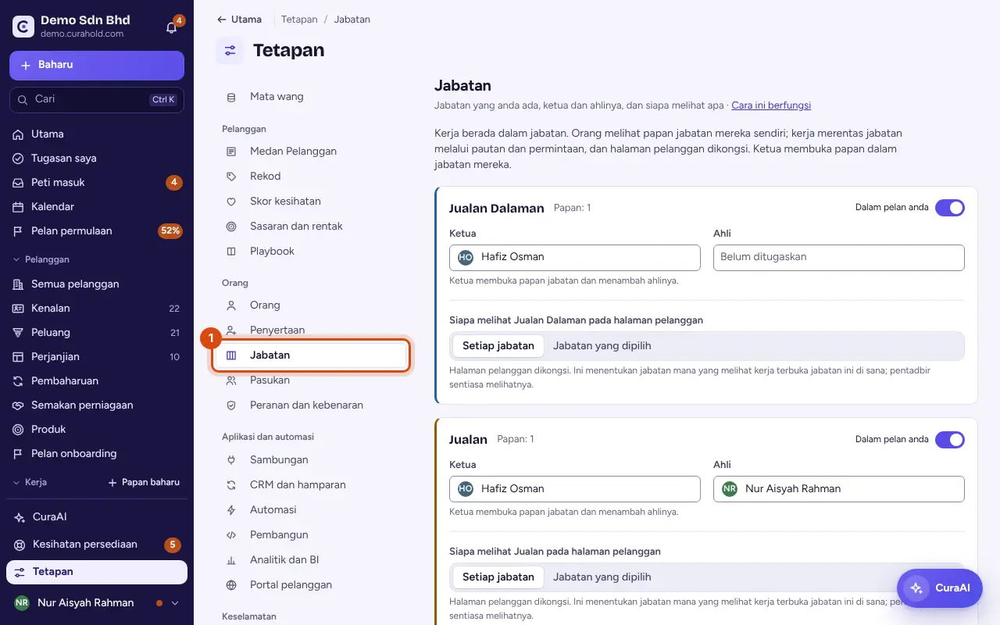
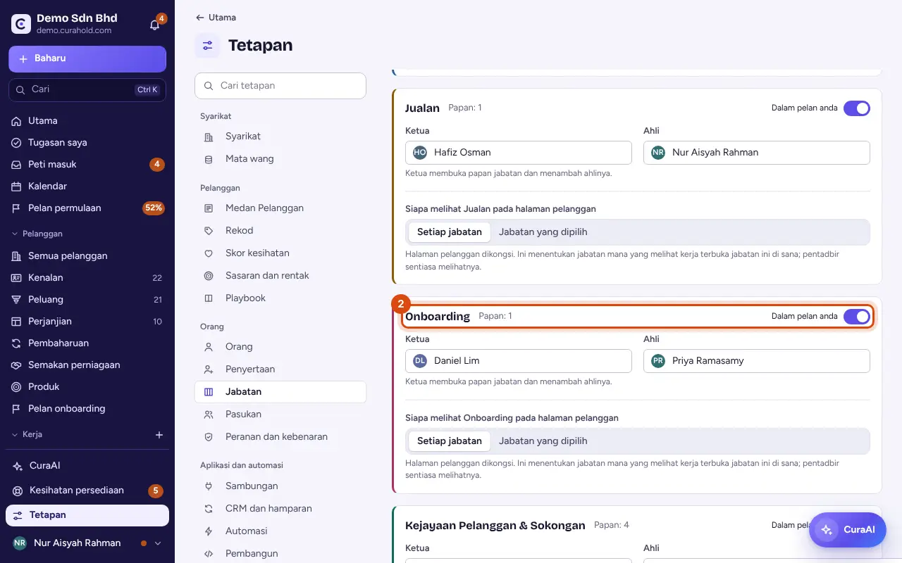
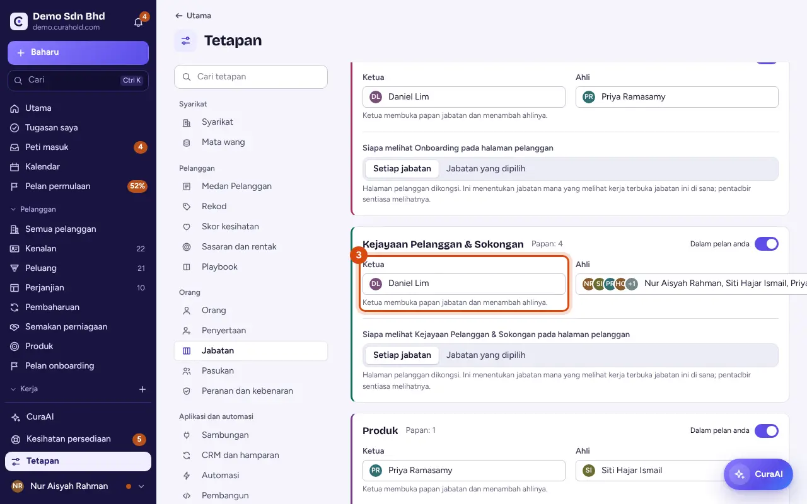
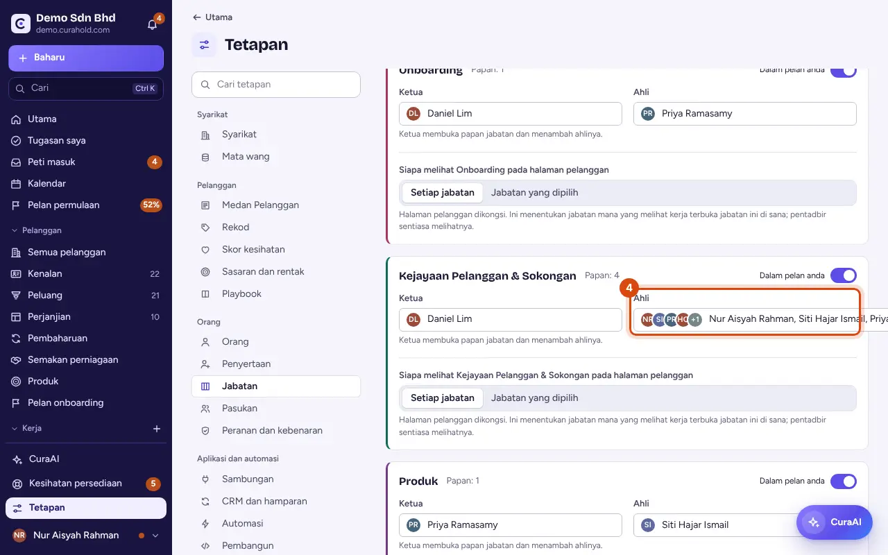
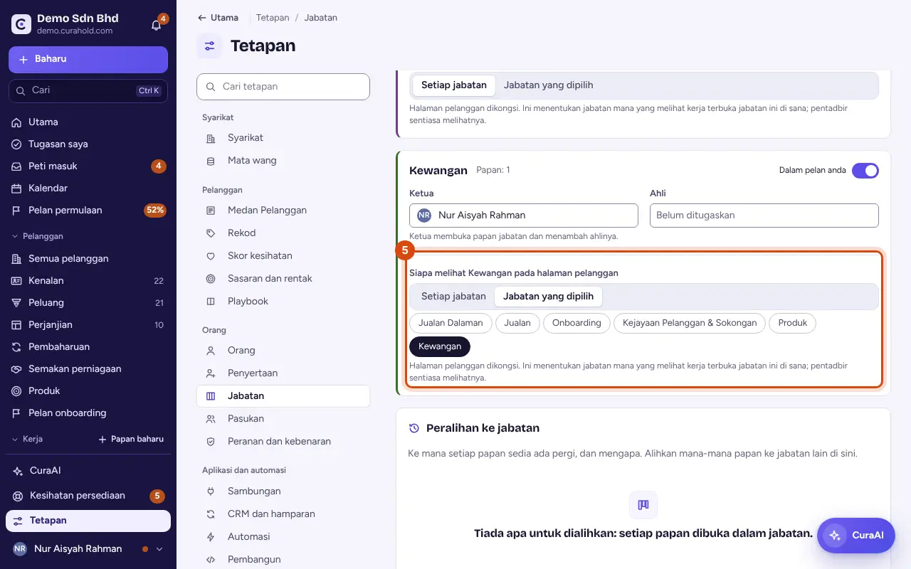
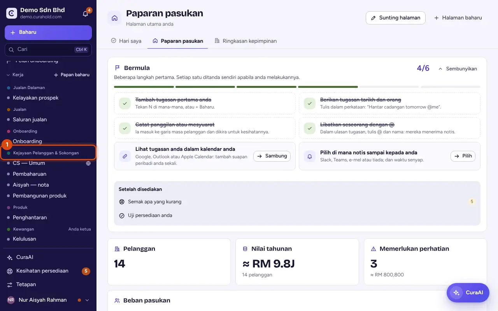
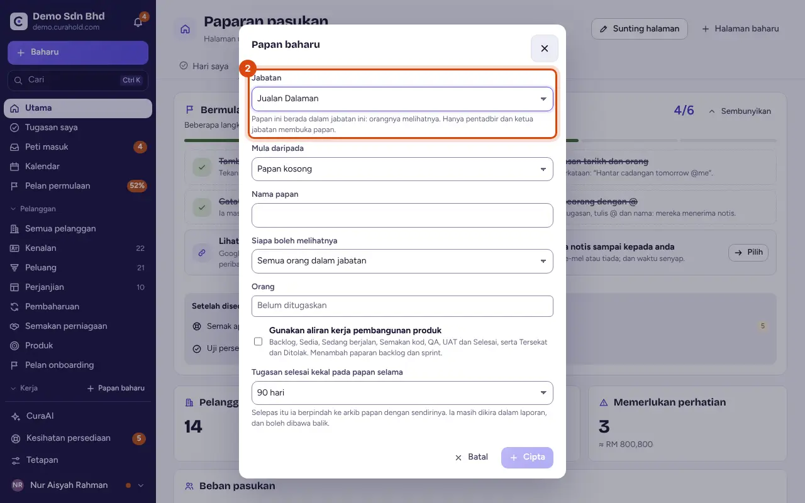
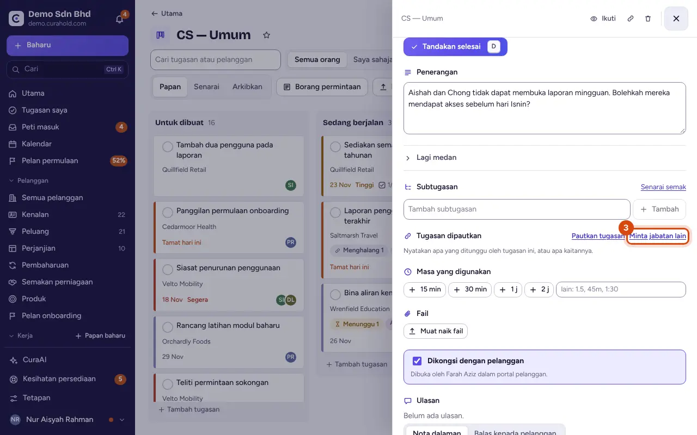
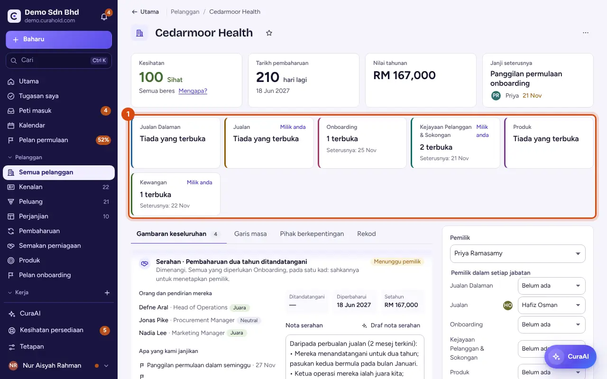
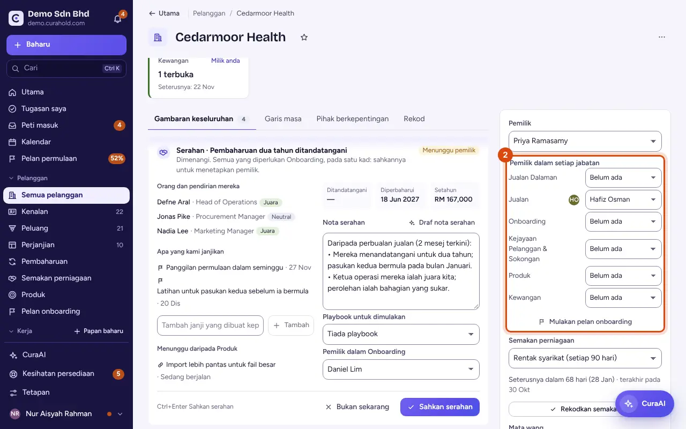

# Jabatan

Kerja dalam Curahold berada dalam jabatan: Jualan Dalaman, Jualan, Onboarding, Kejayaan Pelanggan & Sokongan, Produk dan Kewangan. Setiap orang melihat papan jabatan mereka sendiri. Kerja berpindah ke jabatan lain melalui permintaan, dan halaman pelanggan dikongsi oleh semua orang yang boleh melihat pelanggan itu.

## Sediakan jabatan anda {#set-up}

Anda perlu menjadi pentadbir (atau seseorang yang mengurus orang).

1. Dalam menu di sebelah kiri, klik **Tetapan**, kemudian **Jabatan** (di bawah **Orang**).
   
2. Biarkan **Dalam pelan anda** hidup untuk setiap jabatan yang ada dalam syarikat anda. Matikannya untuk jabatan yang tidak anda gunakan: ia disembunyikan daripada semua orang, dan papannya disimpan sehingga anda menghidupkannya semula.
   
3. Di bawah **Ketua**, pilih siapa yang mengetuai jabatan itu. Ketua membuka papan jabatan dan menambah ahlinya.
   
4. Di bawah **Ahli**, pilih semua orang lain yang bekerja di dalamnya. Seseorang boleh berada dalam lebih daripada satu jabatan.
   
5. Di bawah **Siapa melihat … pada halaman pelanggan**, pilih **Setiap jabatan**, atau **Jabatan yang dipilih** dan klik jabatan yang boleh melihat kerja terbuka jabatan ini di sana. Pentadbir sentiasa melihatnya. Kewangan bermula dengan Kewangan sahaja.
   

Semuanya disimpan semasa anda bekerja. Orang yang belum berada dalam mana-mana jabatan menyimpan kerja mereka sendiri dalam **Tugasan saya** sehingga anda menambah mereka.

Apabila syarikat anda berpindah ke jabatan, setiap papan sedia ada diletakkan dalam satu jabatan. **Peralihan ke jabatan**, di bahagian bawah halaman yang sama, menunjukkan ke mana setiap papan pergi dan mengapa; ubah jabatan sesuatu papan di sana. **Orang untuk ditempatkan** menyenaraikan orang yang boleh melihat sesuatu papan sebelum ini tetapi tidak bekerja padanya: **Berikan akses** menjadikan mereka ahli.

## Papan dalam jabatan {#boards}

1. Dalam menu, papan dikumpulkan di bawah nama jabatannya. **Anda ketua** dipaparkan di sebelah jabatan yang anda ketuai.
   
2. Untuk membuka papan baharu, klik **+** di sebelah **Kerja**. Dalam **Jabatan**, pilih tempat papan itu berada, kemudian beri nama dan klik **Cipta**. Hanya pentadbir dan ketua jabatan membuka papan.
   

**Siapa boleh melihatnya** ialah **Semua orang dalam jabatan** secara lalai; anda boleh mengecilkannya kepada satu pasukan atau orang yang dipilih.

## Minta jabatan lain {#ask}

1. Buka tugasan yang berkaitan dengan permintaan itu dan klik **Minta jabatan lain**. Pilih papan jabatan itu dalam senarai, isi borang permintaannya dan hantar.
   

Permintaan itu sampai pada papan jabatan tersebut dan dipautkan kepada tugasan anda. Anda melihat tajuk dan statusnya, tidak pernah papan jabatan lain itu. Sesebuah jabatan menerima permintaan apabila ketuanya menghidupkan borang permintaan papan (**Tetapan papan → Medan dan borang permintaan**).

## Pada halaman pelanggan {#customer-page}

1. Pada halaman pelanggan, **Merentas jabatan** menunjukkan kerja terbuka setiap jabatan untuk pelanggan itu, berapa banyak yang lewat dan tarikh akhir seterusnya. **Milik anda** menandakan jabatan yang anda sertai.
   
2. Di sebelah kanan, **Pemilik dalam setiap jabatan** menunjukkan siapa yang menjaga pelanggan dalam setiap jabatan. Pilih seseorang untuk menetapkannya.
   

Serahan antara jabatan (urus niaga yang dimenangi berpindah ke Onboarding atau Kejayaan Pelanggan) diterangkan dalam [Serahan, permintaan dan gelung balik](/docs/ms/handover-and-requests/).
