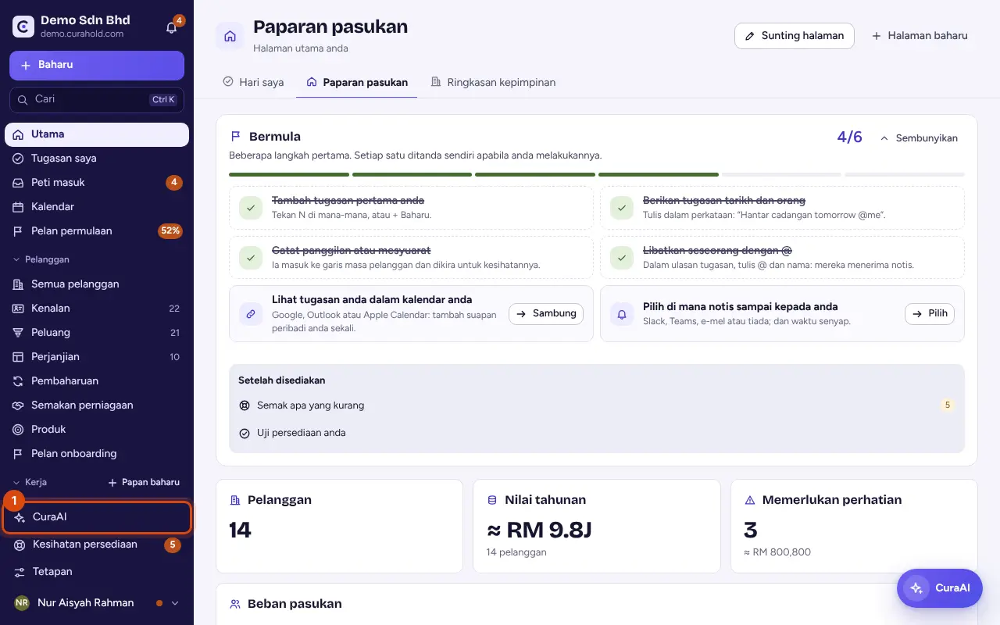
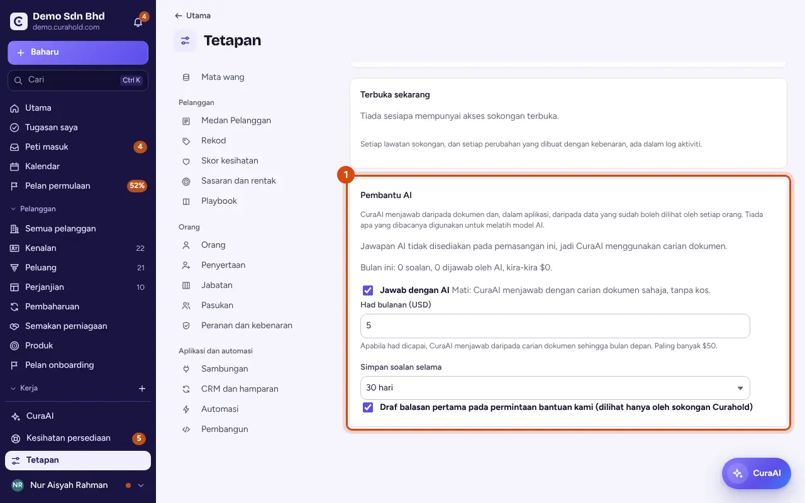
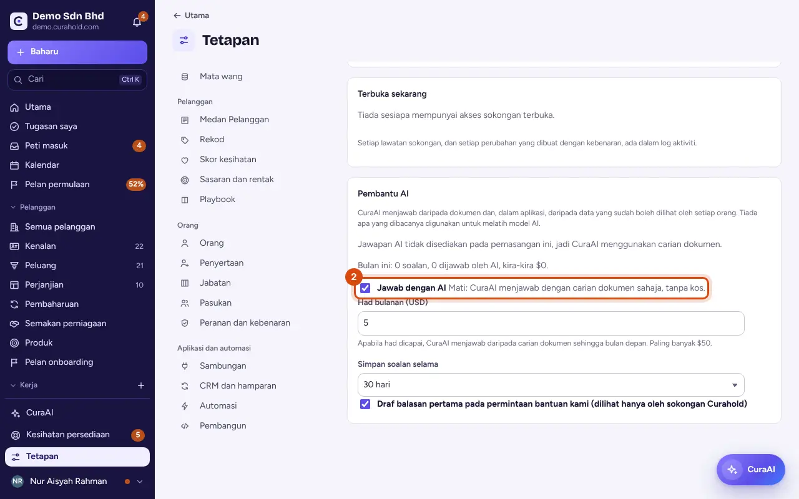

# Mendapatkan bantuan

Dua langkah, mengikut susunan ini: **tanya**, dan jika itu tidak menyelesaikannya, **tulis kepada sokongan**.

## Tanya dahulu {#ask}

1. Klik **CuraAI** dalam menu di sebelah kiri (pada telefon, butang di bahagian bawah kanan; dalam dokumentasi ini, butang **Tanya**). Tulis soalan anda dalam kata-kata anda sendiri: "bagaimana saya import pelanggan", "siapa boleh melihat medan ini".
   

Jawapan datang daripada dokumentasi ini, bersama tempat asalnya. Apabila syarikat anda menghidupkan **jawapan AI** (lihat di bawah), CuraAI juga membaca apa yang sudah boleh anda lihat dalam Curahold, seperti pelanggan, pembaharuan dan tugasan anda, jadi anda boleh bertanya "apa yang akan diperbaharui dalam 90 hari akan datang?". Ia hanya membaca; ia tidak pernah mengubah apa-apa. Apabila jawapan AI dimatikan, belum disediakan atau melebihi had bulan itu, dokumentasi dicari pada peranti anda sendiri dan tiada apa-apa yang anda taip dihantar ke mana-mana.

Jika jawapan itu bukan yang anda perlukan, beritahu: anda mendapat tempat lain yang paling hampir, dan butang untuk menulis kepada sokongan dengan soalan anda sudah diisi.

## Menghubungi sokongan: menghantar permintaan

Gunakan **Tulis kepada sokongan** di bahagian bawah CuraAI. Borang itu meminta apa yang diperlukan oleh sokongan untuk mencari masalah tanpa perlu kembali kepada anda dengan soalan. Tiada apa-apa dihantar yang belum anda lihat; anda memilih apa yang dihantar.

1. **Topik**: Sesuatu tidak berfungsi, Bagaimana saya…?, Data atau sambungan, Satu idea, atau Pengebilan dan pelan.
2. **Kesan**: bagi ralat dan masalah data, nyatakan sama ada ia menghentikan kerja anda. Susunan sokongan mengikutinya.
3. **Tajuk**: beberapa perkataan. Semasa anda menaip, halaman dokumentasi yang mungkin sudah menjawabnya dicadangkan.
4. **Apa yang berlaku**: apa yang anda cuba lakukan, apa yang anda jangkakan dan apa yang berlaku sebaliknya. Jika ada mesej ralat, salin perkataan demi perkataan.
5. **Bagaimana kami boleh melihatnya berlaku**: bagi ralat, langkah demi langkah (pilihan, tetapi sangat membantu).

6. **Maklumkan** dan **Diperlukan sebelum** (kedua-duanya pilihan): rakan sekerja yang patut membaca permintaan dan mendengar jawapannya, dan hari anda memerlukannya.

Anda menerima **rujukan** (cth. CH-000123) dan salinan melalui e-mel.

## Perbualan: jawapan, balasan, dan giliran siapa

Permintaan ialah perbualan. Bukanya di bawah **Permintaan saya** (butang peti masuk di bahagian atas CuraAI):

- **Jawapan sokongan** tiba melalui e-mel dan pada permintaan. Tanda pada butang CuraAI menyatakan ada jawapan yang menunggu.
- **Balas** dalam produk, atau hanya **jawab e-mel itu**: apa yang anda tulis di atas bahagian yang dipetik masuk ke permintaan.
- Permintaan menyatakan **giliran siapa**: *Dengan sokongan*, *Menunggu balasan anda*, atau *Selesai*. **Tandakan sebagai selesai** menutupnya; menulis semula membukanya.
- **Rakan sekerja yang dimaklumkan** membaca permintaan, menerima jawapan sokongan melalui e-mel dan boleh membalas. Hanya orang yang bertanya boleh menambah atau membuang mereka. Pentadbir boleh membaca mana-mana permintaan syarikat tetapi hanya menjawab permintaannya sendiri.
- Pasukan Curahold mungkin menyimpan **nota sendiri** pada sesuatu permintaan. Nota itu tidak pernah ditunjukkan atau dihantar kepada syarikat anda.

## Tangkapan skrin dan fail

- **Ambil tangkapan skrin**: pelayar bertanya tab mana yang hendak dikongsi; pilih tab Curahold. Tetingkap bantuan beralih ke tepi, jadi hanya halaman itu ditangkap.
- **Tampal atau lepas**: tampal gambar yang disalin ke dalam borang, atau lepaskan fail padanya.
- **Tanda**: serlahkan perkara penting dengan bingkai merah. **Sembunyikan** menutup apa-apa yang tidak patut dilihat oleh sokongan (nama pelanggan, amaun); ia dibuang daripada gambar yang dihantar.

Sehingga 6 fail, 10 MB setiap satu. Gambar, PDF, teks, CSV, JSON, Excel dan video pendek.

## Butiran teknikal yang ditambah pada permintaan

Borang menambah perkara ini dengan sendirinya dan menunjukkannya kepada anda sebelum dihantar:

| Butiran | Mengapa ia membantu |
|---|---|
| Alamat halaman | Di mana masalahnya. Bahagian rahsia alamat (kod log masuk dan seumpamanya) dibuang. |
| Pelayar, skrin, versi aplikasi | Untuk masalah yang berlaku dalam satu pelayar sahaja. |
| Halaman terakhir yang anda buka | Bagaimana anda sampai ke situ. Alamat sahaja, tiada kandungan halaman. |
| Ralat pada halaman | Mesej ralat dari latar belakang. Alamat e-mel dan teks seperti kunci disembunyikan. |
| Permintaan yang gagal | Tindakan mana yang gagal (laluan dan kod status). |
| Apa yang terbuka sekarang | Pelanggan, papan atau tugasan yang anda buka. |

Nyahtanda apa-apa yang anda lebih suka tidak dihantar. Tiada apa-apa yang anda taip dan tiada data pada halaman menjadi sebahagian daripada butiran ini.

## Membenarkan sokongan melihat akaun anda

Sesetengah masalah sukar dibaiki tanpa melihatnya. Kotak **Benarkan sokongan Curahold melihat akaun saya** di hujung borang adalah untuk itu. Ia tidak pernah ditanda untuk anda.

- **Apa yang dilihat oleh sokongan**: tepat apa yang anda lihat — pelanggan, papan dan medan yang sama. Tidak lebih.
- **Untuk berapa lama**: 24 jam, 3 hari atau 7 hari. Akses tamat dengan sendirinya. Setiap lawatan sokongan berlangsung paling lama 8 jam.
- **Apa yang boleh dilakukan oleh sokongan**: **melihat sahaja**. Sokongan tidak pernah mengubah apa-apa dalam akaun anda.
- **Tidak pernah dalam capaian**: peranti dan sesi anda, kunci API, aplikasi dan webhook, menjemput orang, peranan, tetapan syarikat, mengeksport atau memadam data. Sokongan juga tidak boleh melanjutkan aksesnya sendiri.
- **Menutupnya**: bila-bila masa, di bawah **Bantuan → Permintaan saya → Tutup akses**. Lawatan sokongan yang sedang berjalan tamat dengan serta-merta. Semasa akses terbuka, jalur di bahagian atas halaman mengingatkan anda.
- **Rekod**: setiap lawatan sokongan, dan apa yang dibaca oleh sokongan semasanya, ditulis ke **Tetapan → Log aktiviti** bersama nama kakitangan sokongan.

Semasa sokongan berada di dalam, jalur di bahagian atas skrin menunjukkan siapa yang melihat dan sehingga bila.

## Tetapan syarikat (pentadbir)

Dalam **Tetapan → Keselamatan → Akses sokongan**, pilih siapa yang boleh membenarkan sokongan masuk:

- **Sesiapa sahaja**: untuk apa yang boleh mereka lihat sendiri (lalai).
- **Pentadbir sahaja**: akses terbuka semua orang lain tamat sekarang.
- **Tiada sesiapa**: sokongan masih boleh menjawab melalui e-mel, tetapi tidak boleh masuk.

Halaman yang sama menyenaraikan akses yang terbuka sekarang, siapa yang memberikannya dan lawatan terakhir, dan membolehkan anda menutup mana-mana daripadanya.

## Rakaman sesi untuk sokongan

Supaya sokongan boleh melihat apa yang berlaku apabila sesuatu rosak — dan bukannya meminta anda menerangkannya — halaman merakam dirinya semasa anda menggunakannya (butang mana, skrin mana, apa yang dilukis oleh aplikasi). Ini berasingan daripada membenarkan sokongan melihat akaun anda; ia berjalan secara senyap di latar belakang.

- **Tiada apa-apa yang anda taip dirakam.** Setiap medan — carian, nota, butiran pelanggan yang anda masukkan — disembunyikan. Rakaman adalah tentang antara muka, bukan apa yang anda tulis di dalamnya.
- **Disimpan selama 7 hari**, kemudian dipadam.
- **Hanya pasukan sokongan Curahold boleh membuka rakaman**, dari meja mereka sendiri, dan setiap kali rakaman dibuka, ia ditulis ke log meja sokongan. Syarikat anda tidak melihat rakamannya sendiri.
- **Pentadbir boleh mematikannya** di bawah **Tetapan → Keselamatan → Akses sokongan → Rakaman sesi untuk sokongan**. Apabila dimatikan, tiada apa-apa dirakam.

Jika organisasi anda perlu memaklumkan orangnya sendiri tentang perkara ini dalam notis privasi, suis itu dan halaman ini menjadi asasnya.

## Jawapan AI (pentadbir) {#ai-answers}

1. Buka **Tetapan → Akses sokongan** dan tatal ke **Pembantu AI**.
   
2. Tandakan **Jawab dengan AI** untuk membenarkan CuraAI menjawab dengan AI, atau nyahtanda untuk menjawab dengan carian dokumentasi sahaja, tanpa kos. Apa yang dibaca oleh CuraAI tidak pernah digunakan untuk melatih model AI. Syarikat baharu bermula dengannya **dimatikan**: tiada apa-apa dihantar kepada pembekal AI sehingga pentadbir menandakannya, dan kad itu menyatakannya selagi ia dimatikan.
   

Pada kad yang sama:

- **Had bulanan (USD)**: apabila dicapai, CuraAI menjawab daripada carian dokumentasi sehingga bulan depan. Kad menunjukkan soalan bulan ini dan kosnya.
- **Simpan soalan selama**: berapa lama soalan disimpan (atau tidak langsung). Soalan seseorang ada dalam muat turun data peribadinya.
- **Draf balasan pertama pada permintaan bantuan kami**: sokongan Curahold melihat draf jawapan pertama kepada permintaan anda; anda tidak pernah melihat draf itu, hanya jawapan sebenar sokongan.

Jika kad menyatakan jawapan AI belum disediakan pada pemasangan ini, CuraAI menggunakan carian dokumentasi; orang yang menjalankan pelayan Curahold anda menambah kunci AI.

**Semua orang ditanya dahulu.** Kali pertama seseorang membuka CuraAI di mana jawapan AI dihidupkan, CuraAI menyatakan apa yang dihantar kepada pembekal AI, mengapa, untuk berapa lama, dan memautkan notis privasi, dengan **Terima** dan **Tolak** (tiada apa-apa ditanda untuk mereka). Sehingga mereka menerima, tiada apa-apa yang mereka taip meninggalkan peranti mereka dan carian dokumentasi yang menjawab; menolak tidak merugikan mereka. Mereka boleh menarik balik bila-bila masa di bawah CuraAI atau dalam **Tetapan anda → Persetujuan pembantu AI**, dan ditanya semula apabila notis berubah. Pelayan menolak soalan tanpa "ya", dan setiap jawapan ada dalam log aktiviti. Portal pelanggan dan dokumentasi awam bertanya dengan cara yang sama.

## Log ralat (pentadbir) {#errors}

**Tetapan → Ralat** menyenaraikan apa yang tidak kena bagi orang anda dalam 30 hari terakhir dan di mana: skrin, permintaan yang gagal dan berapa kerap. Tiada apa-apa yang peribadi di dalamnya. Lampirkan apa yang anda lihat di sana apabila menulis kepada sokongan.
