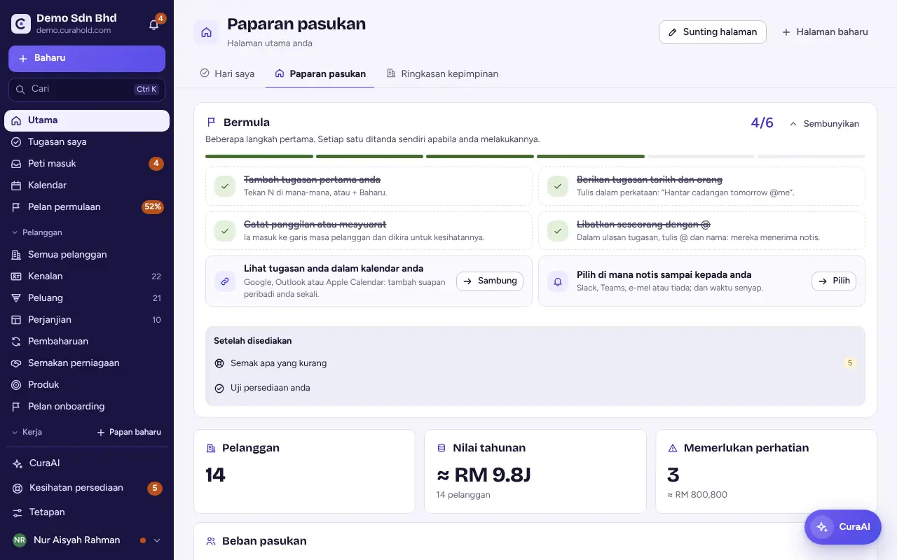

# Bermula

Curahold ialah tempat pasukan kejayaan pelanggan dan pasukan akaun mengurus pelanggan, pihak berkepentingan dan kerja harian mereka di satu tempat. Halaman ini merangkumi lima belas minit pertama anda.

## Memulakan percubaan

**Cuba percuma** di laman web meminta percubaan dan bukannya membuka syarikat dengan serta-merta: borang ringkas, kod ke e-mel kerja anda, dan kami menjawab, biasanya dalam tempoh satu hari bekerja. Setelah diluluskan, syarikat anda dicipta dan anda menerima pautan log masuk; lihat [Pelan dan pengebilan](/docs/ms/billing/) untuk tempoh, pengguna dan peringatan.

## Alamat syarikat anda

Setiap syarikat mempunyai alamatnya sendiri: `yourcompany.curahold.com`. Semua orang dalam pasukan anda log masuk di sana. Data syarikat lain tidak pernah dipaparkan di alamat itu; pengasingan ini dikuatkuasakan dalam pangkalan data itu sendiri.

## Log masuk

- **Pautan e-mel:** taip alamat e-mel anda dan klik pautan yang kami hantar. Tiada kata laluan.
- **Google atau Microsoft:** satu klik, jika syarikat anda menghidupkannya. Pada peranti yang belum pernah kami lihat, kami juga meminta kod 6 digit yang dihantar ke e-mel anda.
- **Kunci laluan:** cap jari, wajah atau PIN peranti anda, selepas log masuk pertama.
- **Langkah kedua:** tambah aplikasi pengesah dalam Tetapan anda → **Keselamatan log masuk**, dengan 10 kod pemulihan. Pentadbir boleh mewajibkan langkah kedua bagi pentadbir atau semua orang.
- Sebelum tindakan sensitif (menukar peranan, kunci API, mengeksport data anda…) anda diminta **Sahkan bahawa ini anda** jika anda belum log masuk dalam sepuluh minit terakhir.
- Sesuatu alamat menerima paling banyak 5 pautan log masuk dalam 15 minit.

## Persediaan pertama

Sesiapa yang mencipta syarikat memilih templat: kejayaan pelanggan, pengurusan akaun, jualan, sokongan atau kosong. Templat membawa medan pelanggan (tarikh pembaharuan, nilai tahunan, kesihatan…), papan dan automasi sedia. Semuanya boleh diubah kemudian.

Kemudian jemput pasukan anda. Jika anda menambah domain e-mel syarikat anda (`@yourcompany.com`), orang daripada domain itu boleh meminta untuk menyertai, atau terus menyertai.

## Hari pertama anda

Kad **Bermula** pada halaman Utama anda menunjukkan beberapa langkah pertama: menambah tugasan pertama, memberikan tarikh dan orang kepada tugasan, mencatat panggilan, membawa seseorang masuk dengan @, melihat tugasan anda dalam kalendar dan memilih di mana notis sampai kepada anda. Setiap langkah ditanda dengan sendirinya apabila anda melakukannya; **Sembunyikan** menyimpan kad itu.

Butang **+ Baharu** di sebelah kiri menambah apa sahaja dari satu tempat: tugasan, pelanggan, nota panggilan atau papan. Apabila anda menulis tugasan, anda boleh meletakkan tarikh, orang dan pelanggan pada baris yang sama; lihat [Tambah pantas dan pintasan](/docs/ms/quick-add/). Menu anda (nama anda di bahagian bawah kiri) mempunyai mod cerah atau gelap, bahasa dan pintasan; **Apa yang baharu** menunjukkan tambahan terkini.

## Bahasa

Curahold bertutur dalam sebelas bahasa: Inggeris, Turki, Arab, Ibrani, Parsi, Cina Ringkas dan Tradisional, Jepun, Korea, Hindi dan Melayu. Bahasa dipilih di salah satu daripada dua tempat:

- **Untuk diri anda:** Tetapan anda → Bahasa. Ia mengikut anda ke setiap peranti.
- **Untuk syarikat:** pentadbir menetapkannya dalam Tetapan → Syarikat. Orang baharu kemudian bermula dalam bahasa itu, dan e-mel kepada seluruh syarikat menggunakannya.

Tiada apa-apa diteka daripada pelayar anda, jadi semua orang yang membuka pautan yang sama melihat perkara yang sama. Tarikh, nombor dan amaun mengikut bahasa yang anda pilih; bahasa Arab, Ibrani dan Parsi dibaca dari kanan ke kiri.

## Had peranti

Seseorang boleh kekal log masuk pada dua peranti serentak; pentadbir boleh menetapkannya antara 1 hingga 5. Log masuk pada satu peranti lagi akan melog keluar peranti yang paling lama. Ini menghalang satu pengguna dikongsi oleh beberapa orang.

> **Petua:** Tetapan anda → Peranti menyenaraikan tempat anda log masuk, dan membolehkan anda log keluar daripada mana-mana satu.

## Pasang pada telefon atau komputer

Curahold dipasang seperti aplikasi, tanpa melibatkan sebarang gedung aplikasi.

- **Android dan komputer (Chrome, Edge):** klik nama anda di bahagian bawah kiri → **Pasang Curahold**. Ikon pasang dalam bar alamat pelayar melakukan perkara yang sama.
- **iPhone dan iPad (Safari):** butang Kongsi → **Add to Home Screen** → Add.

Aplikasi yang dipasang dibuka dalam tetingkapnya sendiri; tekan lama ikonnya untuk pilihan Tugasan saya, Peti masuk dan Pelanggan.

**Tanpa sambungan**, aplikasi masih dibuka dan menunjukkan apa yang terakhir anda lihat: tugasan, papan, pelanggan, peti masuk anda. Jalur di bahagian atas menyatakan anda di luar talian; perubahan tidak boleh disimpan sehingga anda bersambung. Log keluar membuang salinan yang disimpan pada peranti.

**Muat semula langsung:** semasa halaman dibuka, perubahan orang lain (kad baharu, tugasan yang dipindahkan, komen, notis baharu) dipaparkan dengan sendirinya dalam beberapa saat; tidak perlu memuat semula. Tiada apa-apa bergerak di bawah tangan anda semasa anda menaip atau menyeret kad.

## Seterusnya

- [Pelanggan, medan dan rekod](/docs/ms/customers/)
- [Tugasan dan papan](/docs/ms/tasks/)
- [Peranan dan akses](/docs/ms/roles-and-access/)
- [Tambah pantas dan pintasan](/docs/ms/quick-add/)
