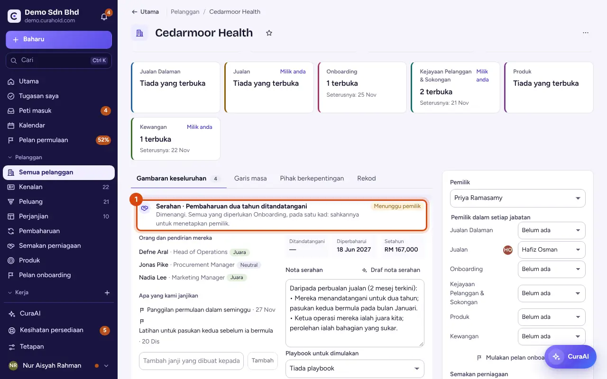
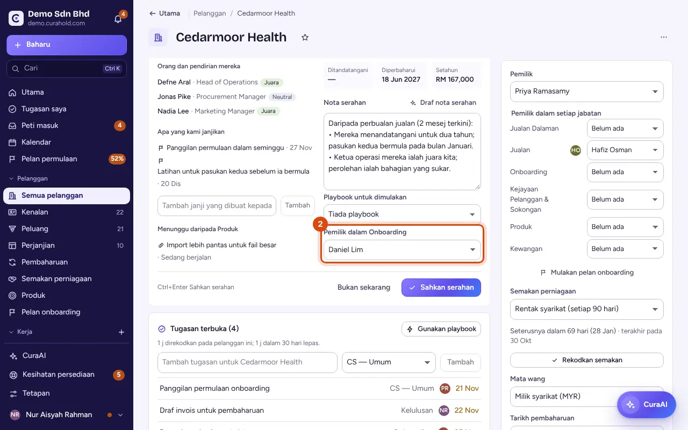
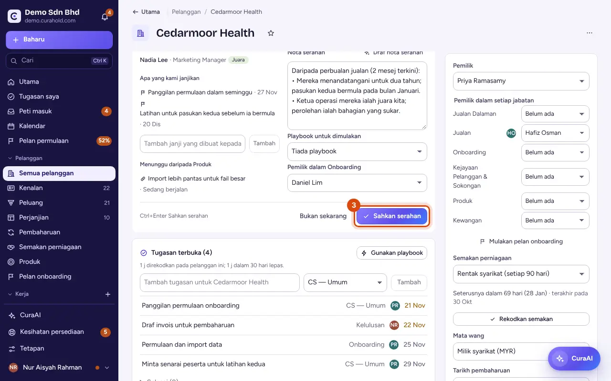
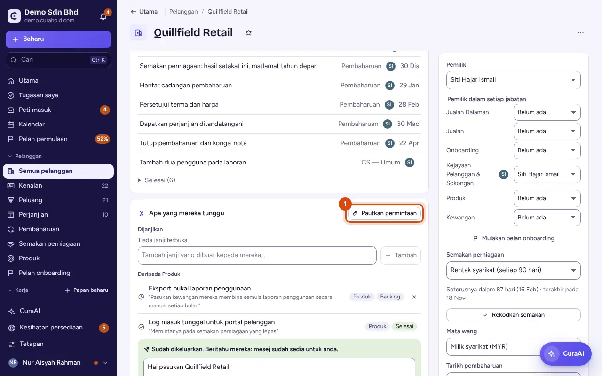
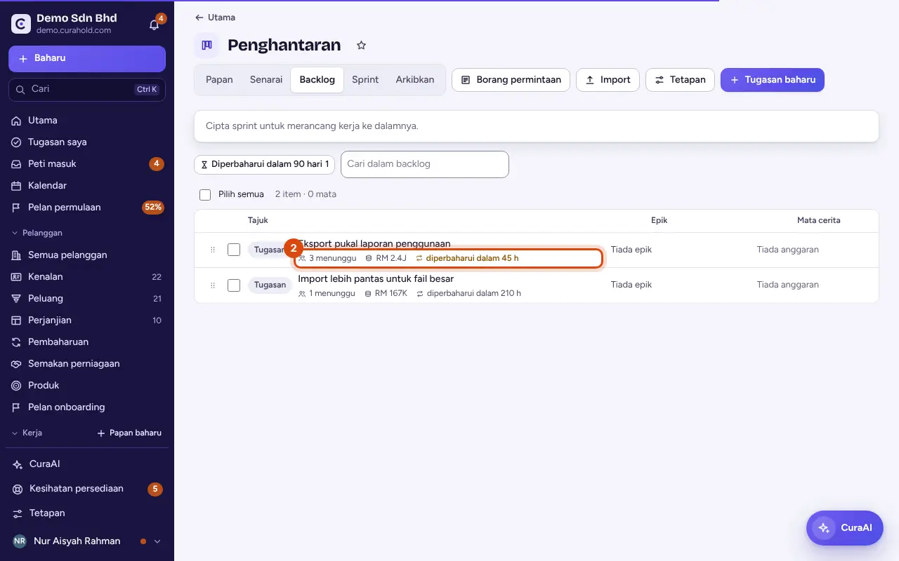
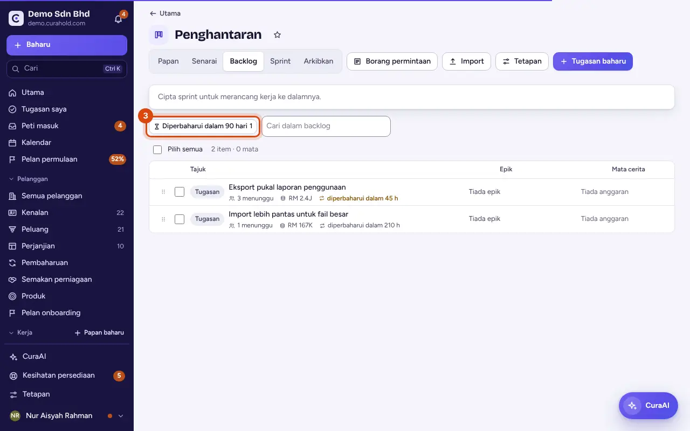
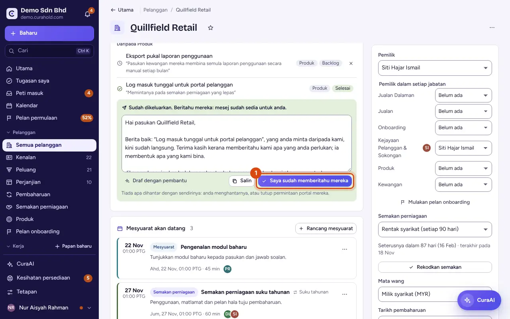
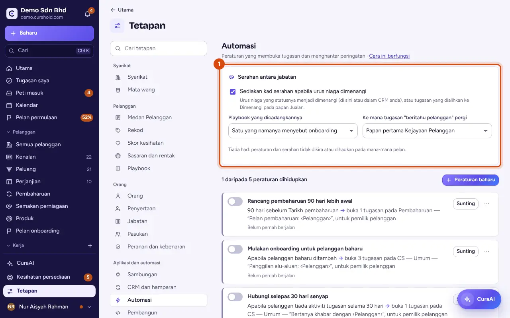

# Serahan, permintaan dan gelung balik

Kerja berpindah dari Jualan ke Onboarding atau Kejayaan Pelanggan, dan daripada pelanggan ke Produk. Curahold menyimpan apa yang diperlukan oleh setiap pasukan pada halaman pelanggan, supaya tiada apa-apa ditaip semula dan tiada sesiapa perlu membuka papan jabatan lain.

## Apabila urus niaga dimenangi {#handover}

Urus niaga yang statusnya menjadi **won** (di sini atau dalam CRM anda), atau tugasan yang dipindahkan ke **Dimenangi** pada papan Jualan, mendapat satu **kad serahan** pada halaman pelanggan. Ia pergi ke **Onboarding** jika syarikat anda mempunyai jabatan itu, jika tidak ke **Kejayaan Pelanggan**.

1. Buka halaman pelanggan. Kad itu berada di bahagian atas **Gambaran keseluruhan**, ditandakan **Menunggu pemilik**. Bacanya: orang-orangnya dan pendirian mereka terhadap anda, apa yang dijanjikan oleh Jualan, apa yang masih ditunggu oleh pelanggan daripada Produk, tarikh, nilai tahunan (jika anda boleh melihat medan itu) dan nota serahan daripada bebenang jualan.
   
2. Dalam **Pemilik dalam …**, pilih siapa yang mengambil alih pelanggan. Semak **Playbook untuk dimulakan** di sebelahnya.
   
3. Klik **Sahkan serahan** (atau tekan Ctrl+Enter, ⌘+Enter pada Mac). Pemilik ditetapkan, playbook bermula, pemilik dimaklumkan, dan garis masa pelanggan merekodkan kedua-dua langkah.
   

**Bukan sekarang** menyimpan kad itu. **Draf nota serahan** meminta pembantu menulis nota; anda membaca dan mengubahnya sebelum apa-apa disimpan.

## Pautkan permintaan pelanggan kepada kerja produk {#requests}

1. Pada halaman pelanggan, di bawah **Apa yang mereka tunggu**, klik **Pautkan permintaan**. Cari kerja Produk, pilih cerita (story), dan tambah apa yang mereka minta dalam kata-kata mereka sendiri jika mahu. Jika tiada yang sesuai, minta Produk untuknya dari tetingkap yang sama.
   

Ramai pelanggan boleh menunggu cerita yang sama; setiap satu dikira. Sesiapa yang boleh melihat pelanggan melihat tajuk kerja, status, tamat sprint dan jabatan, tidak pernah papan Produk.

## Apa yang dilihat oleh Produk {#backlog}

1. Pada papan Produk, buka **Backlog**. Di bawah setiap cerita: berapa ramai pelanggan menunggunya, nilai tahunan mereka (hanya kepada orang yang boleh melihat medan itu) dan pembaharuan yang paling hampir.
   
2. Klik **Diperbaharui dalam 90 hari** untuk melihat hanya kerja yang ditunggu oleh pelanggan yang akan memperbaharui tidak lama lagi, pembaharuan paling hampir dahulu.
   

## Apabila ia dilancarkan {#shipped}

Apabila cerita yang dipautkan selesai, pemilik setiap pelanggan menerima tugasan, dan halaman pelanggan menunjukkan mesej sedia di bawah cerita itu.

1. Baca mesej itu, ubahnya jika mahu, klik **Salin** dan hantarnya daripada e-mel atau sembang anda sendiri. Kemudian klik **Saya sudah memberitahu mereka**. Jika pelanggan bertanya melalui portal, **Tutup permintaan portal mereka** menutupnya di sana juga.
   

**Tiada apa-apa dihantar dengan sendirinya.** Garis masa menyatakan "dibina untuk mereka", dan ringkasan pembaharuan menyenaraikannya.

## Tetapan (pentadbir) {#settings}

1. Buka **Tetapan → Automasi**. Di bawah **Serahan antara jabatan**, pilih sama ada urus niaga yang dimenangi mendapat kad serahan, playbook yang dicadangkan dan ke mana tugasan "maklumkan pelanggan" pergi.
   

## Draf daripada pembantu

Nota serahan, mesej "sudah dilancarkan", serta janji dan langkah seterusnya mesyuarat boleh didrafkan oleh pembantu. Anda membaca dan mengubah setiap draf sebelum apa-apa disimpan, Buat asal menariknya balik, dan tanpa pembantu (atau melebihi had bulanannya) draf itu datang daripada templat.

## Peraturan

Peraturan boleh bermula apabila tugasan ditambah atau diselesaikan, permintaan tiba melalui borang, rekod mencapai sesuatu peringkat atau tiket sokongan dibuka, dan boleh menugaskan, memindahkan, menetapkan medan, memberi komen, menghantar ke webhook anda atau menyediakan serahan. Peraturan tidak pernah dikira atau dihadkan.
