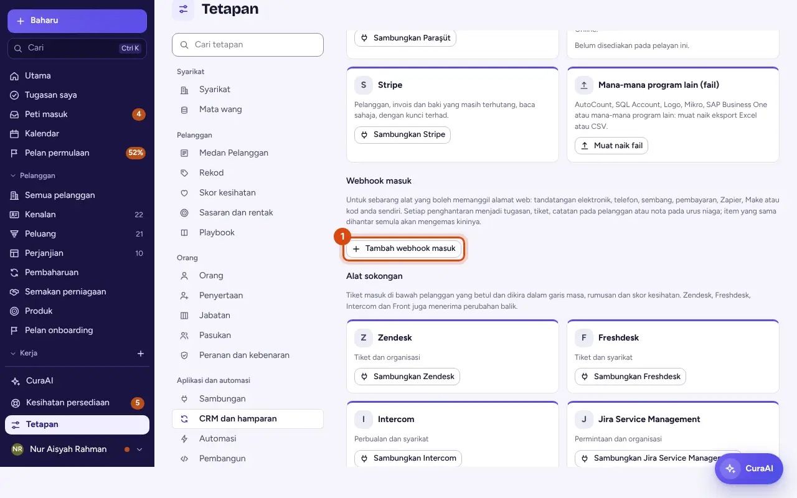
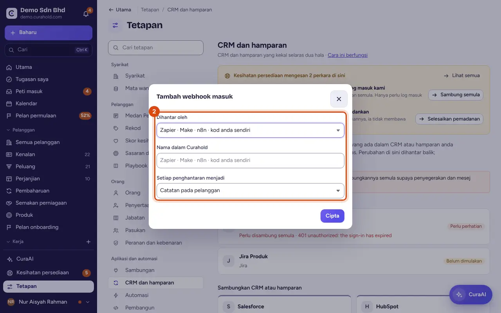
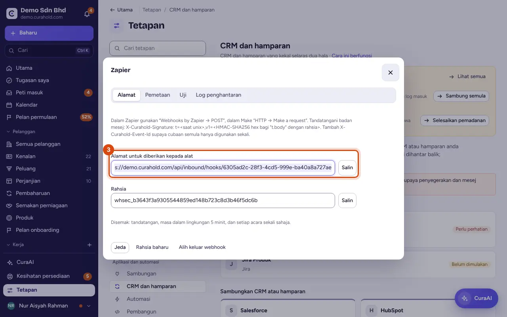
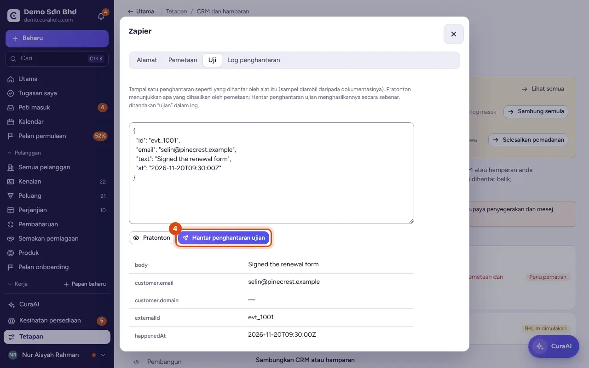
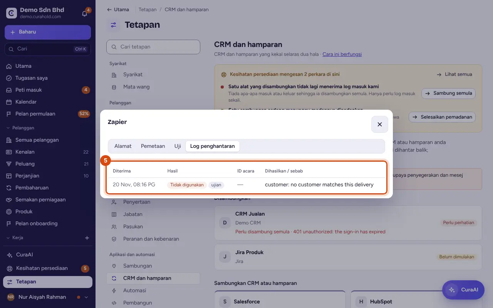

# Webhook masuk

Untuk alat yang belum mempunyai penyambung sedia dalam Curahold. Alat itu menghantar ke alamat anda; setiap penghantaran menjadi **tugasan**, **tiket sokongan**, **catatan pada garis masa pelanggan** atau **nota pada urus niaga**. Item yang sama dihantar semula mengemas kini apa yang telah dihasilkannya. Setiap penghantaran disemak: tandatangan (atau token kongsi), masanya, dan setiap acara digunakan sekali sahaja.

## Dalam Curahold {#connect}

1. Buka **Tetapan → CRM dan hamparan**, tatal ke **Webhook masuk** dan klik **Tambah webhook masuk**.
   
2. Di bawah **Dihantar oleh**, pilih alat itu (atau **Zapier · Make · n8n · kod anda sendiri**), semak **Setiap penghantaran menjadi**, dan klik **Cipta**.
   
3. Pada **Alamat**, salin alamat dan rahsia ke dalam alat itu.
   
4. Pada **Uji**, klik **Pratonton** untuk melihat apa yang dihasilkan oleh pemetaan daripada sampel, kemudian **Hantar penghantaran ujian**.
   
5. Pada **Log penghantaran**, semak setiap penghantaran: digunakan, dilangkau, tidak digunakan (dengan sebabnya) atau ditolak.
   

## Pemetaan

Setiap nilai ialah teks dengan `{{path}}` untuk nilai daripada penghantaran, contohnya `{{data.envelopeSummary.status}}` atau `{{items[0].email}}`. Pelanggan dicari melalui e-mel kenalan, kemudian alamat web, kemudian nama. **ID item dalam alat itu** membolehkan "cipta atau kemas kini" berfungsi. **Gunakan hanya apabila nilai ini…** melangkau acara lain (ia dicatat sebagai dilangkau).

## Resipi sedia ada

| Alat | Ditandatangani dengan | Menjadi |
| --- | --- | --- |
| Tandatangan elektronik (DocuSign Connect; CloudSign, Modusign, Leegality dengan cara yang sama) | `X-DocuSign-Signature-1`, HMAC-SHA256, base64, kunci yang anda buat dalam alat itu | nota pada urus niaga |
| Aircall | token webhook dalam badan mesej | panggilan pada pelanggan |
| Tawk.to | `X-Tawk-Signature`, HMAC-SHA1, hex | tiket |
| Razorpay (iyzico dengan cara yang sama) | `X-Razorpay-Signature`, HMAC-SHA256, hex | catatan pada pelanggan |
| Freshchat, Kylas, Sansan dan apa-apa yang lain | token kongsi (`X-Curahold-Token` atau `?token=`) | pilihan anda |

## Menandatangani sendiri (Zapier, Make, n8n, kod) {#sign}

Hantar `X-Curahold-Signature` dan `X-Curahold-Event-Id`:

```text
X-Curahold-Signature: t=1763631000,v1=<hex HMAC-SHA256 of "1763631000.<raw body>" with the secret>
X-Curahold-Event-Id: evt_1001
```

Dalam kod (Node.js):

```js
const t = Math.floor(Date.now() / 1000);
const v1 = crypto.createHmac('sha256', secret).update(`${t}.${body}`).digest('hex');
fetch(address, { method: 'POST', body, headers: { 'content-type': 'application/json', 'x-curahold-signature': `t=${t},v1=${v1}`, 'x-curahold-event-id': id } });
```

Masa mesti dalam lingkungan 5 minit. ID acara yang berulang dijawab `200` dengan `duplicate` dan tidak digunakan lagi. Jawapan: `200` (dengan `status` ok, skipped atau failed), `401` (tandatangan, masa atau token), `404` (tidak dikenali atau dijeda). Senarai penuh ada dalam rujukan API dokumentasi pembangun.

## Resipi Zapier dan Make untuk alat yang belum mempunyai penyambung

Gunakan pencetus alat itu, kemudian **Webhooks by Zapier → POST** (Zapier) atau **HTTP → Make a request** (Make) ke alamat di atas, dengan dua pengepala itu. Langkah **Custom JS** dalam Make atau **Code** dalam Zapier mengira tandatangan (kod di atas).

| Alat | Pencetus | Medan badan mesej untuk dihantar | Menjadi |
| --- | --- | --- | --- |
| LINE WORKS | Mesej baharu dalam saluran bot | `id`, `email` penghantar, `text` | catatan |
| Chatwork | Mesej baharu dalam bilik | `id`, `email`, `text` | catatan |
| kintone | Rekod ditambah atau diedit | `id`, `email`, `title`, `status` | tugasan |
| Money Forward Cloud | Invois dicipta atau dibayar | `id`, `email`, `text` (nombor, amaun, tarikh akhir) | catatan |
| Channel Talk | Sembang ditutup | `id`, `email`, `title` | tiket |
| KakaoWork | Mesej bot | `id`, `email`, `text` | catatan |
| LeadSquared | Prospek atau peluang dikemas kini | `id`, `email`, `title`, `status` | tugasan |
| Razorpay | Pembayaran diterima | `id`, `email`, `text` | catatan (atau gunakan resipi) |
| DingTalk | Mesej robot | `id`, `email`, `text` | catatan |
| WeCom | Mesej aplikasi | `id`, `email`, `text` | catatan |

## Menyimpan dan mengalih keluar

Log menyimpan 30 hari dan paling banyak 500 penghantaran bagi setiap webhook. **Rahsia baharu** menghentikan rahsia lama serta-merta; **Jeda** menjawab `404` sehingga disambung semula; **Alih keluar webhook** memadamkannya bersama lognya, dan apa yang telah dihasilkannya kekal. Webhook bertindak dengan hak orang yang menyediakannya: ia hanya mencapai papan dan pelanggan yang boleh dicapai oleh orang itu, dan berhenti jika orang itu pergi.

## Apabila penghantaran ditolak atau tidak digunakan {#log}

Tab **Log penghantaran** menyatakan apa yang berlaku pada setiap penghantaran, dalam bahasa anda: tandatangan atau token salah (salin rahsia dari **Alamat** ke dalam alat sekali lagi), dihantar terlalu lama dahulu (penghantaran lama yang diulang juga ditolak begini), nilai yang tidak digunakan oleh webhook ini, tiada pelanggan yang sepadan, atau medan yang kosong (semak **Pemetaan**). Penghantaran yang sama tiba dua kali, seperti cubaan semula daripada Zapier atau Make, disimpan sekali. Papan webhook tugasan boleh ditukar di **Pemetaan** di bawah **Papan**: alamatnya kekal, jadi tiada apa yang berubah dalam alat penghantar.

## Lihat juga

- [Sambungan dan CRM](/docs/ms/connections/)
