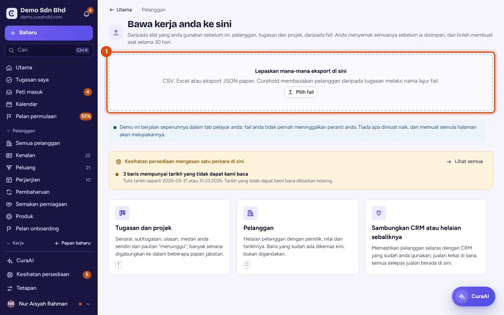
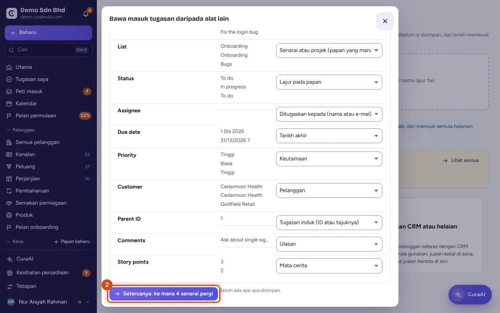
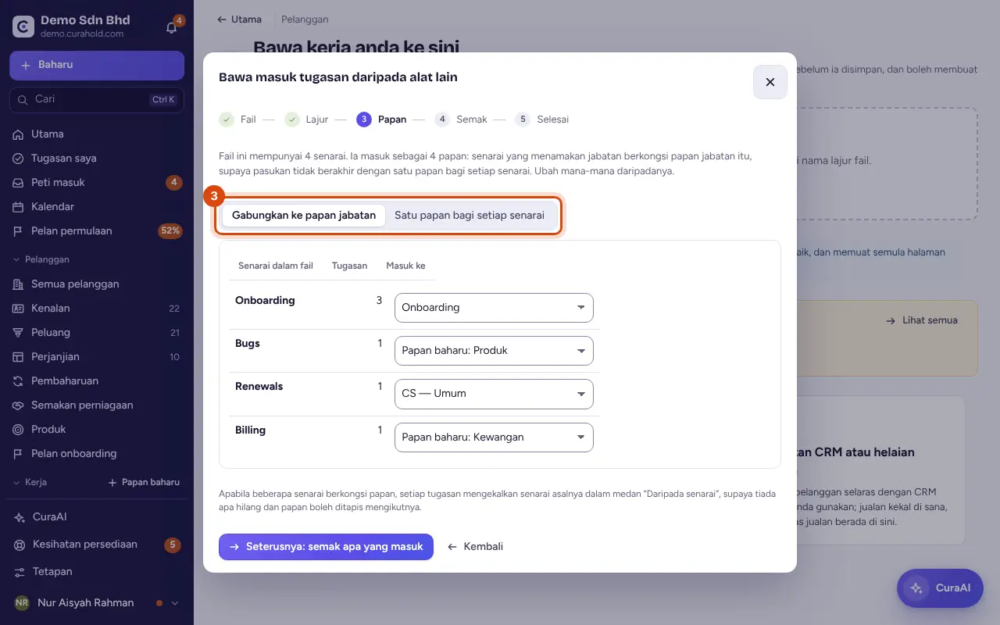
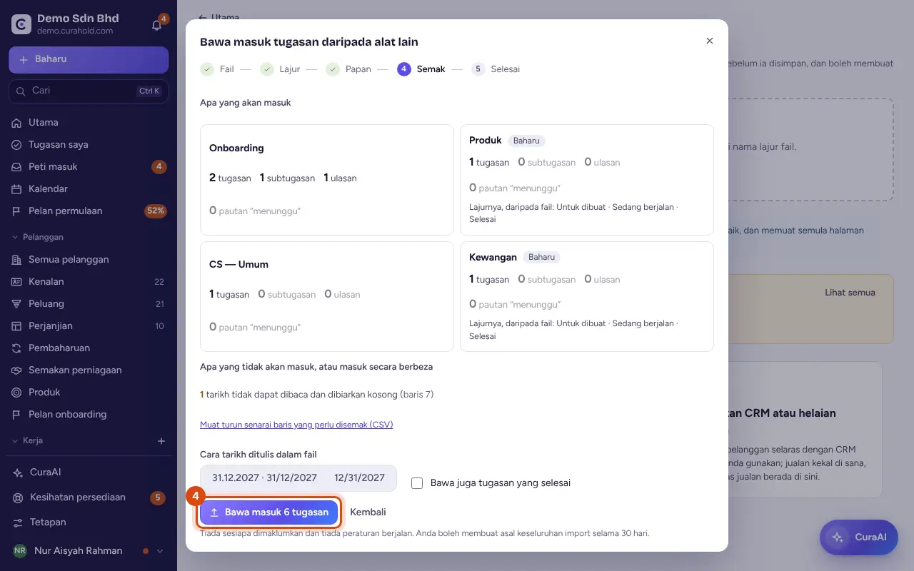
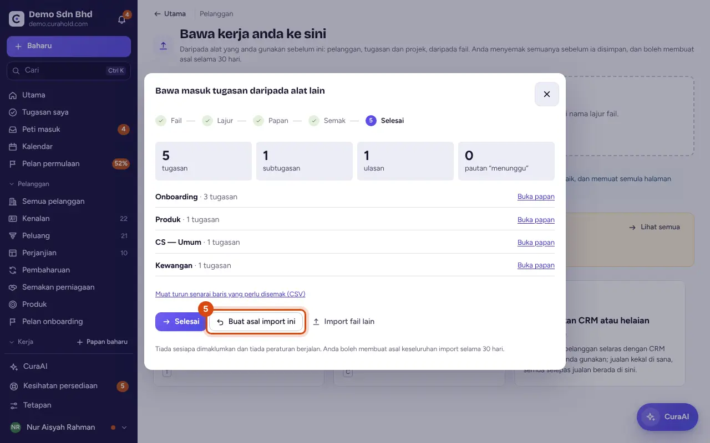

# Berpindah daripada alat lain

Eksport kerja anda daripada alat yang anda gunakan sebelum ini (CSV, helaian Excel (.xlsx) atau eksport JSON papan kanban) dan bawanya masuk daripada fail itu. Tiada apa-apa disimpan sehingga langkah terakhir, tiada sesiapa dimaklumkan dan tiada peraturan dijalankan: ini berpindah rumah, bukan kerja baharu.

## Bawa tugasan anda masuk {#tasks}

1. Buka **Bawa kerja anda ke sini**: taip "import" dalam carian (Ctrl K, atau ⌘ K pada Mac), atau gunakan butang anak panah ke atas pada papan. Lepaskan fail anda pada **Lepaskan mana-mana eksport di sini**, atau klik **Pilih fail**. Curahold membezakan pelanggan dan tugasan berdasarkan nama lajur fail; tekan **T** untuk tugasan atau **C** untuk pelanggan jika mahu memilih sendiri.
   
2. **Lajur.** Setiap lajur fail anda dipadankan dengan tempatnya: tajuk, penerangan, lajur pada papan, orang, tarikh, keutamaan, pelanggan, mata cerita, ID alat lama, tugasan induk, komen, pautan "menunggu", atau medan tersendiri. Nilai pertama menunjukkan apa yang akan menjadi setiap satu. Ubah yang salah, kemudian klik **Seterusnya**.
   
3. **Papan.** Jika fail mempunyai banyak senarai, ia digabungkan ke dalam beberapa papan jabatan: senarai bernama "Renewals" pergi ke Kejayaan pelanggan, "Bugs" ke Produk. Klik **Satu papan bagi setiap senarai** untuk mengasingkannya, atau pilih mana-mana papan untuk mana-mana senarai. Setiap tugasan menyimpan senarai asalnya dalam medan **Daripada senarai**. Klik **Seterusnya: semak apa yang akan masuk**.
   
4. **Semak.** Baca, papan demi papan, berapa banyak tugasan, subtugasan, komen dan pautan yang akan masuk, dan, dengan nombor baris, apa yang tidak akan masuk atau masuk secara berbeza. **Muat turun senarai baris yang perlu disemak (CSV)** jika anda mahu membaikinya dalam fail anda dahulu. Kemudian klik **Bawa masuk … tugasan**.
   
5. **Selesai.** Setiap papan mempunyai pautan **Buka papan**. Jika ada sesuatu yang bukan seperti yang anda mahu, klik **Buat asal import ini**.
   

Curahold memahami baris tajuk di atas pengepala, kumpulan dengan pengepala yang diulang di bawah setiap satu, dan sub-item yang diinden di bawah itemnya.

## Buat asal {#undo}

**Buat asal import ini** berfungsi selama 30 hari, daripada hasil atau daripada **Import terdahulu anda** pada langkah pertama. Tugasan yang tidak disentuh oleh sesiapa masuk ke tong sampah sebagai satu item; tugasan yang telah diubah atau diberi komen sejak itu dikekalkan, dalam arkib papannya. Papan yang dibuat untuk import dan dibiarkan kosong disimpan.

## Templat {#template}

**Muat turun templat** pada langkah pertama memberikan fail dengan setiap lajur yang dibaca oleh Curahold dan tiga baris contoh. Ia dibuka dalam Excel. Baris pertamanya (Region ialah contoh lajur anda sendiri):

```text
ID,Title,Description,List,Status,Assignee,Due date,Priority,Customer,Parent ID,Comments,Depends on,Story points,Region
```

## Dalam demo

Demo berjalan sepenuhnya dalam tab pelayar anda. **Cuba fail anda sendiri** dalam bar demo membuka halaman yang sama: fail anda dibaca dalam tab dan tidak pernah meninggalkan peranti anda, dan memuat semula halaman akan melupakannya.
