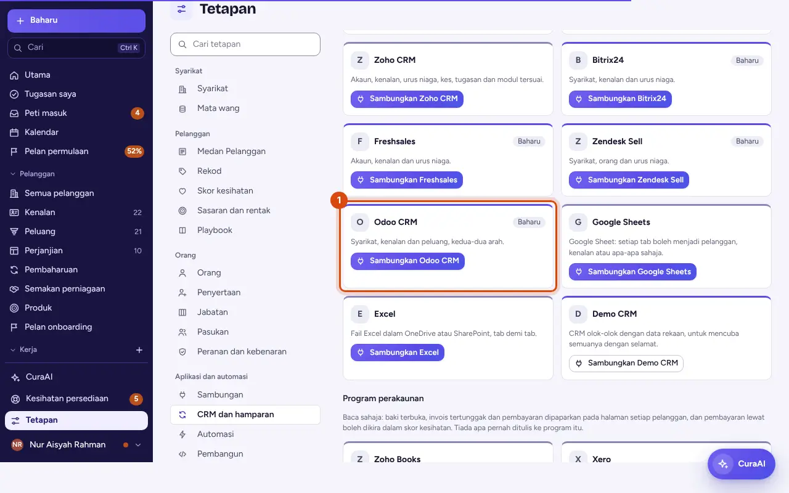

# Odoo CRM

Syarikat, kenalan mereka dan peluang daripada Odoo Online, Odoo.sh atau pelayan anda sendiri, selaras kedua-dua arah: perubahan dalam Odoo tiba dalam masa sejam, perubahan dalam Curahold dihantar balik serta-merta.

## Dalam Curahold {#connect}

1. Buka **Tetapan → CRM dan hamparan** dan klik **Sambungkan Odoo CRM** pada jubinnya.
   

Kemudian isi empat medan dan klik **Semak dan sambung**:

- **Alamat Odoo**, contohnya:

```text
https://yourcompany.odoo.com
```

- **Nama pangkalan data**: hanya pada Odoo.sh atau pelayan anda sendiri yang mempunyai beberapa pangkalan data.
- **Log masuk (e-mel)**: pengguna Odoo yang haknya digunakan oleh Curahold.
- **Kunci API**: lihat di bawah.

Seterusnya, tandakan **Syarikat**, **Kenalan** dan **Peluang**, semak pasangan medan yang dicadangkan dan klik **Mula menyegerakkan**. Peluang dikira dimenangi pada kebarangkalian 100 % dan kalah apabila Odoo mengarkibkannya.

## Dalam Odoo

1. Klik gambar anda (kanan atas) → **Preferences** (dalam Odoo 17 dan ke atas: **My Profile**).
2. Buka **Account Security** dan klik **New API Key**.
3. Taip nama (contohnya `Curahold`), pilih berapa lama ia sah dan klik **Generate key**.
4. Salin kunci itu. Odoo memaparkannya sekali sahaja.

Pada Odoo Online, akses API memerlukan pelan **Custom** (peraturan Odoo). Aplikasi CRM mesti dipasang.

## Had dan masa

Odoo tidak menerbitkan had tetap; Curahold mengehadkan dirinya kepada kira-kira dua permintaan sesaat. Odoo 19 dan ke atas menjawab melalui API JSON-2; versi lebih lama melalui JSON-RPC, yang akan dibuang oleh Odoo dalam versi 20. Dalam Odoo 19, kunci boleh sah paling lama tiga bulan: buat kunci baharu dan sambung semula sebelum ia tamat.

## Konflik, ralat dan memutuskan sambungan

Apabila kedua-dua pihak mengubah medan yang sama, peraturan yang dipilih untuk sambungan itu menentukan (secara lalai, perubahan yang terkemudian). Nilai yang ditolak menunggu pada tab **Status** sambungan dengan mesej Odoo sendiri. Kunci yang dibatalkan atau tamat tempoh menandakan sambungan **Perlu perhatian**: tampal kunci baharu dengan **Sambung semula**; pemetaan kekal. **Buang** memadamkan kunci; pelanggan dan rekod yang sudah dibawa masuk kekal dalam Curahold.

## Lihat juga

- [Sambungan dan CRM](/docs/ms/connections/)
- [Odoo (perakaunan)](/docs/ms/accounting-odoo/)
