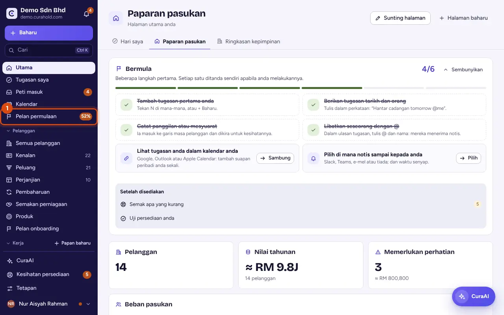
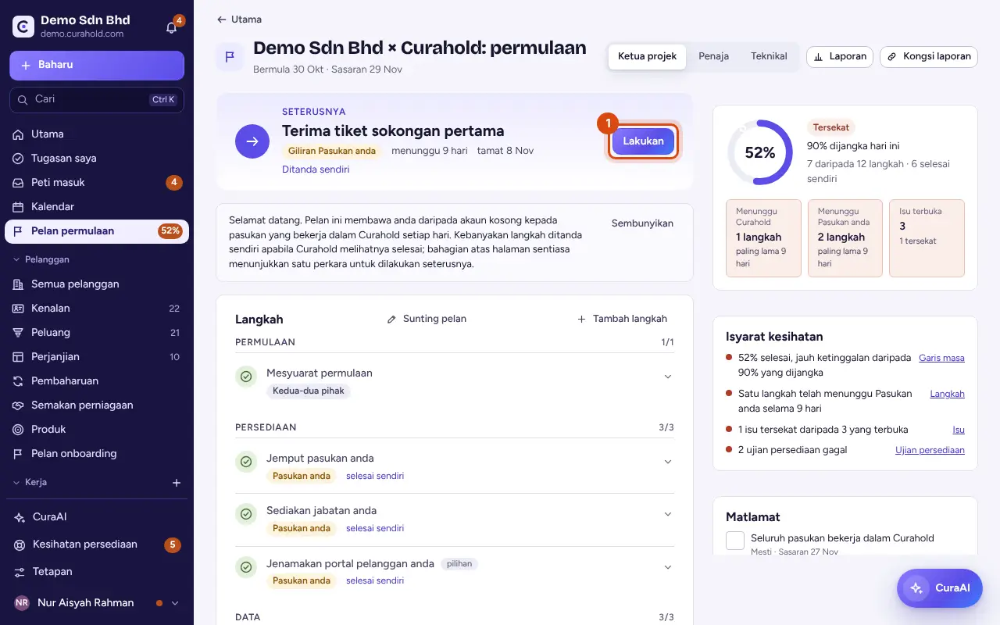
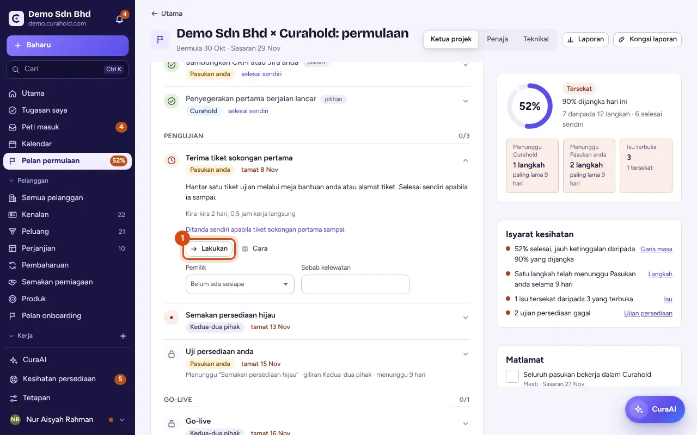
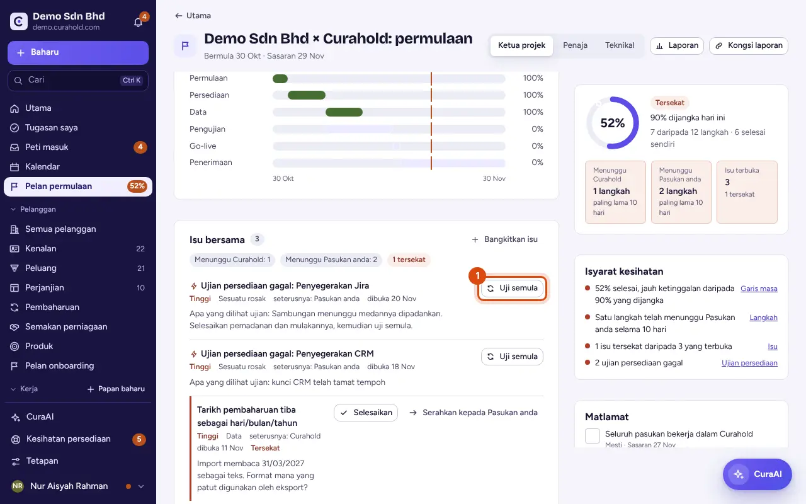
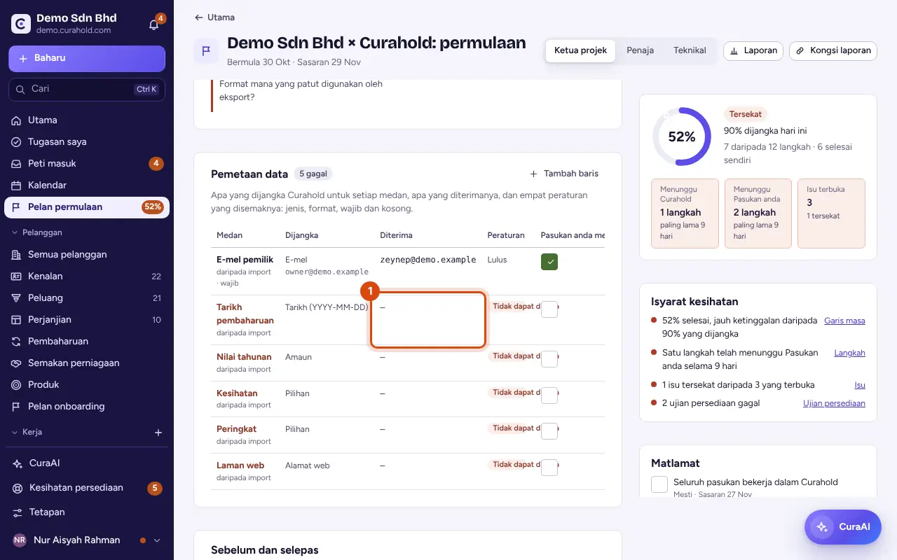
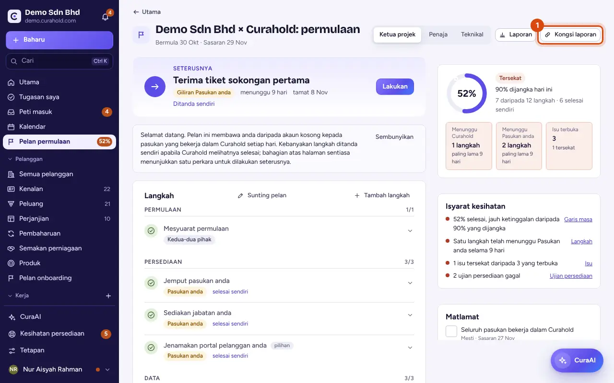
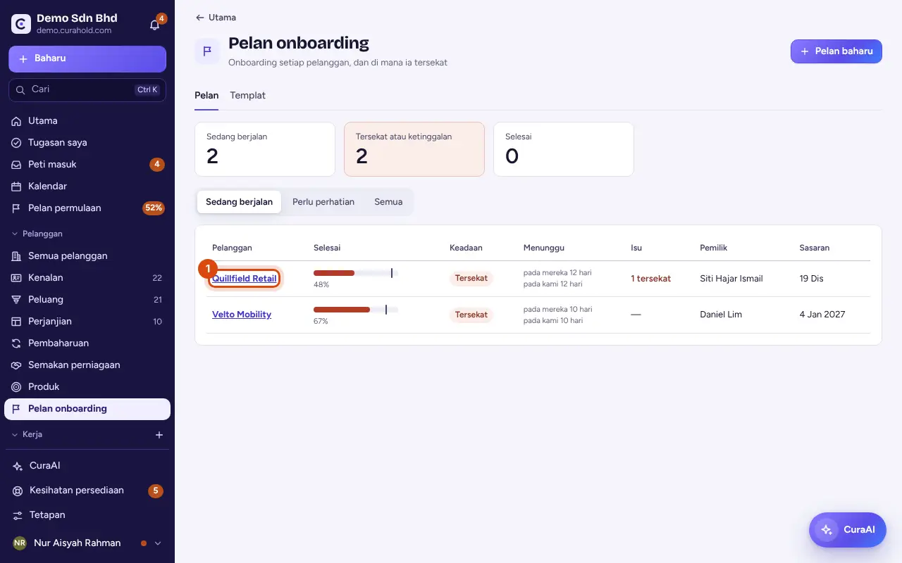
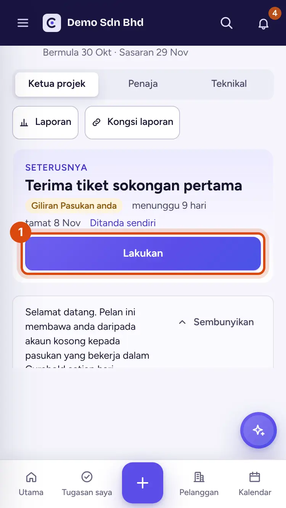

# Pelan onboarding

Pelan onboarding ialah satu halaman yang dikerjakan bersama oleh kedua-dua pihak. Syarikat anda menggunakannya untuk bermula dengan Curahold, dan anda menggunakan pelan yang sama untuk setiap pelanggan yang anda onboard. Kebanyakan langkah ditanda dengan sendirinya apabila Curahold melihatnya selesai; anda hanya menanda secara manual apa yang tidak dapat dilihat oleh Curahold, seperti mesyuarat.

## 1. Buka pelan anda {#start}

Klik **Pelan permulaan** dalam menu kiri. Nombor di sebelahnya menunjukkan berapa banyak yang telah selesai.



Pelan anda berada di alamat syarikat anda sendiri:

```text
https://<your-company>.curahold.com/onboarding
```

## 2. Buat perkara seterusnya {#next}

Kad di bahagian atas sentiasa menunjukkan satu perkara seterusnya yang perlu dibuat untuk melengkapkan persediaan anda, giliran siapa dan berapa lama ia telah menunggu. Klik **Lakukan**: Curahold membuka skrin tempat ia dilakukan.



## 3. Buka langkah {#team}

Klik mana-mana langkah untuk melihat tujuannya, berapa lama masa yang diambil dan sama ada ia ditanda dengan sendirinya. Langkah berkunci menunggu langkah lain; baris di bawahnya menyatakan langkah yang mana dan giliran siapa. Klik **Tandakan selesai** hanya pada langkah yang tidak dapat dilihat oleh Curahold.



Langkah yang ditanda dengan sendirinya: pasukan anda telah dijemput, jabatan telah disediakan, import yang membawa masuk baris, sambungan yang dibenarkan dan larian terakhirnya tanpa ralat, tiket sokongan pertama, portal dihidupkan dengan logo atau warna anda, semakan persediaan hijau dan setiap ujian persediaan lulus.

## 4. Betulkan isu bersama {#health}

Isu bersama ialah soalan dan masalah antara kedua-dua pihak. Setiap isu menyatakan giliran siapa untuk bertindak; isu yang terbuka selama lima hari atau melepasi tarikhnya ditandakan **Tersekat**. Ujian persediaan yang gagal dipaparkan di sini sekali. Klik **Uji semula** selepas anda membetulkannya: apabila ujian lulus, isu itu ditutup dengan sendirinya.



## 5. Semak data anda {#mapping}

Jadual data menunjukkan, bagi setiap medan, apa yang dijangka oleh Curahold, apa yang diterimanya dan empat peraturan yang disemaknya: jenis, format, wajib dan kosong. Baris yang gagal menyatakan peraturan mana yang gagal. Apabila nilainya betul, tandakan kotak di pihak anda.



Tarikh ditulis seperti ini:

```text
2027-03-31
```

## 6. Namakan orangnya {#people}

Di bawah **Orang daripada kedua-dua pihak**, klik **Tambah orang** dan nyatakan peranan mereka. Setiap langkah boleh mempunyai seorang pemilik; Curahold mengingatkan orang itu dalam aplikasi apabila tiba gilirannya, dan sekali lagi jika langkah itu tersekat. Peringatan melalui e-mel dimatikan melainkan pentadbir menghidupkannya.

## 7. Kongsi laporan kemajuan {#report}

Klik **Kongsi laporan** dan salin pautannya. Sesiapa yang memilikinya melihat laporan kemajuan (tiada nota, tiada butiran hubungan). Buka **Laporan** untuk mencetaknya atau menyimpannya sebagai PDF.



## 8. Pelan permulaan pelanggan anda {#customers}

Klik **Pelan onboarding** di bawah Pelanggan. Apabila urus niaga dimenangi, draf pelan dibuka dengan sendirinya bersama nota serahan; ia bermula apabila serahan disahkan. Senarai menunjukkan setiap pelan, sejauh mana kemajuannya, siapa yang ditunggu dan yang mana tersekat. Klik pelanggan untuk membuka pelannya.



Pelanggan anda melihat pelan yang sama dalam portal anda, dalam warna anda: mereka menanda langkah mereka sendiri, mengisi borang ringkas yang terus masuk ke rekod mereka, menyemak baris data mereka dan membangkitkan isu. Apabila selesai, klik **Selesai dan serahkan**: skor kesihatan disimpan sebagai garis dasar dan Kejayaan Pelanggan menerima kad serahan.

## 9. Jadikan pelan pelanggan milik anda {#personal}

Pelan setiap pelanggan ialah salinannya sendiri: ubahnya tanpa menyentuh templat.

1. Dalam **Langkah** pelan, klik **Sunting pelan**.
2. Namakan semula fasa dalam kotaknya, alihkannya dengan anak panah, atau tambah fasa dengan **Tambah fasa**. Fasa yang mengandungi langkah tidak boleh dibuang: alihkan atau buang langkahnya dahulu.
3. Namakan semula langkah dalam kotaknya, alihkannya dengan anak panah, pilih fasa lain untuknya, atau buangnya.
4. Klik **Selesai menyunting**. Untuk menggunakan pelan ini semula, klik **Simpan sebagai templat** dan beri nama.

## 10. Pelan yang dibuka dengan sendirinya {#won}

Pentadbir membuat keputusan dalam **Pelan onboarding → Templat**, di bahagian bawah:

1. Tandakan **Buka pelan onboarding apabila urus niaga dimenangi**. Ia mati sehingga anda menghidupkannya.
2. Pilih templat yang dibukanya, atau **Tanya setiap kali**: draf itu kemudian meminta sesiapa yang mengambil alih pelanggan untuk memilih.
3. Pilihan: tambah peraturan mengikut segmen, pelan atau wilayah (mana-mana medan pelanggan). Peraturan pertama yang sepadan dengan pelanggan memilih templat.

Peringatan sentiasa dipaparkan dalam aplikasi. Setiap orang menentukan dalam tetapan pemberitahuan mereka sendiri sama ada mereka juga menerimanya melalui e-mel.

## Pada telefon

Halaman yang sama, satu lajur: perkara seterusnya dahulu.


