# Kesihatan persediaan dan menguji persediaan anda

Dua skrin membantu anda menyelesaikan persediaan tanpa meneka. **Kesihatan persediaan** memberitahu apa yang tiada atau salah. **Uji persediaan anda** membolehkan anda mencuba segala-galanya seperti yang akan dilakukan oleh pasukan anda. Tiada apa-apa yang diubah untuk anda: setiap pembaikan ialah butang yang membuka skrin yang betul, dan anda melakukan selebihnya.

## Cari apa yang tiada

1. Dalam menu di sebelah kiri, klik **Kesihatan persediaan**. Nombor di sebelahnya menunjukkan berapa banyak perkara yang patut disemak. Ia hilang apabila semuanya betul.
   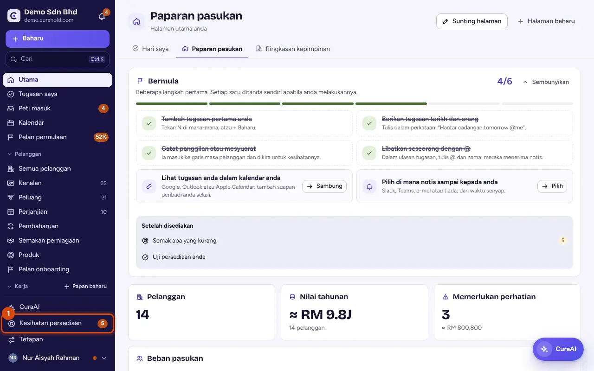
2. Baca baris pertama. Yang paling penting datang dahulu: **Betulkan dahulu**, kemudian **Patut dibetulkan**, kemudian **Apabila anda ada masa**. Setiap baris menyatakan apa yang kami perasan dan mengapa ia penting.
   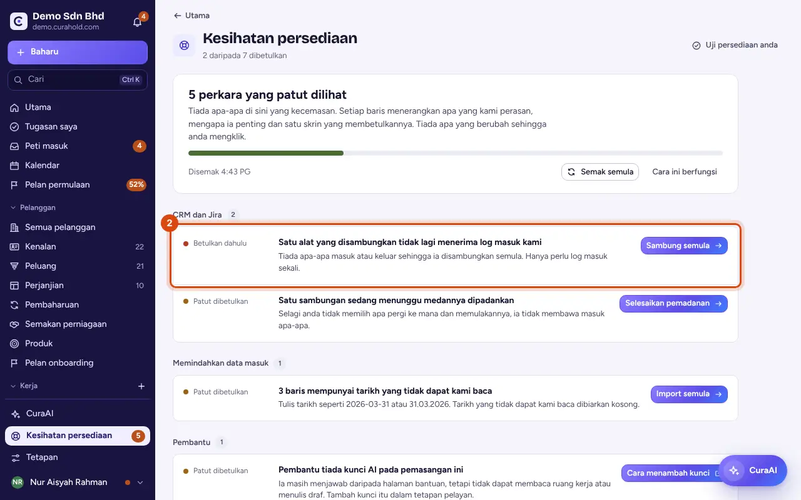
3. Klik butang pada baris itu. Ia membuka skrin tepat di mana anda membaikinya.
   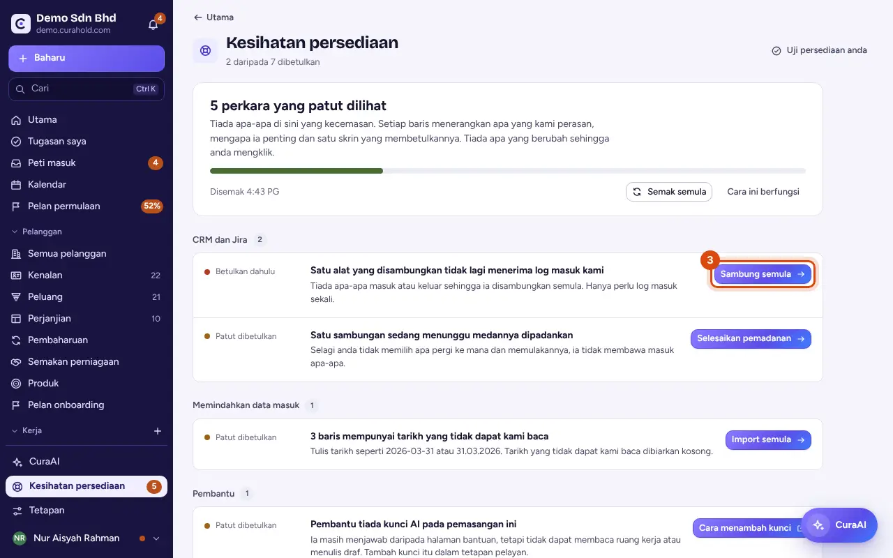
4. Setelah anda membaikinya, kembali dan klik **Semak semula**. Baris itu berpindah ke **Dibaiki**, dan bahagian atas halaman menyatakan berapa banyak yang telah dibaiki.
   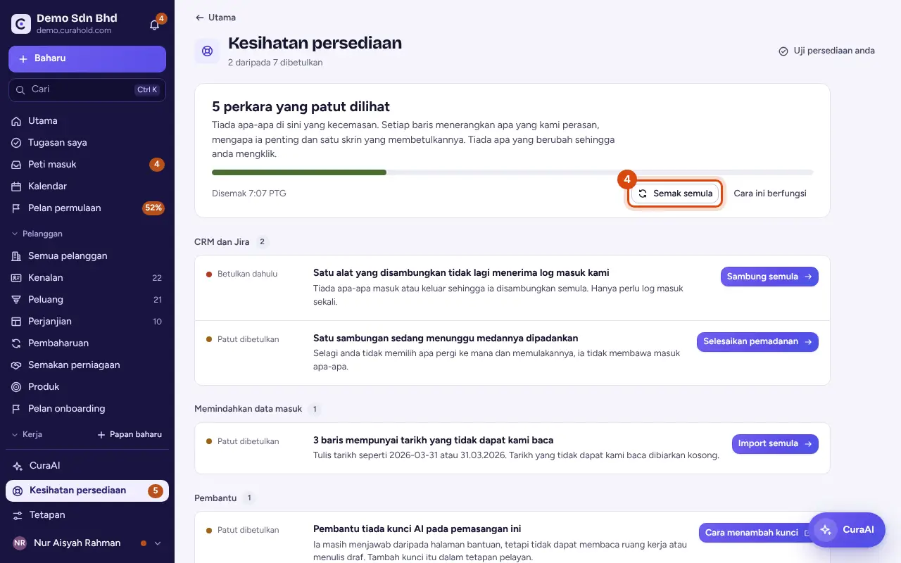
5. Anda juga melihat masalah pada skrin yang membaikinya, dalam kotak kuning di bahagian atas. Klik **Lihat semua** untuk membuka senarai penuh.
   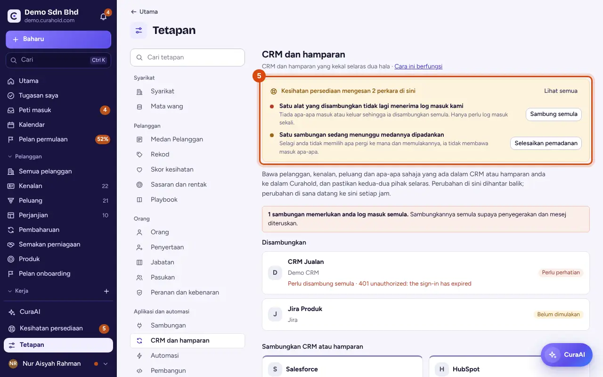

Sesetengah perkara tidak dapat kami baca dari sini, seperti rekod SPF, DKIM dan DMARC domain mel anda. Tambahkannya, kemudian klik **Saya sudah lakukan** pada baris itu.

Setiap orang hanya melihat apa yang boleh dibaikinya. Pentadbir melihat segala-galanya tentang syarikat; orang yang menjalankan pelayan Curahold juga melihat mel dan kunci AI. Kami menyemak semula sekali sehari dan menandakan apa-apa yang baharu.

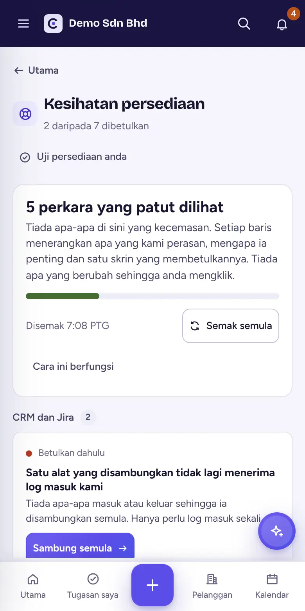

## Tanya pembantu

Buka pembantu dan tanya, perkataan demi perkataan:

```text
Apa yang tidak kena dengan persediaan saya?
```

Ia menyenaraikan masalah yang sama bersama butangnya. Ia hanya membaca; ia tidak pernah membaiki apa-apa sendiri.

## Uji persediaan anda

1. Pada **Kesihatan persediaan**, klik **Uji persediaan anda** di bahagian atas kanan.
   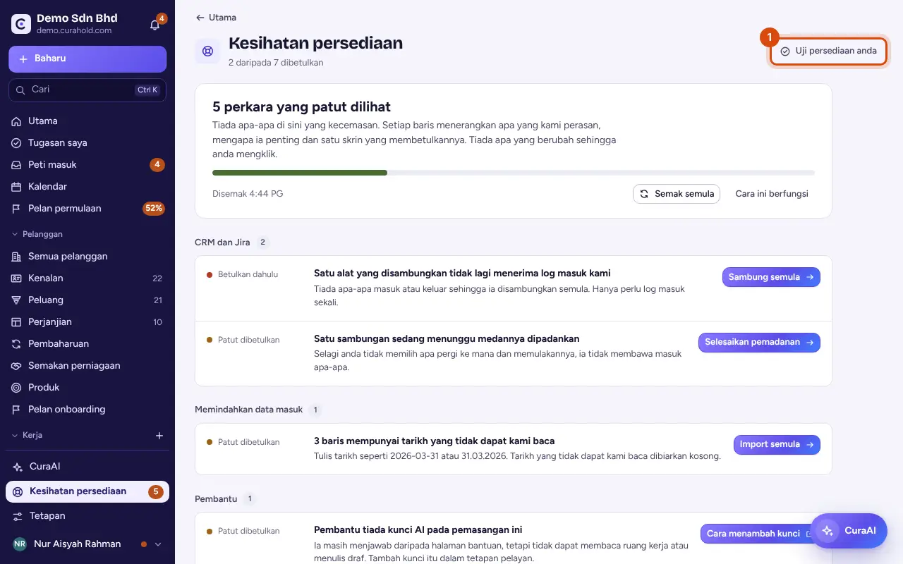
2. Klik **Uji** pada sesuatu langkah. Langkah yang anda semak dengan mata sendiri mempunyai **Ia berjaya** dan **Ia tidak berjaya** sebaliknya. Di mana langkah bertanya apa yang hendak dicuba (pelanggan, sambungan, rakan sekerja), pilih sekali: ia disimpan untuk percubaan seterusnya.
   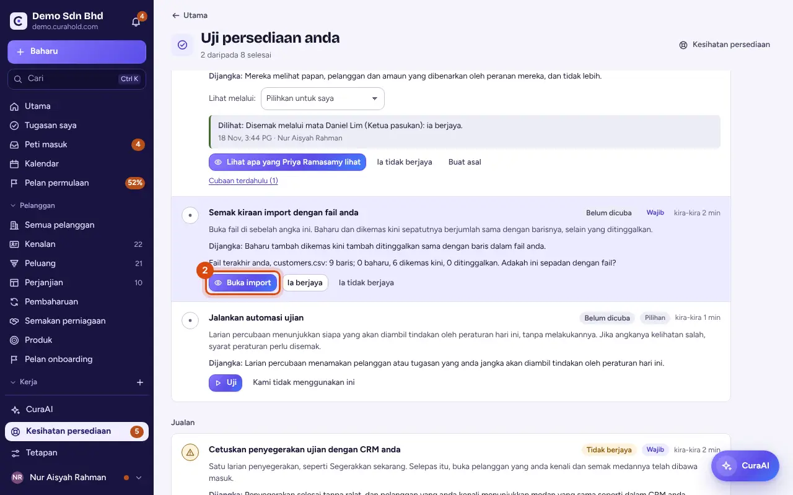
3. Bandingkan **Dilihat** dengan **Dijangka**. Jika sepadan, langkah itu lulus. Setiap percubaan disimpan bersama siapa yang menjalankannya dan bila, jadi anda boleh menguji semula bila-bila masa.
   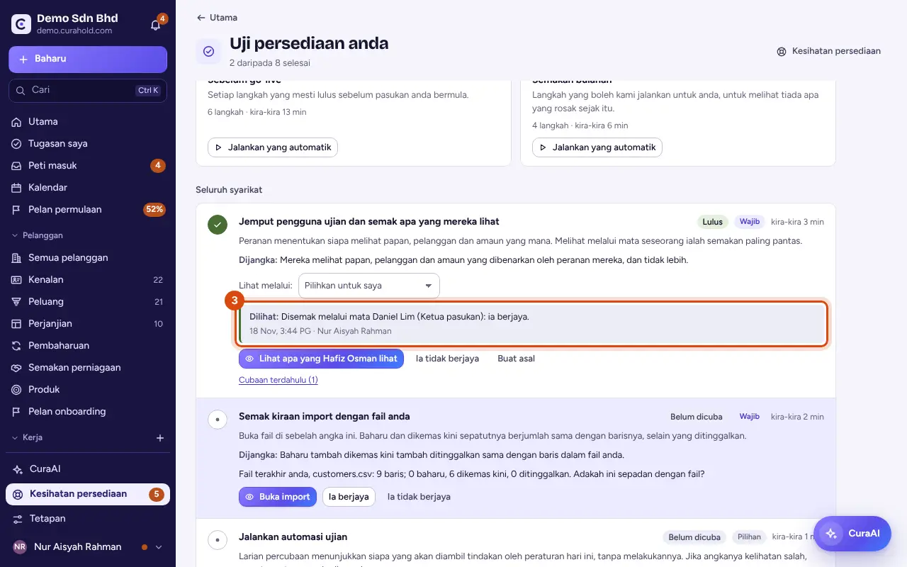
4. Jika ia tidak berjaya, klik **Buka skrin yang membaikinya**, baikinya dan uji semula. Jika anda perlukan bantuan, klik **Buka isu**: isu itu kekal bersama langkah dan ditutup dengan sendirinya apabila langkah itu lulus.
   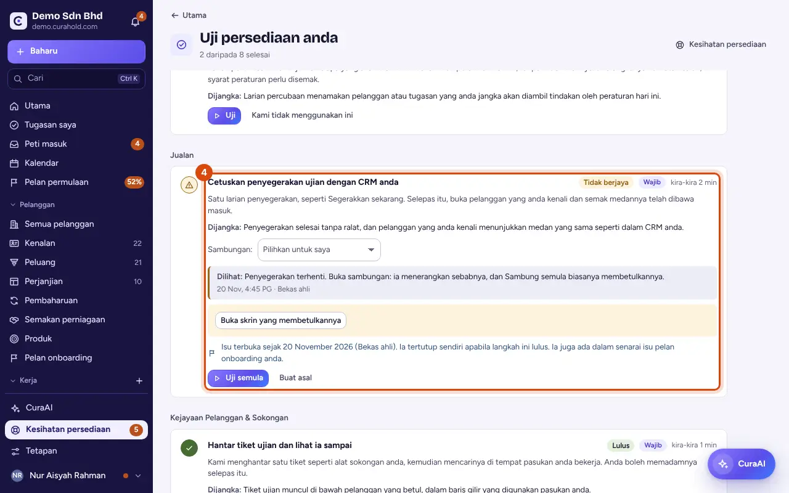
5. Untuk menjalankan beberapa sekali gus, pilih satu himpunan: **Sebelum go-live** atau **Semakan bulanan**, kemudian **Jalankan yang automatik**.
   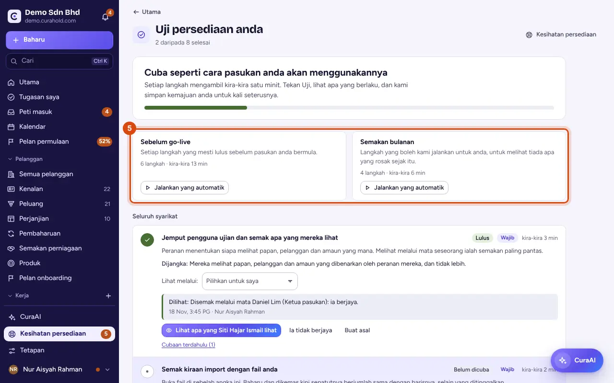
6. Apabila setiap langkah **Wajib** telah lulus, pentadbir syarikat anda mengklik **Luluskan**, kemudian seseorang daripada Curahold juga. Halaman kemudian menyatakan **Persediaan selesai**, bersama tarikhnya.
   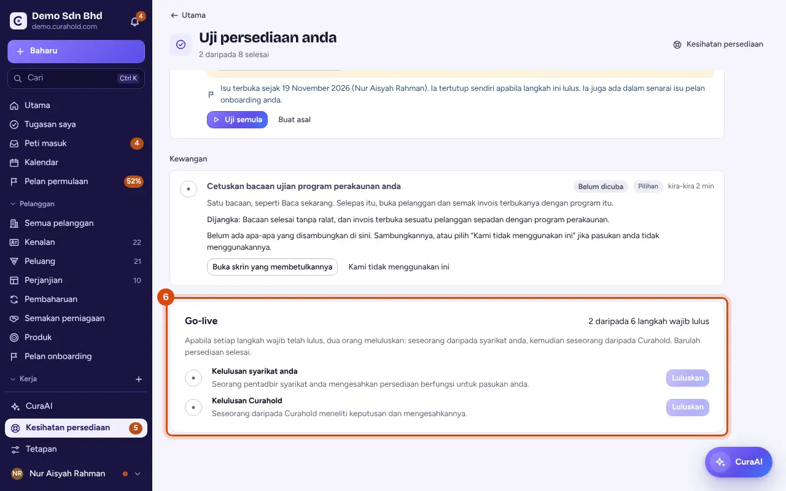

## Maksud setiap semakan

Jadual ini ditulis daripada kata-kata produk itu sendiri, jadi ia sentiasa sepadan dengan skrin.

<!-- setup-checks:start (scripts/docs/setup-health-page.ts writes this part) -->

### Pasukan

| Apa yang kami perasan | Mengapa ia penting | Butang |
| --- | --- | --- |
| Setakat ini hanya anda di sini (Betulkan dahulu) | Tugasan, serahan dan peringatan perlu ditujukan kepada seseorang. Jemput orang yang akan bekerja dalam Curahold. | **Jemput orang** |
| … jemputan belum diterima selama lebih seminggu (Apabila anda ada masa) | Mereka mungkin terlepas e-mel itu. Hantar sekali lagi, atau semak alamatnya. | **Lihat jemputan** |
| … peranan tidak dipegang oleh sesiapa (Apabila anda ada masa) | Peranan yang tidak dipegang sesiapa tidak berbuat apa-apa. Berikan kepada orang yang betul, atau buang supaya senarai kekal kemas. | **Buka peranan** |

### Jabatan

| Apa yang kami perasan | Mengapa ia penting | Butang |
| --- | --- | --- |
| Jabatan belum disediakan (Patut dibetulkan) | Papan, serahan dan siapa melihat apa mengikut jabatan. Letakkan setiap orang dalam jabatan masing-masing. | **Sediakan jabatan** |
| … jabatan tiada ketua (Patut dibetulkan) | Hanya ketua boleh membuka papan jabatan, dan serahan kepada jabatan pergi kepada ketuanya. | **Pilih ketua** |

### Memindahkan data masuk

| Apa yang kami perasan | Mengapa ia penting | Butang |
| --- | --- | --- |
| … baris daripada import terakhir anda tidak masuk (Patut dibetulkan) | Ada sesuatu dalam baris itu yang tidak dapat dibaca. Skrin import menyenaraikannya bersama nombor baris. | **Buka import** |
| … baris daripada import terakhir anda tiada nama pelanggan (Patut dibetulkan) | Nama ialah satu-satunya lajur yang diperlukan oleh setiap baris. Isikannya dalam fail dan import semula: baris yang sudah ada akan dikemas kini, bukan digandakan. | **Import semula** |
| … baris mempunyai tarikh yang tidak dapat kami baca (Patut dibetulkan) | Tulis tarikh seperti 2026-03-31 atau 31.03.2026. Tarikh yang tidak dapat kami baca dibiarkan kosong. | **Import semula** |
| … baris mempunyai amaun yang tidak dapat kami baca (Patut dibetulkan) | Gunakan digit sahaja, seperti 12500 atau 12.500,00, dengan mata wang dalam lajurnya sendiri. Amaun itu dibiarkan kosong. | **Import semula** |
| … pelanggan muncul dua kali (Apabila anda ada masa) | Tugasan dan nota terbahagi antara dua salinan. Simpan satu dan gabungkan yang satu lagi ke dalamnya. | **Tunjukkan** |

### CRM dan Jira

| Apa yang kami perasan | Mengapa ia penting | Butang |
| --- | --- | --- |
| Satu alat yang disambungkan tidak lagi menerima log masuk kami (Betulkan dahulu) | Tiada apa-apa masuk atau keluar sehingga ia disambungkan semula. Hanya perlu log masuk sekali. | **Sambung semula** |
| Penyegerakan terakhir dengan … alat tidak selesai (Betulkan dahulu) | Perubahan yang dibuat sejak itu sedang menunggu. Halaman sambungan menerangkan apa yang menghentikannya. | **Lihat apa yang berlaku** |
| Satu webhook masuk tidak menggunakan apa-apa selama sehari (Patut dibetulkan) | Setiap penghantaran ditolak (rahsia salah) atau tidak dapat digunakan (tiada pelanggan yang sepadan, kandungan yang berubah). Lognya menunjukkan yang mana satu. | **Buka webhook masuk** |
| WhatsApp sudah disambungkan tetapi tiada mesej yang tiba (Patut dibetulkan) | Selepas sehari, ini biasanya bermakna alamat panggil balik dan token pengesahan belum disimpan dalam aplikasi Meta, atau “messages” belum dilanggan. | **Buka sambungan** |
| Satu sambungan sedang menunggu medannya dipadankan (Patut dibetulkan) | Selagi anda tidak memilih apa pergi ke mana dan memulakannya, ia tidak membawa masuk apa-apa. | **Selesaikan pemadanan** |
| … perubahan tidak dapat dihantar ke alat yang satu lagi (Patut dibetulkan) | Kami telah mencuba tiga kali. Halaman sambungan menunjukkan setiap satu dan sebabnya, dan boleh mencuba lagi. | **Semak semula** |
| … kunci API berhenti berfungsi dalam dua minggu (Patut dibetulkan) | Apa-apa yang menggunakannya akan berhenti menghantar. Buat kunci baharu dan pasangkannya sebelum itu. | **Buka kunci API** |
| … perubahan telah ditulis ganti oleh alat yang satu lagi minggu ini (Apabila anda ada masa) | Kedua-dua pihak mengubah perkara yang sama. Tiada apa yang hilang: nilai yang diganti ada dalam sejarah setiap tugasan. Pastikan peraturan sambungan itu yang anda mahu. | **Semak peraturan** |

### Perakaunan

| Apa yang kami perasan | Mengapa ia penting | Butang |
| --- | --- | --- |
| Program perakaunan anda tidak dapat dibaca (Betulkan dahulu) | Invois dan bayaran pada halaman pelanggan kekal seperti bacaan berjaya yang terakhir. | **Buka sambungan** |
| Perakaunan tidak dibaca selama dua hari (Patut dibetulkan) | Invois tertunggak mungkin tidak terkini. Baca sekarang, atau semak mengapa bacaan harian terhenti. | **Buka sambungan** |

### Alat BI

| Apa yang kami perasan | Mengapa ia penting | Butang |
| --- | --- | --- |
| … kunci analitik berhenti berfungsi dalam dua minggu (Patut dibetulkan) | Laporan dalam alat BI anda akan berhenti dimuat semula. Tukar kunci dan tampal kunci baharu di sana. | **Buka kunci analitik** |
| Alat BI anda tidak menarik data selama seminggu (Apabila anda ada masa) | Papan pemukanya menunjukkan angka minggu lepas. Semak muat semula berjadualnya, atau kunci yang digunakannya. | **Buka kunci analitik** |

### Semakan portal pelanggan

| Apa yang kami perasan | Mengapa ia penting | Butang |
| --- | --- | --- |
| Portal pelanggan dihidupkan, tetapi tidak menunjukkan apa-apa kepada pelanggan (Patut dibetulkan) | Kongsi sekurang-kurangnya satu papan dengan portal supaya pelanggan boleh menghantar permintaan dan mengikutinya. | **Pilih apa yang hendak dikongsi** |
| Belum ada sesiapa dijemput ke portal (Apabila anda ada masa) | Pelanggan hanya boleh log masuk setelah dijemput. Jemput satu kenalan di satu pelanggan untuk bermula. | **Jemput pelanggan** |
| Portal masih menggunakan warna Curahold (Apabila anda ada masa) | Logo dan warna anda memberitahu pelanggan bahawa mereka berada di tempat yang betul. | **Tambah jenama anda** |

### Automasi

| Apa yang kami perasan | Mengapa ia penting | Butang |
| --- | --- | --- |
| … automasi menggunakan medan yang telah dipadam (Betulkan dahulu) | Dalam keadaan ini ia tidak akan dapat berjalan. Pilih medan lain, atau matikan peraturan itu. | **Betulkan peraturan** |
| … automasi menunjuk kepada papan yang sudah tiada (Betulkan dahulu) | Tugasan yang sepatutnya dibuatnya tiada tempat untuk pergi. Pilih papan lain. | **Betulkan peraturan** |
| Belum ada automasi (Apabila anda ada masa) | Satu peraturan, seperti tugasan 60 hari sebelum setiap pembaharuan, menjimatkan satu peringatan setiap kali. Peraturan sedia ada menunggu untuk dihidupkan. | **Lihat peraturan sedia** |

### Semakan pada data anda

| Apa yang kami perasan | Mengapa ia penting | Butang |
| --- | --- | --- |
| … pelanggan tiada pemilik (Patut dibetulkan) | Peringatan mereka tidak sampai kepada sesiapa, dan mereka tiada dalam senarai sesiapa. Berikan setiap satu seorang pemilik. | **Tetapkan pemilik** |
| … urus niaga terbuka tiada peringkat (Patut dibetulkan) | Ia tertinggal daripada saluran jualan dan ramalan. | **Buka urus niaga** |
| … tiket terbuka tidak dijaga oleh sesiapa (Apabila anda ada masa) | Tiket tanpa pemilik tidak berada dalam baris gilir sesiapa. Tugaskan setiap satu, atau tambah peraturan yang melakukannya. | **Buka tiket** |

### Mel

| Apa yang kami perasan | Mengapa ia penting | Butang |
| --- | --- | --- |
| Pemasangan ini belum menghantar e-mel (Betulkan dahulu) | Jemputan, pautan log masuk dan peringatan hanya ditulis ke log pelayan. Sediakan geganti mel atau penyedia mel. | **Cara menyediakan mel** |
| Sahkan rekod SPF, DKIM dan DMARC domain mel (Patut dibetulkan) | Tanpanya, jemputan masuk ke spam atau ditolak. Kami tidak dapat membaca DNS anda dari sini: tambah rekod itu, kemudian sahkan. | **Lihat rekod** |

### Privasi

| Apa yang kami perasan | Mengapa ia penting | Butang |
| --- | --- | --- |
| Tiada sesiapa boleh menjawab permintaan data peribadi (Patut dibetulkan) | Di bawah KVKK dan GDPR, seseorang mesti boleh mengeksport atau memadam data seseorang. Berikan kebenaran privasi kepada satu peranan. | **Buka peranan** |

### Percubaan dan pelan

| Apa yang kami perasan | Mengapa ia penting | Butang |
| --- | --- | --- |
| Percubaan anda tamat pada … (Patut dibetulkan) | Selepas itu ruang kerja hanya boleh dibaca sehingga pelan dipilih. Tiada apa yang dipadam. | **Pilih pelan** |
| Kuota pengguna percubaan sudah penuh (Patut dibetulkan) | Orang baharu hanya boleh menyertai sebagai pemerhati. Minta lebih banyak pengguna penuh, atau lepaskan satu. | **Lihat pengguna** |

### Pembantu

| Apa yang kami perasan | Mengapa ia penting | Butang |
| --- | --- | --- |
| Pembantu tiada kunci AI pada pemasangan ini (Patut dibetulkan) | Ia masih menjawab daripada halaman bantuan, tetapi tidak dapat membaca ruang kerja atau menulis draf. Tambah kunci itu dalam tetapan pelayan. | **Cara menambah kunci** |

<!-- setup-checks:end -->

## Untuk pembangun

Semakan yang sama ada dalam API, dibaca sebagai pemilik kunci. Letakkan alamat syarikat anda dan kunci anda menggantikan dua contoh:

```bash
curl -H "Authorization: Bearer YOUR_API_KEY" https://your-company.curahold.com/api/setup-health
```

Senarai penuh alamat ada dalam [Rujukan: kesihatan persediaan](/docs/ms/ref-setup/).
