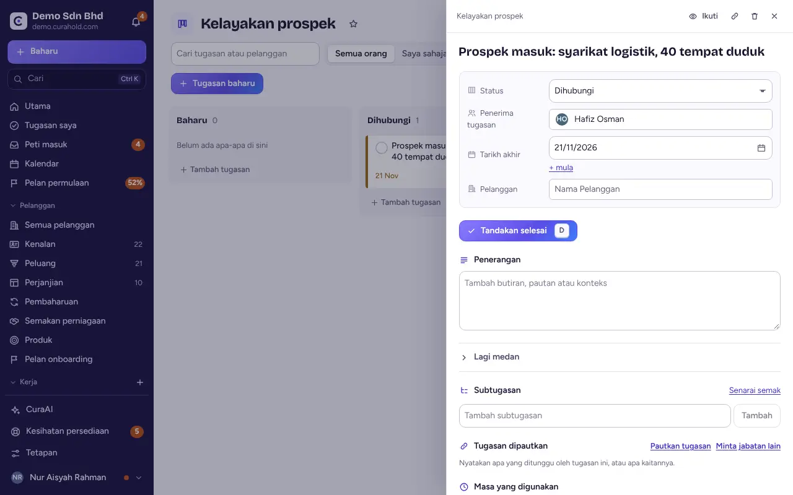

# Tugasan dan papan

Kerja berjalan pada papan. Sesebuah papan milik satu pasukan, seluruh syarikat atau anda sahaja, dan anda memilih lajurnya.

## Tugasan

Tugasan mempunyai tajuk, penerangan, orang (sehingga 10), tarikh akhir, keutamaan dan, jika mahu, pelanggan. Tambah subtugasan, fail dan komen. Tugasan dibuka dalam panel di sebelah papan, dan pautannya berfungsi untuk sesiapa sahaja yang anda hantarkan.

Jalur nipis di sebelah kiri setiap kad menunjukkan kedudukan tugasan berbanding masa: tenang, tidak lama lagi, hari ini, lewat, selesai. Warna yang sama muncul semula dalam kalendar dan dalam Tugasan saya. Tarikh dipilih dengan pemilih tarikh produk itu sendiri, dalam bahasa anda dan mengikut susunan anda menulis tarikh.

## Apabila dua orang mengubah tugasan yang sama

Curahold tidak pernah menulis ganti perubahan sesiapa secara senyap. Jika seseorang menyimpan semasa anda sedang menyunting, perubahannya dikekalkan dan perubahan anda digunakan di atasnya. Anda hanya ditanya apabila medan yang sama benar-benar bercanggah.

## Mengubah banyak sekali gus, dan buat asal

Pilih beberapa tugasan pada papan atau dalam senarai dan ubah status, orang, tarikh atau keutamaannya bersama-sama. Notis di bahagian bawah menawarkan **Buat asal**.

## Tugasan berulang

Jadikan tugasan berulang setiap beberapa hari, minggu atau bulan. Tugasan seterusnya dibuka apabila yang semasa diselesaikan. Tarikh baharu dikira sama ada:

- **Dari tarikh akhir:** untuk kalendar tetap, seperti "laporan pada 1hb setiap bulan".
- **Dari hari ia diselesaikan:** untuk kerja seperti "telefon semula dua minggu selepas panggilan terakhir".

## Sebutan dan senyap

Taip `@` dalam komen untuk menyebut seseorang; mereka dimaklumkan. Jika anda tidak mahu lagi mendengar tentang sesuatu tugasan, pilih **Senyapkan** dalam menunya.

## Carian pantas

Tekan Ctrl K (⌘ K pada Mac) di mana-mana untuk mencari pelanggan, tugasan, orang, papan atau halaman. Bergerak dengan kekunci anak panah, buka dengan Enter.

## Lebih lanjut tentang tugasan

- **Ikuti:** dengan butang di bahagian atas tugasan, dapatkan berita tentang komen dan perpindahan lajur pada tugasan yang bukan milik anda.
- **Tugasan yang dipautkan:** nyatakan bahawa tugasan **menunggu** tugasan lain, **menghalang** tugasan lain, atau **berkaitan dengan** tugasan lain. Tugasan yang menunggu menyatakan "Menunggu 1" pada kadnya; apabila tugasan yang ditunggunya selesai, orangnya menerima notis "Anda boleh mula". Tugasan tidak boleh dibuat saling menunggu dalam bulatan.
- **Tarikh mula:** **+ mula** di sebelah tarikh akhir merekodkan bila kerja bermula; garis masa melukisnya sebagai bar.
- **Masa digunakan:** butang +15 m, +30 m, +1 j, atau secara manual ("1.5", "45m", "1:30"). Halaman pelanggan menunjukkan jumlah yang direkodkan untuk pelanggan itu.
- **Senarai semak:** simpan langkah yang kerap anda gunakan sekali (tambah subtugasan → **Senarai semak → simpan sebagai senarai semak**), kemudian tambahkannya ke mana-mana tugasan dengan satu klik.
- **Sejarah:** siapa mengubah apa dan bila, baris demi baris, di bahagian bawah tugasan.
- **Amaran tugasan serupa:** jika tugasan yang hendak anda tambah kelihatan seperti tugasan yang sudah terbuka, tambah pantas memaklumkannya.

## Medan papan itu sendiri

Tetapan papan → **Medan dan borang permintaan**: tambah medan tambahan pada setiap tugasan dalam papan itu (teks, nombor, wang, tarikh, pilihan, pautan, e-mel, orang, ya/tidak). Medan yang ditandakan **Wajib diisi untuk selesai** mesti diisi sebelum tugasan boleh berpindah ke lajur "selesai"; perubahan pukal melangkau tugasan sebegitu dan menyatakan berapa banyak. Medan pilihan dipaparkan sebagai label berwarna pada kad dan boleh ditapis.

## Penapis dan paparan yang disimpan

**Tapis** di bahagian atas papan mengecilkannya mengikut orang, tarikh akhir (lewat, hari ini, 7 hari…), keutamaan dan medan pilihan papan. Pada telefon, setiap penapis berada bersama pada satu helaian **Tapis**. Namakan penapis yang sedang digunakan dengan **Paparan → Simpan**, dan tunjukkan paparan itu kepada semua orang pada papan jika mahu.

## Borang permintaan

Dalam tetapan papan, hidupkan **Terima permintaan melalui borang** dan pilih apa yang ditanya oleh borang. Rakan sekerja menggunakan butang **Borang permintaan** pada papan; permintaan masuk ke lajur yang anda pilih sebagai tugasan, dan orang yang meminta mengikutinya secara automatik.

## Berpindah daripada alat lain: mengimport tugasan daripada fail

Butang anak panah ke atas di bahagian atas papan (**Import tugasan daripada fail**) menerima fail CSV atau Excel yang anda eksport daripada alat lama anda. Fail dibaca dalam pelayar; tiada apa-apa dihantar sehingga anda melihat lajur mana pergi ke mana.

- Lajur dikenali dengan sendirinya (Title, Description, Status, Assignee, Due date, Start date, Priority, Customer, Completed on; nama Turkinya juga). Ubah mana-mana daripadanya; lajur "Menjadi" menunjukkan bagaimana baris pertama akan masuk.
- **Status** pergi ke lajur papan dengan nama yang sama. Nama biasa seperti "To do", "In progress" dan "Done" juga difahami; selebihnya masuk ke lajur pertama dan disenaraikan dalam hasil.
- **Assignee** dipadankan mengikut nama atau e-mel; orang yang tidak ditemui dikecualikan, dan anda diberitahu siapa. Nama pelanggan dipadankan dengan cara yang sama.
- Tugasan yang selesai dikecualikan melainkan anda menandakan "Bawa juga tugasan yang selesai".
- Tiada sesiapa dimaklumkan dan tiada peraturan dijalankan. Anda boleh **membuat asal** keseluruhan import dalam tempoh 30 hari: tugasan yang tidak disentuh oleh sesiapa dibuang, yang telah dikerjakan oleh seseorang berpindah ke arkib.

Sehingga 5,000 baris pada satu masa.

## Kalendar

**Kalendar** menunjukkan apa yang jatuh pada hari mana: tugasan mengikut tarikh akhirnya, mesyuarat, panggilan dan semakan yang telah diadakan, pembaharuan, dan semakan perniagaan yang akan tiba. Cip di atasnya menghidupkan atau mematikan setiap jenis.

- **Hari, Minggu, Bulan, Tahun:** suis di bahagian atas. Hari menyenaraikan segala-galanya pada hari itu bersama pelanggan dan pemiliknya; tahun menunjukkan dua belas bulan kecil, lebih gelap di tempat yang lebih banyak. Klik nombor hari untuk membuka hari itu.
- **Kalendar siapa:** milik anda, atau semua orang yang boleh anda lihat. Seseorang yang perananya boleh *melihat kalendar rakan sepasukan* (pentadbir dan ketua pasukan pada permulaannya) juga boleh memilih seorang atau seluruh pasukan. Ini mengecilkan apa yang sudah boleh mereka lihat; ia tidak menunjukkan apa-apa yang baharu, jadi papan peribadi kekal peribadi.
- Paparan, hari dan kalendar siapa berada dalam alamat, jadi pautan membuka perkara yang sama.

## Arkib

Tugasan yang selesai berpindah ke **Arkib** papan dengan sendirinya setelah papan menyimpannya cukup lama (90 hari secara lalai; 30–365 hari atau "Sentiasa" dalam tetapan papan). Papan yang telah digunakan bertahun-tahun masih dibuka dengan segera. Tugasan yang diarkibkan terus dikira dalam laporan; carinya dalam paparan **Arkib** di sebelah Papan / Senarai dan kembalikan satu dengan **Bawa balik**. Tugasan yang anda bawa balik kekal pada papan untuk bilangan hari yang sama sekali lagi. Tugasan yang anda arkibkan secara manual daripada paparan senarai juga berada di sini.

## Memadam tugasan, dan mendapatkan semula tugasan yang dipadam

Tugasan yang dipadam masuk ke [tong sampah](/docs/ms/trash/) bersama subtugasan, komen, masa dan failnya, dan boleh dipulihkan dalam tempoh 30 hari: pilih **Buat asal** dalam notis sejurus selepas memadam, atau buka menu anda, pilih **Tong sampah** dan kemudian **Pulihkan**. Hanya orang yang mencipta tugasan boleh memadamnya, atau seseorang yang perananya boleh memadam mana-mana tugasan. Untuk mengetepikan tugasan yang selesai tanpa memadamnya, arkibkannya.
