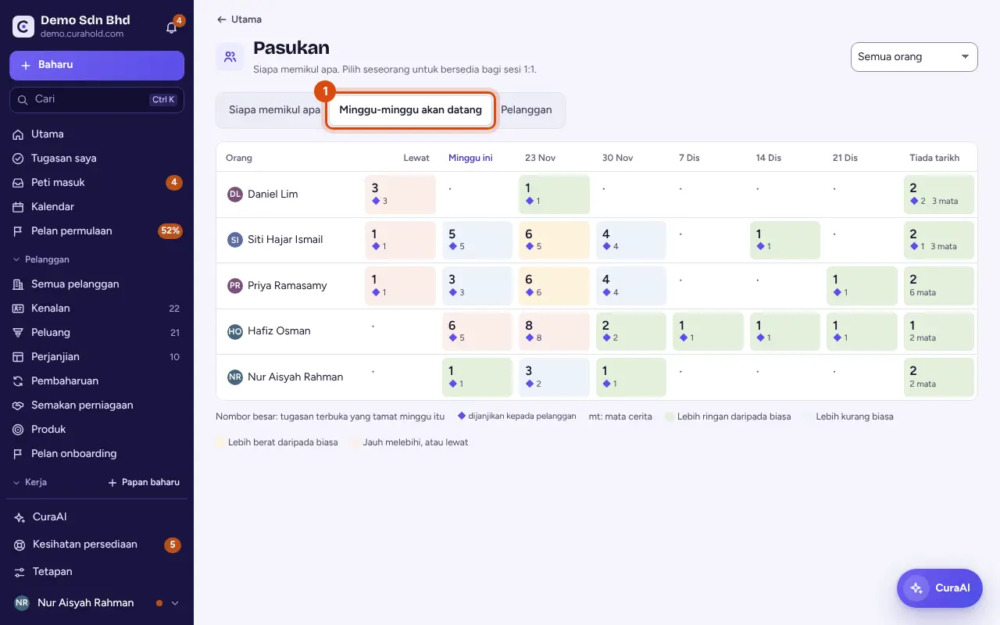
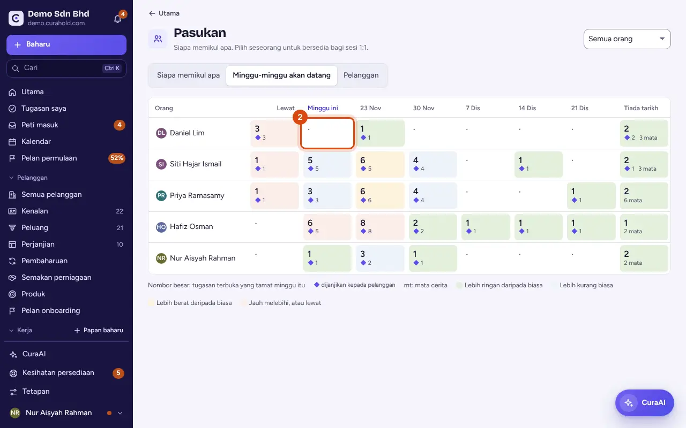
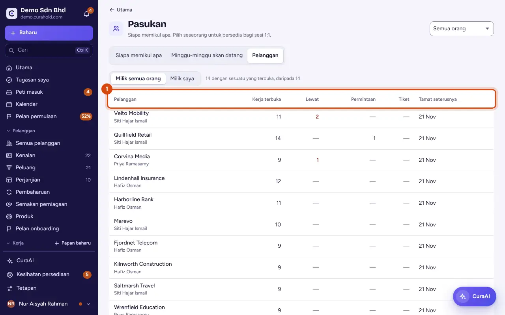
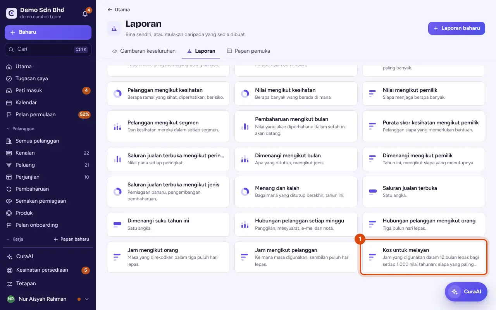

# Minggu pasukan, portfolio pelanggan dan kos untuk melayan

**Pasukan** (dalam menu di sebelah kiri) mempunyai tiga paparan: **Siapa memikul apa**, **Minggu-minggu akan datang** dan **Pelanggan**. Pilih pasukan di bahagian atas kanan untuk mengecilkan mana-mana paparan. Hanya tugasan yang boleh anda lihat dikira.

## Siapa yang ada ruang dalam minggu-minggu akan datang {#weeks}

1. Buka **Pasukan** dan klik **Minggu-minggu akan datang**.
   
2. Baca baris seseorang minggu demi minggu. Dalam setiap sel, nombor besar ialah tugasan terbuka yang perlu disiapkan minggu itu, ◆ berapa banyak daripadanya janji kepada pelanggan, dan **pt** mata cerita (story points) tugasan itu. Warna membandingkan minggu itu dengan beban biasa orang itu: lebih ringan, lebih kurang biasa, lebih berat atau jauh melebihi. **Lewat** dan **Tiada tarikh** mempunyai lajur sendiri. Klik sel untuk membuka paparan 1:1 orang itu.
   

## Kerja terbuka setiap pelanggan {#customers}

1. Buka **Pasukan** dan klik **Pelanggan**. Setiap pelanggan yang ada sesuatu yang terbuka disenaraikan, yang paling sibuk dahulu: kerja terbuka, berapa banyak yang lewat, permintaan yang dihantar oleh orang mereka melalui portal, tiket sokongan yang belum diselesaikan, dan tarikh akhir seterusnya. Klik nama lajur untuk mengisih mengikutnya; tukar antara **Milik semua orang** dan **Milik saya**.
   

Amaun sengaja tidak ditunjukkan di sini: siapa boleh melihat wang ditentukan medan demi medan.

## Kos untuk melayan {#cost-to-serve}

1. Buka **Laporan** dalam menu, klik tab **Laporan**, kemudian **Kos untuk melayan**. Bagi setiap pelanggan, ia menunjukkan jam yang direkodkan pada kerjanya dalam 12 bulan terakhir bagi setiap 1,000 nilai tahunan (ARR, jika tiada MRR × 12, jika tiada medan amaun pertama). Yang tertinggi ialah pelanggan yang paling tinggi kos untuk dijaga.
   

Dua medan disertakan dalam pembina laporan: **Masa direkodkan, 12 bulan terakhir** dan **Jam bagi setiap 1,000 nilai tahunan**. Sesiapa yang tidak boleh melihat nilai pelanggan tidak mendapat angka kos.
