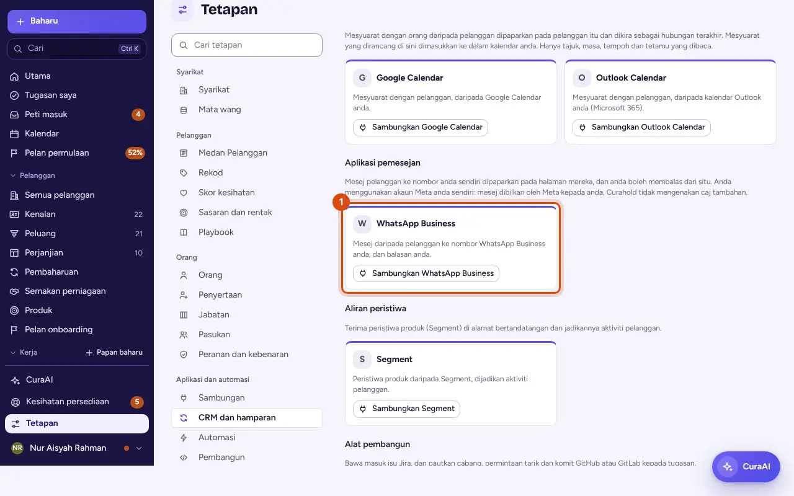
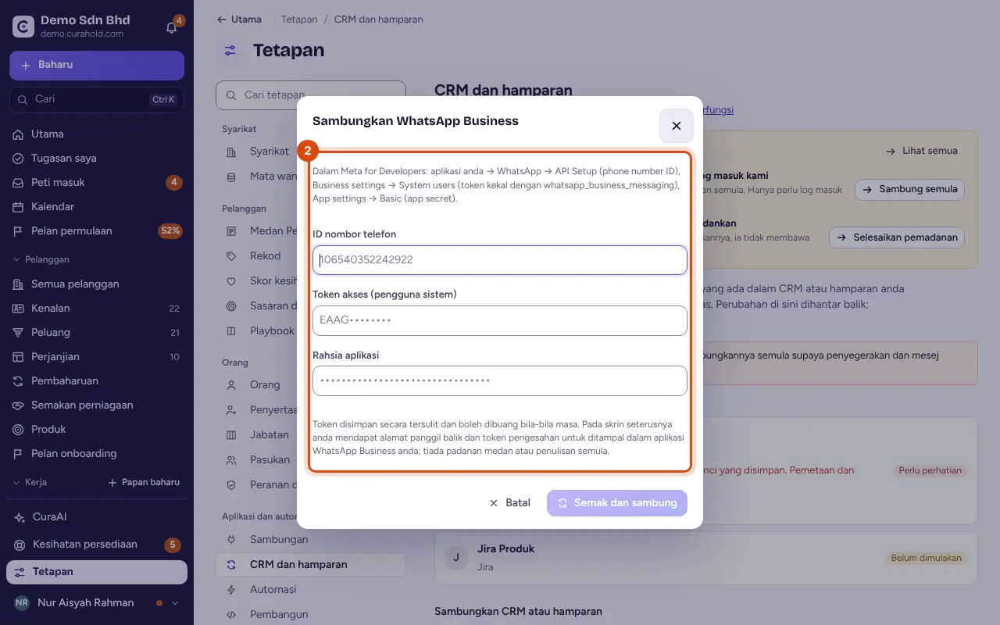

# WhatsApp Business

Mesej yang dihantar pelanggan ke nombor WhatsApp Business anda dipaparkan pada halaman mereka, dan anda membalas dari situ. Anda menggunakan aplikasi Meta dan nombor anda **sendiri**: Meta membilkan mesej kepada anda, Curahold tidak mengenakan caj tambahan dan tidak pernah melihat invois Meta anda.

## Sebelum anda bermula

Anda memerlukan akaun perniagaan Meta dengan nombor WhatsApp Business pada Cloud API, aplikasi Meta dengan produk WhatsApp, dan **system user** dengan token kekal (kebenaran `whatsapp_business_messaging`). Halaman Meta sendiri membimbing anda melaluinya; ia mengambil masa kira-kira 15 minit.

## Dalam Curahold {#connect}

1. Buka **Tetapan → CRM dan hamparan**, cari **Aplikasi pemesejan** dan klik **Sambungkan WhatsApp Business**.
   
2. Tampal tiga nilai di bawah dan klik **Semak dan sambung**. Halaman sambungan kemudian memaparkan **alamat panggil balik** dan **token pengesahan**.
   

- **ID nombor telefon**: Meta for Developers → aplikasi anda → **WhatsApp → API Setup**.
- **Token akses (pengguna sistem)**: Business settings → **System users** → pengguna anda → **Generate new token**.
- **Rahsia aplikasi**: aplikasi anda → **App settings → Basic** → **App secret** → **Show**.

## Dalam Meta

1. Buka aplikasi anda → **WhatsApp → Configuration**. Di sebelah **Webhook**, klik **Edit**.
2. Tampal alamat panggil balik ke dalam **Callback URL** dan token pengesahan ke dalam **Verify token**. Klik **Verify and save**.
3. Di bawah **Webhook fields**, klik **Manage** dan langgan **messages**.

## Apa yang tiba, dan membalas

Mesej tiba sebagai nota pada pelanggan yang kenalannya mempunyai nombor penghantar (bentuk tempatan seperti `012…` juga sepadan). Pada nota itu, klik **Balas di WhatsApp**. WhatsApp membenarkan teks bebas hanya dalam masa 24 jam selepas mesej terakhir pelanggan; selepas itu, Curahold meminta nama dan bahasa **templat** yang diluluskan.

## Had dan masa

Mesej tiba sebaik sahaja Meta menghantarnya. Meta mencuba semula penghantaran yang gagal sehingga 7 hari; setiap mesej disimpan sekali sahaja. Meta mengehadkan kelajuan satu nombor boleh menghantar; jawapan sibuk menyatakannya dan tiada apa yang hilang.

## Jika ada masalah

Token yang tamat tempoh atau dibatalkan kelihatan apabila anda membalas: tampal token baharu dengan **Sambung semula**. Mesej daripada nombor yang tiada pada mana-mana kenalan dikira pada sambungan, tidak disimpan. **Buang** menghentikan panggilan balik serta-merta; nota yang sudah ada pada pelanggan kekal.

## Lihat juga

- [Garis masa dan skor kesihatan](/docs/ms/timeline-and-health/)
- [Sambungan dan CRM](/docs/ms/connections/)
