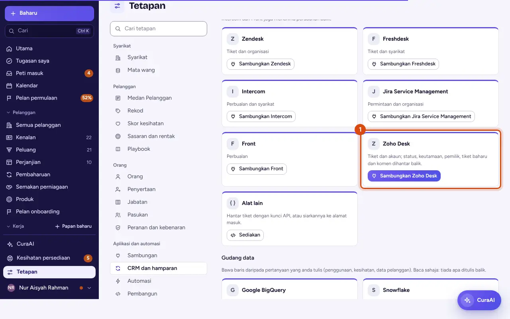

# Zoho Desk

Tiket dan akaun daripada Zoho Desk dipaparkan pada pelanggan yang sepadan, dalam ringkasan dan dalam skor kesihatan. Status, keutamaan dan pemilik yang diubah dalam Curahold dihantar balik ke Zoho Desk, tiket yang dibuat dalam Curahold dibuat di sana, dan balasan atau nota peribadi ditambah sebagai komen.

## Dalam Curahold {#connect}

1. Buka **Tetapan → CRM dan hamparan**, cari **Alat sokongan** dan klik **Sambungkan Zoho Desk**.
   

Zoho dibuka. Log masuk sebagai ejen meja bantuan anda dan klik **Accept**. Curahold mencari pusat data anda (.com, .eu, .in, .com.au, .jp, .sa, .uk, .ae, .ca, .com.cn) dan portal anda. Kembali ke Curahold, tandakan **Tiket** dan **Akaun**, semak pasangan medan dan klik **Mula menyegerakkan**.

## Had dan masa

Perubahan dibaca setiap jam. Zoho mengira kredit bagi setiap panggilan berbanding peruntukan harian mengikut pelan; apabila ia habis, Zoho meminta anda menunggu dan Curahold meneruskannya pada kali seterusnya. Balasan awam daripada Curahold ialah komen awam pada tiket; balasan e-mel dihantar daripada Zoho Desk.

## Jika ada masalah

Log masuk yang tamat tempoh diperbaharui sendiri. Jika ejen itu kehilangan akses, sambungan menunjukkan **Perlu perhatian**: **Sambung semula** dan log masuk sekali lagi. **Buang** memadamkan log masuk; tiket yang sudah dibawa masuk kekal.

## Lihat juga

- [Garis masa dan skor kesihatan](/docs/ms/timeline-and-health/)
- [Sambungan dan CRM](/docs/ms/connections/)
