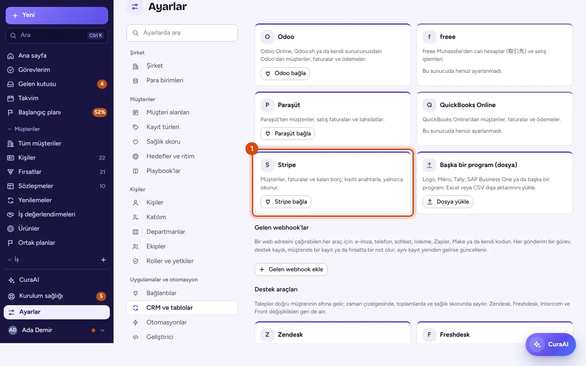

# Stripe (yalnızca okunur)

Stripe'tan müşteriler, faturalar (vade tarihi ve kalan tutarıyla) ve ödemeler. Curahold Stripe'a hiçbir şey yazmaz: verdiğiniz anahtar yalnızca okuyabilir.

## Curahold'da {#connect}

1. **Ayarlar → CRM ve tablolar**'ı açın, **Muhasebe programları**'nı bulun ve **Stripe bağla**'ya tıklayın.
   

Kısıtlı anahtarı **Kısıtlı anahtar**'a yapıştırın ve **Kontrol et ve bağla**'ya tıklayın. Tam yetkili gizli anahtar (`sk_…`) bilerek reddedilir. Sonra **Başlat**'a tıklayın ve eşleşemeyen müşterileri **Eşleştirme** sekmesinde kontrol edin.

## Stripe'ta

1. **Developers → API keys**'i açın ve **Create restricted key**'e tıklayın.
2. Adını `Curahold` koyun.
3. **Customers**, **Invoices** ve **Events**'i **Read** yapın. Diğer her şeyi **None** bırakın.
4. **Create key**'e tıklayın, ikinci adımınızla onaylayın ve anahtarı kopyalayın. Şöyle başlar:

```text
rk_live_
```

Önce denemek için bir sandbox anahtarı (`rk_test_…`) kullanın.

## Sınırlar ve zamanlama

İlk okuma her şeyi getirir; sonra yalnızca değişenler, Stripe'ın olay listesinden (Stripe 30 gün saklar). Stripe saniyede 100 istek kabul eder (sandbox'ta 25); Curahold bunun çok altında kalır. Tutarlar her para biriminin kendi ondalıklarına göre okunur (yende ondalık yoktur). Stripe'ın "uncollectible" dediği fatura burada borç olarak kalır, böylece gecikme görünmeye devam eder.

## Bir sorun olursa

Yenilenmiş ya da silinmiş anahtar bağlantıyı **Bakılması gerek** olarak işaretler: yeni bir kısıtlı anahtar yapın ve **Yeniden bağla** ile yapıştırın. Bir izin eksikse bağlanma adımı onu söyler. **Kaldır** anahtarı siler; okunmuş rakamlar siz kaldırana kadar kalır.

## Ayrıca bakın

- [Muhasebe programları](/docs/tr/accounting/)
