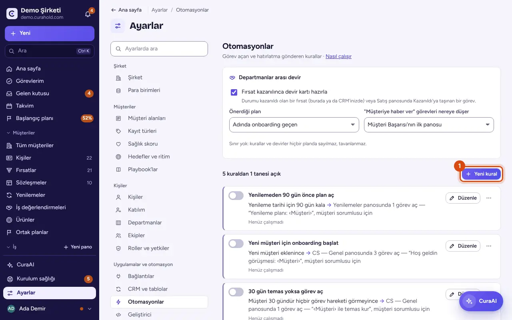
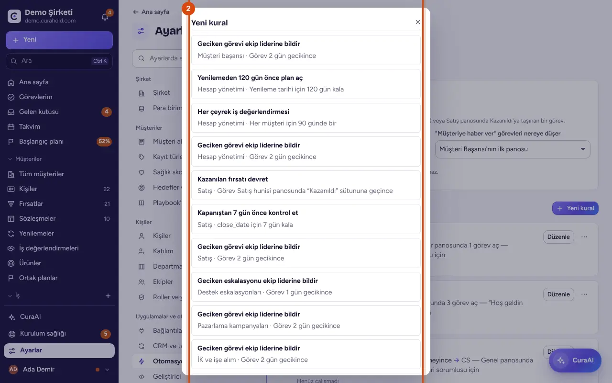
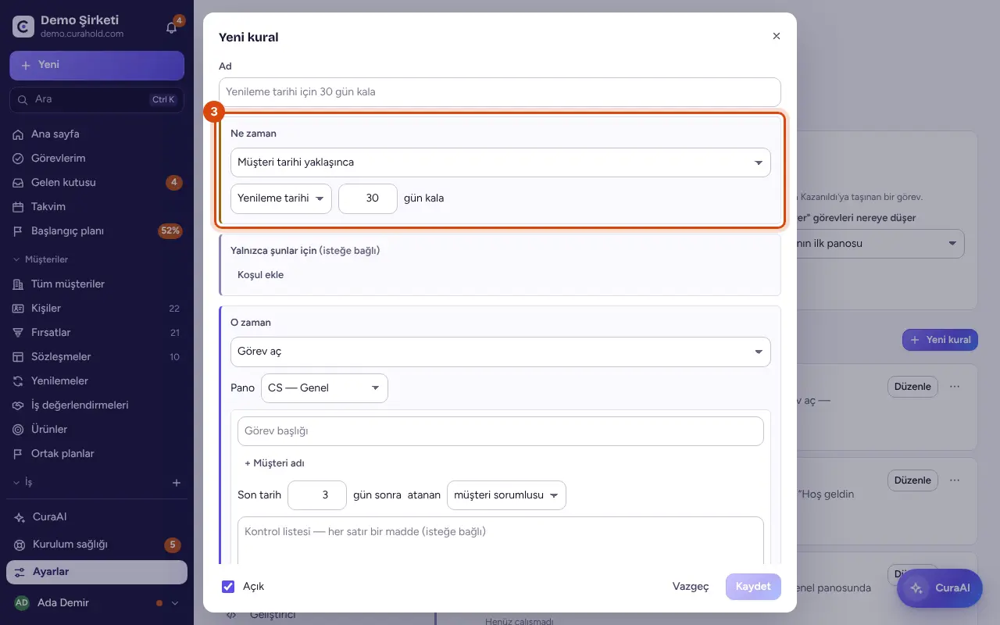
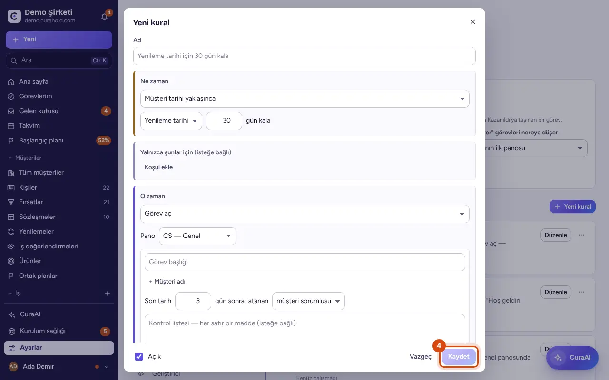

# Otomasyonlar

Kurallar rutini senin yerine yapar: 90 gün önceden yenileme planı, yeni müşteriye hoş geldin araması, geciken görev için hatırlatma, fırsat kazanılınca devir kartı. Hiçbir planda sayılmaz, tavanlanmaz.

## Kural oluştur {#new-rule}

Otomasyonları yönetme iznin olmalı (yöneticilerde vardır).

1. **Ayarlar → Otomasyonlar**'ı aç ve **Yeni kural**'a tıkla.
   
2. Uyan hazır bir kuralı seç ya da **Sıfırdan başla**.
   
3. **Ne zaman** altında kuralı neyin başlatacağını ve ayrıntılarını (hangi tarih, kaç gün, hangi pano) seç. Bazı müşterilere ya da görevlere daraltmak için **Koşul ekle**'ye tıkla. **O zaman** altında ne olacağını seç. Aşağıdaki "Bugün … için çalışırdı" satırı şu an neye dokunacağını gösterir; henüz hiçbir şey değişmez.
   
4. Bir **Ad** ver, **Açık** işaretli kalsın ve **Kaydet**'e tıkla.
   

## Kuralı ne başlatır {#when}

Müşteride yaklaşan bir tarih (yenileme, sözleşme bitişi), her müşteri için belli günde bir, sessizleşen müşteri, yeni müşteri, geciken görev, bir sütuna taşınan görev, eklenen ya da biten görev, bir panonun formundan gelen talep, bir aşamaya ulaşan kayıt, açılan destek talebi.

## Kural ne yapabilir {#then}

Görev açmak (kontrol listesiyle, müşterinin sahibine ya da herhangi birine), hatırlatma göndermek, atamak, taşımak, alan doldurmak, yorum yazmak, webhook'larına göndermek ya da devir kartını hazırlamak.

## Çalıştırmak ve durdurmak {#running}

Her kural son 30 günde kaç kez çalıştığını gösterir. **Şimdi çalıştır**, zamanlanmış bir kuralı bir sonraki saati beklemeden hemen çalıştırır; yine de her durum için bir kez uygulanır. Ara vermek için kuralı kapat. Silinen kuralın açtığı görevler kalır, kural 30 gün çöp kutusunda durur.

Aynı sayfanın üstündeki devir ayarları [Devir, talepler ve müşteriye dönüş](/docs/tr/handover-and-requests/) sayfasında.
