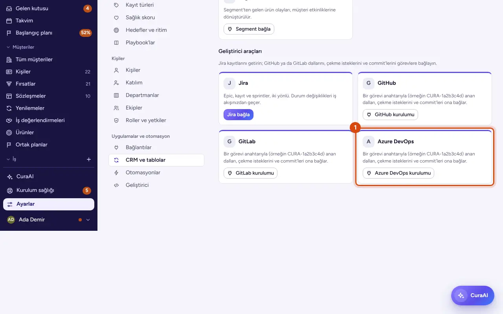

# Azure DevOps

Azure Repos'ta bir görevi anan dallar, çekme istekleri ve commit'ler o göreve bağlanır; durumları (açık, birleşti, kapandı) ve derleme sonucuyla. GitHub ve GitLab gibi çalışır: görevin anahtarını, örneğin `CURA-1a2b3c4d`, dal adına, çekme isteği başlığına ya da commit mesajına yaz.

## Curahold'da {#connect}

1. **Ayarlar → CRM ve tablolar**'nı aç, **Geliştirici araçları**'nı bul ve **Azure DevOps kurulumu**'na tıkla.
   
2. **Aç**'a tıkla, sonra gösterilen **adresi** ve **parolayı** kopyala.
   

## Azure DevOps'ta

Bunu her olay için bir kez yap (Code pushed, Pull request created, Pull request updated, Pull request merge attempted, Build completed):

1. Projeyi aç → **Project settings** → **Service hooks** → **+** (Create subscription).
2. **Web Hooks**'u seç ve **Next**'e tıkla.
3. Olayı seç, filtreleri olduğu gibi bırak ve **Next**'e tıkla.
4. Adresi **URL**'e yapıştır. **Username**'e herhangi bir şey yaz (örneğin `azure`) ve parolayı **Password**'e yapıştır.
5. **Resource details to send**'i **All**'da bırak, **Test**'e, sonra **Finish**'e tıkla.

## Sınırlar ve zamanlama

Bağlantılar Azure DevOps gönderir göndermez görünür. Azure DevOps yalnızca HTTPS ile gönderir ve imzalamaz: kanıt paroladır, onu parola gibi sakla.

## Bir sorun olursa

Azure DevOps her gönderimin cevabını **Service hooks → History**'de gösterir: 401 parolanın yanlış olduğu anlamına gelir (yeni parola için webhook'u yeniden aç ve her aboneliği güncelle). **Kapat** yeni bağlantıları durdurur; kurulmuş bağlantılar görevlerde kalır.

## Ayrıca bakın

- [Webhook'lar](/docs/tr/webhooks/)
- [Görevler ve panolar](/docs/tr/tasks/)
