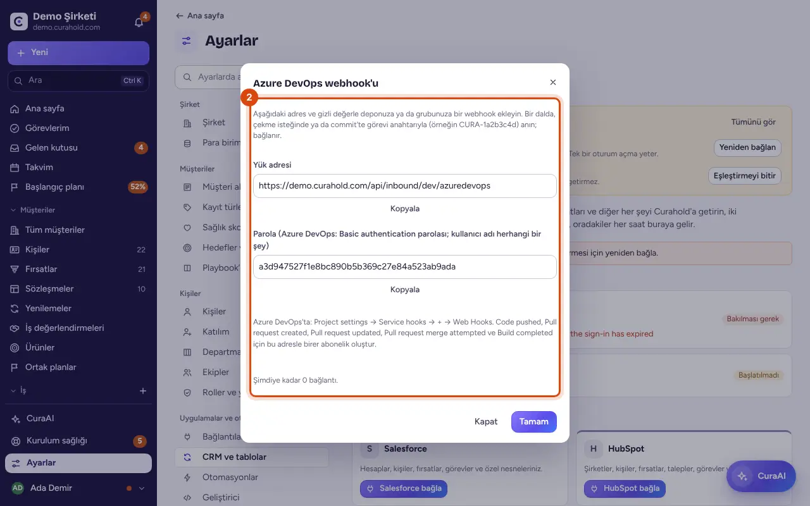

# Azure DevOps

Azure Repos'ta bir görevi anan dallar, çekme istekleri ve commit'ler o göreve bağlanır; durumları (açık, birleşti, kapandı) ve derleme sonucuyla. GitHub ve GitLab gibi çalışır: görevin anahtarını, örneğin `CURA-1a2b3c4d`, dal adına, çekme isteği başlığına ya da commit mesajına yazın.

## Curahold'da {#connect}

1. **Ayarlar → CRM ve tablolar**'ı açın, **Geliştirici araçları**'nı bulun ve **Azure DevOps kurulumu**'na tıklayın.
   
2. **Aç**'a tıklayın, sonra gösterilen **adresi** ve **parolayı** kopyalayın.
   

## Azure DevOps'ta

Bunu her olay için bir kez yapın (Code pushed, Pull request created, Pull request updated, Pull request merge attempted, Build completed):

1. Projeyi aç → **Project settings** → **Service hooks** → **+** (Create subscription).
2. **Web Hooks**'u seçin ve **Next**'e tıklayın.
3. Olayı seçin, filtreleri olduğu gibi bırakın ve **Next**'e tıklayın.
4. Adresi **URL**'e yapıştırın. **Username**'e herhangi bir şey yazın (örneğin `azure`) ve parolayı **Password**'e yapıştırın.
5. **Resource details to send**'i **All**'da bırakın, **Test**'e, sonra **Finish**'e tıklayın.

## Sınırlar ve zamanlama

Bağlantılar Azure DevOps gönderir göndermez görünür. Azure DevOps yalnızca HTTPS ile gönderir ve imzalamaz: kanıt paroladır, onu parola gibi saklayın.

## Bir sorun olursa

Azure DevOps her gönderimin cevabını **Service hooks → History**'de gösterir: 401 parolanın yanlış olduğu anlamına gelir (yeni parola için webhook'u yeniden açın ve her aboneliği güncelleyin). **Kapat** yeni bağlantıları durdurur; kurulmuş bağlantılar görevlerde kalır.

## Ayrıca bakın

- [Webhook'lar](/docs/tr/webhooks/)
- [Görevler ve panolar](/docs/tr/tasks/)
