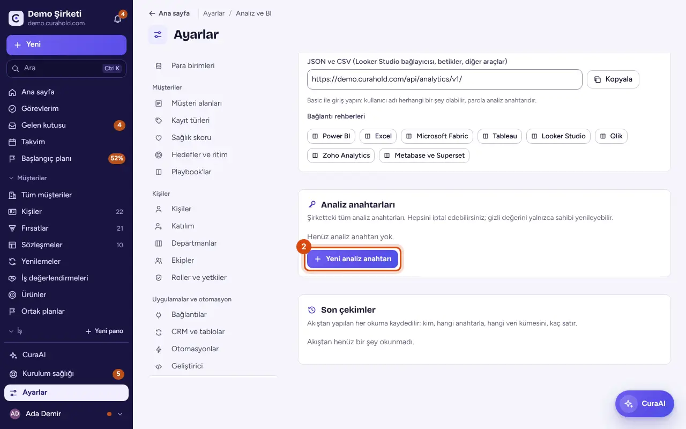

# BI aracı bağlama

Curahold'da BI araçları için yalnızca okunabilen tek bir **analiz akışı** var. Power BI, Excel, Microsoft Fabric, Tableau, Qlik ve Zoho Analytics onu **OData akışı** olarak okur; Looker Studio, betikler ve diğer araçlar aynı verileri **JSON ya da CSV** olarak alır. Bu yoldan Curahold'da hiçbir şey değiştirilemez.

Aşağıdaki menü adları araçların İngilizce arayüzündeki gibidir; Türkçe arayüzde karşılıklarını seç.

## Başlamadan önce {#key}

Veri dışa aktarma iznin olmalı (yöneticilerde ve müdürlerde vardır).

1. **Ayarlar → Analiz ve BI**'ı aç ve **Yeni analiz anahtarı**'na tıkla. Bir ad ver (ör. "Power BI satış panosu"), okuyabileceği veri kümelerini ve departmanları, bir de bitiş tarihini seç ve oluştur. Anahtarı hemen kopyala: yalnızca bir kez gösterilir ve `chb_` ile başlar.
   
2. Aynı sayfada **BI araçları için analiz akışı** altında, aracının istediği adresin yanındaki **Kopyala**'ya tıkla. Şirketinin adresiyle şöyle görünürler:
   

OData akışı (Power BI, Excel, Fabric, Tableau, Qlik, Zoho Analytics):

```text
https://sirketin.curahold.com/api/analytics/odata/
```

JSON ve CSV (Looker Studio, betikler, diğer araçlar):

```text
https://sirketin.curahold.com/api/analytics/v1/
```

Araç nasıl giriş yapacağını sorduğunda **Basic**'i seç: kullanıcı adına herhangi bir şey yaz, parola olarak anahtarı yapıştır.

Anahtar, Curahold'da senin gördüğünü okur: aynı müşteriler, panolar ve alanlar. Rolünün göremediği bir alan sütun olarak bile gelmez. Şirketten ayrılırsan ya da dışa aktarma iznini kaybedersen anahtar durur. **Gizli değeri yenile** aynı anahtara yeni bir değer verir; **İptal et** onu hemen sonlandırır.

## Veri kümeleri

| Veri kümesi | İçinde ne var |
| --- | --- |
| `Customers` | Her müşteri için bir satır; görebildiğin her müşteri alanı ayrı bir sütun |
| `Renewals` | Yenileme tarihi olan müşteriler: değer, sağlık ve açık yenileme fırsatları |
| `HealthHistory` | Her müşterinin her günkü sağlık skoru |
| `Opportunities` | Satış hunisi: tutar, aşama, durum, kapanış tarihi |
| `Tickets` | Destek talepleri |
| `Contacts` | Müşterilerindeki kişiler |
| `Records…` | Eklediğin her kayıt türü için bir veri kümesi (sözleşmeler, riskler…) |
| `Boards`, `Tasks`, `TaskAssignees` | Panolar, görevleri ve her görev-atanan kişi için bir satır |
| `Sprints`, `SprintBurndown` | Sprintler ile günlük kapsam ve kalan iş |
| `People` | Ad ve rol; sahip ve atanan kimliklerine ad koymak için |

Her veri kümesinde `Id` ve `ModifiedAt` (satırın son değiştiği an) bulunur. Çoğunda `IsDeleted` de var: arşivlenen satırlar akışta `IsDeleted = true` ile kalır, böylece bir yenileme onları raporlarından çıkarabilir. Veri kümelerini kimlik sütunlarıyla birleştir: `Tasks.CustomerId` → `Customers.Id`, `Tasks.BoardId` → `Boards.Id`, `OwnerId` → `People.Id`.

## Power BI

1. Power BI Desktop'ta **Get data → OData feed**'i seç.
2. OData adresini yapıştır ve **OK**'e bas.
3. **Basic**'i seç. Kullanıcı adı: herhangi bir şey. Parola: analiz anahtarın. **Connect**'e bas.
4. Navigator'da istediğin veri kümelerini işaretle ve **Load**'a bas (önce sütun çıkarmak için **Transform data**).
5. Yayımladıktan sonra semantik modelin **Settings → Data source credentials** bölümünde yine **Basic** ve anahtarla giriş yap, **scheduled refresh**'i aç.

Power BI hizmeti Basic giriş için ağ geçidi (gateway) isterse anahtarı **Web API key** olarak kullan: **Transform data → Advanced editor**'da kaynağı `OData.Feed("https://sirketin.curahold.com/api/analytics/odata/Tasks", null, [ApiKeyName = "key", Implementation = "2.0"])` diye yaz; Power BI sorunca **Web API**'yi seçip anahtarı yapıştır.

**Büyük veri kümeleri.** Artımlı yenileme için aralığı adrese yaz; Curahold göndermeden önce süzer:

```
let
    Start = DateTime.ToText(RangeStart, "yyyy-MM-ddTHH:mm:ss") & "Z",
    End = DateTime.ToText(RangeEnd, "yyyy-MM-ddTHH:mm:ss") & "Z",
    Source = OData.Feed("https://sirketin.curahold.com/api/analytics/odata/Tasks?$filter=CreatedAt ge " & Start & " and CreatedAt lt " & End, null, [Implementation = "2.0"])
in
    Source
```

Sonra tablonun artımlı yenileme kuralını her zamanki gibi ayarla ve `ModifiedAt` sütunuyla **Detect data changes**'i işaretle; böylece satırları değişen bir dönem yeniden okunur.

## Excel

1. Windows için Excel'de **Data → Get Data → From Other Sources → From OData Feed**'i seç.
2. OData adresini yapıştır ve **OK**'e bas.
3. **Basic**'i seç, herhangi bir kullanıcı adı yaz, parola olarak anahtarı yapıştır, **Connect**'e bas.
4. Navigator'da veri kümelerini seç ve **Load**'a bas.
5. **Data → Refresh All** ne zaman istersen en güncel veriyi getirir.

## Microsoft Fabric

1. Çalışma alanında **New item → Dataflow Gen2**'yi, sonra **Get data → OData**'yı seç.
2. OData adresini yapıştır. Bağlantı kimlik bilgilerinde **Basic**'i seç: herhangi bir kullanıcı adı, parola olarak anahtar.
3. Veri kümelerini seç, gerekirse düzenle ve bir **data destination** (lakehouse ya da warehouse) ekle.
4. **Publish**'e bas, sonra veri akışına bir yenileme takvimi koy.

Bir veri hattının **Copy activity**'si de aynı akışı OData bağlayıcısı ve Basic girişle okuyabilir.

## Tableau

1. Tableau Desktop'ta **Connect → To a Server → OData**'yı seç.
2. Sunucu olarak tek bir veri kümesinin adresini yapıştır, ör. `https://sirketin.curahold.com/api/analytics/odata/Customers`.
3. **Use username and password**'ü seç: herhangi bir kullanıcı adı, parola olarak anahtar. **Sign In**'e bas.
4. Tableau OData'yı **extract** olarak okur. İstediğin her veri kümesi için bir OData bağlantısı daha ekle ve kimlik sütunlarıyla ilişkilendir.
5. Tableau Cloud'a ya da Server'a yayımlarken kimlik bilgilerini göm ve bir extract yenileme takvimi koy.

## Looker Studio

Looker Studio'nun böyle bir akışı okuması için bir bağlayıcı gerekir. **Curahold'un kendi Looker Studio bağlayıcısı yakında.** O zamana kadar:

1. Yeni bir Google E-Tablosu'nda A1 hücresine şunu yaz: `=IMPORTDATA("https://sirketin.curahold.com/api/analytics/v1/Customers.csv?limit=5000&key=ANAHTARIN")`.
2. Looker Studio'da **Create → Data source → Google Sheets**'i seç ve o tabloyu göster.
3. Bunun için ayrı bir anahtar oluştur ve yalnızca tablonun ihtiyaç duyduğu veri kümeleriyle sınırla: tabloyu düzenleyebilen herkes formüldeki anahtarı görebilir. Tablo fazla kişiyle paylaşılırsa anahtarı Curahold'da iptal et.

Bir tabloyu **CRM ve tablolar** (Ayarlar → CRM ve tablolar) ile güncel tutup Looker Studio'da o tabloyu da kullanabilirsin.

## Qlik

1. Qlik Sense ya da Qlik Cloud'da **Add data → OData**'yı (ya da **Create new connection → OData**) seç.
2. OData adresini yapıştır, kimlik doğrulamada **Basic**'i seç: herhangi bir kullanıcı adı, parola olarak anahtar.
3. Veri kümelerini seçip yükle; yeniden yüklemeyi uygulamanın ayarlarından takvime bağla.

Qlik'in REST bağlayıcısı da JSON adresiyle (`…/api/analytics/v1/Customers.json`) çalışır: Basic giriş ve `next` alanı üzerinden "next URL" sayfalama.

## Zoho Analytics

1. **Create → New Workspace → Web URL / Feeds**'i (web akışından içe aktarma) seç.
2. Tek bir veri kümesinin adresini yapıştır: OData adresi (`…/api/analytics/odata/Customers`) ya da CSV adresi (`…/api/analytics/v1/Customers.csv`).
3. Kimlik doğrulamada **Basic**'i seç: herhangi bir kullanıcı adı, parola olarak anahtar.
4. Sayfalama için **next page URL**'i seç: OData'da `@odata.nextLink`, JSON'da `next`.
5. İçe aktarmanın ne sıklıkla yineleneceğini ayarla.

## Metabase / Superset

Metabase ve Superset web akışlarını değil veritabanlarını okur. Doğrudan bağlantı Curahold'un yakında gelecek **veri ambarına aktarma** özelliğiyle (BigQuery ya da Snowflake'e) mümkün olacak. O zamana kadar, kurulumun dosya yüklemeye izin veriyorsa `…/api/analytics/v1/<veri-kümesi>.csv` adresinden aldığın CSV'yi yükle.

## Diğer araçlar ve betikler

JSON ve CSV adresi şunları alır:

| Seçenek | Anlamı |
| --- | --- |
| `limit` | Sayfa başına satır, en çok 5000 (varsayılan 1000) |
| `page` ya da `offset` | Sayfa numarasıyla ya da satırla sayfalama |
| `cursor` | Önceki sayfanın `next` değeri (büyük veri kümelerinde en hızlısı) |
| `since` | Yalnızca bu tarihte ya da sonrasında değişen satırlar, ör. `2026-11-01` |
| `fields` | Yalnızca bu sütunlar, ör. `Id,Name,ModifiedAt` |
| `filter`, `orderby` | OData `$filter` ve `$orderby` ile aynı ifadeler |
| `count=1` | Toplam satır sayısını da döndür |

Anahtarı Basic (parola) olarak ya da `Authorization: Bearer chb_…` ile gönder. Bir JSON sayfası `{ "dataset": "Tasks", "rows": [...], "next": "…" }` biçimindedir; CSV sayfaları sonraki adresi `Link` başlığında verir. Domo, SAP Analytics Cloud, Quick BI ve FineBI gibi araçlar JSON ya da OData adresini aynı yolla okur.

OData akışı `$select`, `$filter` (`eq ne gt ge lt le`, `and`, `or`, `not`, `contains`, `startswith`, `endswith`), `$orderby`, `$top`, `$skip`, `$count` ve `/$count` anlar. `$expand` sunmaz: veri kümelerini kimlik sütunlarıyla birleştir.

## Yenileme ve sınırlar

- Büyük veri kümeleri 1.000 satırlık sayfalarla gelir; BI araçları sonraki sayfa bağlantısını kendileri izler.
- **Yalnızca değişenler:** `ModifiedAt` üzerinde süz (`$filter=ModifiedAt ge 2026-11-01T00:00:00Z`) ya da JSON'da `since` kullan. `Prefer: odata.track-changes` başlığıyla son sayfa bir `@odata.deltaLink` de verir; o bağlantı sonradan yalnızca değişenleri döndürür.
- Her anahtar saniyede yaklaşık iki istek yapabilir ve her şirketin günlük bir satır kotası vardır. Aşılınca akış 429 döner ve ne zaman yeniden denenebileceğini söyler.
- Her okuma kaydedilir (kim, hangi anahtar, hangi veri kümesi, kaç satır) ve Ayarlar'da **Son çekimler** altında görünür.

## Bir şey ters giderse

- **401 / araç yeniden kimlik soruyor:** anahtar yanlış, iptal edilmiş ya da süresi dolmuş; ya da kullanıcı adı isteyen bir araçta bu alan boş bırakılmış: oraya herhangi bir şey yaz.
- **403:** anahtarın sahibinin artık veri dışa aktarma izni yok.
- **Bir veri kümesi için 404:** anahtar başka veri kümeleri ya da departmanlarla sınırlı, ya da veri kümesinin alanları sahibin rolüne kapalı.
- **Mesajlı 400:** sorgu akışın desteklemediği bir şey kullanıyor; mesaj onu söyler.
