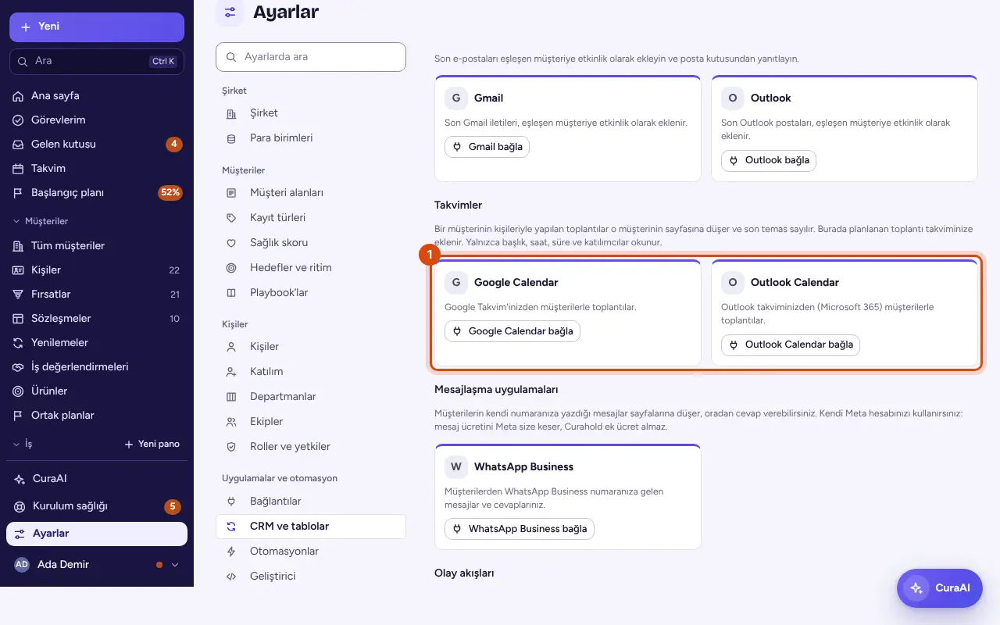

# Google Takvim ve Outlook Takvimi

Takviminizi bağlayın: bir müşterinin kişileriyle yaptığınız her toplantı, süresiyle birlikte o müşterinin zaman çizelgesinde toplantı olarak görünür ve son temas sayılır. Müşterinin zaman çizelgesinden doğrudan takviminize toplantı da planlayabilirsiniz; davetleri takvim gönderir.

## Ne okunur, ne okunmaz

Ana takviminden yalnızca gerçekleşmiş toplantılar: başlık, saat, süre ve katılımcılar. Açıklama, yer ya da görüşme bağlantısı asla. Özel toplantılar, tüm gün kayıtları ve dışarıdan kimsenin olmadığı toplantılar atlanır. Toplantı, katılımcılarından biri kişisi olan ya da web adresi bir katılımcının alan adı olan müşteriye düşer.

## Curahold'da {#connect}

1. **Ayarlar → CRM ve tablolar**'ı açın, **Takvimler**'i bulun ve **Google Calendar bağla** ya da **Outlook Calendar bağla**'ya tıklayın.
   

Google ya da Microsoft açılır. İş hesabınızı seçin ve **İzin ver**'e (Google) ya da **Kabul et**'e (Microsoft) tıklayın. Curahold'a dönünce **Başlat**'a tıklayın: son 90 gün okunur, sonra saatte bir.

## Toplantı planlayın

Müşterinin sayfasında **Zaman çizelgesi**'ni açın ve **Google Calendar içinde toplantı planla**'ya (ya da Outlook) tıklayın. Başlığı, saati, süreyi ve katılımcıların e-postalarını yazın, **… takvimine ekle**'ye tıklayın. Toplantı gerçekleştikten sonra zaman çizelgesinde görünür.

## Sınırlar ve zamanlama

Saatte bir okunur; son bir haftada taşınan ya da adı değişen toplantı güncellenir. İptal edilen toplantı yerinde kalır: yapılmadıysa zaman çizelgesinden silin (çöp kutusuna gider). Google ve Microsoft dakikadaki istekleri sınırlar: "meşgul" cevabı okumayı duraklatır, okuma sonraki sefer devam eder.

## Bir sorun olursa

Oturumun süresi dolarsa kendiliğinden yenilenir. Erişim geri alındıysa (değişen parola, yöneticinin kararı) bağlantı **Bakılması gerek** gösterir: **Yeniden bağla**'ya tıklayın ve aynı hesapla giriş yapın. **Kaldır** oturumu siler; zaman çizelgelerindeki toplantılar kalır.

## Ayrıca bakın

- [Zaman çizelgesi ve sağlık skoru](/docs/tr/timeline-and-health/)
- [Bağlantılar ve CRM](/docs/tr/connections/)
