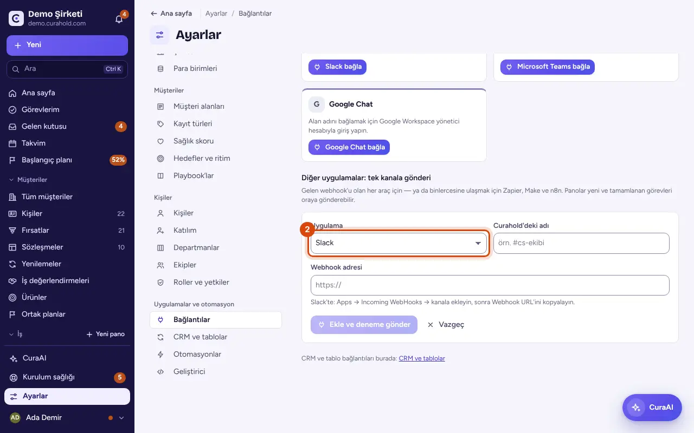

# Lark, Feishu ve Telegram bildirimleri

Bir pano haberlerini (yeni görev, biten görev) bir grup sohbetine gönderebilir. Lark ve Feishu grubun özel botunu kullanır; Telegram iki dakikada yaptığınız bir botu. İkisi de tek yönlüdür: gönderirler, oradan cevap gelmez.

## Curahold'da {#connect}

1. **Ayarlar → Bağlantılar**'ı açın ve **Uygulama ekle**'ye tıklayın.
   
2. **Uygulama** altında **Lark · Feishu** ya da **Telegram**'ı seçin, aşağıdaki adımların verdiğini yapıştırın ve **Ekle ve deneme gönder**'e tıklayın. Gruba bir deneme mesajı gelir.
   

Sonra panoyu açın, **Pano ayarları → Bildirimler**'den istediğiniz haberler için yeni bağlantıyı seçin.

## Lark ya da Feishu

1. Grupta **Ayarlar → Botlar → Bot ekle → Özel bot**'u açın, bir ad verin ve **Ekle**'ye tıklayın.
2. **Webhook adresini** kopyalayın. Şuna benzer:

```text
https://open.larksuite.com/open-apis/bot/v2/hook/0f3c2a9e-7d1b-4c55-9a7e-2b8f6c1d3e4f
```

3. İsteğe bağlı ama önerilir: **Güvenlik ayarları** altında **İmza doğrulama**'yı işaretleyin ve gizli anahtarı Curahold'da **İmza anahtarı**'na kopyalayın. Anahtar kelime filtresi kullanmayın: mesajlar düşer.

## Telegram

1. Telegram'da **@BotFather**'a yazın, `/newbot` gönderin, iki sorusunu cevaplayın ve verdiği **anahtarı** kopyalayın.
2. Botu grubunuza ekleyin (kanal için: yönetici olarak ekleyin).
3. Gruba bir mesaj gönderin. Curahold grubu bu mesajdan bulur, kimliğini bilmeniz gerekmez.
4. Anahtarı Curahold'da **Bot anahtarı**'na yapıştırın. Herkese açık bir kanal için `@adını` da yazabilirsiniz.

## Sınırlar ve zamanlama

Lark bot başına dakikada yaklaşık 100, Telegram grup başına dakikada yaklaşık 20 gönderi kabul eder; "meşgul" cevabı kaybolmaz, yeniden denenir. Telegram mesajları düz metindir, en çok 4.096 karakter.

## Bir sorun olursa

Yanlış imza anahtarı, çıkarılmış bot ya da iptal edilmiş anahtar bağlantıyı Ayarlar → Bağlantılar'da **Bakılması gerek** olarak işaretler; deneme de bunu söyler. Karşı tarafta düzeltin, sonra yeniden **Deneme gönder**'e tıklayın: çalışan bir deneme sorunu kaldırır. **Kaldır** gönderileri durdurur; bot siz çıkarana kadar grupta kalır.

## Ayrıca bakın

- [Bağlantılar ve CRM](/docs/tr/connections/)
- [Bildirimler](/docs/tr/notifications/)
