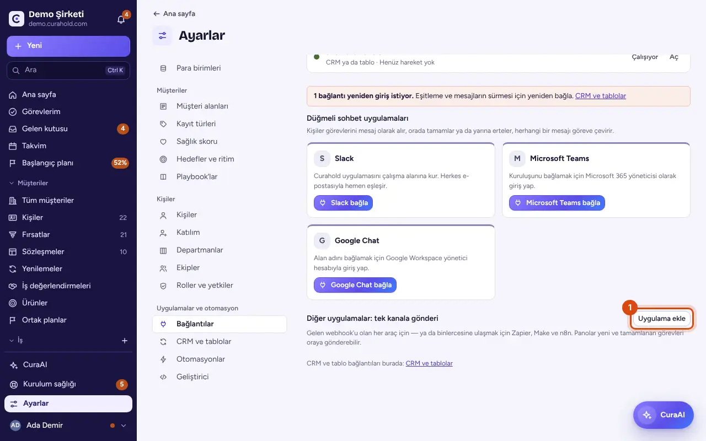

# Lark, Feishu ve Telegram bildirimleri

Bir pano haberlerini (yeni görev, biten görev) bir grup sohbetine gönderebilir. Lark ve Feishu grubun özel botunu kullanır; Telegram iki dakikada yaptığın bir botu. İkisi de tek yönlüdür: gönderirler, oradan cevap gelmez.

## Curahold'da {#connect}

1. **Ayarlar → Bağlantılar**'ı aç ve **Uygulama ekle**'ye tıkla.
   
2. **Uygulama** altında **Lark · Feishu** ya da **Telegram**'ı seç, aşağıdaki adımların verdiğini yapıştır ve **Ekle ve deneme gönder**'e tıkla. Gruba bir deneme mesajı gelir.
   

Sonra panoyu aç, **Pano ayarları → Bildirimler**'den istediğin haberler için yeni bağlantıyı seç.

## Lark ya da Feishu

1. Grupta **Ayarlar → Botlar → Bot ekle → Özel bot**'u aç, bir ad ver ve **Ekle**'ye tıkla.
2. **Webhook adresini** kopyala. Şuna benzer:

```text
https://open.larksuite.com/open-apis/bot/v2/hook/0f3c2a9e-7d1b-4c55-9a7e-2b8f6c1d3e4f
```

3. İsteğe bağlı ama önerilir: **Güvenlik ayarları** altında **İmza doğrulama**'yı işaretle ve gizli anahtarı Curahold'da **İmza anahtarı**'na kopyala. Anahtar kelime filtresi kullanma: mesajlar düşer.

## Telegram

1. Telegram'da **@BotFather**'a yaz, `/newbot` gönder, iki sorusunu cevapla ve verdiği **anahtarı** kopyala.
2. Botu grubuna ekle (kanal için: yönetici olarak ekle).
3. Gruba bir mesaj gönder. Curahold grubu bu mesajdan bulur, kimliğini bilmen gerekmez.
4. Anahtarı Curahold'da **Bot anahtarı**'na yapıştır. Herkese açık bir kanal için `@adını` da yazabilirsin.

## Sınırlar ve zamanlama

Lark bot başına dakikada yaklaşık 100, Telegram grup başına dakikada yaklaşık 20 gönderi kabul eder; "meşgul" cevabı kaybolmaz, yeniden denenir. Telegram mesajları düz metindir, en çok 4.096 karakter.

## Bir sorun olursa

Yanlış imza anahtarı, çıkarılmış bot ya da iptal edilmiş anahtar bağlantıyı Ayarlar → Bağlantılar'da **Bakılması gerek** olarak işaretler; deneme de bunu söyler. Karşı tarafta düzelt, sonra yeniden **Deneme gönder**'e tıkla: çalışan bir deneme sorunu kaldırır. **Kaldır** gönderileri durdurur; bot sen çıkarana kadar grupta kalır.

## Ayrıca bakın

- [Bağlantılar ve CRM](/docs/tr/connections/)
- [Bildirimler](/docs/tr/notifications/)
