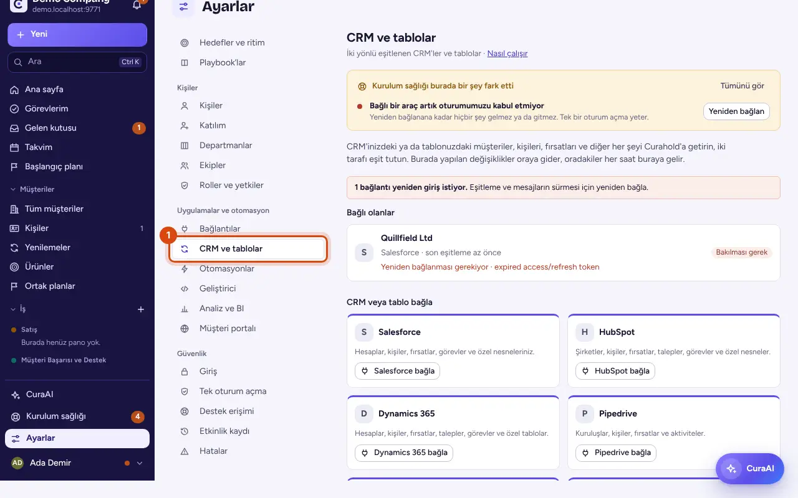
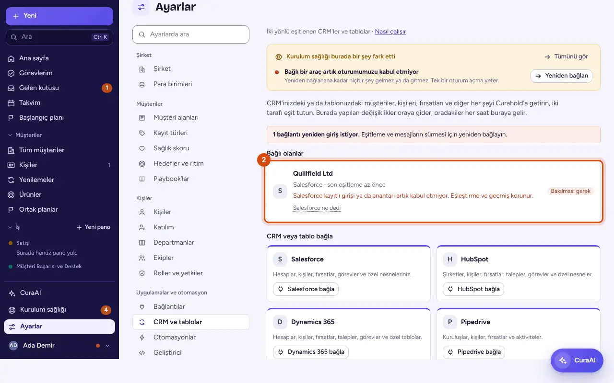
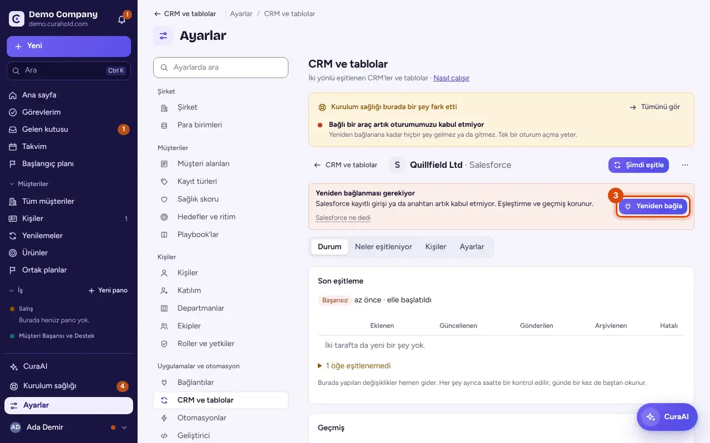
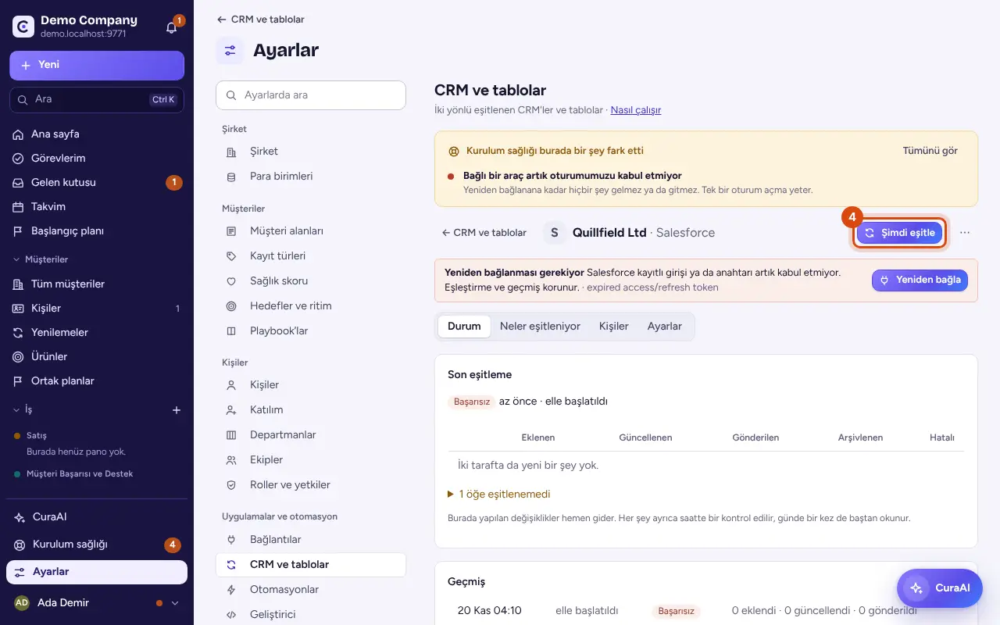

# Bağlantılar ve CRM

Curahold ekibinizin zaten kullandığı araçlarla birlikte çalışır. Bağlantıları Ayarlar → Bağlantılar ve Ayarlar → Veri kaynakları'ndan yönetirsiniz.

## Sohbet uygulamaları

Slack, Microsoft Teams ve Google Chat bağlandığında bildirimler kişiye özel mesaj olarak gider. Mesajın içinden görevi tamamlayabilir ya da yeniden açabilirsiniz.

## CRM ve tablolar

Müşterileri, kişileri ve fırsatları Salesforce, HubSpot, Microsoft Dynamics, Pipedrive, Zoho, Bitrix24, Freshsales, Zendesk Sell, Google Sheets ve Excel ile eşitleyin. **Ayarlar → CRM ve tablolar** sayfasını açın ve **Bağla**'ya tıklayın.

1. **Giriş yapın.** CRM'in kendi giriş sayfasına gidersiniz ve Curahold'un neyi okuyup yazabileceğini onaylarsınız. Curahold'a hiçbir zaman şifre yazılmaz. (Bitrix24, Freshsales ve Zendesk Sell bunun yerine bir anahtarla bağlanır; aşağıya bakın.)
2. **Neyin geleceğini seçin.** İhtiyacınız olan nesneleri işaretleyin ve her birinin Curahold'da ne olduğunu belirtin: müşteriler, kişiler, fırsatlar, kendi kayıt türünüz ya da bir panodaki görevler.
3. **Alanları eşleyin.** Curahold her alan için bir eşleşme önerir; istediğinizi değiştirin ve alan başına yalnızca gelsin mi, iki tarafta aynı mı kalsın, onu seçin.
4. **Kontrol et ve başlat.** Önizleme, hiçbir şey değişmeden önce kaç kaydın ekleneceğini ve güncelleneceğini gösterir.

Sonrasında eşitleme her saat kendiliğinden çalışır; Curahold'da yapılan değişiklik CRM'e hemen yazılır. Eşitlenemeyenler nedenleriyle listelenir ve yeniden denenebilir. Aynı şey iki tarafta da değiştiyse yeni olan kazanır; isterseniz her zaman CRM'in ya da Curahold'un kazanmasını seçebilirsiniz (bağlantının Ayarlar sekmesi).

Bağlamak için bağlantıları yönetme yetkisi gerekir. Kişiler e-postayla eşlenir; böylece müşterinin CRM'deki sahibi Curahold'da da sahibi olur.

## Salesforce

Gelenler: hesaplar, kişiler, fırsatlar, görevler ve kendi özel nesneleriniz. Test ortamı kullanacaksanız bağlamadan önce **Sandbox** kutusunu işaretleyin.

**İlk seferde bir Salesforce yöneticisi Curahold'u kurar.** Salesforce, kurumunuza kurulmamış uygulamaları engeller; bu yüzden ilk girişten önce bir yönetici kurulum sayfasını açar (bağlantı, Bağla'yı seçtiğinizde gösterilir) ve onaylar. Paket kod, alan ya da nesne eklemez: yalnızca kurumunuzdaki kişilerin Curahold'a izin verebilmesini sağlar. İstenildiği an Setup → Installed Packages üzerinden kaldırılabilir; Curahold erişimini o anda kaybeder. Salesforce uygulamaya izin verilmediğini söylerse bu adım henüz yapılmamıştır. Bağlayan kullanıcının Salesforce'ta API erişimi olmalı (Enterprise ve üstünde dahil, Professional'da ek paket).

## HubSpot

Gelenler: şirketler, kişiler, anlaşmalar, destek kayıtları, görevler ve özel nesneler. HubSpot hangi hesabın bağlanacağını sorar ve Curahold'un neyi okuyup yazabileceğini listeler; kişiler ve anlaşmalar yalnızca HubSpot planında varsa istenir.

## Microsoft Dynamics 365

Gelenler: hesaplar, kişiler, fırsatlar, servis talepleri, görevler ve özel tablolar. Giriş yapmadan önce kurumunuzun adresini verirsiniz (`https://sirketiniz.crm4.dynamics.com` gibi görünür). Microsoft "Yönetici onayı gerekli" derse, bir Microsoft 365 yöneticisinin Curahold'u kurumunuz için bir kez onaylaması gerekir.

## Pipedrive

Gelenler: kurumlar, kişiler, anlaşmalar ve aktiviteler. Özel alanlar standart alanlar gibi eşlenir.

## Zoho CRM

Gelenler: hesaplar, kişiler, anlaşmalar, servis talepleri, görevler ve özel modüller. Curahold, Zoho veri merkezini (ABD, AB, Hindistan, Avustralya…) kendisi bulur.

## Bitrix24, Freshsales ve Zendesk Sell

Bu üçü, CRM'in içinde sizin oluşturduğunuz bir anahtarla bağlanır; giriş sayfası yoktur ve kimsenin bir şeyi onaylaması gerekmez. Curahold anahtarı yapıştırdığınız anda dener, şifreli saklar ve bir daha göstermez; bağlantıyı kaldırınca anahtar da silinir. Sonrası diğer CRM'lerle aynıdır: neyin geleceğini seçersiniz, alanları eşlersiniz, değişiklikler iki yöne de gider.

| CRM | Ne yapıştırılır | Nerede bulunur | Gelenler |
| --- | --- | --- | --- |
| Bitrix24 | gelen webhook adresi | Geliştirici kaynakları → Diğer → Gelen webhook; CRM iznini verin, sahipler eşleşsin diye Kullanıcılar iznini de | şirketler, kişiler, anlaşmalar |
| Freshsales | adresiniz ve API anahtarı | profil resminiz → Ayarlar → API ayarları | hesaplar, kişiler, anlaşmalar |
| Zendesk Sell | bir erişim anahtarı | Ayarlar → Entegrasyonlar → OAuth → Erişim anahtarları | şirketler, kişiler, anlaşmalar |

Bilmekte fayda var:

- **Anahtar, onu oluşturan kişi gibi davranır.** Curahold, o kişinin CRM'de gördüğünü görür. Anahtarı, burada olmasını istediğiniz bütün müşterileri görebilen bir hesapla oluşturun.
- **Bitrix24'te e-posta, telefon ve web adresi** orada birer listedir. Curahold ilkini okur ve yeni bir kişi ya da şirket oluştururken doldurur, ama listeyi sonradan yeniden yazmaz.
- **Freshsales, "All accounts", "All contacts" ve "All deals" görünümleri üzerinden okunur.** Bunlardan birinin adı değiştirilmiş ya da görünüm silinmişse o liste okunmaz ve çalıştırma bunu söyler; listenin yalnızca bir kısmını getirmez.
- **Zendesk Sell'de bir anlaşmanın şirketi olmak zorundadır.** Curahold'da açılan anlaşma, orada müşterinin şirketi altında oluşturulur.
- Bu bağlayıcılar yeni. Beklediğiniz gibi gelmeyen bir şey olursa ürünün içindeki Yardım'dan bize yazın.

## Google Sheets ve Excel

Tablo, veri getirmenin en kolay yoludur ve tabloya dışa aktarabilen her araç için çalışır. Bir Google Sheet'i ya da OneDrive veya SharePoint'teki bir Excel dosyasını sekme sekme bağlayın; her sekme müşteriler, kişiler ya da kendi kayıt türünüz olabilir. Satırı tanıtan sütunu seçin; böylece değişen satır ikinci bir müşteri eklemek yerine aynı müşteriyi günceller. Tablo her satır için bir değişiklik zamanı tutmaz; aynı hücre iki tarafta da değiştiyse Curahold'daki değişiklik kazanır. Tablonun kazanmasını isterseniz bunu bağlantının Ayarlar sekmesinden seçin.

## Destek araçları

Zendesk, Freshdesk, Intercom ve Jira Service Management yalnızca adres ve API anahtarıyla bağlanır; talepler doğru müşterinin altına gelir. Salesforce ve Dynamics'teki vakalar da destek talebi olarak eşleştirilebilir. Ayrıntılar: [Destek talepleri](/docs/tr/support-tickets/).

## Eşitleme durursa {#sync-stops}

Bağlantının **Durum** sekmesi ne olduğunu sade bir dille söyler; altında servisin kendi mesajı durur.

| Ne diyor | Ne yapmalı |
| --- | --- |
| Servis Curahold'dan yavaşlamasını istedi | Hiçbir şey. Kalınan yer saklanır, bir sonraki saatlik çalışma devam eder. |
| Curahold'un girişini ya da anahtarını artık kabul etmiyor | Aşağıdaki gibi yeniden bağlayın. |
| Hesabınızın bir şeyi okuma ya da değiştirme izni yok | O aracın yöneticisinden hesaba erişim vermesini isteyin, sonra **Şimdi eşitle**'ye tıklayın. |
| Servise ulaşılamadı | Hiçbir şey. Curahold bir sonraki saatlik çalışmada yeniden dener. |

Yeniden bağlamak için:

1. **Ayarlar → CRM ve tablolar**'ı açın.
   
2. **Bakılması gerek** yazan bağlantıya tıklayın.
   
3. Sayfanın üstündeki **Yeniden bağla**'ya tıklayın.
   
   Daha önceki hesapla giriş yapın (ya da yeni anahtarı yapıştırın) ve onaylayın.
4. **Şimdi eşitle**'ye tıklayın. Eşleştirdiğiniz alanlar olduğu gibi kalır.
   

Bir bağlantıyı kaldırmak için açın, **⋯**'ye tıklayın ve **Kaldır**'ı seçin. Eşitleme durur; gelen müşteriler, kişiler ve fırsatlar Curahold'da kalır, öbür araçta hiçbir şey silinmez. Muhasebe programında ise ondan okunan bakiyeler, faturalar ve ödemeler müşteri sayfalarından kaldırılır.

## Kendi araçların

Başka bir sisteme bağlanmak istiyorsanız [API anahtarları](/docs/tr/api-keys/), [webhook'lar](/docs/tr/webhooks/) ya da [AI asistanları](/docs/tr/ai-assistants/) sayfalarına bakın.
