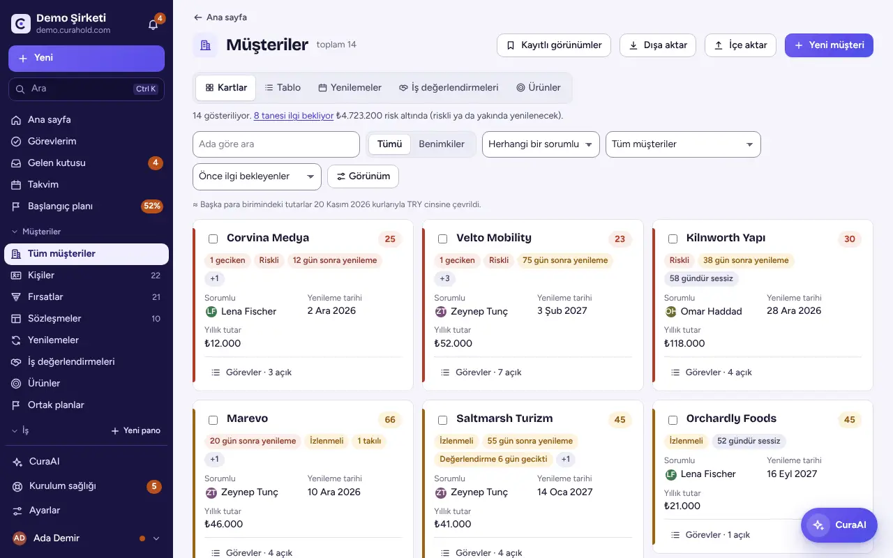
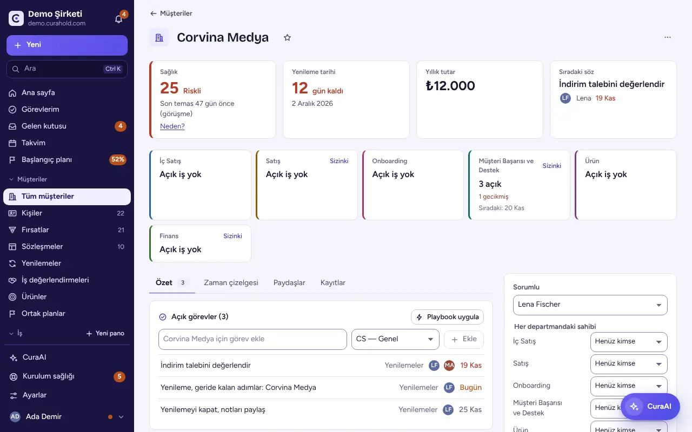

# Müşteriler, alanlar ve kayıtlar

Müşteriler Curahold'un merkezidir. Her müşterinin bir sahibi, isteğe bağlı bir ekibi ve şirketine özel alanları olur.

## Müşteri sayfası

Müşteri sayfasının en üstünde bir bakışta okunan bir şerit vardır: nedeni ve **Neden?** düğmesiyle **Sağlık**, yenileme tarihi ve kalan gün, yıllık tutar ve **Sıradaki söz**: müşteriye verdiğiniz en yakın adım ve onu kimin taşıdığı. Şeridin altında sekmeler: **Özet** (açık görevler ve yaklaşan toplantılar), **Zaman çizelgesi**, **Paydaşlar**, **Kayıtlar** ve **Bilgiler**. Açık sekme adreste durur; sayfayı yenileyince ya da gönderdiğiniz bağlantıyla aynı sekmeye dönülür.

## Alanlar

Ayarlar → Müşteri alanları'ndan alan eklersiniz: metin, sayı, tutar, tarih, seçim, e-posta, bağlantı. Seçim alanlarının seçeneklerine renk verebilirsiniz; sağlık durumu gibi alanlar listede ve kartlarda bu renkle görünür.

"Müşteri" kelimesini de değiştirebilirsiniz: "Hesap", "Marka", "Partner" ne kullanıyorsanız arayüzün her yerinde o yazar.

## Kayıtlar: kişiler, fırsatlar ve fazlası

Müşterilerin altında kayıt tutarsınız:

- **Kişiler (paydaşlar):** unvan, karar düzeyi (karar verici, bütçe onaylayan, etkileyen, değerlendiren, kullanıcı) ve bize karşı duruşu (güçlü destekçi, destekçi, nötr, şüpheci, engelleyici).
- **Fırsatlar:** tutar, kapanış tarihi, aşama ve durum.
- **Kendi kayıt türlerin:** örneğin "Projeler" ya da "Sözleşmeler".

Kayıtlardan müşteri alanı türetebilirsiniz: "Açık fırsat tutarı", "Güçlü destekçi sayısı", "Engelleyici sayısı" gibi. Kayıt değişince alan kendiliğinden güncellenir.

## Görünümler: kartlar, tablo, yenilemeler, ürünler

Müşteriler sayfasının üstündeki düğmelerle dört görünüm arasında geçiş yapılır; seçiminiz o cihazda hatırlanır.

- **Kartlar:** her müşteri bir kart. Kartın üstünde neye bakılması gerektiği yazar: geciken görevler, riskli ya da izlenmeli sağlık, yaklaşan ya da geçmiş yenileme, 14 gündür kımıldamayan görevler, 30 gündür temas olmaması. En ciddisi en başta; hiçbir şey yoksa “Her şey yolunda”. Kartlar varsayılan olarak “önce ilgi bekleyenler” sırasıyla gelir; ada, sağlığa, tutara, yenilemeye ya da açık görev sayısına göre de sıralanır. **Görünüm** menüsünden kartta hangi alanların görüneceğini seçersiniz.
- **Tablo:** sütunlara göre sıralanan, toplu değişiklik yapılabilen liste.
- **Yenilemeler:** önümüzdeki 12 ayın yenilemeleri ay ay; her ayın toplamı ve riskli ya da izlenmeli olanların tuttuğu tutar.
- **Ürünler:** bir kayıt türündeki seçim alanına göre (örneğin “Abonelik → Ürün”) hangi müşteride hangi ürünün olduğu. Boş hücredeki **+** o müşteri için bir çapraz satış görevi açar.

Sayfanın üstündeki cümle kaç müşterinin ilgi beklediğini ve ne kadar tutarın risk altında olduğunu söyler; “ilgi bekliyor” bağlantısı listeyi onlara daraltır. Telefonda filtreler tek bir **Filtre** sayfasında toplanır.

## İçe aktarma

Excel ya da CSV dosyasını sürükleyin; sütunları alanlarla eşleştirin, önizlemeye bakın, aktarın. Yanlış giden bir aktarmayı 30 gün içinde tek tıkla geri alabilirsiniz.

## Dışa aktarma

Müşteri ve kayıt listelerini o an gördüğünüz filtreyle Excel ya da CSV olarak indirirsiniz. Dosya tarayıcınızda hazırlanır; sizin göremediğiniz alanlar dosyada da yer almaz.

## Toplu değişiklik

Listede birden çok müşteri seçin: sahibini, ekibini ya da bir alanı birlikte değiştirin. Alttaki bildirimden **Geri al** diyebilirsiniz.

## Müşteri silmek ve silinen müşteriyi geri almak

Silinen müşteri kayıtları, zaman çizelgesi, toplantıları ve portal kişileriyle [çöp kutusuna](/docs/tr/trash/) gider ve 30 gün boyunca geri alınabilir: silmenin hemen ardından bildirimdeki **Geri al**'a basın ya da menüyü açıp **Çöp kutusu**'nu seçin ve **Geri al**'a basın. Görevleri panolarında müşterisiz kalır; müşteri geri gelince yine onu gösterir. Bir müşteriyi silmeden gözden kaldırmak için arşivleyin.

## Playbook'lar

Bir **playbook**, bir müşteriye tek tıkla eklenen tarihli görev takımıdır: onboarding, yenileme hazırlığı, QBR. Yönetici onu Ayarlar → **Playbook'lar**'da bir kez yazar (görev başlığı, başlangıçtan kaç gün sonra, kime); müşteri sayfasındaki **Playbook uygula** ile başlangıç gününü seçip uygularsınız. Başlıkta `{account_name}` yazan yere müşterinin adı gelir.

## İş değerlendirmeleri

Her müşteriyle ne sıklıkla oturup değerlendirme yapacağınıza bir kez karar verin: Ayarlar → **Hedefler ve ritim** → *İş değerlendirmeleri* (örneğin 90 günde bir). Tek bir müşteri için ayrı ritim, o müşterinin sayfasındaki **İş değerlendirmesi** alanından verilir; “Değerlendirme yok” o müşteriyi ritmin dışında tutar.

İş değerlendirmesi, her müşteriyle belli aralıklarla yaptığınız, sonuçları ve planları konuştuğunuz toplantıdır (QBR). **Müşteriler → İş değerlendirmeleri** zamanı gelenleri sıralar: gecikenler, önümüzdeki 30 gün ve daha sonrası. Değerlendirmeyi yaptığında satırdaki **Yapıldı** (ya da müşteri sayfası) toplantı formunu açar; kaydettiğinde müşterinin **Toplantılar** listesine ve zaman çizelgesine “İş değerlendirmesi” olarak düşer, sıradaki tarih kendiliğinden ilerler. Hiç değerlendirilmemiş bir müşteride süre, müşterinin eklendiği gün başlar. Geciken değerlendirme müşteri kartında da işaret olarak görünür.

## Toplantılar

Müşteri sayfasındaki **Toplantılar**, o müşteriyle yapılan bütün toplantıları, iş değerlendirmelerini ve aramaları en yenisi üstte gösterir: tarih, tür, başlık, süre, kimin kaydettiği, kimlerin katıldığı (onlardan ve bizden), notlar ve sonraki adımlar. Üstteki düğmelerle yalnızca bir türü süzebilirsiniz; sıradaki iş değerlendirmesinin ne zaman olduğu da başlığın yanında yazar.

**Toplantı kaydet** (müşteri sayfasında ya da **+ Yeni → Toplantı, arama ya da not kaydet**) şunları sorar:

- tür (toplantı, iş değerlendirmesi, arama), başlık, tarih ve süre,
- müşteriden katılanlar (müşterinin kişileri) ve bizden katılanlar,
- notlar: neler konuşuldu, ne kararlaştırıldı,
- sonraki adımlar: her biri; kime verildiği ve son tarihiyle, seçtiğiniz panoda bu müşteriye bağlı bir görev olur.

Sonraki adımlar toplantının altında durumlarıyla görünür (tamamlananların üstü çizili); birine tıklayınca görev açılır. Bir toplantıyı sonradan düzenleyebilir, yeni adım ekleyebilir ya da silebilirsiniz; silinen toplantının görevleri yerinde kalır, toplantının kendisi de 30 gün boyunca [çöp kutusundan](/docs/tr/trash/) geri alınabilir.

