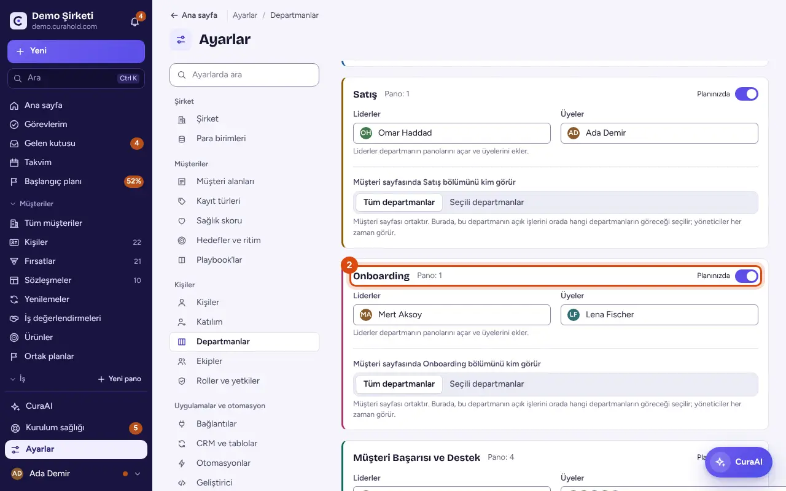
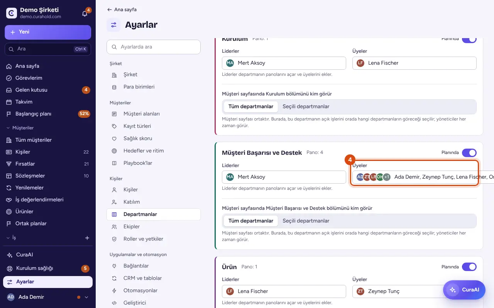
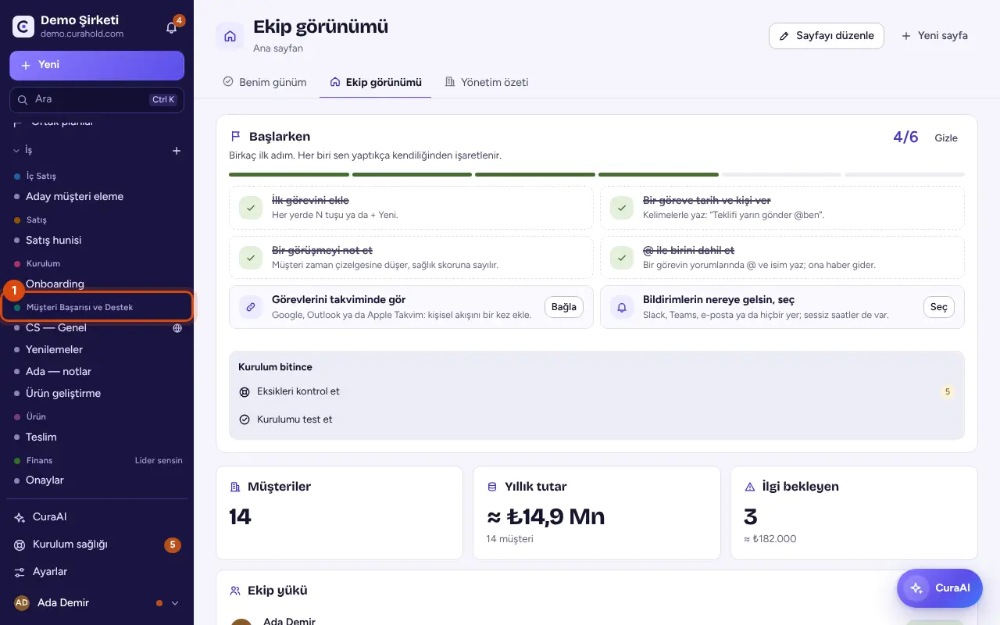
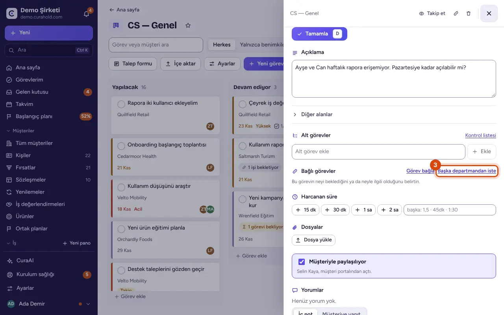
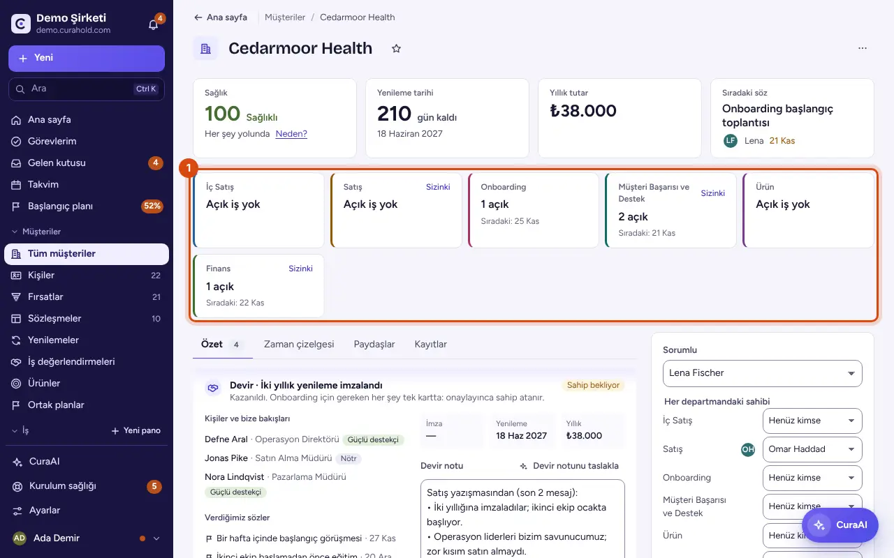
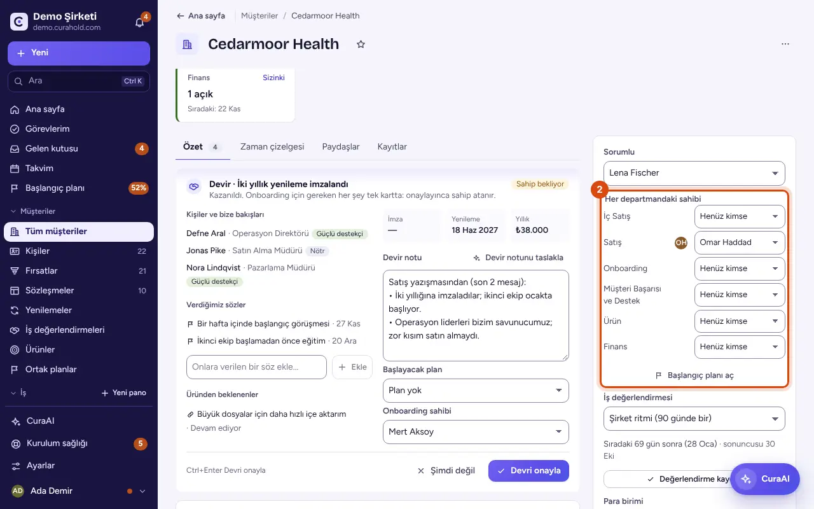

# Departmanlar

Curahold'da iş departmanlarda yaşar: İç Satış, Satış, Onboarding, Müşteri Başarısı ve Destek, Ürün ve Finans. Herkes kendi departmanlarının panolarını görür. İş başka bir departmana bir taleple geçer; müşteri sayfası ise o müşteriyi görebilen herkesin ortak sayfasıdır.

## Departmanlarını kur {#set-up}

Yönetici (ya da kişileri yöneten biri) olmanız gerekir.

1. Soldaki menüde **Ayarlar**'a, sonra **Kişiler** altındaki **Departmanlar**'a tıklayın.
   
2. Şirketinizde olan her departmanda **Planında** anahtarını açık bırakın. Kullanmadığınız bir departmanınkini kapatın: herkese gizlenir, panoları siz yeniden açana kadar saklanır.
   
3. **Liderler** alanında departmanı kimin yöneteceğini seçin. Liderler departmanın panolarını açar ve üyelerini ekler.
   
4. **Üyeler** alanında orada çalışan diğer herkesi seçin. Bir kişi birden fazla departmanda olabilir.
   
5. **Müşteri sayfasında … bölümünü kim görür** altında **Tüm departmanlar**'ı seçin ya da **Seçili departmanlar**'ı seçip bu departmanın açık işlerini orada görebilecek departmanlara tıklayın. Yöneticiler her zaman görür. Finans başta yalnızca Finans'a açıktır.
   

Her şey yaptıkça kaydedilir. Henüz bir departmanda olmayan kişi, siz onu ekleyene kadar kendi işlerini **Görevlerim**'de tutar.

Şirketiniz departmanlara geçtiğinde var olan her pano bir departmana yerleştirildi. Aynı sayfanın altındaki **Departmanlara geçiş**, her panonun nereye gittiğini ve nedenini gösterir; bir panonun departmanını oradan değiştirin. **Yerleştirilecek kişi** listesi, önceden bir panoyu görebilen ama üzerinde çalışmayan kişileri gösterir: **Erişim ver** onları üye yapar.

## Bir departmandaki panolar {#boards}

1. Menüde panolar departmanlarının adı altında toplanır. Yönettiğiniz departmanın yanında **Lider sizsiniz** yazar.
   
2. Yeni pano açmak için **İş** başlığının yanındaki **+**'ya tıklayın. **Departman** alanında panonun duracağı yeri seçin, ad verin ve **Oluştur**'a tıklayın. Panoları yalnızca yöneticiler ve departman liderleri açar.
   

**Kim görebilir** başta **Departmandaki herkes**'tir; bir ekiple ya da seçtiğiniz kişilerle daraltabilirsiniz.

## Başka departmandan iste {#ask}

1. Talebin ilgili olduğu görevi açın ve **Başka departmandan iste**'ye tıklayın. Listeden departmanın panosunu seçin, talep formunu doldurun ve gönderin.
   

Talep o departmanın panosuna düşer ve sizin görevinize bağlanır. Başlığını ve durumunu görürsünüz, diğer departmanın panosunu hiçbir zaman görmezsiniz. Bir departman, lideri bir panonun talep formunu açtığında talep almaya başlar (**Pano ayarları → Alanlar ve talep formu**).

## Müşteri sayfasında {#customer-page}

1. Bir müşterinin sayfasında **Departmanlar genelinde**, her departmanın o müşteri için açık işlerini, ne kadarının geciktiğini ve sıradaki son tarihi gösterir. **Sizinki**, içinde olduğunuz departmanları işaretler.
   
2. Sağda **Her departmandaki sahibi**, müşteriyle her departmanda kimin ilgilendiğini gösterir. Atamak için bir kişi seçin.
   

Departmanlar arası devirler (Onboarding'e ya da Müşteri Başarısı'na giden kazanılmış bir fırsat) [Devir, talepler ve müşteriye dönüş](/docs/tr/handover-and-requests/) sayfasında.
