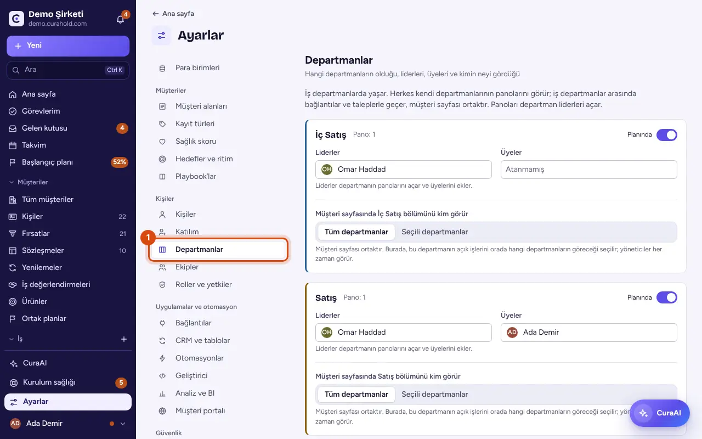
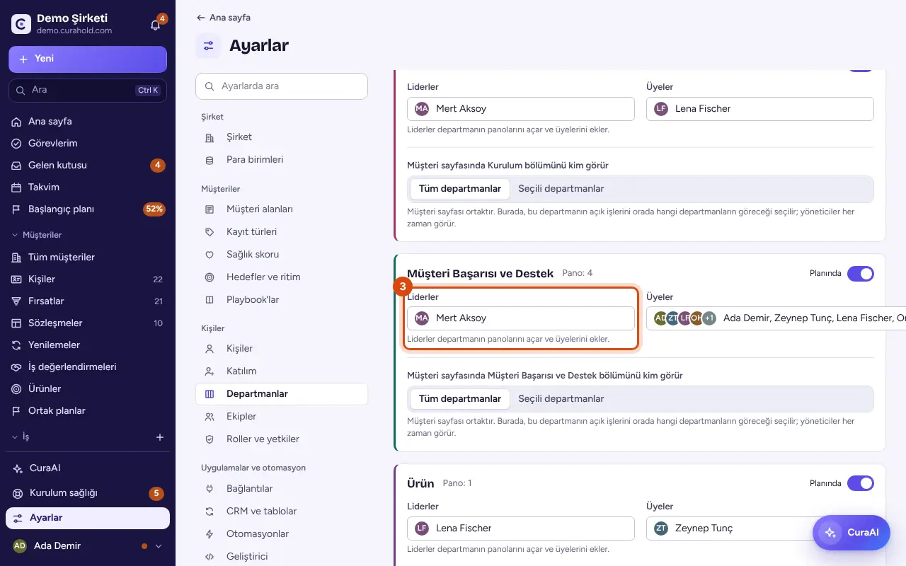
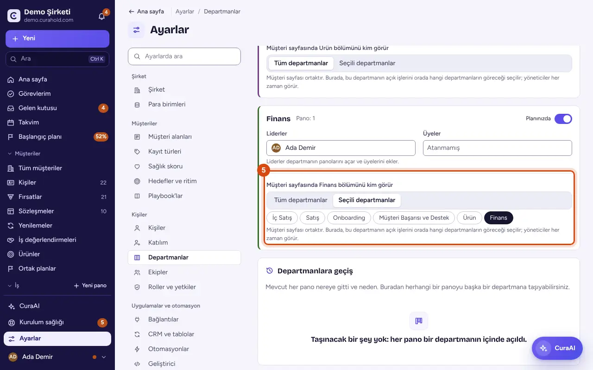
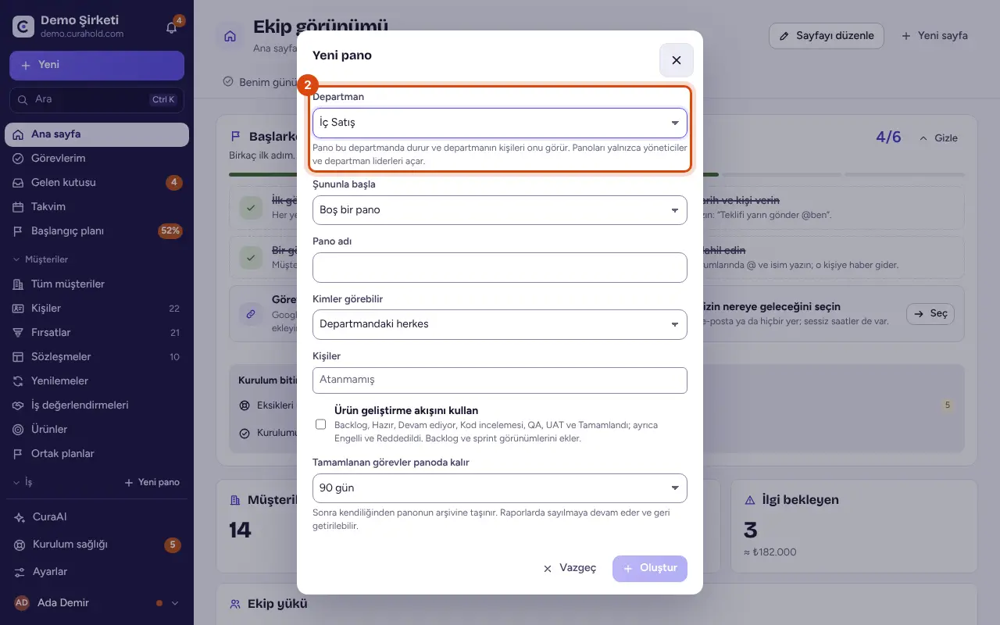

# Departmanlar

Curahold'da iş departmanlarda yaşar: İç Satış, Satış, Onboarding, Müşteri Başarısı ve Destek, Ürün ve Finans. Herkes kendi departmanlarının panolarını görür. İş başka bir departmana bir taleple geçer; müşteri sayfası ise o müşteriyi görebilen herkesin ortak sayfasıdır.

## Departmanlarını kur {#set-up}

Yönetici (ya da kişileri yöneten biri) olman gerekir.

1. Soldaki menüde **Ayarlar**'a, sonra **Kişiler** altındaki **Departmanlar**'a tıkla.
   
2. Şirketinde olan her departmanda **Planında** anahtarını açık bırak. Kullanmadığın bir departmanınkini kapat: herkese gizlenir, panoları sen yeniden açana kadar saklanır.
   
3. **Liderler** alanında departmanı kimin yöneteceğini seç. Liderler departmanın panolarını açar ve üyelerini ekler.
   
4. **Üyeler** alanında orada çalışan diğer herkesi seç. Bir kişi birden fazla departmanda olabilir.
   
5. **Müşteri sayfasında … bölümünü kim görür** altında **Tüm departmanlar**'ı seç ya da **Seçili departmanlar**'ı seçip bu departmanın açık işlerini orada görebilecek departmanlara tıkla. Yöneticiler her zaman görür. Finans başta yalnızca Finans'a açıktır.
   

Her şey yaptıkça kaydedilir. Henüz bir departmanda olmayan kişi, sen onu ekleyene kadar kendi işlerini **Görevlerim**'de tutar.

Şirketin departmanlara geçtiğinde var olan her pano bir departmana yerleştirildi. Aynı sayfanın altındaki **Departmanlara geçiş**, her panonun nereye gittiğini ve nedenini gösterir; bir panonun departmanını oradan değiştir. **Yerleştirilecek kişi** listesi, önceden bir panoyu görebilen ama üzerinde çalışmayan kişileri gösterir: **Erişim ver** onları üye yapar.

## Bir departmandaki panolar {#boards}

1. Menüde panolar departmanlarının adı altında toplanır. Yönettiğin departmanın yanında **Lider sensin** yazar.
   
2. Yeni pano açmak için **İş** başlığının yanındaki **+**'ya tıkla. **Departman** alanında panonun duracağı yeri seç, ad ver ve **Oluştur**'a tıkla. Panoları yalnızca yöneticiler ve departman liderleri açar.
   

**Kim görebilir** başta **Departmandaki herkes**'tir; bir ekiple ya da seçtiğin kişilerle daraltabilirsin.

## Başka departmandan iste {#ask}

1. Talebin ilgili olduğu görevi aç ve **Başka departmandan iste**'ye tıkla. Listeden departmanın panosunu seç, talep formunu doldur ve gönder.
   

Talep o departmanın panosuna düşer ve senin görevine bağlanır. Başlığını ve durumunu görürsün, diğer departmanın panosunu hiçbir zaman görmezsin. Bir departman, lideri bir panonun talep formunu açtığında talep almaya başlar (**Pano ayarları → Alanlar ve talep formu**).

## Müşteri sayfasında {#customer-page}

1. Bir müşterinin sayfasında **Departmanlar genelinde**, her departmanın o müşteri için açık işlerini, ne kadarının geciktiğini ve sıradaki son tarihi gösterir. **Seninki**, içinde olduğun departmanları işaretler.
   
2. Sağda **Her departmandaki sahibi**, müşteriyle her departmanda kimin ilgilendiğini gösterir. Atamak için bir kişi seç.
   

Departmanlar arası devirler (Onboarding'e ya da Müşteri Başarısı'na giden kazanılmış bir fırsat) [Devir, talepler ve müşteriye dönüş](/docs/tr/handover-and-requests/) sayfasında.
