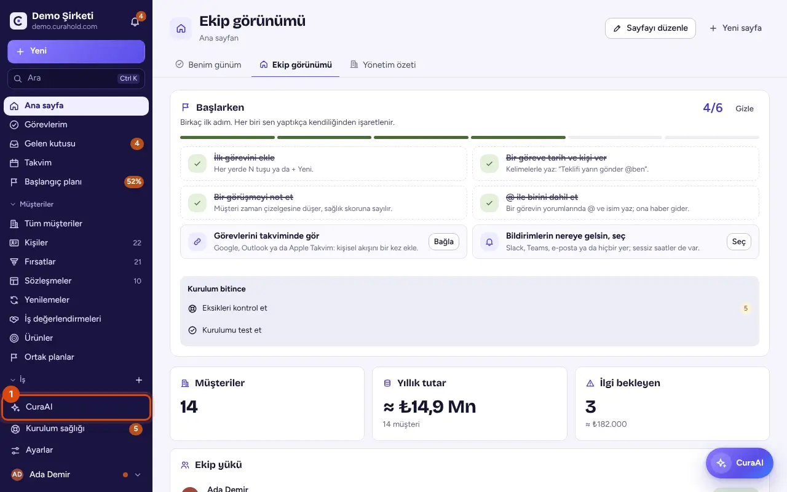
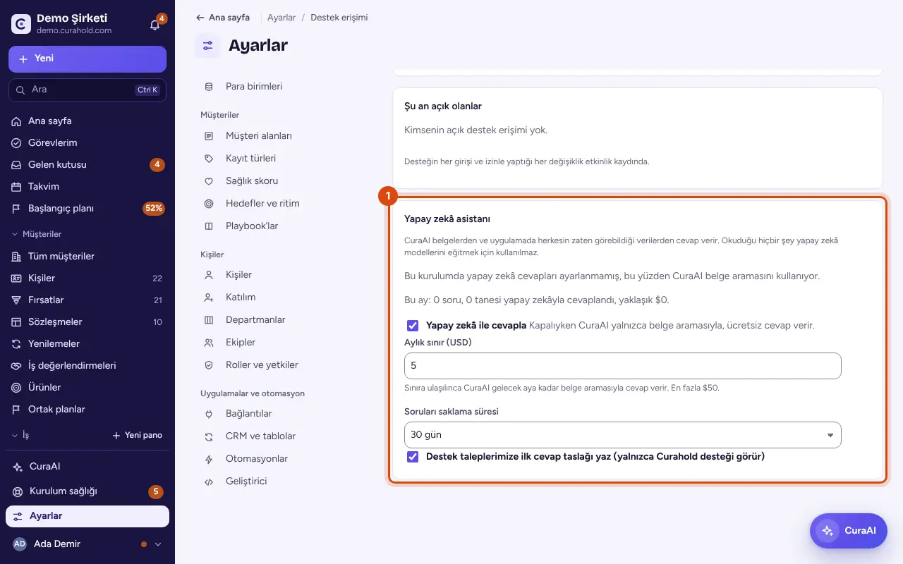
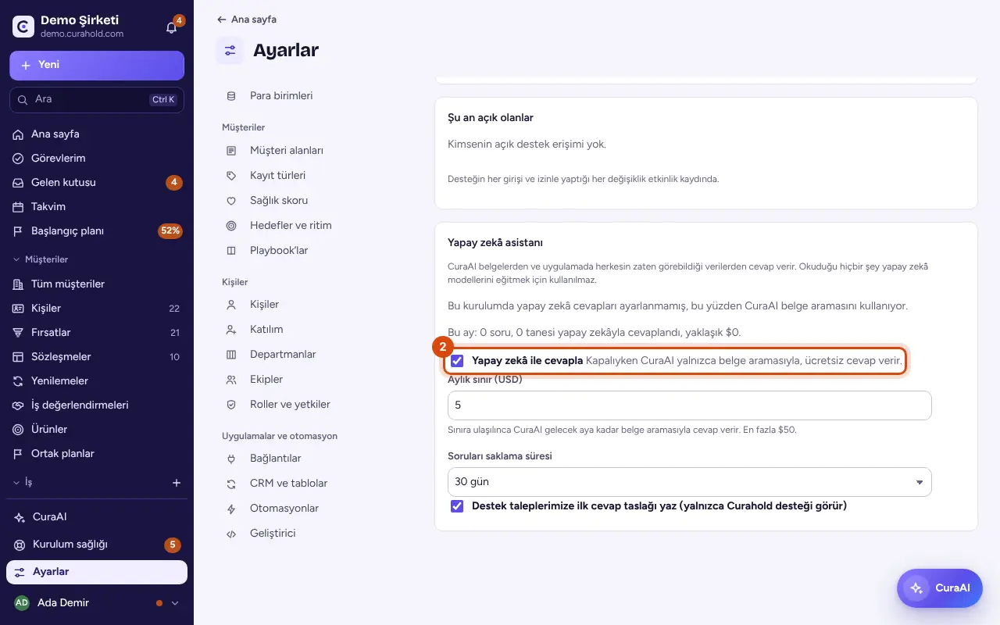

# Destek almak

İki adım, bu sırayla: önce **sor**, yetmediyse **desteğe yaz**.

## Önce sor {#ask}

1. Soldaki menüde **CuraAI**'ya tıklayın (telefonda sağ alttaki düğme; bu belgelerde **Sor** düğmesi). Sorunuzu kendi cümlelerinizle yazın: "müşterileri nasıl içe aktarırım", "bu alanı kim görebilir".
   

Cevap bu belgelerden, nereden geldiğiyle birlikte gelir. Şirketinizde **yapay zekâ ile cevap** açıksa (aşağıya bakın), CuraAI Curahold'da zaten görebildiklerinizi de okur: müşterileriniz, yenilemeler, görevler. Böylece "önümüzdeki 90 günde neler yenileniyor?" diye sorabilirsiniz. Yalnızca okur, hiçbir şeyi değiştirmez. Yapay zekâ ile cevap kapalıysa, kurulmamışsa ya da ayın sınırı dolduysa belgeler kendi cihazınızda aranır ve yazdığınız hiçbir şey bir yere gönderilmez.

Cevap işinizi görmediyse bunu belirtin: en yakın diğer yerleri ve sorun hazır yazılmış halde desteğe yazma düğmesini görürsünüz.

## Desteğe ulaşmak: talep göndermek

CuraAI'nın altındaki **Desteğe yaz**'ı kullanın. Form, desteğin size yeniden soru sormadan sorunu bulabilmesi için gerekenleri ister. Görmediğiniz hiçbir şey gönderilmez; neyin gideceğini siz seçersiniz.

1. **Konu**: Bir şey çalışmıyor, Nasıl yapılır, Veri ya da bağlantı, Öneri ya da Fatura ve plan.
2. **Etki**: Hata ve veri sorunlarında işinizi durdurup durdurmadığını seçin. Desteğin sırası buna göre belirlenir.
3. **Başlık**: Birkaç kelime yeter. Yazarken belgelerden cevabı içerebilecek sayfalar önerilir.
4. **Ne oldu**: Ne yapmaya çalıştığınızı, ne beklediğinizi ve ne olduğunu yazın. Hata mesajı çıktıysa aynen kopyalayın.
5. **Nasıl tekrar edebiliriz**: Hatalarda adım adım (isteğe bağlı ama çok işe yarar).

6. **Haberdar edilecekler** ve **Ne zamana lazım** (ikisi de isteğe bağlı): talebi okuyup cevabı duyması gereken iş arkadaşların ve cevabın gerektiği gün.

Gönderince bir **referans numarası** (örn. CH-000123) alırsınız; bir kopyası e-postanıza gelir.

## Konuşma: cevaplar, yanıtlar ve sıranın kimde olduğu

Talep bir konuşmadır. **Taleplerim** altında açarsınız (CuraAI'nın üstündeki gelen kutusu düğmesi):

- **Desteğin cevabı** e-postayla ve talebin üzerine gelir. CuraAI düğmesindeki işaret, bekleyen bir cevap olduğunu söyler.
- Üründe **cevap yaz** ya da yalnızca **e-postayı yanıtla**: alıntının üstüne yazdığınız, talebe düşer.
- Talep **sıranın kimde olduğunu** söyler: *Destekte*, *Cevabınız bekleniyor* ya da *Çözüldü*. **Çözüldü olarak işaretle** kapatır; yeniden yazarsanız açılır.
- **Haberdar edilen iş arkadaşları** talebi okur, desteğin cevaplarını e-postayla alır ve cevap yazabilir. Onları yalnızca talebi açan kişi ekler ya da çıkarır. Yönetici şirketinizin her talebini okuyabilir ama yalnızca kendi talebinde cevap yazar.
- Curahold ekibi talep üzerinde **kendi notlarını** tutabilir. Bunlar şirketine hiçbir zaman gösterilmez ve gönderilmez.

## Ekran görüntüleri ve dosyalar

- **Ekran görüntüsü al**: Tarayıcı hangi sekmeyi paylaşacağını sorar; Curahold sekmesini seçin. Yardım penceresi o an gizlenir, yalnızca sayfa çekilir.
- **Yapıştır ya da sürükle**: Kopyaladığınız bir görüntüyü forma yapıştırabilir, dosyaları sürükleyebilirsiniz.
- **İşaretle**: Önemli yeri kırmızı çerçeveyle vurgulayın. **Gizle** ile desteğin görmemesi gereken her şeyi (bir müşteri adı, bir tutar) kapatın; kapattığınız yer gönderilen görüntüden silinir.

En fazla 6 dosya, her biri 10 MB. Resim, PDF, metin, CSV, JSON, Excel ve kısa videolar eklenebilir.

## Talebe eklenen teknik bilgiler

Form şunları kendiliğinden ekler ve gönderilmeden önce size gösterir:

| Bilgi | Ne işe yarar |
|---|---|
| Sayfanın adresi | Sorunun nerede olduğu. Adresteki gizli parçalar (bağlantı kodları gibi) çıkarılır. |
| Tarayıcı, ekran, uygulama sürümü | Yalnızca belli bir tarayıcıda olan sorunlar için. |
| Son açtığınız sayfalar | Oraya nasıl geldiğiniz. Yalnızca adresler, sayfa içeriği yok. |
| Sayfadaki hatalar | Arka planda oluşan hata mesajları. E-posta adresleri ve anahtar benzeri metinler maskelenir. |
| Başarısız istekler | Hangi işlem hata verdi (yol ve durum kodu). |
| Şu an açık olanlar | Açık müşteri, pano ya da görev. |

Göndermek istemediğinizin işaretini kaldırmanız yeterli. Yazdığınız hiçbir şey ve sayfadaki veriler bu bilgilere girmez.

## Desteğin hesabına bakmasına izin vermek

Bazı sorunları görmeden çözmek zordur. Formun sonundaki **Curahold desteğinin hesabıma bakmasına izin ver** kutusu bunun içindir. Kutu kendiliğinden işaretli gelmez.

- **Ne görür**: Destek, tam olarak sizin gördüğünüzü görür: aynı müşteriler, aynı panolar, aynı alanlar. Fazlasını değil.
- **Ne kadar**: 24 saat, 3 gün ya da 7 gün. Süre dolunca erişim kendiliğinden kapanır. Destek bir girişte en fazla 8 saat kalır.
- **Ne yapabilir**: **yalnızca bakar**. Destek hesabında hiçbir şeyi değiştirmez.
- **Hiç dokunamadıkları**: Cihazların ve oturumların, API anahtarları, uygulama ve webhook ayarları, kişi davet etme, roller, şirket ayarları, veri dışa aktarma ve silme. Destek kendi erişimini de uzatamaz.
- **Kapatmak**: İstediğiniz an **Yardım → Taleplerim → Erişimi kapat**. Açık bir destek oturumu da hemen sona erer. Erişim açıkken sayfanın üstünde bir şerit bunu hatırlatır.
- **Kayıt**: Desteğin her girişi ve bu sırada okuduğu her şey, destek çalışanının adıyla birlikte **Ayarlar → Etkinlik kaydı**'na yazılır.

Destek içerideyken ekranın üstünde kimin baktığını ve ne zamana kadar baktığını gösteren bir şerit görünür.

## Şirket ayarı (yöneticiler)

**Ayarlar → Güvenlik → Destek erişimi** ile kimin desteğe erişim verebileceğini seçersiniz:

- **Herkes**: Herkes kendi görebildikleri için (varsayılan).
- **Yalnızca yöneticiler**: Diğerlerinin açık erişimleri hemen kapanır.
- **Hiç kimse**: Destek yine e-postayla yanıt verir ama içeri giremez.

Aynı sayfada şu an açık olan erişimleri, kimin verdiğini ve son giriş zamanını görür, istediğinizi kapatabilirsiniz.

## Destek için oturum kaydı

Bir şey bozulduğunda destek, onu tarif etmenizi istemek yerine ne olduğunu görebilsin diye sayfa siz kullandıkça kendini kaydeder (hangi düğmeler, hangi ekranlar, uygulamanın ne çizdiği). Bu, desteğin hesabınıza bakmasına izin vermekten ayrıdır; arka planda sessizce çalışır.

- **Yazdığınız hiçbir şey kaydedilmez.** Her alan — aramalar, notlar, girdiğiniz müşteri bilgileri — maskelenir. Kayıt, içine yazdıklarınızın değil, arayüzün kaydıdır.
- **7 gün tutulur**, sonra silinir.
- **Bir kaydı yalnızca Curahold destek ekibi açabilir**, kendi masasından, ve her açılış destek masasının kaydına yazılır. Şirketiniz kendi kayıtlarını görmez.
- **Yöneticiler kapatabilir**: **Ayarlar → Güvenlik → Destek erişimi → Destek için oturum kaydı**. Kapalıyken hiçbir şey kaydedilmez.

Kurumun kendi çalışanlarına bunu bir gizlilik bildiriminde anlatması gerekiyorsa, dayanağı bu ayar ve bu sayfadır.

## Yapay zekâ ile cevap (yöneticiler) {#ai-answers}

1. **Ayarlar → Destek erişimi**'ni açın ve **Yapay zekâ asistanı**'na kadar kaydırın.
   
2. CuraAI'nın yapay zekâyla cevap vermesi için **Yapay zekâ ile cevapla**'yı işaretleyin; yalnızca belge aramasıyla, ücretsiz cevap vermesi için işareti kaldırın. CuraAI'nın okudukları hiçbir zaman yapay zekâ modellerini eğitmek için kullanılmaz. Yeni bir şirkette bu kutu **kapalı** başlar: bir yönetici işaretleyene kadar yapay zekâ sağlayıcısına hiçbir şey gönderilmez; kapalıyken kart bunu açıkça yazar.
   

Aynı kartta:

- **Aylık sınır (USD)**: dolunca CuraAI ay sonuna kadar belge aramasıyla cevap verir. Kart bu ayki soruları ve maliyetlerini gösterir. Ayarlayabileceğiniz en yüksek tutar planınıza ve tam kullanıcı sayınıza göre belirlenir, deneme süresince sabittir; kart bunu gösterir.
- **Soruları saklama süresi**: soruların ne kadar saklanacağı (ya da hiç saklanmayacağı). Bir kişinin kendi soruları kişisel veri indirmesinde yer alır.
- **Destek taleplerimize ilk cevap taslağı yaz**: Curahold desteği taleplerinize taslak bir ilk cevap görür; siz taslağı hiç görmezsiniz, yalnızca desteğin gerçek cevabını görürsünüz. Taslak yalnızca CuraAI bilgilendirmesini kabul etmiş kişilerin taleplerine yazılır; diğer talepler desteğe taslaksız ulaşır ve içerikleri yapay zekâ sağlayıcısına gönderilmez.

Kart, bu kurulumda yapay zekâ ile cevabın kurulmadığını söylüyorsa CuraAI belge aramasını kullanır; yapay zekâ anahtarını Curahold sunucunu çalıştıran kişi ekler.

**Herkese önce sorulur.** Yapay zekâ cevapları açıkken biri CuraAI'yi ilk kez açtığında CuraAI, yapay zekâ sağlayıcısına neyin, neden ve ne kadar süreyle gönderildiğini söyler, aydınlatma metnine bağlantı verir ve **Kabul ediyorum** ile **Reddet** düğmelerini gösterir (hiçbir şey önceden işaretli değildir). Kabul edilene kadar yazılan hiçbir şey cihazdan çıkmaz, belge araması cevap verir; reddetmek hiçbir şey kaybettirmez. Onay CuraAI'nin altından ya da **Ayarlarınız → Yapay zekâ asistanı onayı**'ndan her an geri alınabilir; bilgilendirme değişince yeniden sorulur. Sunucu "evet" olmadan gelen soruyu reddeder ve her cevap aktivite kaydına yazılır. Müşteri portalı ve herkese açık belgeler de aynı şekilde sorar.

## Hata kaydı (yöneticiler) {#errors}

**Ayarlar → Hatalar**, son 30 günde kişilerinizin karşılaştığı aksaklıkları ve nerede olduklarını listeler: ekran, başarısız istek ve kaç kez olduğu. İçinde kişisel bir şey yoktur. Desteğe yazarken orada gördüğünüzü ekleyin.
