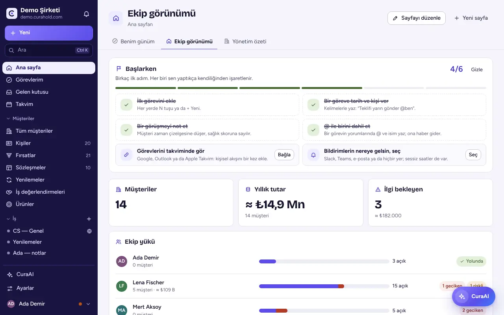

# Başlarken

Curahold, müşteri başarısı ve hesap yönetimi ekiplerinin müşterilerini, paydaşlarını ve günlük işlerini tek yerde yürüttüğü bir çalışma alanıdır. Bu sayfa ilk on beş dakikanı anlatır.

## Şirket adresin

Her şirketin kendi adresi vardır: `sirketin.curahold.com`. Ekibindeki herkes bu adresten girer. Başka bir şirketin verisi bu adreste hiçbir zaman görünmez; ayrım veritabanının kendisinde yapılır.

## Giriş

- **E-posta bağlantısı:** e-posta adresini yaz, gelen bağlantıya tıkla. Şifre yok.
- **Google ya da Microsoft:** şirketin açtıysa tek tıkla girersin. Daha önce görmediğimiz bir cihazdan giriyorsan e-postana gelen 6 haneli kodu da isteriz.
- **Geçiş anahtarı:** ilk girişten sonra parmak izin, yüzün ya da cihaz PIN'inle.
- **İkinci adım:** Ayarların → **Giriş güvenliği**'nden bir doğrulama uygulaması ekleyebilirsin; yanında 10 kurtarma kodu gelir. Yönetici ikinci adımı yöneticilere ya da herkese zorunlu kılabilir.
- Hassas işlemlerden önce (rol değiştirmek, API anahtarı, verini dışa aktarmak…) son on dakikada giriş yapmadıysan **Sen olduğunu onayla** istenir.
- Bir adrese 15 dakikada en fazla 5 giriş bağlantısı gönderilir.

## İlk kurulum

Şirketi kuran kişi bir şablon seçer: müşteri başarısı, hesap yönetimi, satış, destek ya da boş. Şablon; müşteri alanlarını (yenileme tarihi, yıllık tutar, sağlık…), panoları ve hazır otomasyonları getirir. Hepsi sonradan değiştirilebilir.

Ardından ekibini davet edersin. Şirket alan adını (`@sirketin.com`) eklersen, o alan adından gelen kişiler katılma isteği gönderebilir ya da doğrudan katılabilir.

## İlk günün

Ana sayfanda **Başlarken** kartı birkaç ilk adımı gösterir: ilk görevini eklemek, bir göreve tarih ve kişi vermek, bir görüşmeyi not etmek, @ ile birini dahil etmek, görevlerini takvimine bağlamak ve bildirimlerin nereye geleceğini seçmek. Her adım sen onu yaptıkça kendiliğinden işaretlenir; kart istersen **Gizle** ile kaybolur.

Soldaki **+ Yeni** düğmesi her şeyi tek yerden ekler: görev, müşteri, görüşme notu ya da pano. Görev yazarken tarihi, kişiyi ve müşteriyi aynı satıra yazabilirsin; ayrıntılar [Hızlı ekleme ve kısayollar](/docs/tr/quick-add/) sayfasında. Menünden (sol altta adın) açık ya da koyu görünümü, dili ve kısayolları bulursun; **Yenilikler** son eklenenleri gösterir.

## Dil

Curahold dokuz dil konuşur: İngilizce, Türkçe, Arapça, İbranice, Farsça, Basitleştirilmiş ve Geleneksel Çince, Japonca ve Korece. Dil iki yerden seçilir:

- **Kendin için:** Ayarların → Dil. Seçimin her cihazda seninle gelir.
- **Şirket için:** bir yönetici Ayarlar → Şirket sayfasından belirler. Yeni gelenler o dilde başlar, şirketin tamamına giden e-postalar o dilde yazılır.

Tarayıcından hiçbir şey tahmin edilmez; aynı bağlantıyı açan herkes aynı şeyi görür. Tarihler, sayılar ve tutarlar seçtiğin dile uyar; Arapça, İbranice ve Farsça sağdan sola okunur.

## Cihaz sınırı

Bir kişi aynı anda en fazla iki cihazda açık kalabilir; yönetici bunu 1 ile 5 arasında değiştirebilir. Üçüncü cihazdan girildiğinde en eski oturum kapanır. Böylece bir koltuk birkaç kişi arasında paylaşılamaz.

> **İpucu:** Ayarların → Cihazlar sayfasından açık oturumlarını görebilir, istemediğini kapatabilirsin.

## Telefona ya da bilgisayara kur

Curahold bir uygulama gibi kurulabilir; mağaza gerekmez.

- **Android ve bilgisayar (Chrome, Edge):** sol alttaki adına tıkla → **Curahold’u kur**. Tarayıcının adres çubuğundaki kur simgesi de aynı işi görür.
- **iPhone ve iPad (Safari):** Paylaş düğmesi → **Ana Ekrana Ekle** → Ekle.

Kurulan uygulama kendi penceresinde açılır; simgeye uzun basınca Görevlerim, Gelen kutusu ve Müşteriler kısayolları çıkar.

**Bağlantı yokken** uygulama yine açılır ve son gördüklerini gösterir: görevlerin, panolar, müşteriler, gelen kutusu. Üstte bir şerit çevrimdışı olduğunu söyler; değişiklikler bağlantı gelene kadar kaydedilmez. Çıkış yaptığında cihazda tutulan bu kopya silinir.

**Canlı yenileme:** sayfa açıkken başkasının yaptığı değişiklik (yeni kart, taşınan görev, yorum, yeni bildirim) birkaç saniye içinde kendiliğinden görünür; sayfayı yenilemen gerekmez. Bir şey yazarken ya da kart sürüklerken ekran elinin altından oynamaz.

## Sonraki adımlar

- [Müşteriler, alanlar ve kayıtlar](/docs/tr/customers/)
- [Görevler ve panolar](/docs/tr/tasks/)
- [Roller ve erişim](/docs/tr/roles-and-access/)
- [Hızlı ekleme ve kısayollar](/docs/tr/quick-add/)
