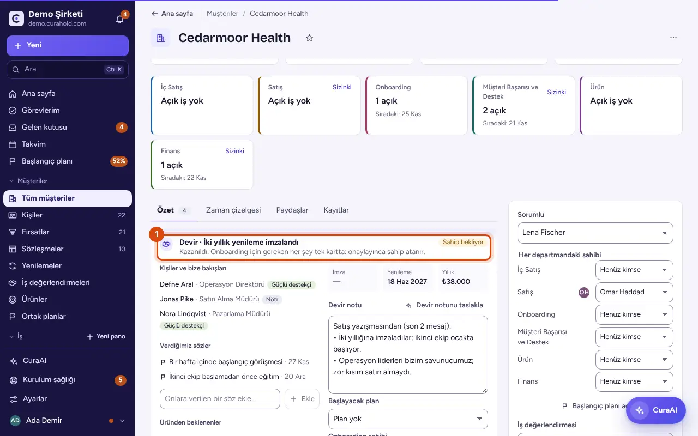
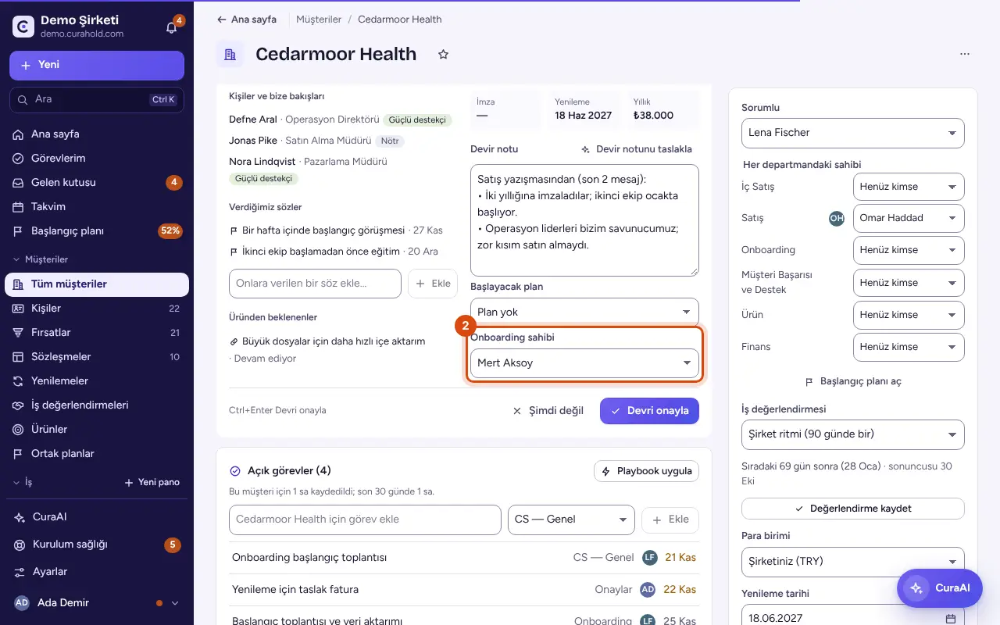
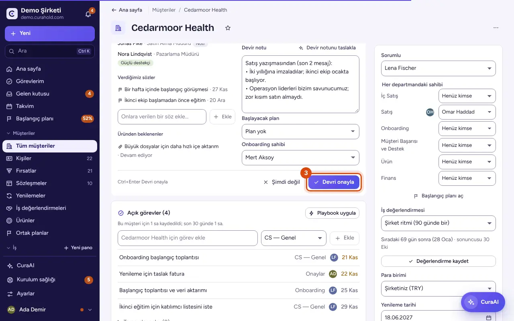
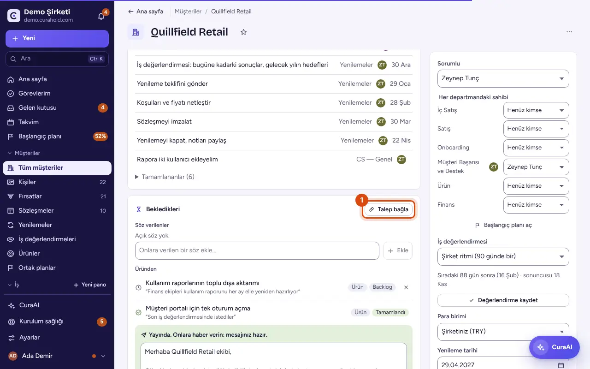
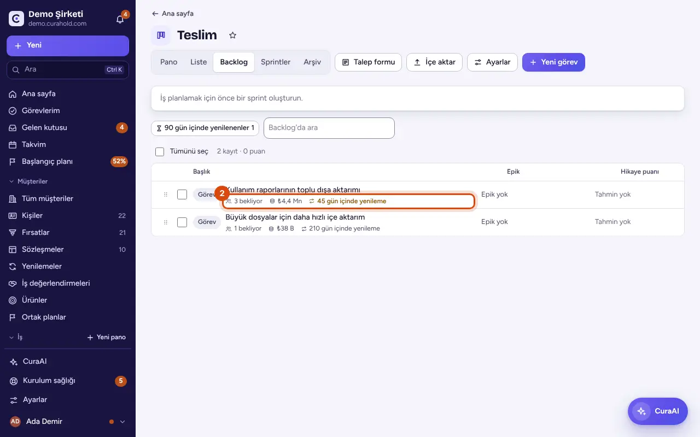
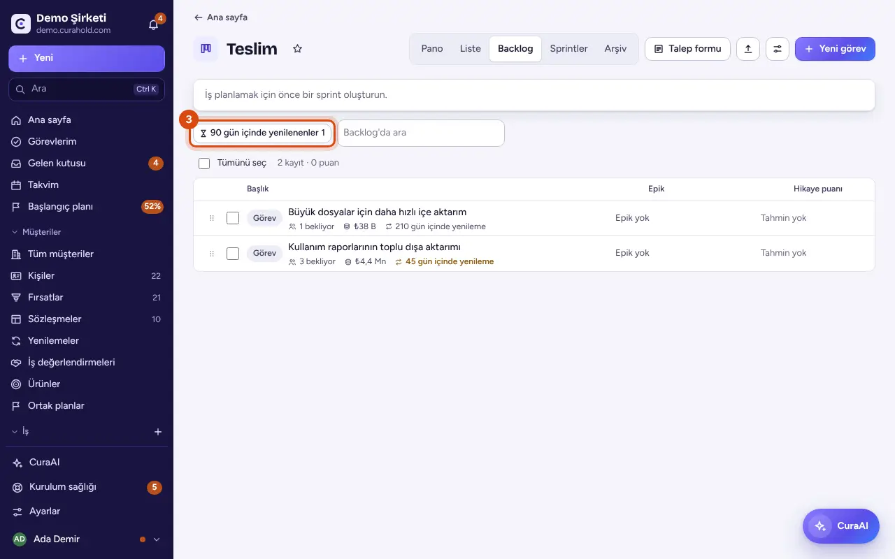
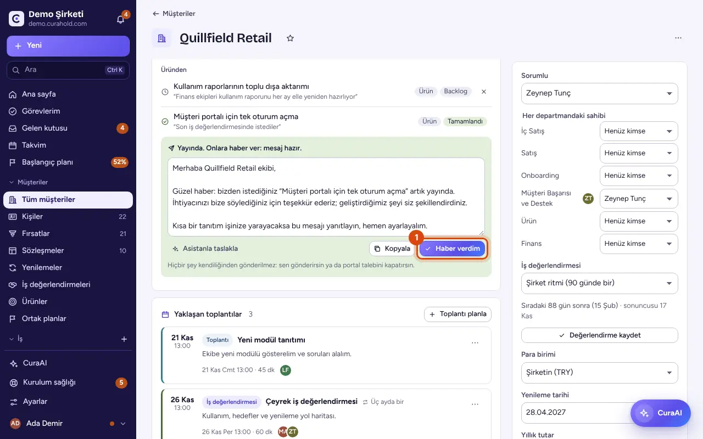
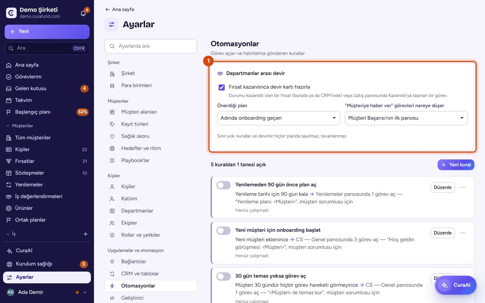

# Devir, talepler ve müşteriye dönüş

İş Satış'tan Kurulum'a ya da Müşteri Başarısı'na, müşteriden Ürün'e geçer. Curahold her ekibin ihtiyacını müşteri sayfasında tutar; kimse yeniden yazmaz, kimse başka departmanın panosunu açmak zorunda kalmaz.

## Fırsat kazanılınca {#handover}

Durumu **kazanıldı** olan bir fırsat (burada ya da CRM'inde) veya Satış panosunda **Kazanıldı**'ya taşınan bir görev, müşteri sayfasında tek bir **devir kartı** alır. Şirketinde Kurulum departmanı varsa kart **Kurulum**'a, yoksa **Müşteri Başarısı**'na gider.

1. Müşterinin sayfasını aç. Kart **Özet**'in en üstündedir ve **Sahip bekliyor** yazar. Oku: kişiler ve size bakışları, Satış'ın verdiği sözler, müşterinin Ürün'den hâlâ beklediği işler, tarihler, yıllık değer (o alanı görebiliyorsan) ve satış yazışmasından gelen devir notu.
   
2. **… sahibi** alanında müşteriyi kimin devralacağını seç. Yanındaki **Başlayacak plan**'a da bak.
   
3. **Devri onayla**'ya tıkla (ya da Ctrl+Enter, Mac'te ⌘+Enter). Sahip atanır, plan başlar, sahibe haber gider ve müşterinin zaman çizelgesi iki adımı da kaydeder.
   

**Şimdi değil** kartı kaldırır. **Devir notunu taslakla**, notu asistana yazdırır; kaydedilmeden önce okuyup değiştirirsin.

## Müşteri talebini ürün işine bağla {#requests}

1. Müşterinin sayfasında **Bekledikleri** altında **Talep bağla**'ya tıkla. Ürün'ün işlerinde ara, işi seç ve istersen müşterinin ne istediğini kendi sözleriyle ekle. Uyan bir iş yoksa aynı pencereden Ürün'den iste.
   

Aynı işi birçok müşteri bekleyebilir; her biri sayılır. Müşteriyi görebilen herkes işin başlığını, durumunu, sprint bitişini ve departmanını görür, Ürün'ün panosunu hiçbir zaman görmez.

## Ürün ne görür {#backlog}

1. Bir Ürün panosunda **Backlog**'u aç. Her işin altında: kaç müşterinin beklediği, yıllık değerleri (yalnızca o alanı görebilenlere) ve en yakın yenileme.
   
2. Yakında yenilenecek müşterilerin beklediği işleri, en yakın yenileme başta görmek için **90 gün içinde yenilenenler**'e tıkla.
   

## İş yayına girince {#shipped}

Bağlı bir iş bitince her müşterinin sahibine bir görev düşer ve müşterinin sayfasında işin altında hazır bir mesaj görünür.

1. Mesajı oku, istersen değiştir, **Kopyala**'ya tıkla ve kendi e-postandan ya da sohbetinden gönder. Sonra **Haber verdim**'e tıkla. Müşteri portaldan istediyse **Portal talebini kapat** talebi orada da kapatır.
   

**Hiçbir şey kendiliğinden gönderilmez.** Zaman çizelgesinde "onlar için yapıldı" yazar ve yenilemenin özeti bunu listeler.

## Ayarlar (yöneticiler) {#settings}

1. **Ayarlar → Otomasyonlar**'ı aç. **Departmanlar arası devir** altında, kazanılan fırsatın devir kartı alıp almayacağını, önerdiği planı ve "müşteriye haber ver" görevlerinin nereye düşeceğini seç.
   

## Asistandan taslaklar

Devir notu, "yayında" mesajı ve bir toplantının sözleri ile sonraki adımları asistana taslak olarak yazdırılabilir. Her taslağı kaydedilmeden önce okuyup değiştirirsin, Geri al onu geri alır; asistan yoksa (ya da aylık sınırı dolduysa) taslak şablondan gelir.

## Kurallar

Kurallar artık bir görev eklendiğinde ya da bittiğinde, bir formdan talep geldiğinde, bir kayıt bir aşamaya ulaştığında veya bir destek talebi açıldığında başlayabilir; atayabilir, taşıyabilir, alan doldurabilir, yorum yazabilir, webhook'larına gönderebilir ya da devri hazırlayabilir. Kurallar hiçbir planda sayılmaz, tavanlanmaz.
