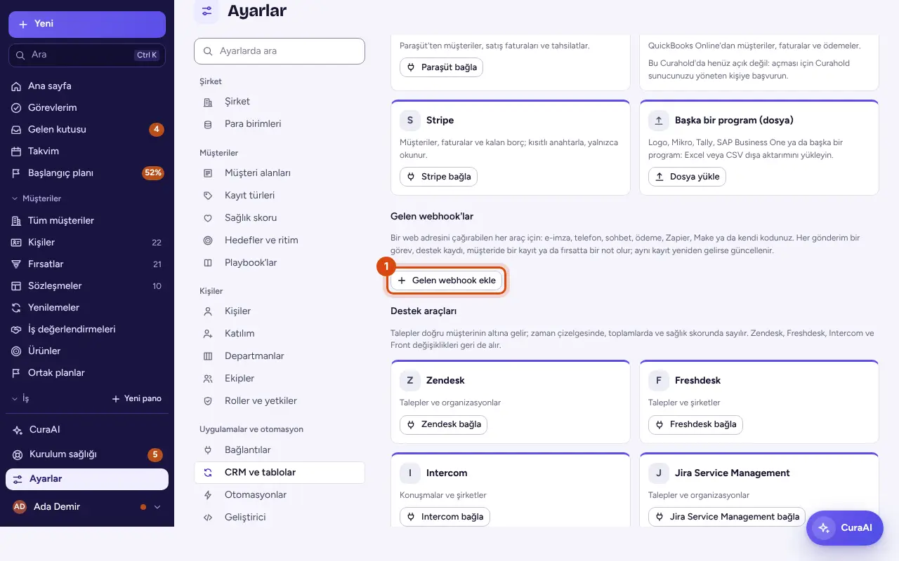
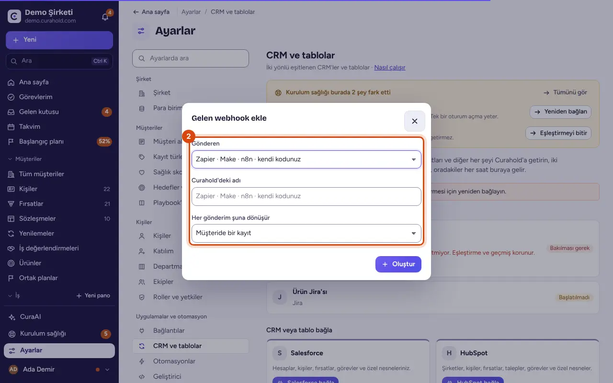
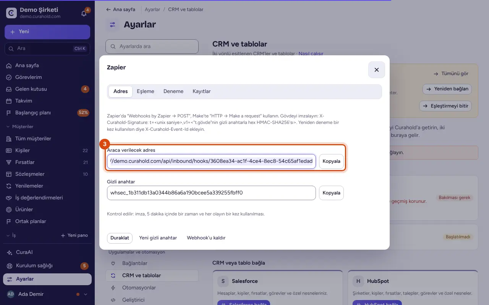
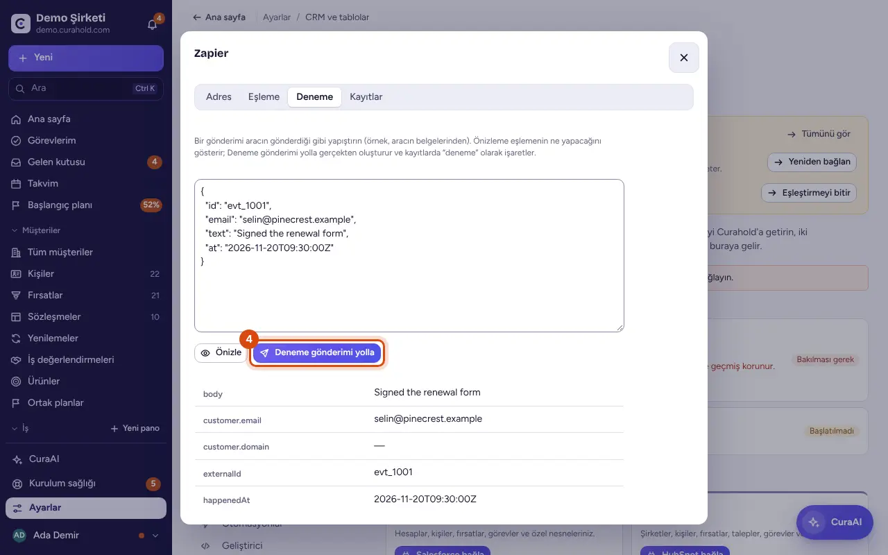
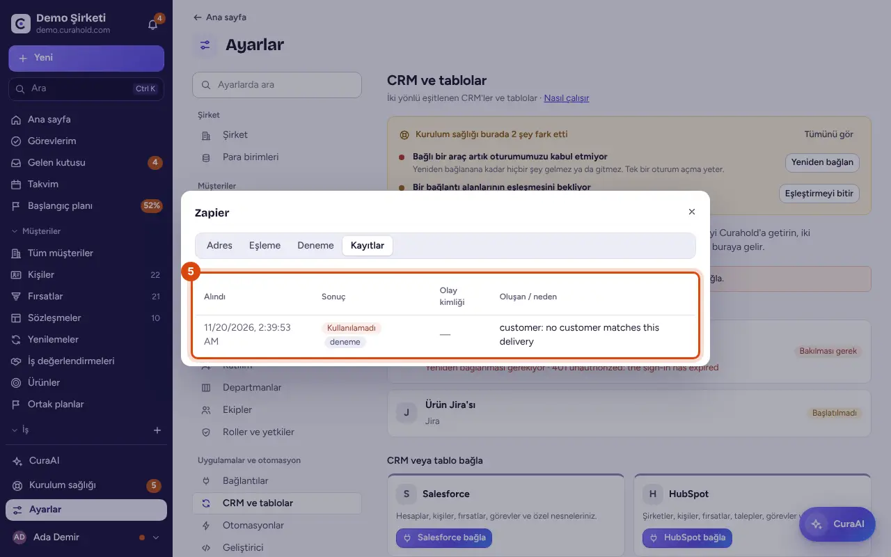

# Gelen webhook'lar

Curahold'un hazır bağlayıcısı olmayan araçlar için. Araç sana ait bir adrese gönderir; her gönderim bir **görev**, bir **destek kaydı**, **müşterinin zaman çizelgesinde bir kayıt** ya da **bir fırsatta not** olur. Aynı kayıt yeniden gelirse oluşturduğunu günceller. Her gönderim kontrol edilir: imza (ya da ortak anahtar), zamanı ve her olayın bir kez kullanılması.

## Curahold'da {#connect}

1. **Ayarlar → CRM ve tablolar**'nı aç, **Gelen webhook'lar**'a in ve **Gelen webhook ekle**'ye tıkla.
   
2. **Gönderen** altında aracı seç (ya da **Zapier · Make · n8n · kendi kodun**), **Her gönderim şuna dönüşür**'ü kontrol et ve **Oluştur**'a tıkla.
   
3. **Adres** sekmesinde adresi ve gizli anahtarı araca kopyala.
   
4. **Deneme** sekmesinde eşlemenin örnekten ne yapacağını görmek için **Önizle**'ye, sonra **Deneme gönderimi yolla**'ya tıkla.
   
5. **Kayıtlar** sekmesinde her gönderimi kontrol et: kullanıldı, atlandı, kullanılamadı (nedeniyle) ya da reddedildi.
   

## Eşleme

Her değer, gönderimden bir değer için `{{yol}}` içeren bir metindir; örneğin `{{data.envelopeSummary.status}}` ya da `{{items[0].email}}`. Müşteri önce bir kişinin e-postasıyla, sonra web adresiyle, sonra adıyla bulunur. **Aracın kayıt kimliği** "oluştur ya da güncelle"yi çalıştırır. **Yalnızca bu değer…** diğer olayları atlar (atlandı olarak kaydedilir).

## Hazır tarifler

| Araç | İmza | Neye dönüşür |
| --- | --- | --- |
| E-imza (DocuSign Connect; CloudSign, Modusign, Leegality aynı yolla) | `X-DocuSign-Signature-1`, HMAC-SHA256, base64, araçta ürettiğin anahtar | fırsatta not |
| Aircall | gövdede webhook'un token'ı | müşteride arama |
| Tawk.to | `X-Tawk-Signature`, HMAC-SHA1, hex | destek kaydı |
| Razorpay (iyzico aynı yolla) | `X-Razorpay-Signature`, HMAC-SHA256, hex | müşteride kayıt |
| Freshchat, Kylas, Sansan ve diğer her şey | ortak anahtar (`X-Curahold-Token` ya da `?token=`) | sen seçersin |

## Kendin imzalamak (Zapier, Make, n8n, kod) {#sign}

`X-Curahold-Signature` ve `X-Curahold-Event-Id` gönder:

```text
X-Curahold-Signature: t=1763631000,v1=<"1763631000.<ham gövde>"nin gizli anahtarla hex HMAC-SHA256'sı>
X-Curahold-Event-Id: evt_1001
```

Kodda (Node.js):

```js
const t = Math.floor(Date.now() / 1000);
const v1 = crypto.createHmac('sha256', secret).update(`${t}.${body}`).digest('hex');
fetch(address, { method: 'POST', body, headers: { 'content-type': 'application/json', 'x-curahold-signature': `t=${t},v1=${v1}`, 'x-curahold-event-id': id } });
```

Zaman 5 dakika içinde olmalı. Tekrarlanan olay kimliğine `duplicate` ile `200` döner ve yeniden kullanılmaz. Cevaplar: `200` (`status` ok, skipped ya da failed ile), `401` (imza, zaman ya da anahtar), `404` (bilinmiyor ya da duraklatılmış). Tam liste: [API başvurusu](/docs/tr/ref-developer-settings/).

## Henüz bağlayıcısı olmayan araçlar için Zapier ve Make tarifleri

Aracın tetikleyicisini kullan, sonra yukarıdaki adrese iki başlıkla **Webhooks by Zapier → POST** (Zapier) ya da **HTTP → Make a request** (Make). İmzayı Make'in **Custom JS** ya da Zapier'in **Code** adımı hesaplar (yukarıdaki kod).

| Araç | Tetikleyici | Gönderilecek gövde alanları | Neye dönüşür |
| --- | --- | --- | --- |
| LINE WORKS | Bot kanalında yeni mesaj | `id`, gönderenin `email`'i, `text` | kayıt |
| Chatwork | Odada yeni mesaj | `id`, `email`, `text` | kayıt |
| kintone | Kayıt eklendi ya da düzenlendi | `id`, `email`, `title`, `status` | görev |
| Money Forward Cloud | Fatura oluşturuldu ya da ödendi | `id`, `email`, `text` (numara, tutar, vade) | kayıt |
| Channel Talk | Sohbet kapandı | `id`, `email`, `title` | destek kaydı |
| KakaoWork | Bot mesajı | `id`, `email`, `text` | kayıt |
| LeadSquared | Lead ya da fırsat güncellendi | `id`, `email`, `title`, `status` | görev |
| Razorpay | Ödeme alındı | `id`, `email`, `text` | kayıt (ya da tarifi kullan) |
| DingTalk | Robot mesajı | `id`, `email`, `text` | kayıt |
| WeCom | Uygulama mesajı | `id`, `email`, `text` | kayıt |

## Saklama ve kaldırma

Kayıtlar webhook başına 30 gün ve en çok 500 gönderim saklanır. **Yeni gizli anahtar** eskisini hemen durdurur; **Duraklat** sürdürülene kadar `404` döner; **Webhook'u kaldır** onu ve kayıtlarını siler, oluşturdukları kalır. Bir webhook onu kuran kişinin yetkileriyle çalışır: yalnızca onun erişebildiği panolara ve müşterilere ulaşır, o kişi ayrılırsa durur.

## Ayrıca bakın

- [Webhook'lar (giden)](/docs/tr/webhooks/)
- [Kendi aracını bağla](/docs/tr/connect-your-own-tool/)
