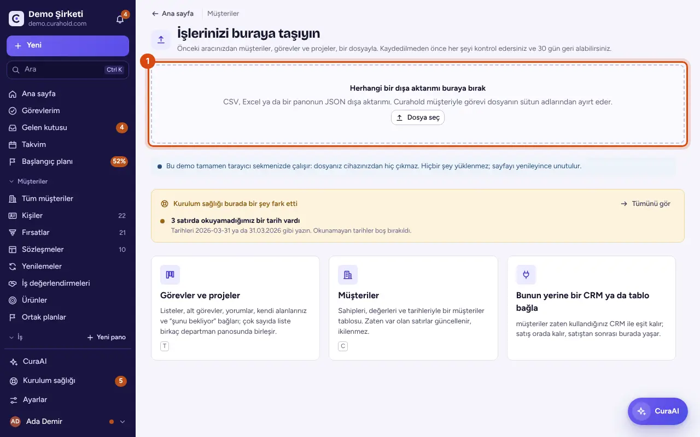
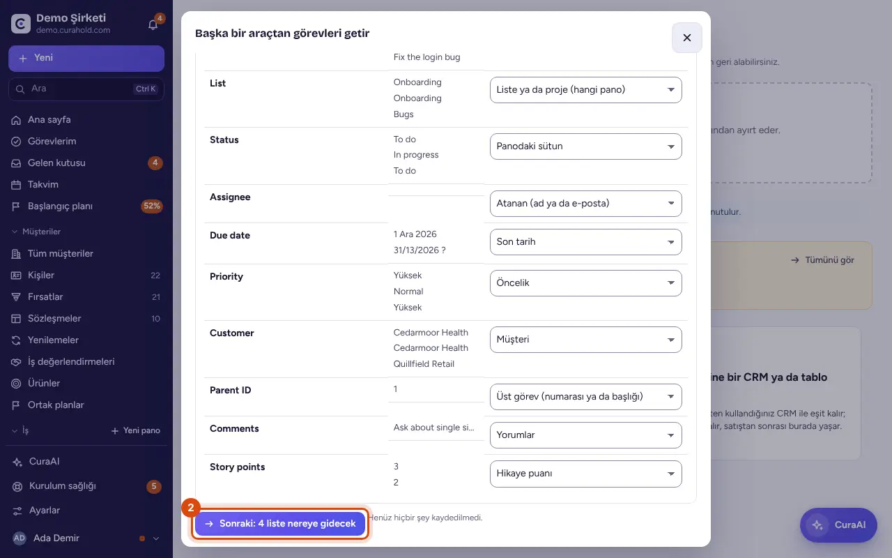
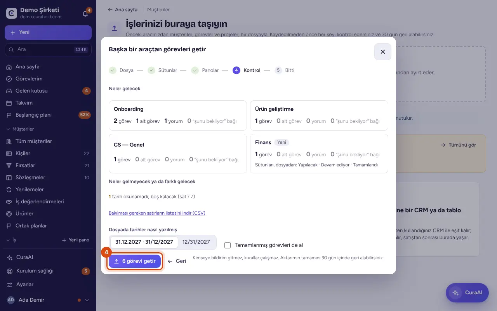
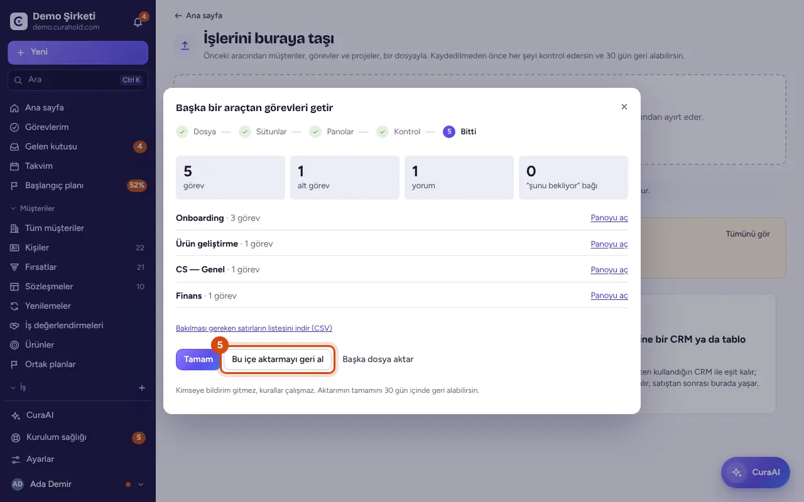

# Başka bir araçtan taşınmak

Önceden kullandığınız araçtan işlerinizi dışa aktarın (CSV, Excel tablosu (.xlsx) ya da bir kanban panosunun JSON dışa aktarımı) ve o dosyadan getirin. Son adıma kadar hiçbir şey kaydedilmez, kimseye bildirim gitmez, hiçbir kural çalışmaz: bu yeni iş değil, ev taşımaktır.

## Görevlerini getir {#tasks}

1. **İşlerinizi buraya taşıyın** sayfasını açın: aramaya (Ctrl K, Mac'te ⌘ K) "içe aktar" yazın ya da bir panodaki yukarı ok düğmesini kullanın. Dosyanızı **Herhangi bir dışa aktarımı buraya bırak** alanına bırakın ya da **Dosya seç**'e tıklayın. Curahold dosyanın sütun adlarından müşteri mi görev mi olduğunu anlar; kendiniz seçmek için görevler için **T**'ye, müşteriler için **C**'ye basın.
   
2. **Sütunlar.** Dosyanın her sütunu gideceği yerle eşlenir: başlık, açıklama, panodaki sütun, kişiler, tarihler, öncelik, müşteri, puan, eski araçtaki kimlik, üst görev, yorumlar, "şunu bekler" bağları ya da kendi tanımladığınız bir alan. İlk değerler her birinin neye dönüşeceğini gösterir. Yanlış olanı değiştirin, sonra **Sonraki**'ye tıklayın.
   
3. **Panolar.** Dosyada çok liste varsa birkaç departman panosunda birleşirler: "Yenilemeler" adlı liste Müşteri Başarısı'na, "Hatalar" Ürün'e gider. Ayrı tutmak için **Her liste ayrı pano**'ya tıklayın ya da her liste için istediğiniz panoyu seçin. Her görev geldiği listeyi **Geldiği liste** alanında saklar. **Sonraki: neyin geleceğini kontrol edin**'e tıklayın.
   
4. **Kontrol.** Pano pano kaç görev, alt görev, yorum ve bağ geleceğini, satır numaralarıyla da neyin gelmeyeceğini ya da farklı geleceğini okuyun. Önce dosyanızda düzeltmek isterseniz **Bakılması gereken satırların listesini indir (CSV)**'ye tıklayın. Sonra **… görevi getir**'e tıklayın.
   
5. **Bitti.** Her panonun bir **Panoyu aç** bağlantısı var. Bir şey istediğiniz gibi değilse **Bu içe aktarmayı geri al**'a tıklayın.
   

Curahold başlıkların üstündeki bir başlık satırını, başlıkları her grubun altında tekrarlanan grupları ve kendi öğesinin altına girintili alt öğeleri anlar.

## Geri al {#undo}

Bir görev içe aktarmasını geri alabilirsiniz: **Bu içe aktarmayı geri al** 30 gün çalışır, sonuç ekranından ya da ilk adımdaki **Önceki içe aktarmalarınız** listesinden. Kimsenin dokunmadığı görevler tek bir öğe olarak çöp kutusuna gider; o zamandan beri birinin değiştirdiği ya da yorum yazdığı görev panosunun arşivinde kalır. İçe aktarma için açılıp boş kalan pano kaldırılır.

## Şablon {#template}

İlk adımdaki **Şablonu indir**, Curahold'un okuduğu her sütunu ve üç örnek satırı içeren bir dosya verir; Excel'de açılır. İlk satırı (Bölge kendi sütununa bir örnektir):

```text
No;Başlık;Açıklama;Liste;Durum;Atanan;Son tarih;Öncelik;Müşteri;Üst görev;Yorumlar;Şuna bağlı;Puan;Bölge
```

## Demoda

Demo tamamen tarayıcı sekmenizde çalışır. Demo çubuğundaki **Kendi dosyanızla deneyin** aynı sayfayı açar: dosyanız sekmede okunur, cihazınızdan hiç çıkmaz ve sayfayı yenileyince unutulur.
