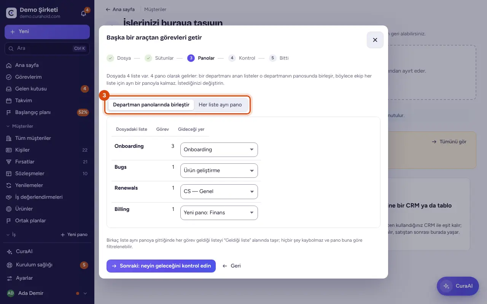

# Başka bir araçtan taşınmak

Önceden kullandığın araçtan işlerini dışa aktar (CSV, Excel tablosu (.xlsx) ya da bir kanban panosunun JSON dışa aktarımı) ve o dosyadan getir. Son adıma kadar hiçbir şey kaydedilmez, kimseye bildirim gitmez, hiçbir kural çalışmaz: bu yeni iş değil, ev taşımaktır.

## Görevlerini getir {#tasks}

1. **İşlerini buraya taşı** sayfasını aç: aramaya (Ctrl K, Mac'te ⌘ K) "içe aktar" yaz ya da bir panodaki yukarı ok düğmesini kullan. Dosyanı **Herhangi bir dışa aktarımı buraya bırak** alanına bırak ya da **Dosya seç**'e tıkla. Curahold dosyanın sütun adlarından müşteri mi görev mi olduğunu anlar; kendin seçmek için görevler için **T**'ye, müşteriler için **C**'ye bas.
   
2. **Sütunlar.** Dosyanın her sütunu gideceği yerle eşlenir: başlık, açıklama, panodaki sütun, kişiler, tarihler, öncelik, müşteri, puan, eski araçtaki kimlik, üst görev, yorumlar, "şunu bekler" bağları ya da kendine ait bir alan. İlk değerler her birinin neye dönüşeceğini gösterir. Yanlış olanı değiştir, sonra **Sonraki**'ye tıkla.
   
3. **Panolar.** Dosyada çok liste varsa birkaç departman panosunda birleşirler: "Yenilemeler" adlı liste Müşteri Başarısı'na, "Hatalar" Ürün'e gider. Ayrı tutmak için **Her liste ayrı pano**'ya tıkla ya da her liste için istediğin panoyu seç. Her görev geldiği listeyi **Geldiği liste** alanında saklar. **Sonraki: neyin geleceğini kontrol et**'e tıkla.
   
4. **Kontrol.** Pano pano kaç görev, alt görev, yorum ve bağ geleceğini, satır numaralarıyla da neyin gelmeyeceğini ya da farklı geleceğini oku. Önce dosyanda düzeltmek istersen **Bakılması gereken satırların listesini indir (CSV)**. Sonra **… görevi getir**'e tıkla.
   
5. **Bitti.** Her panonun bir **Panoyu aç** bağlantısı var. Bir şey istediğin gibi değilse **Bu içe aktarmayı geri al**'a tıkla.
   

Curahold başlıkların üstündeki bir başlık satırını, başlıkları her grubun altında tekrarlanan grupları ve kendi öğesinin altına girintili alt öğeleri anlar.

## Geri al {#undo}

Bir görev içe aktarmasını geri alabilirsin: **Bu içe aktarmayı geri al** 30 gün çalışır, sonuç ekranından ya da ilk adımdaki **Önceki içe aktarmaların** listesinden. Kimsenin dokunmadığı görevler tek bir öğe olarak çöp kutusuna gider; o zamandan beri birinin değiştirdiği ya da yorum yazdığı görev panosunun arşivinde kalır. İçe aktarma için açılıp boş kalan pano kaldırılır.

## Şablon {#template}

İlk adımdaki **Şablonu indir**, Curahold'un okuduğu her sütunu ve üç örnek satırı içeren bir dosya verir; Excel'de açılır. İlk satırı (Bölge kendi sütununa bir örnektir):

```text
No;Başlık;Açıklama;Liste;Durum;Atanan;Son tarih;Öncelik;Müşteri;Üst görev;Yorumlar;Şuna bağlı;Puan;Bölge
```

## Demoda

Demo tamamen tarayıcı sekmende çalışır. Demo çubuğundaki **Kendi dosyanla dene** aynı sayfayı açar: dosyan sekmede okunur, cihazından hiç çıkmaz ve sayfayı yenileyince unutulur.
