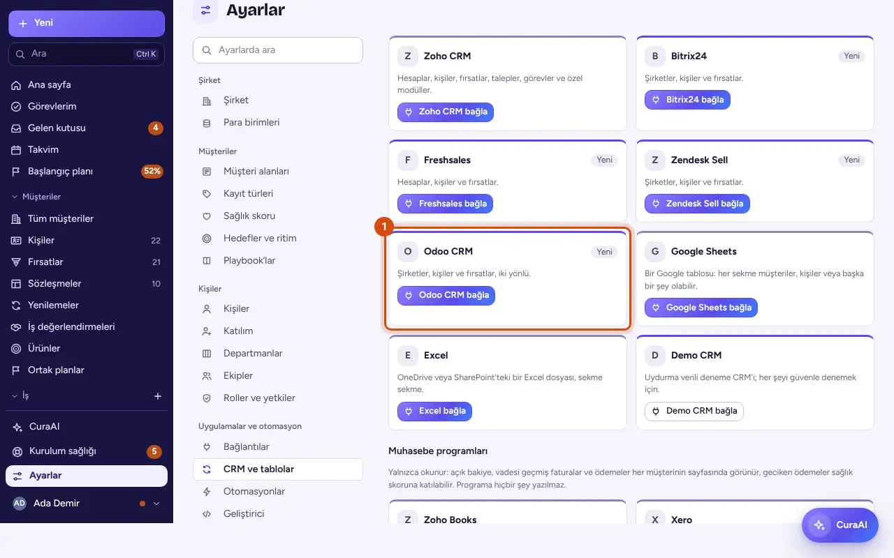

# Odoo CRM

Odoo Online, Odoo.sh ya da kendi sunucundaki Odoo'dan şirketler, kişileri ve fırsatlar, iki yönlü eşit tutulur: Odoo'daki değişiklik bir saat içinde gelir, Curahold'daki değişiklik hemen gider.

## Curahold'da {#connect}

1. **Ayarlar → CRM ve tablolar**'ı açın ve kutucuğundaki **Odoo CRM bağla**'ya tıklayın.
   

Sonra dört alanı doldurun ve **Kontrol et ve bağla**'ya tıklayın:

- **Odoo adresi**, örneğin:

```text
https://yourcompany.odoo.com
```

- **Veritabanı adı**: yalnızca Odoo.sh'ta ya da birden çok veritabanı olan kendi sunucunda.
- **Kullanıcı adı (e-posta)**: Curahold'un yetkileriyle çalışacağı Odoo kullanıcısı.
- **API anahtarı**: aşağıya bakın.

Ardından **Şirketler**, **Kişiler** ve **Fırsatlar**'ı işaretleyin, önerilen alan eşlerini kontrol edin ve **Eşitlemeyi başlat**'a tıklayın. Bir fırsat %100 olasılıkta kazanılmış, Odoo arşivlediğinde kaybedilmiş sayılır.

## Odoo'da

1. Sağ üstte resmine tıkla → **Tercihler** (Odoo 17 ve sonrasında: **Profilim**).
2. **Hesap Güvenliği**'ni açın ve **Yeni API Anahtarı**'na tıklayın.
3. Bir ad yazın (örneğin `Curahold`), ne kadar geçerli olacağını seçin ve **Anahtar oluştur**'a tıklayın.
4. Anahtarı kopyalayın. Odoo onu bir kez gösterir.

Odoo Online'da API erişimi **Custom** planını gerektirir (Odoo'nun kuralı). CRM uygulaması kurulu olmalı.

## Sınırlar ve zamanlama

Odoo sabit bir sınır yayımlamaz; Curahold saniyede yaklaşık iki istekte kalır. Odoo 19 ve sonrası JSON-2 API ile, eski sürümler JSON-RPC ile cevap verir; Odoo JSON-RPC'yi 20. sürümde kaldırıyor. Odoo 19'da bir anahtar en çok üç ay geçerlidir: süresi dolmadan yenisini oluşturun ve yeniden bağlayın.

## Çakışmalar, hatalar ve kaldırma

İki taraf aynı alanı değiştirdiyse bağlantı için seçilen kural karar verir (varsayılan: sonraki değişiklik). Reddedilen bir değer, Odoo'nun kendi mesajıyla bağlantının **Durum** sekmesinde bekler. İptal edilmiş ya da süresi dolmuş anahtar bağlantıyı **Bakılması gerek** olarak işaretler: **Yeniden bağla** ile yeni anahtarı yapıştırın; eşleme kalır. **Kaldır** anahtarı siler; gelmiş müşteriler ve kayıtlar Curahold'da kalır.

## Ayrıca bakın

- [Bağlantılar ve CRM](/docs/tr/connections/)
- [Odoo (muhasebe)](/docs/tr/accounting-odoo/)
