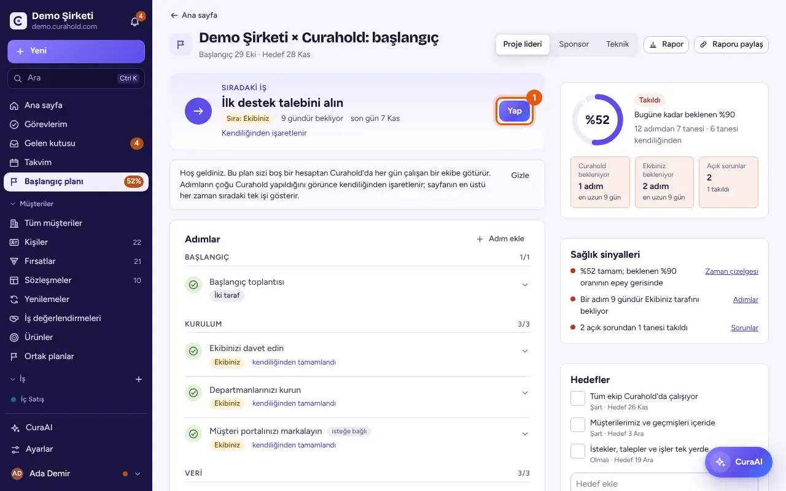
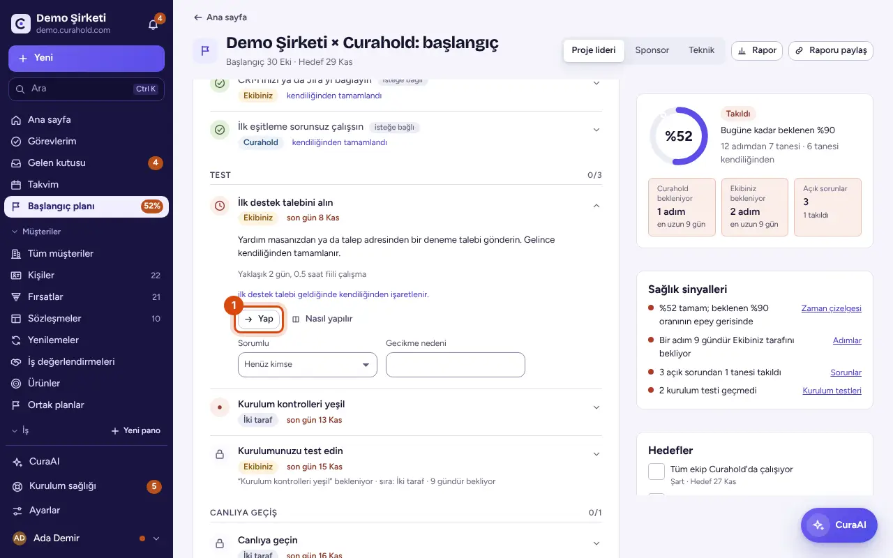
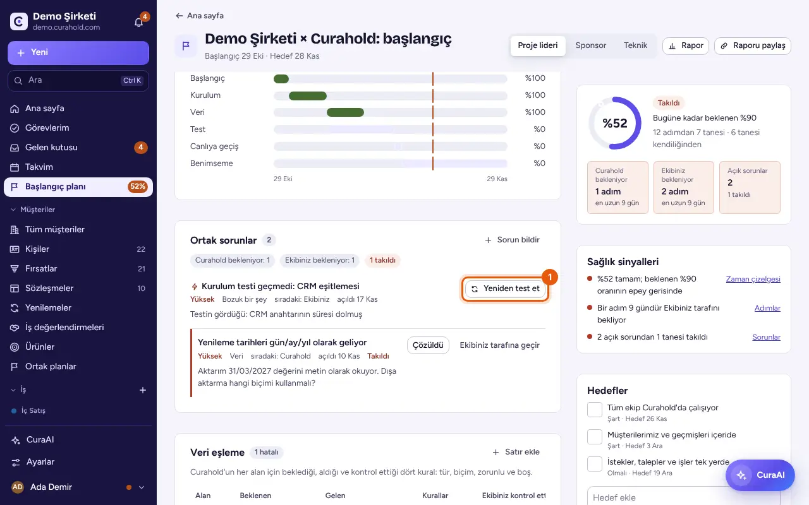
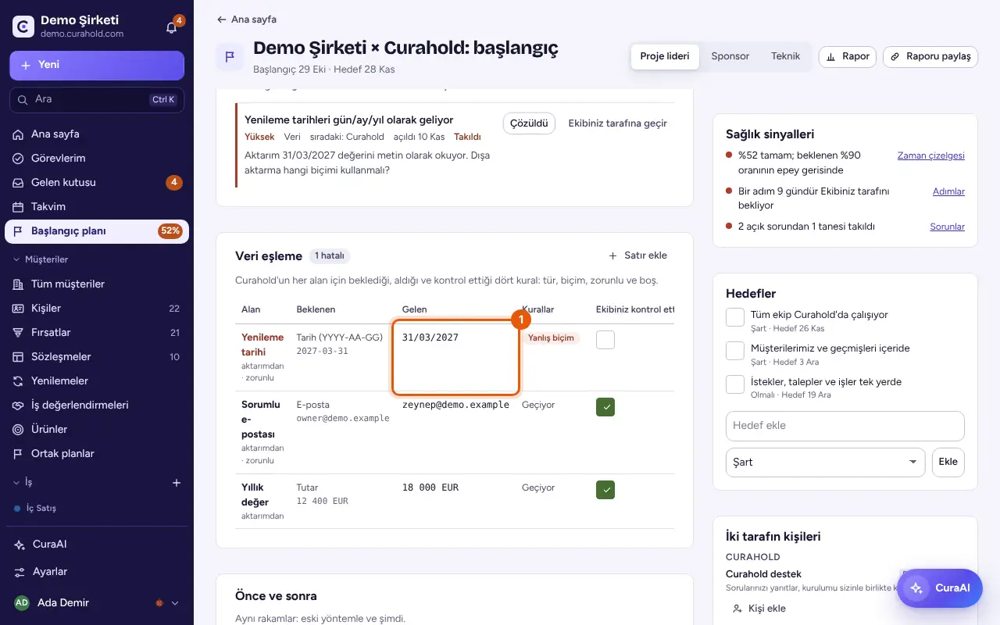
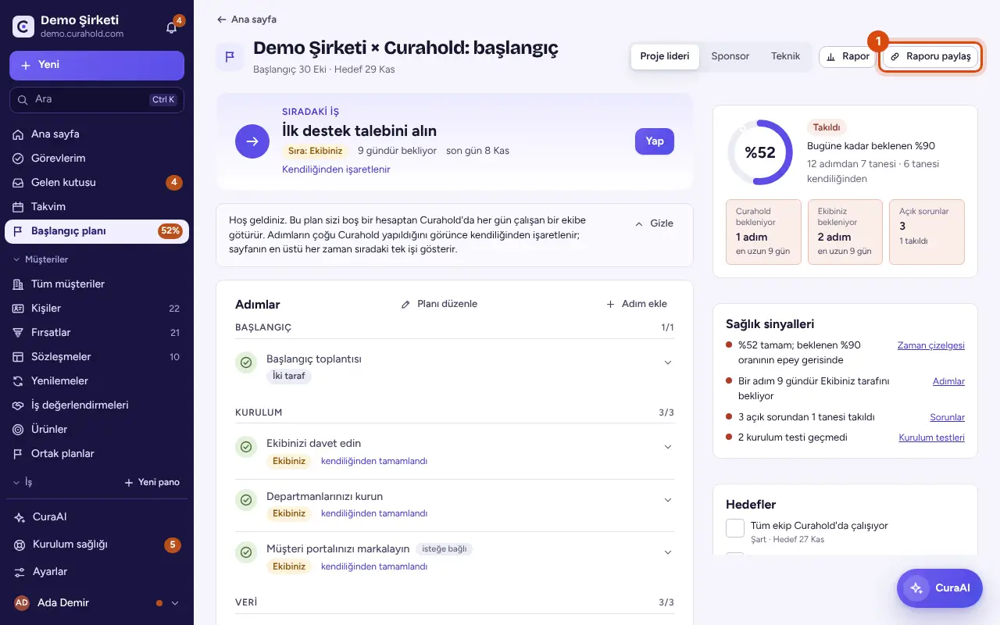
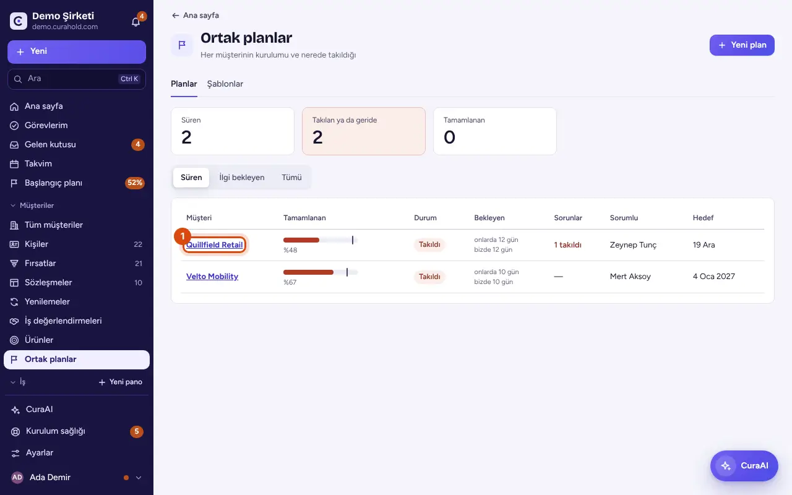
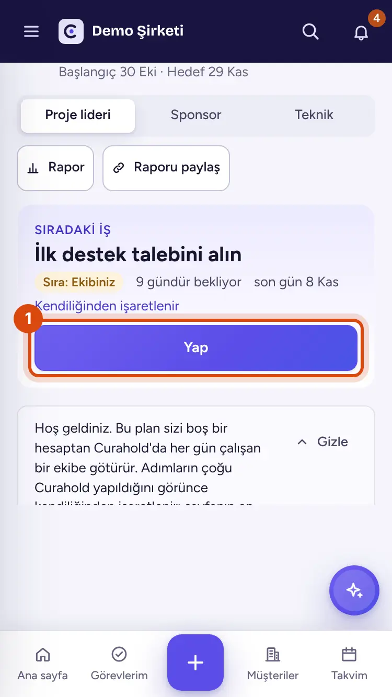

# Ortak plan

Ortak plan, iki tarafın birlikte üzerinde çalıştığı tek bir sayfadır. Şirketiniz Curahold'a başlarken bunu kullanır; siz de kurduğunuz her müşteri için aynı planı kullanırsınız. Adımların çoğu, Curahold yapıldığını görünce kendiliğinden işaretlenir; elle yalnızca Curahold'un göremediğini (ör. bir toplantı) işaretlersiniz.

## 1. Planınızı açın {#start}

Soldaki menüde **Başlangıç planı**'na tıklayın. Yanındaki sayı ne kadarının bittiğidir.


Planınız şirketinizin kendi adresindedir:

```text
https://<sirketiniz>.curahold.com/onboarding
```

## 2. Sıradaki işi yapın {#next}

En üstteki kart her zaman sıradaki tek işi, sıranın kimde olduğunu ve ne zamandır beklediğini gösterir. **Yap**'a tıklayın: Curahold işin yapıldığı ekranı açar.



## 3. Bir adımı açın {#team}

Neye yaradığını, ne kadar sürdüğünü ve kendiliğinden işaretlenip işaretlenmediğini görmek için bir adıma tıklayın. Kilitli adım başka bir adımı bekler; altındaki satır hangisini ve sıranın kimde olduğunu söyler. **Tamamlandı işaretle**'ye yalnızca Curahold'un göremediği adımlarda tıklayın.



Kendiliğinden işaretlenen adımlar: ekibinizin davet edilmesi, departmanların kurulması, satır getiren bir aktarım, yetkilendirilmiş ve son çalışması hatasız bir bağlantı, ilk destek talebi, logonuz ya da renginizle açılmış portal, yeşil kurulum kontrolleri ve geçen tüm kurulum testleri.

## 4. Ortak bir sorunu çözün {#health}

Ortak sorunlar iki taraf arasındaki sorular ve sorunlardır. Her biri hamlenin kimde olduğunu söyler; beş gündür açık olan ya da tarihi geçen **Takıldı** olarak işaretlenir. Geçmeyen bir kurulum testi burada bir kez görünür. Düzelttikten sonra **Yeniden test et**'e tıklayın: test geçince sorun kendiliğinden kapanır.



## 5. Verilerinizi kontrol edin {#mapping}

Veri tablosu her alan için Curahold'un beklediğini, aldığını ve kontrol ettiği dört kuralı gösterir: tür, biçim, zorunlu ve boş. Hatalı satır hangi kuralın tutmadığını söyler. Değer doğruysa kendi tarafınızın kutusunu işaretleyin.



Tarihler şöyle yazılır:

```text
2027-03-31
```

## 6. Kişileri belirleyin {#people}

**İki tarafın kişileri** altında **Kişi ekle**'ye tıklayın ve rolünü seçin. Her adımın bir sorumlusu olabilir; Curahold sırası geldiğinde ve adım takılırsa o kişiye uygulamada hatırlatır. E-postayla hatırlatma, bir yönetici açmadıkça kapalıdır.

## 7. İlerleme raporunu paylaşın {#report}

**Raporu paylaş**'a tıklayın ve bağlantıyı kopyalayın. Bağlantıya sahip olan ilerleme raporunu görür (not ve iletişim bilgisi yok). Yazdırmak ya da PDF kaydetmek için **Rapor**'u açın.



## 8. Müşterilerinizin başlangıç planları {#customers}

Müşteriler altında **Ortak planlar**'a tıklayın. Bir fırsat kazanılınca devir notuyla birlikte taslak bir plan kendiliğinden açılır; devir onaylanınca başlar. Liste her planı, ne kadar ilerlediğini, kimin beklendiğini ve hangilerinin takıldığını gösterir. Planını açmak için bir müşteriye tıklayın.



Müşteriniz aynı planı portalınızda, sizin renklerinizle görür: kendi adımlarını işaretler, doğrudan kaydına giden kısa formları doldurur, veri satırlarını kontrol eder ve sorun bildirir. Bitince **Bitir ve devret**'e tıklayın: sağlık puanı başlangıç değeri olarak saklanır ve Müşteri Başarısı bir devir kartı alır.

## 9. Müşterinin planını ona göre uyarlayın {#personal}

Her müşterinin planı kendine ait bir kopyadır: şablona dokunmadan değiştirin.

1. Planın **Adımlar** bölümünde **Planı düzenle**'ye tıklayın.
2. Bir aşamanın adını kutusunda değiştirin, oklarla taşıyın ya da **Aşama ekle** ile yenisini ekleyin. İçinde adım olan aşama kaldırılamaz: önce adımlarını taşıyın ya da kaldırın.
3. Bir adımın adını kutusunda değiştirin, oklarla taşıyın, başka bir aşamaya alın ya da kaldırın.
4. **Düzenlemeyi bitir**'e tıklayın. Bu planı yeniden kullanmak için **Şablon olarak kaydet**'e tıklayıp bir ad verin.

## 10. Kendiliğinden açılan planlar {#won}

Bunu bir yönetici, **Ortak planlar → Şablonlar** sayfasının en altında belirler:

1. **Kazanılan satışta onboarding planı aç** kutusunu işaretleyin. Siz açana kadar kapalıdır.
2. Açılacak şablonu seçin ya da **Her seferinde sor**'u seçin: taslak, müşteriyi devralan kişiye şablonu sorar.
3. İsteğe bağlı: segmente, pakete ya da bölgeye göre kural ekleyin (herhangi bir müşteri alanı). Müşterinin uyduğu ilk kural şablonu seçer.

Hatırlatmalar her zaman uygulamada görünür. E-postayla da gelip gelmeyeceğine herkes kendi bildirim ayarlarında karar verir.

## Telefonda

Aynı sayfa, tek sütun: önce sıradaki iş.


