# Kurulum sağlığı ve kurulumu test etme

Kurulumu tahmin etmeden bitirmeniz için iki ekran var. **Kurulum sağlığı**, kurulumunuzda hâlâ eksik ya da yanlış olanı söyler. **Kurulumu test et** her şeyi ekibinizin kullanacağı gibi denemenizi sağlar. Sizin yerinize hiçbir şey değişmez: her düzeltme doğru ekranı açan bir düğmedir, gerisini siz yaparsınız.

## Eksik olanı bulun

1. Soldaki menüde **Kurulum sağlığı**'na tıklayın. Yanındaki sayı, bakmaya değer kaç şey olduğunu söyler. Her şey doğru olunca kaybolur.
   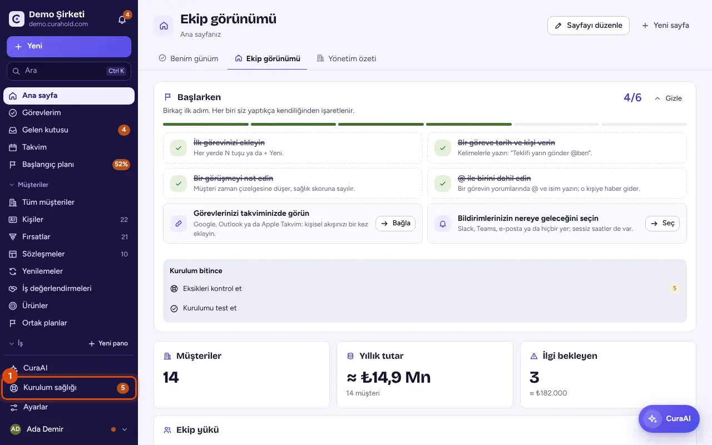
2. İlk satırı okuyun. En önemlisi en üsttedir: önce **Önce bunu**, sonra **Düzeltmeye değer**, sonra **Bir dakikanız olduğunda**. Her satır ne fark ettiğimizi ve neden önemli olduğunu söyler.
   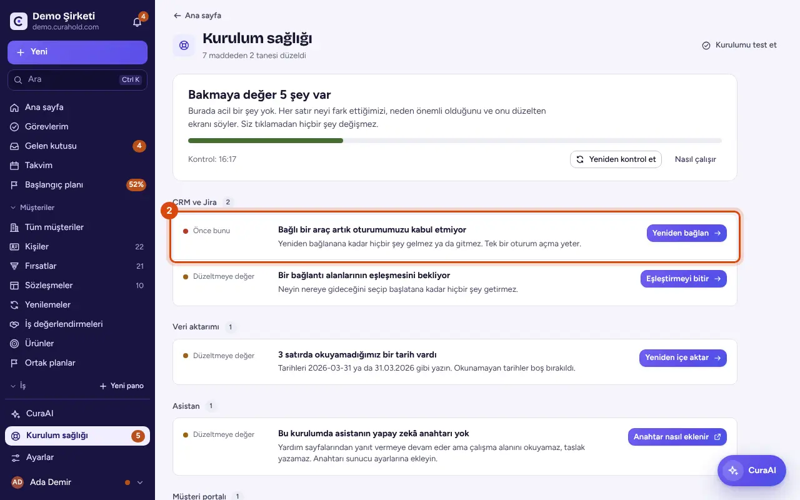
3. O satırdaki düğmeye tıklayın. Düzelteceğiniz ekranın kendisi açılır.
   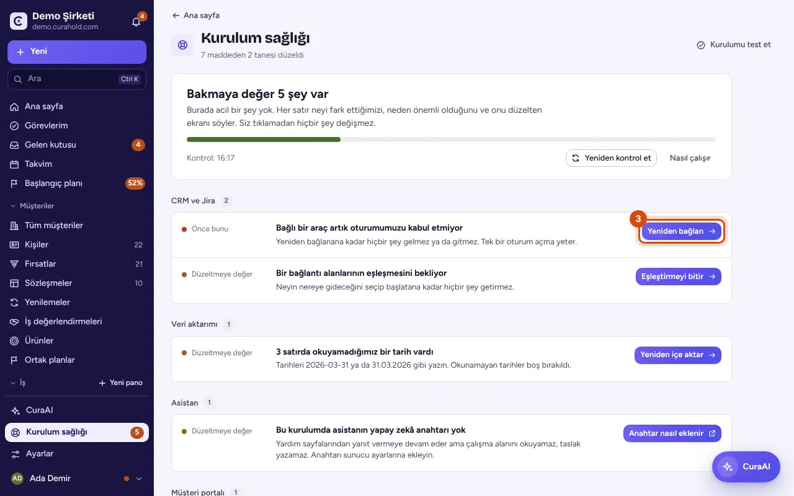
4. Düzelttikten sonra geri gelin ve **Yeniden kontrol et**'e tıklayın. Satır **Düzelenler** altına geçer; sayfanın üstü kaç tanesinin düzeldiğini yazar.
   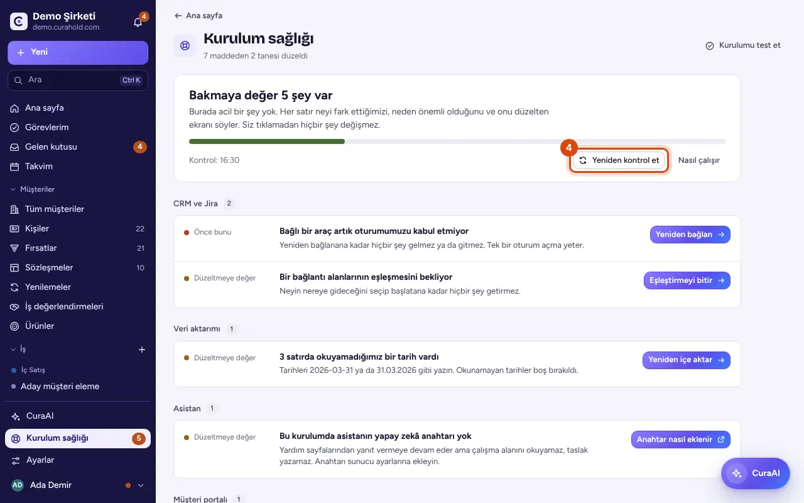
5. Bir sorunu, onu düzelten ekranda da görürsünüz: üstte sarı bir kutuda. Listenin tamamı için **Tümünü gör**'e tıklayın.
   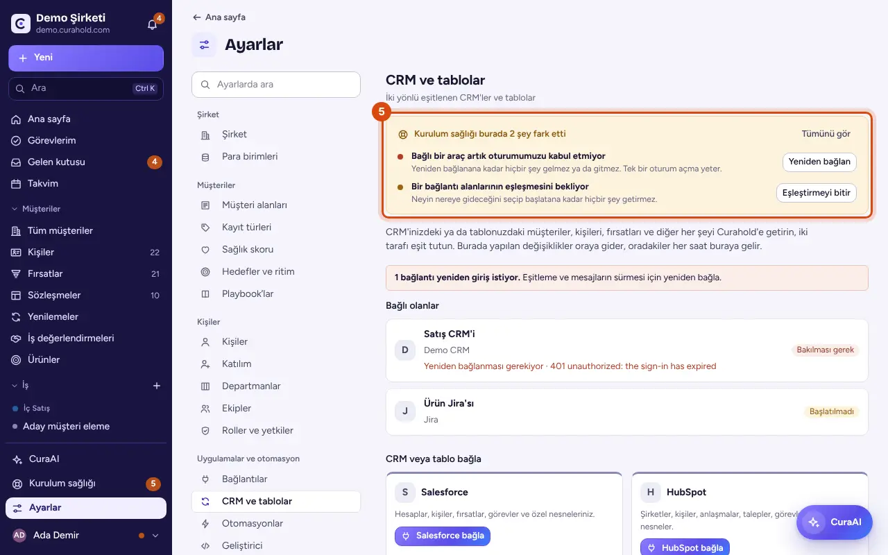

Bazı şeyleri buradan okuyamayız; örneğin e-posta alan adınızın SPF, DKIM ve DMARC kayıtları. Kayıtları ekleyin, sonra o satırda **Bunu yaptım**'a tıklayın.

Herkes yalnızca düzeltebileceği şeyleri görür. Yöneticiler şirketle ilgili her şeyi görür; Curahold sunucusunu çalıştıran kişi e-posta ve yapay zekâ anahtarını da görür. Günde bir kez yeniden kontrol eder, yeni çıkanı işaretleriz.

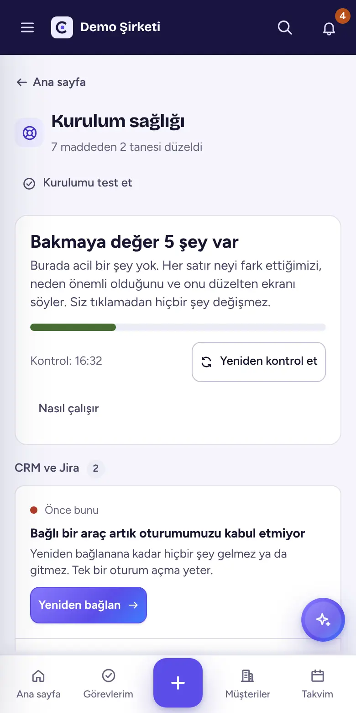

## Asistana sorun

Asistanı açın ve aynen şunu sorun:

```text
Kurulumda ne eksik?
```

Aynı sorunları düğmeleriyle birlikte listeler. Yalnızca okur; hiçbir şeyi kendisi düzeltmez.

## Kurulumu test edin

1. **Kurulum sağlığı** sayfasında sağ üstteki **Kurulumu test et**'e tıklayın.
   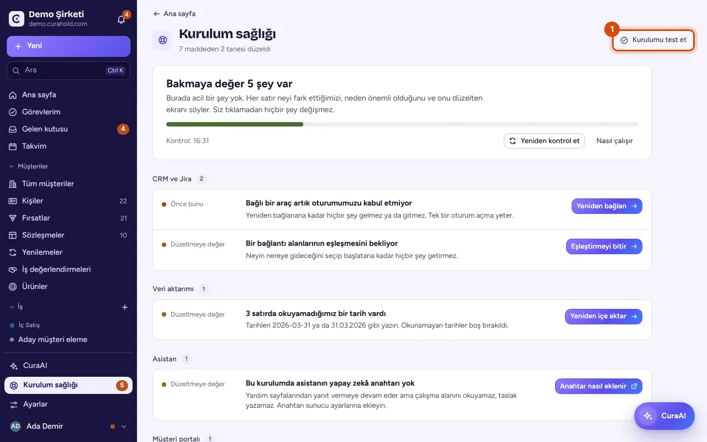
2. Bir adımda **Test et**'e tıklayın. Kendi gözünüzle kontrol ettiğiniz adımlarda bunun yerine **Çalıştı** ve **Çalışmadı** vardır. Adım neyle deneneceğini soruyorsa (bir müşteri, bir bağlantı, bir çalışma arkadaşı) bir kez seçin: sonraki deneme için saklanır.
   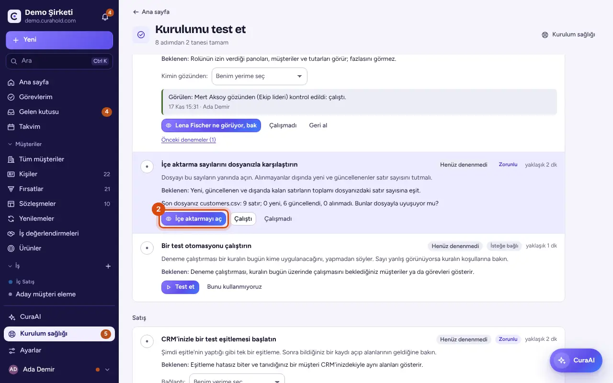
3. **Görülen** ile **Beklenen** satırını karşılaştırın. Aynıysa adım geçmiştir. Her deneme, kimin ne zaman yaptığıyla saklanır; istediğiniz zaman yeniden test edebilirsiniz.
   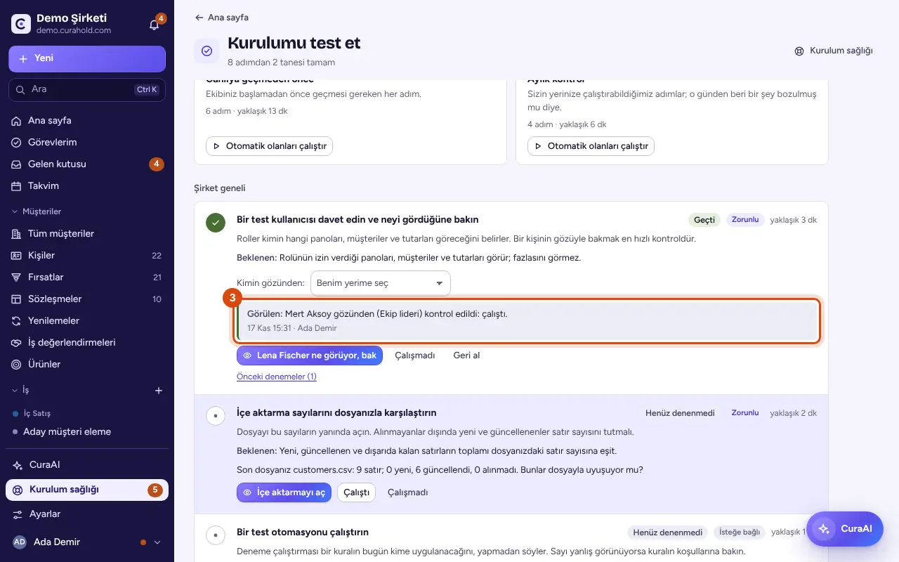
4. Çalışmadıysa **Düzelten ekranı aç**'a tıklayın, düzeltin ve yeniden test edin. Yardım gerekiyorsa **Sorun aç**'a tıklayın: sorun adımla birlikte durur ve adım geçince kendiliğinden kapanır.
   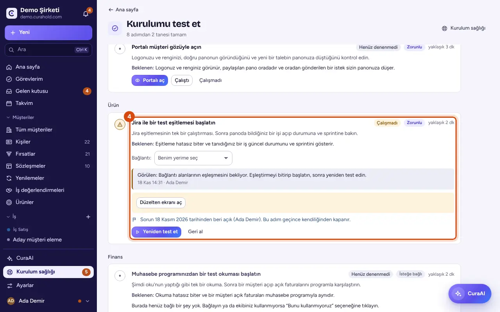
5. Birkaç adımı birden çalıştırmak için bir paket seçin: **Canlıya geçmeden önce** ya da **Aylık kontrol**, sonra **Otomatik olanları çalıştır**.
   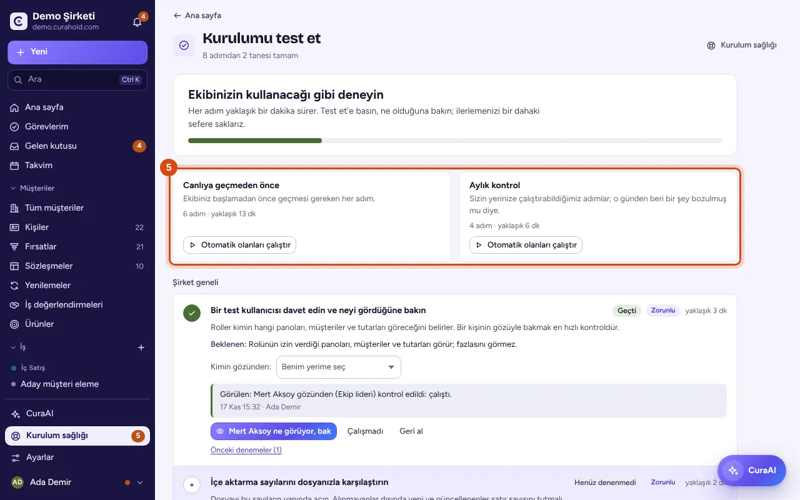
6. Her **Zorunlu** adım geçince önce şirketinizden bir yönetici, sonra Curahold'dan biri **Onayla** düğmesine tıklar. Sayfa tarihiyle birlikte **Kurulum tamam** yazar.
   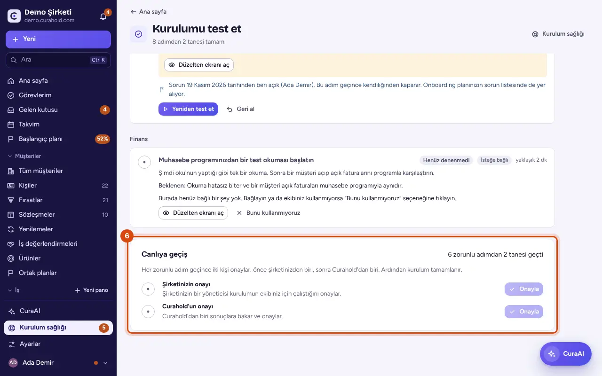

## Her kontrol ne anlama gelir

Tablo ürünün kendi sözcüklerinden yazılır; ekranda gördüğünüzle hep aynıdır.

<!-- setup-checks:start (scripts/docs/setup-health-page.ts writes this part) -->

### Ekip

| Ne fark ederiz | Neden önemli | Düğme |
| --- | --- | --- |
| Şimdilik burada yalnızca siz varsınız (Önce bunu) | Görevler, devirler ve hatırlatmalar birine gitmeli. Curahold'da çalışacak kişileri davet edin. | **Kişileri davet et** |
| … davet bir haftadır kabul edilmedi (Bir dakikanız olduğunda) | E-postayı görmemiş olabilirler. Yeniden gönderin ya da adresi kontrol edin. | **Davetleri gör** |
| … rolde kimse yok (Bir dakikanız olduğunda) | Kimsenin olmadığı bir rol işe yaramaz. Doğru kişilere verin ya da liste sade kalsın diye kaldırın. | **Rolleri aç** |

### Departmanlar

| Ne fark ederiz | Neden önemli | Düğme |
| --- | --- | --- |
| Departmanlar henüz kurulmadı (Düzeltmeye değer) | Panolar, devirler ve kimin neyi göreceği departmanlara göre işler. Herkesi kendi departmanına ekleyin. | **Departmanları kur** |
| … departmanın lideri yok (Düzeltmeye değer) | Departmanın panolarını yalnızca lider açabilir; departmana gelen devirler de lidere gider. | **Lider seç** |

### Veri aktarımı

| Ne fark ederiz | Neden önemli | Düğme |
| --- | --- | --- |
| Son içe aktarmanızda … satır gelmedi (Düzeltmeye değer) | Bu satırlardaki bir şey okunamadı. Satır numaralı liste içe aktarmanın hemen ardından görünür; satırları dosyanızda düzeltip yeniden içe aktarın: gelmiş satırlar güncellenir, ikilenmez. | **İçe aktarmayı aç** |
| Son içe aktarmanızda … satırda müşteri adı yoktu (Düzeltmeye değer) | Her satırda mutlaka olması gereken tek sütun ad. Dosyada doldurup yeniden içe aktarın: gelmiş satırlar güncellenir, ikilenmez. | **Yeniden içe aktar** |
| … satırda okuyamadığımız bir tarih vardı (Düzeltmeye değer) | Tarihleri 2026-03-31 ya da 31.03.2026 gibi yazın. Okunamayan tarihler boş bırakıldı. | **Yeniden içe aktar** |
| … satırda okuyamadığımız bir tutar vardı (Düzeltmeye değer) | Yalnızca rakam kullanın (12500 ya da 12.500,00); para birimini ayrı bir sütuna yazın. Okunamayan tutarlar boş bırakıldı. | **Yeniden içe aktar** |
| … müşteri iki kez kayıtlı (Bir dakikanız olduğunda) | Görevler ve notlar iki kopya arasında bölünür. Birini tutun, diğerini onunla birleştirin. | **Göster** |

### CRM ve Jira

| Ne fark ederiz | Neden önemli | Düğme |
| --- | --- | --- |
| Bağlı bir araç artık oturumumuzu kabul etmiyor (Önce bunu) | Yeniden bağlanana kadar hiçbir şey gelmez ya da gitmez. Tek bir oturum açma yeter. | **Yeniden bağlan** |
| … araçla son eşitleme tamamlanmadı (Önce bunu) | O zamandan beri yapılan değişiklikler bekliyor. Bağlantının sayfası neyin durdurduğunu yazar. | **Ne olduğunu gör** |
| Bir bağlantı alanlarının eşleşmesini bekliyor (Düzeltmeye değer) | Neyin nereye gideceğini seçip başlatana kadar hiçbir şey getirmez. | **Eşleştirmeyi bitir** |
| … değişiklik diğer araca gönderilemedi (Düzeltmeye değer) | Üç kez denedik. Bağlantının sayfası her birini nedeniyle gösterir ve yeniden deneyebilir. | **İncele** |
| … API anahtarı iki hafta içinde çalışmayı bırakacak (Düzeltmeye değer) | Onu kullanan her şey göndermeyi bırakır. Ondan önce yeni bir anahtar oluşturup yerine koyun. | **API anahtarlarını aç** |
| Bu hafta … değişikliğin üzerine diğer araç yazdı (Bir dakikanız olduğunda) | İki taraf aynı şeyi değiştirdi. Hiçbir şey kaybolmadı: eski değer her görevin geçmişinde. Bağlantının kuralının istediğiniz kural olduğunu kontrol edin. | **Kuralı kontrol et** |

### Muhasebe

| Ne fark ederiz | Neden önemli | Düğme |
| --- | --- | --- |
| Muhasebe programınız okunamadı (Önce bunu) | Müşteri sayfalarındaki faturalar ve ödemeler son başarılı okumadaki gibi kalır. | **Bağlantıyı aç** |
| Muhasebe iki gündür okunmadı (Düzeltmeye değer) | Geciken faturalar güncel olmayabilir. Şimdi okutun ya da günlük okumanın neden durduğuna bakın. | **Bağlantıyı aç** |

### BI araçları

| Ne fark ederiz | Neden önemli | Düğme |
| --- | --- | --- |
| … analiz anahtarı iki hafta içinde çalışmayı bırakacak (Düzeltmeye değer) | BI aracınızdaki raporlar yenilenmeyi bırakır. Anahtarı yenileyip yenisini oraya yapıştırın. | **Analiz anahtarlarını aç** |
| BI aracınız bir haftadır veri çekmedi (Bir dakikanız olduğunda) | Panelleri geçen haftanın rakamlarını gösteriyor. Zamanlanmış yenilemesine ya da kullandığı anahtara bakın. | **Analiz anahtarlarını aç** |

### Müşteri portalı kontrolleri

| Ne fark ederiz | Neden önemli | Düğme |
| --- | --- | --- |
| Müşteri portalı açık ama müşterilere bir şey göstermiyor (Düzeltmeye değer) | Müşterilerin talep gönderip takip edebilmesi için en az bir panoyu portalla paylaşın. | **Neyin paylaşılacağını seç** |
| Portala henüz kimse davet edilmedi (Bir dakikanız olduğunda) | Müşteriler davet edildikten sonra giriş yapabilir. Başlamak için bir müşteri kişisini davet edin. | **Müşteri davet et** |
| Portal hâlâ Curahold renklerinde (Bir dakikanız olduğunda) | Logonuz ve renginiz müşterilere doğru yerde olduklarını söyler. | **Markanızı ekleyin** |

### Otomasyonlar

| Ne fark ederiz | Neden önemli | Düğme |
| --- | --- | --- |
| … otomasyon şirkette olmayan bir alanı izliyor (Önce bunu) | Bu haliyle hiç çalışamaz. Kuralı düzelt'e, sonra Düzenle'ye ve Kaydet'e tıklayın: kendi tarih alanınıza geçer. Ya da kuralı kapatın. | **Kuralı düzelt** |
| … otomasyon artık olmayan bir panoyu gösteriyor (Önce bunu) | Oluşturması gereken görevlerin gidecek yeri yok. Başka bir pano seçin. | **Kuralı düzelt** |
| Henüz otomasyon yok (Bir dakikanız olduğunda) | Her yenilemeden 60 gün önce bir görev gibi tek bir kural, her seferinde bir hatırlatmayı üstlenir. Açılmaya hazır kurallar var. | **Hazır kurallara bak** |

### Verilerinizle ilgili kontroller

| Ne fark ederiz | Neden önemli | Düğme |
| --- | --- | --- |
| Sahibi olmayan … müşteri var (Düzeltmeye değer) | Hatırlatmaları kimseye gitmez, kimsenin listesinde görünmezler. Her birine bir sahip verin. | **Sahip ata** |
| Aşaması olmayan … açık fırsat var (Düzeltmeye değer) | Satış hunisinin ve tahminin dışında kalırlar. | **Fırsatları aç** |
| … açık talebe bakan kimse yok (Bir dakikanız olduğunda) | Sahibi olmayan talep kimsenin sırasına girmez. Her birini atayın ya da bunu yapan bir kural ekleyin. | **Talepleri aç** |

### E-posta

| Ne fark ederiz | Neden önemli | Düğme |
| --- | --- | --- |
| Bu kurulum henüz e-posta göndermiyor (Önce bunu) | Davetler, giriş bağlantıları ve hatırlatmalar yalnızca sunucu günlüğüne yazılıyor. E-posta aktarıcısını ya da bir e-posta sağlayıcısını kurun. | **E-posta nasıl kurulur** |
| E-posta alan adının SPF, DKIM ve DMARC kayıtlarını onaylayın (Düzeltmeye değer) | Bunlar olmadan davetler spam'e düşer ya da reddedilir. DNS'inizi buradan okuyamıyoruz: kayıtları ekleyin, sonra onaylayın. | **Kayıtları gör** |

### Gizlilik

| Ne fark ederiz | Neden önemli | Düğme |
| --- | --- | --- |
| Kişisel veri taleplerini yanıtlayabilecek kimse yok (Düzeltmeye değer) | KVKK ve GDPR'a göre birinin bir kişinin verisini dışa aktarabilmesi ya da silebilmesi gerekir. Bir role gizlilik iznini verin. | **Rolleri aç** |

### Deneme ve plan

| Ne fark ederiz | Neden önemli | Düğme |
| --- | --- | --- |
| Deneme süreniz … tarihinde bitiyor (Düzeltmeye değer) | Sonrasında bir plan seçilene kadar çalışma alanı salt okunur olur. Hiçbir şey silinmez. | **Plan seç** |
| Denemedeki tüm koltuklar dolu (Düzeltmeye değer) | Yeni kişiler yalnızca izleyici olarak katılabilir. Daha fazla koltuk isteyin ya da birini boşaltın. | **Koltukları gör** |

### Asistan

| Ne fark ederiz | Neden önemli | Düğme |
| --- | --- | --- |
| Bu kurulumda asistanın yapay zekâ anahtarı yok (Düzeltmeye değer) | Yardım sayfalarından yanıt vermeye devam eder ama çalışma alanını okuyamaz, taslak yazamaz. Anahtarı sunucu ayarlarına ekleyin. | **Anahtar nasıl eklenir** |

<!-- setup-checks:end -->

## Geliştiriciler için

Aynı kontroller API'de de var; anahtarın sahibi adına okunur. İki örneğin yerine şirketinizin adresini ve anahtarınızı yazın:

```bash
curl -H "Authorization: Bearer YOUR_API_KEY" https://your-company.curahold.com/api/setup-health
```

Adreslerin tam listesi [Başvuru: kurulum sağlığı](/docs/tr/ref-setup/) sayfasında.
