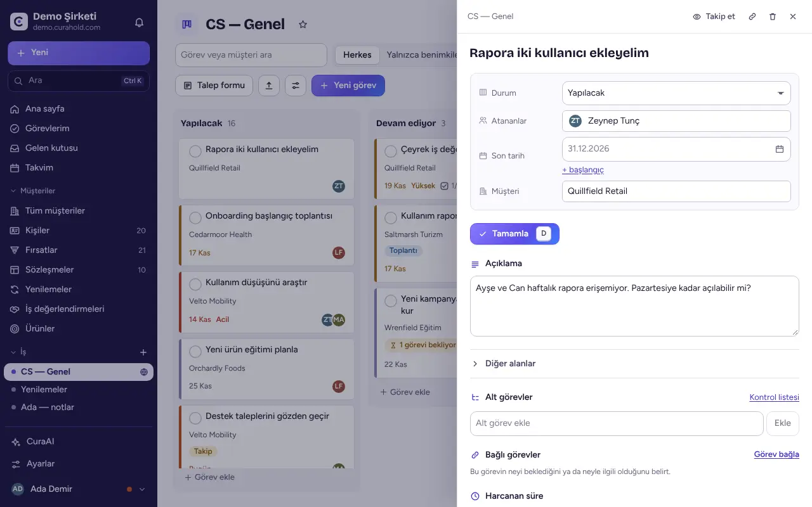

# Görevler ve panolar

İş panolarda yürür. Bir pano ekibe, şirkete ya da yalnızca size ait olabilir; sütunlarını siz belirlersiniz.

## Görev

Bir görevin başlığı, açıklaması, sorumluları (en fazla 10), bitiş tarihi, önceliği ve isteğe bağlı bir müşterisi olur. Alt görev, dosya ve yorum eklenebilir. Görev panonun yanında bir panelde açılır; bağlantısı gönderdiğiniz kişide de çalışır.

Her kartın solundaki ince şerit görevin zamana göre nerede olduğunu gösterir: rahat, yaklaşıyor, bugün, gecikti, bitti. Aynı renkler takvimde ve Görevlerim sayfasında da kullanılır. Tarihler ürünün kendi tarih seçicisiyle, sizin dilinizde ve tarihleri yazdığınız sırayla seçilir.

## İki kişi aynı anda değiştirirse

Curahold kimsenin değişikliğini sessizce ezmez. Siz düzenlerken başkası kaydettiyse, onun değişikliği alınır ve sizinkiler üzerine eklenir. Gerçekten çakışan bir alan varsa size sorulur.

## Toplu değişiklik ve geri alma

Panoda ya da listede birden çok görev seçin: durumunu, sorumlusunu, tarihini ya da önceliğini birlikte değiştirin. Ekranın altındaki bildirimden **Geri al** diyebilirsiniz.

## Tekrarlayan görevler

Bir görevi her gün, hafta ya da ay tekrarlayacak şekilde ayarlayın. Bir sonraki görev, şimdiki tamamlanınca açılır. Yeni tarih iki şekilde hesaplanabilir:

- **Bitiş tarihinden:** "her ayın 1'inde rapor" gibi sabit takvimler için.
- **Tamamlanma tarihinden:** "son görüşmeden 2 hafta sonra tekrar ara" gibi işler için.

## Bahsetme ve sessize alma

Yorumda `@` ile birini anın; ona haber gider. Bir görevden artık haber almak istemiyorsanız görevin menüsünden **Sessize al**'a tıklayın.

## Hızlı arama

Ctrl K (Mac'te ⌘ K) ile her yerden müşteri, görev, kişi, pano ya da sayfa arayın. Klavyeyle gezip Enter'la açarsınız.

## Görevin fazlası

- **Takip et:** görevin üstündeki düğmeyle, size atanmamış bir görevdeki yorumlardan ve sütun değişikliklerinden haberdar olursunuz.
- **Bağlı görevler:** bir görevin başka birini **beklediğini**, birini **beklettiğini** ya da onunla **ilgili** olduğunu belirtin. Bekleyen görev kartında “1 görevi bekliyor” yazar; beklenen görev bitince bekleyenin sahiplerine “Başlayabilirsiniz” bildirimi gider. Görevler birbirini bekleyecek şekilde halka yapılamaz.
- **Başlangıç tarihi:** son tarihin yanındaki **+ başlangıç** ile işin ne zaman başladığını da girin; zaman çizelgesinde çubuk olarak görünür.
- **Harcanan süre:** +15 dk, +30 dk, +1 sa düğmeleri ya da elle (“1,5”, “45dk”, “1:30”). Müşteri sayfasında o müşteri için toplam süre görünür.
- **Kontrol listesi:** sık kullandığınız adımları bir kez kaydedin (alt görevleri ekleyin → **Kontrol listesi → liste olarak kaydet**), sonra herhangi bir göreve tek tıkla ekleyin.
- **Geçmiş:** görevin altında kimin neyi ne zaman değiştirdiği satır satır durur.
- **Benzer görev uyarısı:** eklemek üzere olduğunuz görev açık bir göreve benziyorsa hızlı ekleme bunu söyler.

## Panoya özel alanlar

Pano ayarları → **Alanlar ve talep formu**: o panodaki her görevde tutulacak ek alanlar ekleyin (metin, sayı, para, tarih, seçim, bağlantı, e-posta, kişi, evet/hayır). **Bitirmek için zorunlu** işaretli bir alan dolmadan görev “tamamlandı” sütununa geçemez; toplu değişiklikte de böyle görevler atlanır ve kaç tanesinin atlandığı söylenir. Seçim alanları kartlarda renkli etiket olarak görünür ve filtrelenebilir.

## Filtreler ve kayıtlı görünümler

Panonun üstündeki **Filtre** ile kişiye, son tarihe (gecikmiş, bugün, 7 gün…), önceliğe ve panonun seçim alanlarına göre daraltın. Telefonda bütün filtreler tek bir **Filtre** sayfasında toplanır. Açık filtreleri **Görünümler → Kaydet** ile adlandırın; isterseniz panodaki herkese gösterin.

## Talep formu

Pano ayarlarında **Formla talep al**’ı açın, formun neleri soracağını seçin. Panoda beliren **Talep formu** düğmesiyle iş arkadaşlarınız talebini yazar; talep seçtiğiniz sütuna görev olarak düşer ve talep eden kişi görevi kendiliğinden takip eder.

## Başka bir araçtan geçiş: dosyadan görev aktarma

Panonun üstündeki yukarı ok düğmesi (**Dosyadan görev aktar**) eski aracınızdan dışa aktardığınız CSV ya da Excel dosyasını alır. Dosya tarayıcıda okunur; hangi sütunun nereye gideceğini görmeden hiçbir şey gönderilmez.

- Sütunlar kendiliğinden tanınır (Başlık, Açıklama, Durum, Atanan, Son tarih, Başlangıç, Öncelik, Müşteri, Tamamlanma tarihi; İngilizce adları da). İstediğinizi değiştirebilirsiniz; “Böyle gelir” sütunu ilk satırların nasıl aktarılacağını gösterir.
- **Durum** panodaki aynı adlı sütuna gider. “To do”, “In progress”, “Done” gibi yaygın adlar da tanınır; tanınmayanlar ilk sütuna konur ve sonuçta listelenir.
- **Atanan** ad ya da e-postayla eşleşir; bulunamayanlar atanmadan kalır ve kimler olduğu söylenir. Müşteri adı da aynı şekilde eşleşir.
- Tamamlanmış görevler varsayılan olarak alınmaz; isterseniz “Tamamlanmış görevleri de al”ı işaretleyin.
- Kimseye bildirim gitmez, kurallar çalışmaz. Aktarımın tamamını 30 gün içinde **geri alabilirsiniz**: kimsenin dokunmadığı görevler silinir, üzerinde çalışılanlar arşive taşınır.

Bir seferde 5.000 satıra kadar aktarılır.

## Takvim

**Takvim** hangi güne ne düştüğünü gösterir: son tarihine göre görevler, yapılmış toplantı, arama ve değerlendirmeler, yenilemeler ve zamanı gelen iş değerlendirmeleri. Üstündeki etiketler her türü açıp kapatır.

- **Gün, Hafta, Ay, Yıl:** üstteki seçici. Gün, o güne düşen her şeyi müşterisi ve kime ait olduğuyla listeler; yıl on iki küçük ay gösterir, yoğun günler daha koyudur. Gün numarasına tıklamak o günü açar.
- **Kimin takvimi:** sizinki ya da görebildiğiniz herkesinki. Rolü *ekip arkadaşlarının takvimini görmeye* izin veren kişi (başlangıçta yöneticiler ve ekip liderleri) tek bir kişiyi ya da bütün bir ekibi de seçer. Bu, zaten görebildiğini daraltır; yeni bir şey göstermez, özel pano özel kalır.
- Görünüm, gün ve kimin takvimi olduğu adrestedir; bağlantı aynı şeyi açar.

## Arşiv

Tamamlanan görevler, panonun tuttuğu süre dolunca (varsayılan 90 gün; pano ayarlarından 30–365 gün ya da “Her zaman”) kendiliğinden panonun **Arşiv**’ine taşınır. Böylece yıllardır kullanılan bir pano da hemen açılır. Arşivdeki görevler raporlarda sayılmaya devam eder; Pano / Liste’nin yanındaki **Arşiv** görünümünden aranır ve **Geri getir** ile panoya döner. Geri getirilen görev aynı süre boyunca panoda kalır. Liste görünümünden elle arşivlediklerin de buradadır.

## Görev silmek ve silinen görevi geri almak

Silinen görev alt görevleri, yorumları, süre kayıtları ve dosyalarıyla [çöp kutusuna](/docs/tr/trash/) gider ve 30 gün boyunca geri alınabilir: silmenin hemen ardından bildirimdeki **Geri al**'a basın ya da menüyü açıp **Çöp kutusu**'nu seçin ve **Geri al**'a basın. Bir görevi yalnızca açan kişi ya da rolü her görevi silmeye izin veren biri silebilir. Biten bir görevi silmeden gözden kaldırmak için arşivleyin.
