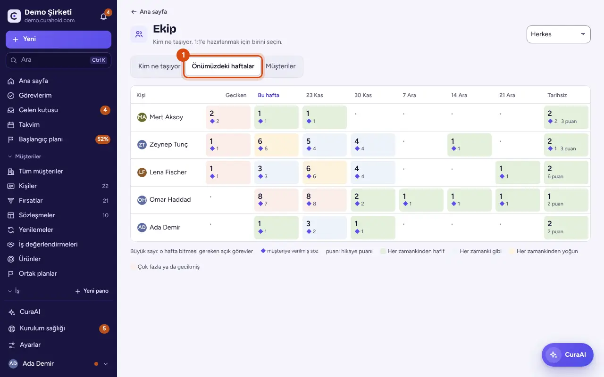
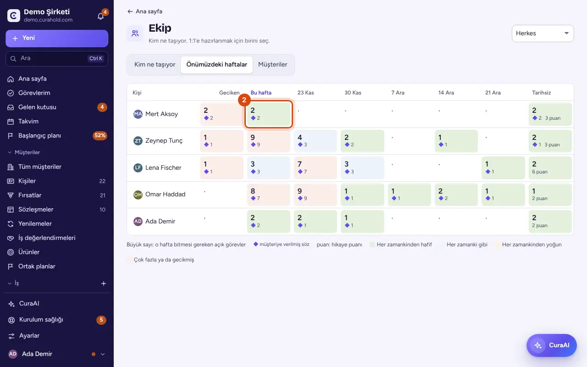
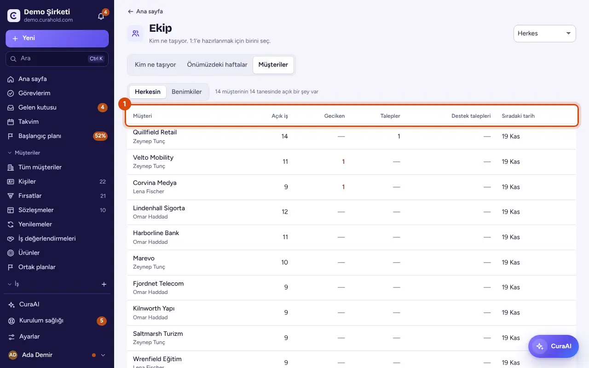
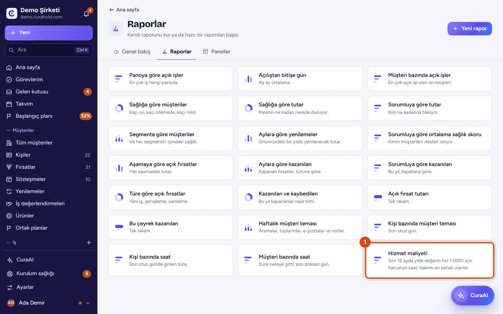

# Ekibinizin haftaları, müşteri portföyü ve hizmet maliyeti

**Ekip** sayfasının (soldaki menüde) üç görünümü var: **Kim ne taşıyor**, **Önümüzdeki haftalar** ve **Müşteriler**. Herhangi birini daraltmak için sağ üstten bir ekip seçin. Yalnızca görebildiğiniz görevler sayılır.

## Önümüzdeki haftalarda kimin yeri var {#weeks}

1. **Ekip**'i açın ve **Önümüzdeki haftalar**'a tıklayın.
   
2. Bir kişinin satırını hafta hafta okuyun. Her hücrede büyük sayı o hafta bitmesi gereken açık görevler, ◆ bunların kaçının bir müşteriye verilmiş söz olduğu, **pt** de puanlarıdır. Renk, haftayı o kişinin her zamanki yüküyle karşılaştırır: daha hafif, her zamanki gibi, daha ağır ya da çok fazla. **Geciken** ve **Tarihsiz** kendi sütunlarındadır. Kişinin birebir görünümünü açmak için bir hücreye tıklayın.
   

## Her müşterinin açık işleri {#customers}

1. **Ekip**'i açın ve **Müşteriler**'e tıklayın. Açık işi olan her müşteri, en yoğunu başta listelenir: açık işler, ne kadarının geciktiği, kişilerinin portaldan gönderdiği talepler, henüz çözülmemiş destek talepleri ve sıradaki son tarih. Sıralamak için bir sütunun adına tıklayın; **Herkesin** ile **Benimkiler** arasında geçiş yapın.
   

Tutarlar burada bilerek yer almaz: parayı kimin görebileceği alan alan belirlenir.

## Hizmet maliyeti {#cost-to-serve}

1. Menüde **Raporlar**'ı açın, **Raporlar** sekmesine, sonra **Hizmet maliyeti**'ne tıklayın. Her müşteri için son 12 ayda işlerine kaydedilen saatleri yıllık değerin her 1.000'i başına gösterir (ARR, yoksa MRR × 12, yoksa ilk tutar alanı). En yüksekler, bakımı en çok zaman alan, yani en pahalı müşterilerdir.
   

Rapor oluşturucuda onunla iki alan gelir: **Kaydedilen süre, son 12 ay** ve **Yıllık değerin her 1.000’i için saat**. Bir müşterinin değerini göremeyen kişi maliyet rakamı da görmez.
