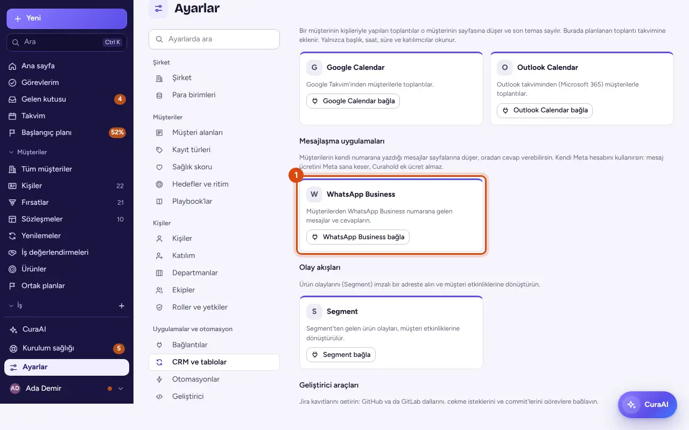

# WhatsApp Business

Müşterilerin WhatsApp Business numarana gönderdiği mesajlar kendi sayfalarında görünür, cevabı oradan verirsin. **Kendi** Meta uygulamanı ve numaranı kullanırsın: mesaj ücretini Meta sana keser, Curahold ek ücret almaz ve Meta faturanı hiç görmez.

## Başlamadan önce

Cloud API'de bir WhatsApp Business numarası olan bir Meta işletme hesabı, WhatsApp ürünü eklenmiş bir Meta uygulaması ve kalıcı anahtarı olan bir **sistem kullanıcısı** (izin: `whatsapp_business_messaging`) gerekir. Meta'nın kendi sayfaları adım adım gösterir; yaklaşık 15 dakika sürer.

## Curahold'da {#connect}

1. **Ayarlar → CRM ve tablolar**'nı aç, **Mesajlaşma uygulamaları**'nı bul ve **WhatsApp Business bağla**'ya tıkla.
   
2. Aşağıdaki üç değeri yapıştır ve **Kontrol et ve bağla**'a tıkla. Bağlantı sayfası bir **geri arama adresi** ve bir **doğrulama anahtarı** gösterir.
   

- **Telefon numarası kimliği**: Meta for Developers → uygulaman → **WhatsApp → API Setup**.
- **Erişim anahtarı (sistem kullanıcısı)**: Business settings → **System users** → kullanıcın → **Generate new token**.
- **Uygulama gizli anahtarı**: uygulaman → **App settings → Basic** → **App secret** → **Show**.

## Meta'da

1. Uygulamanı aç → **WhatsApp → Configuration**. **Webhook**'un yanında **Edit**'e tıkla.
2. Geri arama adresini **Callback URL**'e, doğrulama anahtarını **Verify token**'a yapıştır. **Verify and save**'e tıkla.
3. **Webhook fields** altında **Manage**'e tıkla ve **messages**'a abone ol.

## Ne gelir, nasıl cevap verilir

Mesaj, kişisinde gönderenin numarası olan müşteriye not olarak düşer (`0532…` gibi yerel yazımlar da eşleşir). O notta **WhatsApp'tan cevapla**'ya tıkla. WhatsApp serbest metne yalnızca müşterinin son mesajından sonraki 24 saat içinde izin verir; sonrasında Curahold onaylı bir **şablon** adı ve dili ister.

## Sınırlar ve zamanlama

Mesajlar Meta gönderdikçe gelir. Meta başarısız bir gönderimi 7 güne kadar yeniden dener; her mesaj bir kez saklanır. Meta bir numaranın ne hızla gönderebileceğini sınırlar; "meşgul" cevabı bunu söyler ve hiçbir şey kaybolmaz.

## Bir sorun olursa

Süresi dolmuş ya da iptal edilmiş anahtar cevap verirken görünür: **Yeniden bağla** ile yenisini yapıştır. Hiçbir kişide olmayan bir numaradan gelen mesaj bağlantıda sayılır, saklanmaz. **Kaldır** geri aramayı hemen durdurur; müşterilerdeki notlar kalır.

## Ayrıca bakın

- [Zaman çizelgesi ve sağlık skoru](/docs/tr/timeline-and-health/)
- [Bağlantılar ve CRM](/docs/tr/connections/)
