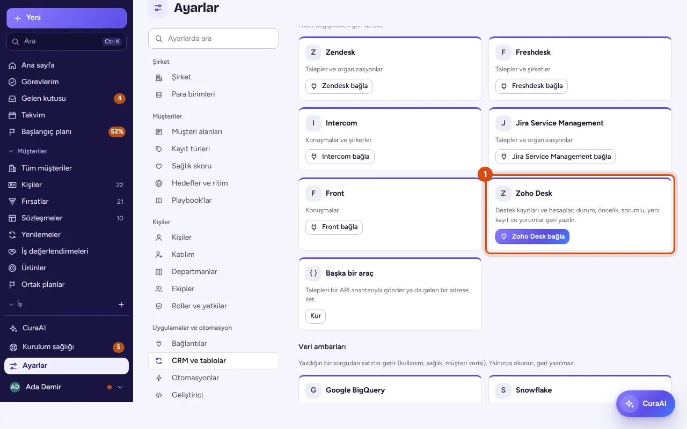

# Zoho Desk

Zoho Desk'teki destek kayıtları ve hesaplar eşleşen müşteride, toplamlarda ve sağlık skorunda görünür. Curahold'da değişen durum, öncelik ve sorumlu Zoho Desk'e geri yazılır; Curahold'da açılan kayıt orada da açılır; cevap ya da özel not yorum olarak eklenir.

## Curahold'da {#connect}

1. **Ayarlar → CRM ve tablolar**'nı aç, **Destek araçları**'nı bul ve **Zoho Desk bağla**'ya tıkla.
   

Zoho açılır. Destek masandaki bir temsilciyle giriş yap ve **Kabul et**'e tıkla. Curahold veri merkezini (.com, .eu, .in, .com.au, .jp, .sa, .uk, .ae, .ca, .com.cn) ve portalını kendisi bulur. Curahold'a dönünce **Destek kayıtları** ve **Hesaplar**'ı işaretle, alan eşlerini kontrol et ve **Eşitlemeyi başlat**'a tıkla.

## Sınırlar ve zamanlama

Değişiklikler saatte bir okunur. Zoho her çağrı için plana göre günlük bir kredi düşer; kredi bitince Zoho beklemeyi ister ve Curahold sonraki sefer devam eder. Curahold'dan verilen herkese açık cevap kayıtta herkese açık bir yorumdur; e-postayla cevap Zoho Desk'ten gönderilir.

## Bir sorun olursa

Süresi dolan oturum kendiliğinden yenilenir. Temsilci erişimini kaybettiyse bağlantı **Bakılması gerek** gösterir: **Yeniden bağla** ve yeniden giriş yap. **Kaldır** oturumu siler; gelmiş kayıtlar kalır.

## Ayrıca bakın

- [Destek talepleri](/docs/tr/support-tickets/)
- [Bağlantılar ve CRM](/docs/tr/connections/)
