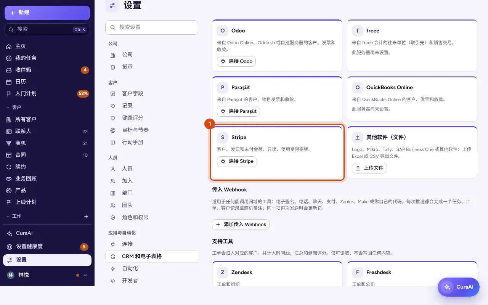

# Stripe（只读）

来自 Stripe 的客户、发票（含到期日和未付金额）和付款。Curahold 从不写入 Stripe：你提供的密钥只能读取。

## 在 Curahold 中 {#connect}

1. 打开 **设置 → CRM 和电子表格**，找到 **会计软件**，点击 **连接 Stripe**。
   

把受限密钥粘贴到 **受限密钥**，点击 **检查并连接**。完整的私密密钥（`sk_…`）会被有意拒绝。然后点击 **开始**，并在 **匹配** 标签中检查未匹配的客户。

## 在 Stripe 中

1. 打开 **Developers → API keys**，点击 **Create restricted key**。
2. 命名为 `Curahold`。
3. 把 **Customers**、**Invoices** 和 **Events** 设为 **Read**，其余保持 **None**。
4. 点击 **Create key**，完成第二步验证，复制密钥。它以这样开头：

```text
rk_live_
```

可以先用沙盒密钥（`rk_test_…`）试用。

## 限制和频率

首次读取会获取全部数据；之后只读取变更，来源是 Stripe 的事件列表（Stripe 保留 30 天）。Stripe 每秒允许 100 次请求（沙盒 25 次）；Curahold 远低于此。金额按各币种自己的小数位读取（日元没有小数）。Stripe 标为 “uncollectible” 的发票在这里仍算欠款，因此逾期仍然可见。

## 出现问题时

密钥被轮换或删除时，连接显示 **需要处理**：新建一个受限密钥，用 **重新连接** 粘贴。缺少权限时，连接步骤会指出是哪一项。**移除** 会删除密钥；已读取的数据保留，直到你删除。

## 另请参阅

- [会计软件](/docs/zh-Hans/accounting/)
