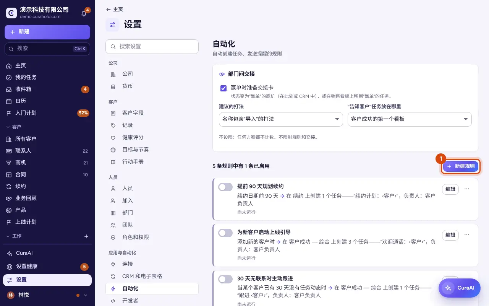
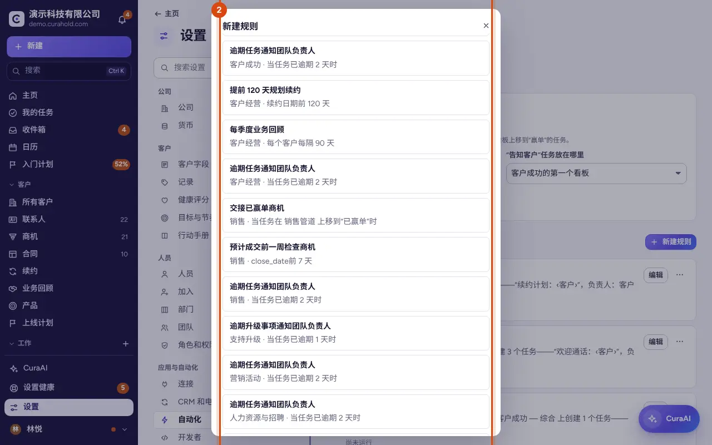
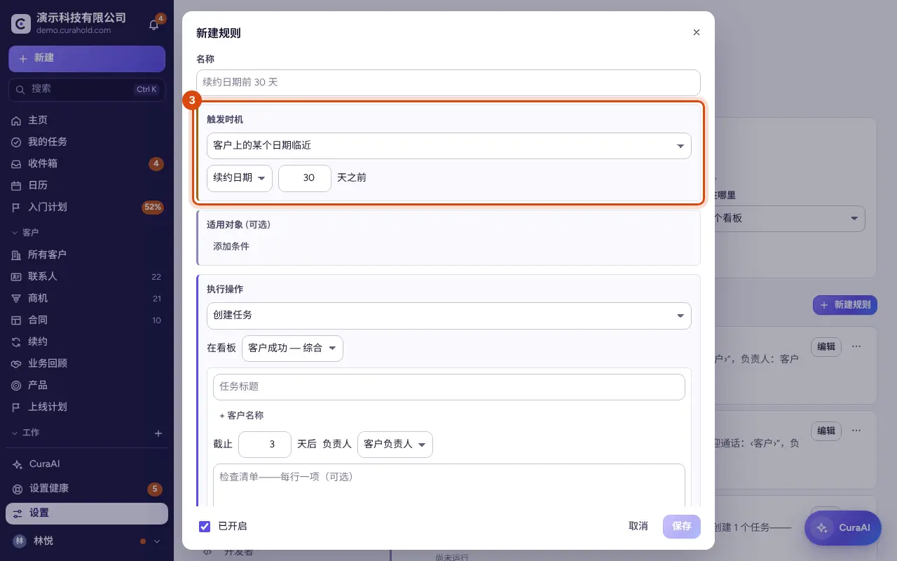
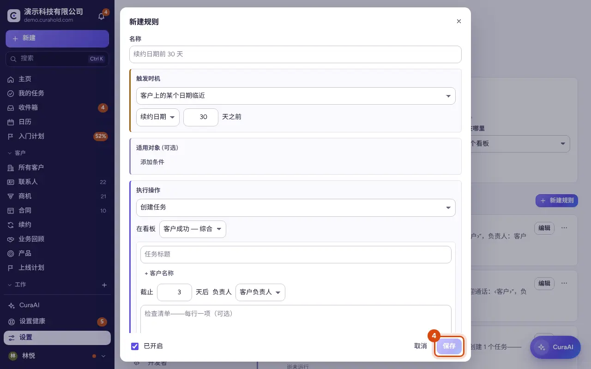

# 自动化

规则替你完成例行工作：提前 90 天的续约计划、给新客户的欢迎电话、任务逾期时的提醒、赢单时的交接卡。任何方案都不计数、不设上限。

## 新建规则 {#new-rule}

你需要管理自动化的权限（管理员拥有）。

1. 打开 **设置 → 自动化**，点击 **新建规则**。
   
2. 选择一个合适的现成规则，或点击 **从头开始**。
   
3. 在 **触发时机** 下选择什么会启动规则以及细节（哪个日期、几天、哪个看板）。点击 **添加条件** 可以缩小到部分客户或任务。在 **执行操作** 下选择要做什么。下方“按今天的情况，这将作用于……”显示它现在会影响哪些内容；此时还没有任何改动。
   
4. 填写 **名称**，保持 **已开启** 勾选，点击 **保存**。
   

## 什么能启动规则 {#when}

客户上即将到来的日期（续约、合同结束）、每隔若干天针对每个客户、客户沉寂、新增客户、任务逾期、任务移到某一列、任务新增或完成、通过看板表单收到请求、记录到达某个阶段、支持工单打开。

## 规则能做什么 {#then}

开任务（可带检查清单，给客户负责人或任何人）、发提醒、分配、移动、填写字段、写评论、发送到你的 Webhook，或准备交接卡。

## 运行与停止 {#running}

每条规则都会显示近 30 天运行了多少次。**立即运行** 会马上运行定时规则，而不必等到下一个整点；每个情况仍然只作用一次。关闭规则即可暂停。删除规则后，它已开的任务会保留，规则在回收站中保留 30 天。

同一页面顶部的交接设置见 [交接、需求与回访客户](/docs/zh-Hans/handover-and-requests/)。
