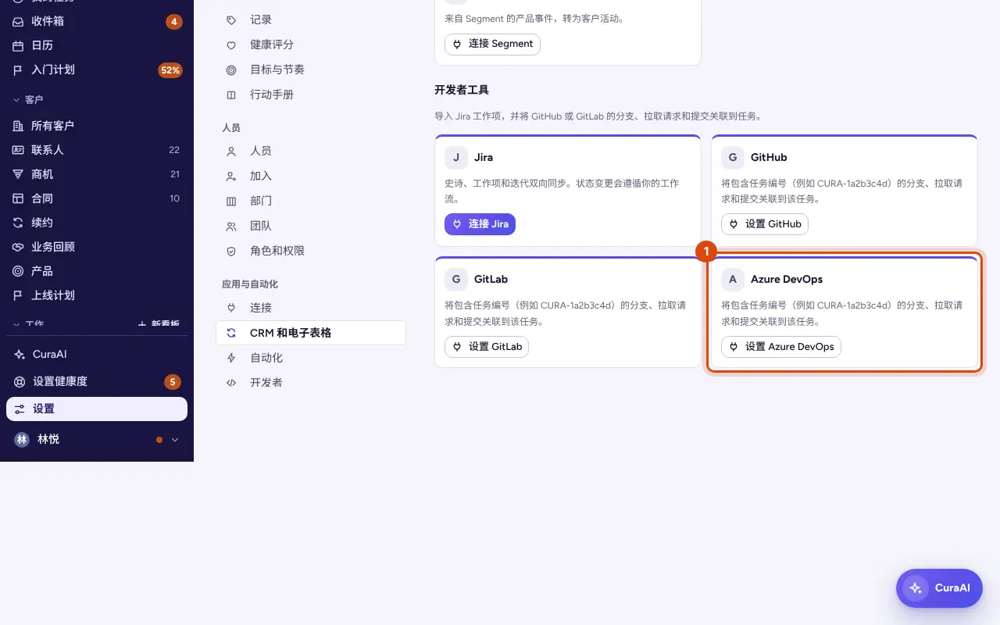
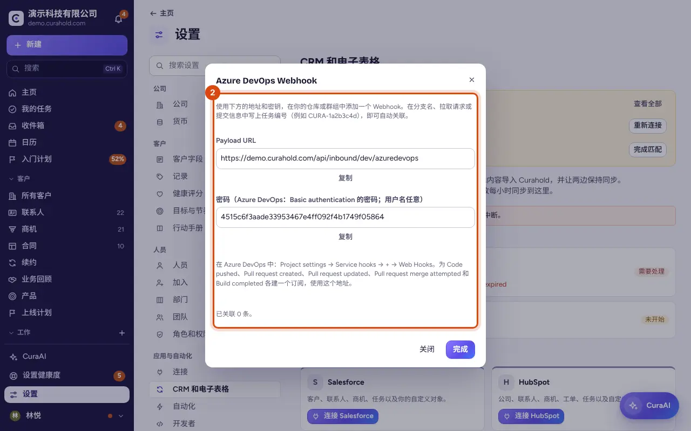

# Azure DevOps

Azure Repos 中提到某个任务的分支、拉取请求和提交会关联到该任务，并显示状态（打开、已合并、已关闭）和构建结果。用法与 GitHub、GitLab 相同：在分支名、拉取请求标题或提交信息中写上任务键，例如 `CURA-1a2b3c4d`。

## 在 Curahold 中 {#connect}

1. 打开 **设置 → CRM 和电子表格**，找到 **开发者工具**，点击 **设置 Azure DevOps**。
   
2. 点击 **开启**，然后复制显示的 **地址** 和 **密码**。
   

## 在 Azure DevOps 中

每个事件做一次（Code pushed、Pull request created、Pull request updated、Pull request merge attempted、Build completed）：

1. 打开项目 → **Project settings** → **Service hooks** → **+**（Create subscription）。
2. 选择 **Web Hooks**，点击 **Next**。
3. 选择事件，筛选条件保持不变，点击 **Next**。
4. 把地址粘贴到 **URL**。**Username** 任意填写（例如 `azure`），把密码粘贴到 **Password**。
5. **Resource details to send** 保持 **All**，点击 **Test**，再点击 **Finish**。

## 限制和频率

Azure DevOps 一发送，关联就会出现。Azure DevOps 只通过 HTTPS 发送且不签名：密码就是凭证，请像密码一样保管。

## 出现问题时

Azure DevOps 会在 **Service hooks → History** 中显示每次推送的结果：401 表示密码错误（重新开启 Webhook 获取新密码，并更新每个订阅）。**关闭** 会停止新的关联；已有关联保留在任务上。

## 另请参阅

- [连接和 CRM](/docs/zh-Hans/connections/)
- [任务和看板](/docs/zh-Hans/tasks/)
