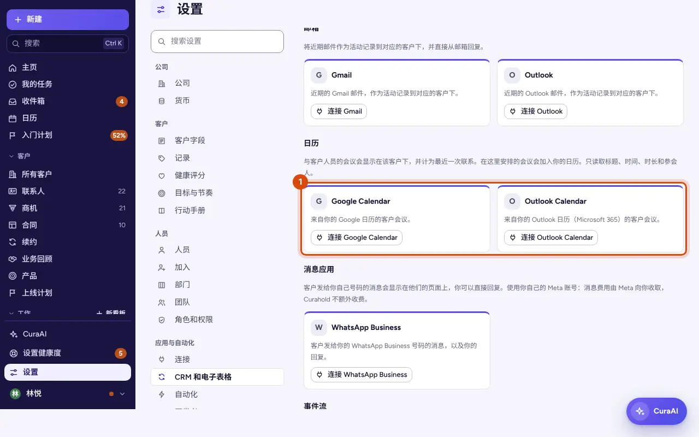

# Google 日历和 Outlook 日历

连接日历后，你与客户人员开过的每个会议都会作为会议（含时长）出现在该客户的时间线上，并计为最近一次联系。在客户的时间线上还可以直接在日历中安排会议，由日历发送邀请。

## 读取什么、不读取什么

只读取主日历中已经开过的会议：标题、时间、时长和参会人。从不读取描述、地点或会议链接。私人会议、全天事件以及没有外部人员的会议会被跳过。会议归入有联系人参会、或网址与参会人邮箱域名一致的客户。

## 在 Curahold 中 {#connect}

1. 打开 **设置 → CRM 和电子表格**，找到 **日历**，点击 **连接 Google Calendar** 或 **连接 Outlook Calendar**。
   

会打开 Google 或 Microsoft 页面。选择工作账号，点击 **允许**（Google）或 **接受**（Microsoft）。回到 Curahold 后点击 **开始**：先读取最近 90 天，之后每小时一次。

## 安排会议

在客户页面打开 **时间线**，点击 **在 Google Calendar 中安排会议**（或 Outlook）。填写标题、时间、时长和参会人邮箱，点击 **添加到 …**。会议开完后会出现在时间线上。

## 限制和频率

每小时读取一次；最近一周内改名或取消的会议会被更新或移除。Google 和 Microsoft 限制每分钟的请求数：遇到“繁忙”时读取暂停，下次继续。

## 出现问题时

登录过期会自动续期。如果访问被收回（改了密码、管理员决定），连接显示 **需要处理**：点击 **重新连接**，用同一账号登录。**移除** 会删除登录信息；已在时间线上的会议保留。

## 另请参阅

- [时间线和健康评分](/docs/zh-Hans/timeline-and-health/)
- [连接和 CRM](/docs/zh-Hans/connections/)
